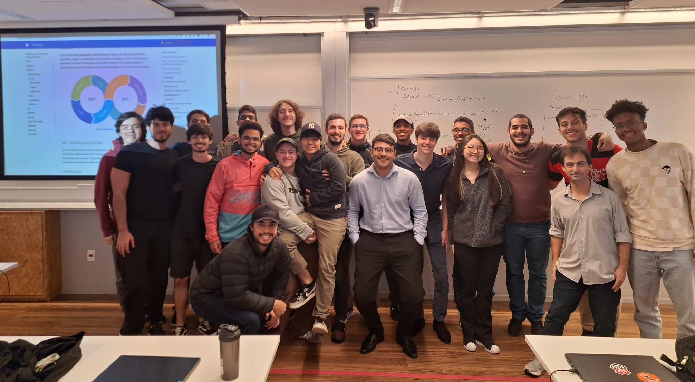

{ .rounded-corners }

## Instructor

-   :material-account-tie:{ .lg .middle } **Instructor**

    ---

    **Humberto Sandmann**

    [:material-web:](https://hsandmann.github.io/){:target="_blank"}
    [:simple-github:](https://github.com/hsandmann){:target="_blank"}
    [:material-linkedin:](https://www.linkedin.com/in/hsandmann/){:target="_blank"}
    [:fontawesome-regular-envelope:](mailto:humbertors@insper.edu.br){:target="_blank"}

!!! example "Students"

    <iframe src="https://docs.google.com/spreadsheets/d/e/2PACX-1vRxWZJ4eS1ss6EM_PPd54TVpaLwrAllQ6fG8jCMYN5k75ULinkfWcNoNaA_ChgFxgllXeoaalOq9a6C/pubhtml?gid=0&amp;single=true&amp;widget=false&amp;headers=false" width="100%" height="650px"></iframe>

!!! abstract "Meetings"

    | Event | Day | Start | End |
    |-|:-:|-:|-:|
    | Class | Wed. | 09:45 | 11:45 |
    | Class | Fri. | 07:30 | 09:30 |
    | Office hours | Mon. | 12:00 | 13:30 |

!!! success "Grades"

    === "Final"

        $$
        \text{Final Grade} = \left\{\begin{array}{lll}
            \text{Individual} \geq 5 \bigwedge \text{Team} \geq 5 &
            \implies &
            \displaystyle \frac{ \text{Individual} + \text{Team} } {2}
            \\
            \\
            \text{Otherwise} &
            \implies &
            \min\left(\text{Individual}, \text{Team}\right)
            \end{array}\right.
        $$

    === "Individual"
        | Assessment | | Description | Date | Grade (%) |
        |-|-|-|:-:|-:|
        | Assignments |  | Arithmetic mean of the 2 highest-graded assignments. | | 60.0 |
        |  | Assignment 1 | Tests | - | |
        |  | Assignment 2 | Bottlenecks | May 22 | |
        |  | Assignment 3 | Cloud | May 22 | |
        | Participation | | Overall grade given to the group, distributed among its members by the group itself, integer grades only $[0; 10]$ | | 40.0 |

    === "Team"
        | Assessment | | Description | Date | Grade (%) |
        |-|-|-|:-:|-:|
        | Checkpoints | | | | |
        | | CP1 | Build a Spring Cloud | Apr 05 | 7.5 |
        | | CP2 | Tests and Pipeline | Apr 19 | 7.5 |
        | | CP3 | K8s | May 10 | 7.5 |
        | | CP4 | Platform as a Product | May 22 | 7.5 |
        | Presentation | | | | 10.0 |
        | Project | | | | 60.0 |

!!! Individual

    === "Assignment 1"

        Tests

        - [x] Functional test scripts or load test scripts
        - [x] Documentation of the results obtained

    === "Assignment 2"

        Bottlenecks

        - [x] Implementation of a *bottleneck* microservice for the project:

            - Messaging
                * [RabbitMQ](https://spring.io/guides/gs/messaging-rabbitmq){target='_blank'}
                * [Kafka](https://www.baeldung.com/spring-kafka){target='_blank'}
                * [Spring and Kafka, Giuliana Bezerra](https://youtu.be/97TF2xZgAhU){target='_blank'}
            - Resilience
                * [Spring Cloud Circuit Breaker](https://spring.io/guides/gs/cloud-circuit-breaker){target='_blank'}
            - Configuration
                * [Spring Cloud Config](https://docs.spring.io/spring-cloud-config/docs/current/reference/html/){target='_blank'}
            - In-Memory Database
                * [Redis, Giuliana Bezerra](https://youtu.be/YcI9b-lgi7w){target='_blank'}
            - Payments (sandboxes)
                * [PayPal](https://developer.paypal.com/tools/sandbox/){target='_blank'}
                * [Heartland](https://developer.heartlandpaymentsystems.com/){target='_blank'}
                * [Mercado Pago](https://www.mercadopago.com.br/developers/pt){target='_blank'}
            - Jenkins
                * [SonarQube](https://docs.sonarsource.com/sonarqube/latest/analyzing-source-code/ci-integration/jenkins-integration/key-features/){target='_blank'}
                * [Dependency Analysis](){target='_blank'}

    === "Assignment 3"

        Cloud

        - [x] Guide to deploying a microservice to the Cloud

    === "Participation"

        - [x] Participants' contributions on GitHub
        - [x] Documentation of the meetings (daily, retro, etc.)
        - [x] Overall grade given by the instructor but divided by the group

!!! Team

    === "Checkpoint 1"

        Spring Cloud development

        - [x] Discovery service
        - [x] Gateway service
        - [x] Authentication and authorization service
        - [x] 3 microservices with data persistence
        - [x] Communication between at least 2 microservices, besides: Gateway $\rightarrow$ Auth $\rightarrow$ Account
        - [x] Monitoring with a microservices dashboard
        - [x] API documentation in the Swagger standard
        - [x] Docker Compose cluster to deploy the microservices

    === "Checkpoint 2"

        Tests and Pipeline

        - [x] Test plan
        - [x] Jenkins script - [Pipeline as Code](https://www.jenkins.io/doc/book/pipeline/pipeline-as-code/){target="_blank"}

    === "Checkpoint 3"

        K8s

        - [x] Release on [Minikube](https://kubernetes.io/pt-br/docs/tutorials/hello-minikube/){target="_blank"}
        - [x] Declarative scripts for the services

    === "Checkpoint 4"

        Platform as a Service

        - [x] Plan for using the platform as a product (PaaS)
        - [x] Envision third parties using the platform

    === "Presentation"

        - [x] Storytelling (beginning, middle, end)
        - [x] Fluency
        - [x] Quality of the material presented
        - [x] Time
        - [x] Participation

    === "Project"

        - [x] Checkpoint 1
        - [x] Checkpoint 2
        - [x] Checkpoint 3
        - [x] Checkpoint 4
        - [x] Planning
        - [x] Documentation (markdown)
        - [x] Frontend (basic features: login, sign-up, dashboard, etc.)

!!! Planning

    <iframe src="https://docs.google.com/spreadsheets/d/e/2PACX-1vSIYIKGE8jucmefQP0HKs1MDLzHPyRgcdOZce9BU-hiNiuiOUyzMHg5Sa32GZO_PxotaxBDC-8dHhKm/pubhtml?widget=true&amp;headers=false" width="100%" height="600px"></iframe>

## Repositories

!!! Dev

    | Microservice | Context | Interface | Service |
    |-|-|-|-|
    | Discovery | Infra |  | [platform.241.store.discovery](https://github.com/hsandmann/platform.241.store.discovery){target="_blank"} | 
    | Gateway | Infra | | [platform.241.store.gateway](https://github.com/hsandmann/platform.241.store.gateway){target="_blank"} |
    | Postgres | Database | | [platform.241.store.db](https://github.com/hsandmann/platform.241.store.db){target='_blank'} |
    | Account | Business | [platform.241.store.account](https://github.com/hsandmann/platform.241.store.account){target="_blank"} | [platform.241.store.account-resource](https://github.com/hsandmann/platform.241.store.account-resource){target="_blank"} |
    | Auth | Business | [platform.241.store.auth](https://github.com/hsandmann/platform.241.store.auth){target="_blank"} | [platform.241.store.auth-resource](https://github.com/hsandmann/platform.241.store.auth-resource){target="_blank"} |

!!! Ops

    | Description | Repositories | Commands |
    |--|--|--|
    | Docker Compose API | [platform.241.store.docker-api](https://github.com/hsandmann/platform.241.store.docker-api){target="_blank"} | `docker compose up --build`{.shell}   `docker compose down`{.shell} |
    | Jenkins Pipelines | [platform.241.store.ops](https://github.com/hsandmann/platform.241.store.ops) |  `docker compose up --build`{.shell}   `docker compose down`{.shell}   [http://localhost:9000](http://localhost:9000){target='_blank'} |

