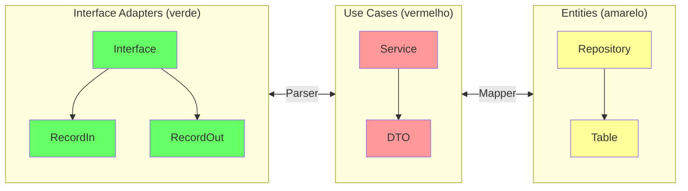
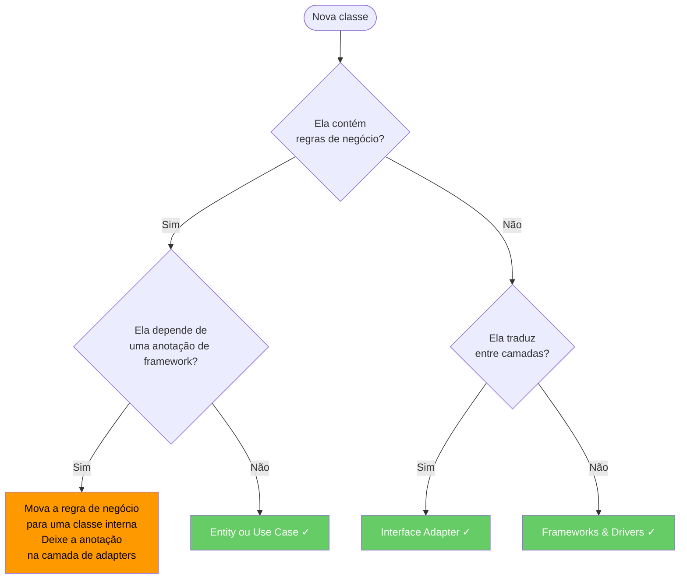
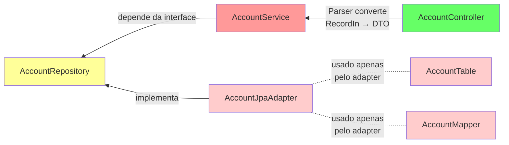

A [Clean Architecture](https://blog.cleancoder.com/uncle-bob/2012/08/13/the-clean-architecture.html){:target="_blank"} foi proposta por Robert C. Martin (Uncle Bob) como uma síntese de várias ideias anteriores de arquitetura em camadas — Hexagonal, Onion e BCE. Sua regra central é a **Regra de Dependência**: as dependências de código-fonte devem sempre apontar *para dentro*, em direção às políticas de nível mais alto[^1].

<figure markdown>
  { width="80%" }
  <figcaption><i>Fonte: <a href="https://blog.cleancoder.com/uncle-bob/2012/08/13/the-clean-architecture.html" target="_blank">The Clean Code Blog — Robert C. Martin</a></i></figcaption>
</figure>

---

## Camadas

| Camada | Também chamada de | Responsabilidade |
|---|---|---|
| **Entities** | Domínio | Regras de negócio e estruturas de dados corporativas. Independentes de qualquer aplicação. |
| **Use Cases** | Aplicação | Regras de negócio específicas da aplicação. Orquestra as Entities; define o que a aplicação *faz*. |
| **Interface Adapters** | Adapters | Converte dados entre os Use Cases e os formatos externos: Controllers, Presenters, Gateways. |
| **Frameworks & Drivers** | Infraestrutura | Frameworks web, bancos de dados, UI, APIs externas. O anel mais externo — todos os detalhes ficam aqui. |

!!! info "A Regra de Dependência"
    Nada em uma camada interna pode referenciar algo de uma camada externa. Os dados que atravessam as fronteiras devem estar em estruturas simples — objetos simples ou records —, **nunca** em um tipo de framework. Uma anotação `@Entity` ou um `HttpServletRequest` nunca devem aparecer dentro de uma classe de Use Case ou de Entity.

### O que vai em cada lugar

Uma heurística prática para decidir a qual camada uma classe pertence:

- **Se ela muda quando o negócio muda** → Entity ou Use Case
- **Se ela muda quando a interface muda** (REST → gRPC, JSON → XML) → Interface Adapter
- **Se ela muda quando uma biblioteca é atualizada** (versão do Spring Boot, dialeto JPA) → Frameworks & Drivers

---

## Na nossa arquitetura

O diagrama abaixo mostra como as camadas da Clean Architecture se mapeiam nas classes e pacotes usados nos microsserviços Spring Boot da disciplina:



### Papel de cada componente

**`RecordIn` / `RecordOut`**
: DTOs de entrada/saída que ficam na fronteira dos adapters. Eles desacoplam o contrato HTTP do modelo interno, de modo que mudar o nome de um campo JSON ou adicionar uma anotação de validação nunca afeta o Use Case.

**`Parser`**
: Converte entre os tipos `Record*` e os DTOs dos Use Cases. É o único lugar que conhece os dois mundos — mantendo os dois lados da fronteira limpos.

**`Service`**
: Implementa a lógica do caso de uso. Depende apenas das *interfaces* de repositório declaradas na camada de Entities, nunca de JPA, Spring Data ou qualquer outro detalhe de persistência.

**`Mapper`**
: Converte entre os DTOs dos Use Cases e os objetos `@Entity` / `@Table` na fronteira de persistência. A classe `@Entity` — que carrega as anotações do ORM — fica confinada à fronteira entre Entities e Infraestrutura e nunca vaza para a lógica do Service.

**`Repository`**
: Uma interface Java simples, declarada na camada de Entities. A implementação JPA (`AccountJpaAdapter`) fica na camada mais externa e é injetada em tempo de execução pelo contêiner de injeção de dependência do Spring.

### Estrutura de pacotes sugerida

```
com.example.product/
├── domain/                  ← Entities layer
│   ├── Product.java         # Domain object (no framework annotations)
│   └── ProductRepository.java  # Repository interface (port)
├── application/             ← Use Cases layer
│   ├── ProductService.java  # Business logic
│   └── ProductDTO.java      # Data passed across the use-case boundary
├── adapter/                 ← Interface Adapters layer
│   ├── in/
│   │   ├── ProductController.java
│   │   ├── ProductRecordIn.java
│   │   └── ProductRecordOut.java
│   └── out/
│       ├── ProductJpaAdapter.java   # Implements ProductRepository
│       ├── ProductTable.java        # @Entity class
│       └── ProductMapper.java
```

---

## Benefícios práticos

**Testabilidade sem infraestrutura**
: As regras de negócio da camada de Use Cases podem ser testadas com JUnit puro — sem contexto Spring, sem banco de dados, sem servidor web. Crie um mock da interface `Repository` e teste o `Service` em milissegundos.

**Mecanismo de entrega substituível**
: A camada HTTP (REST, gRPC, GraphQL, CLI) pode ser trocada ou rodar em paralelo sem tocar na classe `Service`. O adapter é a única coisa que muda.

**Persistência substituível**
: Troque o JPA pelo MongoDB, ou por um mapa em memória nos testes, fornecendo uma nova implementação da interface `Repository`. As camadas de domínio e de aplicação não são afetadas.

**Trabalho paralelo entre equipes**
: As equipes podem desenvolver o adapter de persistência e o adapter REST de forma independente, desde que concordem sobre as interfaces dos ports. O `Service` pode ser desenvolvido — e totalmente testado — antes que qualquer adapter exista.

---

## A qual camada esta classe pertence?

Um guia rápido de decisão para posicionar uma nova classe:



---

## Exemplo completo funcionando

Os arquivos abaixo mostram uma fatia completa de um microsserviço `Account` atravessando as quatro camadas. Cada arquivo está em uma camada diferente — repare que as dependências sempre apontam para dentro.



=== "Account.java — entidade de domínio"

    ``` { .java .copy .select linenums="1" }
    --8<-- "docs/2026.1/classes/architectures/clean/examples/Account.java"
    ```

=== "AccountRepository.java — port"

    ``` { .java .copy .select linenums="1" }
    --8<-- "docs/2026.1/classes/architectures/clean/examples/AccountRepository.java"
    ```

=== "AccountService.java — caso de uso"

    ``` { .java .copy .select linenums="1" }
    --8<-- "docs/2026.1/classes/architectures/clean/examples/AccountService.java"
    ```

=== "AccountController.java — adapter de entrada"

    ``` { .java .copy .select linenums="1" }
    --8<-- "docs/2026.1/classes/architectures/clean/examples/AccountController.java"
    ```

=== "AccountTable.java — @Entity"

    ``` { .java .copy .select linenums="1" }
    --8<-- "docs/2026.1/classes/architectures/clean/examples/AccountTable.java"
    ```

=== "AccountJpaAdapter.java — adapter de saída"

    ``` { .java .copy .select linenums="1" }
    --8<-- "docs/2026.1/classes/architectures/clean/examples/AccountJpaAdapter.java"
    ```

=== "AccountMapper.java — conversor de fronteira"

    ``` { .java .copy .select linenums="1" }
    --8<-- "docs/2026.1/classes/architectures/clean/examples/AccountMapper.java"
    ```

---

## Erros comuns

!!! warning "Vazamento de tipos de framework para dentro"
    Colocar `@Entity`, `@Column`, `@JsonProperty` ou `HttpServletRequest` em uma classe de Use Case ou de Entity viola imediatamente a Regra de Dependência. O detalhe do framework passa a ditar a forma da regra de negócio.

!!! warning "Controllers inchados"
    Controllers que contêm comandos `if`, chamam vários serviços ou orquestram fluxos absorveram responsabilidades de Use Case. Controllers devem traduzir e delegar — nada mais.

!!! warning "Modelo de domínio anêmico"
    Entities que são meros sacos de dados (apenas getters/setters), com toda a lógica na camada de Service, são um sinal de que a fronteira entre camadas não está sendo usada. Mova a garantia das invariantes para a Entity.

---

[^1]: MARTIN, R. C. *Clean Architecture: A Craftsman's Guide to Software Structure and Design*. Prentice Hall, 2017. [:fontawesome-brands-amazon:](https://www.amazon.com.br/Clean-Architecture-Craftsmans-Software-Structure/dp/B075LRM681/){:target='_blank'}

[^2]: :fontawesome-brands-youtube:{ .youtube } [Criando um projeto Spring Boot com Arquitetura Limpa](https://youtu.be/hit0XHGt4WI){:target="_blank"}, de [Giuliana Silva Bezerra](https://github.com/giuliana-bezerra){:target="_blank"}
