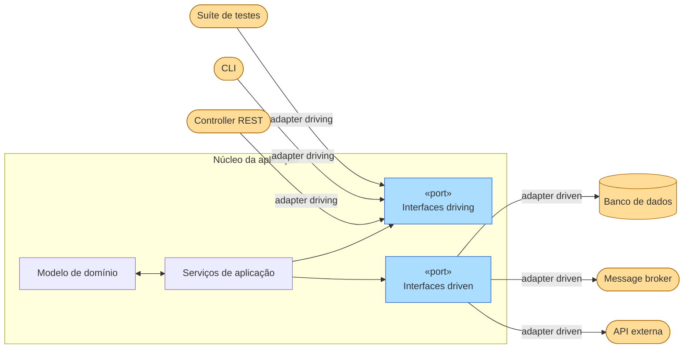

A [Arquitetura Hexagonal](https://alistair.cockburn.us/hexagonal-architecture/){:target="_blank"} — também chamada de **Ports & Adapters** — foi apresentada por Alistair Cockburn em 2005. A ideia é colocar o núcleo da aplicação no centro e expô-lo por meio de *ports* (interfaces), aos quais os *adapters* externos se conectam. O formato de hexágono é arbitrário; ele sinaliza que a aplicação tem vários pontos de entrada/saída equivalentes, sem nenhum lado privilegiado[^1].



---

## Ports

Um **port** é uma interface pura — um contrato definido *pelo* núcleo da aplicação, e não pela tecnologia externa. Há dois tipos:

| Tipo | Direção | Definido por | Implementado por | Exemplo |
|---|---|---|---|---|
| **Port primário / driving** | Fora → Aplicação | A aplicação | A própria aplicação | Interface `AuthService` chamada pelo controller REST |
| **Port secundário / driven** | Aplicação → Fora | A aplicação | Um adapter externo | `AccountRepository` implementado pelo adapter JPA |

!!! info "A posse importa"
    Os dois tipos de port *pertencem ao núcleo da aplicação e são definidos por ele*. O adapter é a peça que fica do lado de fora e se encaixa no port — **o núcleo nunca importa o adapter**.

### Ports primários (driving)

Os ports primários representam *o que a aplicação sabe fazer* — eles são a API dos casos de uso. Qualquer ator externo que queira interagir com a aplicação precisa passar por um port primário.

```java
// Defined inside the application core
public interface AuthService {
    TokenOut login(String email, String password);
    void logout(String token);
}
```

A implementação dessa interface também fica dentro do núcleo — ela é o serviço de aplicação:

```java
// Also inside the core — depends only on secondary ports
public class AuthServiceImpl implements AuthService {
    private final AccountRepository accounts; // ← secondary port

    @Override
    public TokenOut login(String email, String password) {
        Account account = accounts.findByEmail(email)
            .orElseThrow(() -> new InvalidCredentialsException());
        account.validatePassword(password);
        return TokenOut.issue(account);
    }
}
```

### Ports secundários (driven)

Os ports secundários representam *o que a aplicação precisa* do mundo externo — persistência, mensageria, APIs externas. O núcleo define a interface; a infraestrutura fornece a implementação.

```java
// Defined inside the application core
public interface AccountRepository {
    Optional<Account> findByEmail(String email);
    Account save(Account account);
}
```

---

## Adapters

Um adapter é uma classe que **traduz** entre uma tecnologia externa e o contrato de um port. Ele fica fora do núcleo e depende dele — nunca o contrário.

=== "Adapter driving (REST)"

    ```java
    // Adapter: translates HTTP → primary port
    @RestController
    public class AuthController {
        private final AuthService authService; // ← primary port

        public AuthController(AuthService authService) {
            this.authService = authService;
        }

        @PostMapping("/auth/login")
        public ResponseEntity<TokenOut> login(@RequestBody LoginIn in) {
            TokenOut token = authService.login(in.email(), in.password());
            return ResponseEntity.ok(token);
        }
    }
    ```

=== "Adapter driving (CLI)"

    ```java
    // Any driver can plug into the same primary port
    public class AuthCLI {
        private final AuthService authService;

        public void run(String[] args) {
            String email = args[0], password = args[1];
            TokenOut token = authService.login(email, password);
            System.out.println("Token: " + token.value());
        }
    }
    ```

=== "Adapter driven (JPA)"

    ```java
    // Adapter: translates secondary port → JPA
    @Repository
    public class AccountJpaAdapter implements AccountRepository {

        private final AccountJpaRepository jpa;

        @Override
        public Optional<Account> findByEmail(String email) {
            return jpa.findByEmail(email).map(AccountMapper::toDomain);
        }

        @Override
        public Account save(Account account) {
            AccountTable table = AccountMapper.toTable(account);
            return AccountMapper.toDomain(jpa.save(table));
        }
    }
    ```

=== "Adapter driven (em memória / teste)"

    ```java
    // Swap the JPA adapter for a map in tests — no Spring context needed
    public class InMemoryAccountRepository implements AccountRepository {
        private final Map<String, Account> store = new HashMap<>();

        @Override
        public Optional<Account> findByEmail(String email) {
            return Optional.ofNullable(store.get(email));
        }

        @Override
        public Account save(Account account) {
            store.put(account.email(), account);
            return account;
        }
    }
    ```

<figure markdown>
  { width="80%" }
  <figcaption><i>Fonte: <a href="https://en.wikipedia.org/wiki/Hexagonal_architecture_(software)" target="_blank">Wikipedia — Hexagonal Architecture</a></i></figcaption>
</figure>

---

## Exemplo completo funcionando

Os arquivos abaixo mostram a fatia completa de autenticação do `auth-service`. Cada arquivo está identificado com a sua posição em relação à fronteira do hexágono.

=== "AuthService.java — port primário"

    ``` { .java .copy .select linenums="1" }
    --8<-- "docs/2026.1/classes/architectures/hexagonal/examples/AuthService.java"
    ```

=== "AuthServiceImpl.java — implementação do núcleo"

    ``` { .java .copy .select linenums="1" }
    --8<-- "docs/2026.1/classes/architectures/hexagonal/examples/AuthServiceImpl.java"
    ```

=== "AccountRepository.java — port secundário"

    ``` { .java .copy .select linenums="1" }
    --8<-- "docs/2026.1/classes/architectures/hexagonal/examples/AccountRepository.java"
    ```

=== "AuthController.java — adapter driving"

    ``` { .java .copy .select linenums="1" }
    --8<-- "docs/2026.1/classes/architectures/hexagonal/examples/AuthController.java"
    ```

=== "AccountJpaAdapter.java — adapter driven"

    ``` { .java .copy .select linenums="1" }
    --8<-- "docs/2026.1/classes/architectures/hexagonal/examples/AccountJpaAdapter.java"
    ```

=== "InMemoryAccountRepository.java — adapter de teste"

    ``` { .java .copy .select linenums="1" }
    --8<-- "docs/2026.1/classes/architectures/hexagonal/examples/InMemoryAccountRepository.java"
    ```

---

## Estratégia de testes

A principal sacada da Arquitetura Hexagonal para os testes é que o **núcleo da aplicação pode ser totalmente testado sem nenhuma infraestrutura**. Substitua cada adapter driven por um stub em memória e acione o port primário diretamente a partir de um teste.


``` { .java .copy .select linenums="1" title="AuthServiceTest.java" }
--8<-- "docs/2026.1/classes/architectures/hexagonal/examples/AuthServiceTest.java"
```

Sem `@SpringBootTest` do Spring, sem H2, sem porta 8080 — o teste roda em milissegundos e cobre a regra de negócio diretamente.

---

## Estrutura de pacotes sugerida

```
com.example.auth/
├── domain/                         ← Domain Model
│   └── Account.java                # Aggregate root — no framework annotations
├── application/                    ← Application Services + Ports
│   ├── AuthService.java            # Primary port (interface)
│   ├── AuthServiceImpl.java        # Primary port implementation
│   └── port/
│       └── AccountRepository.java  # Secondary port (interface)
├── adapter/
│   ├── in/
│   │   └── AuthController.java     # Driving adapter (REST)
│   └── out/
│       ├── AccountJpaAdapter.java  # Driven adapter (JPA)
│       ├── AccountTable.java       # @Entity — stays in the adapter
│       └── AccountMapper.java
```

---

## Erros comuns

!!! warning "Ports definidos pelo adapter"
    Se a interface `AccountRepository` espelha os nomes de métodos do `JpaRepository` do Spring Data, ela está sendo moldada pelo JPA, e não pelas necessidades da aplicação. Defina os ports em termos de conceitos do domínio, não de conceitos de persistência.

!!! warning "O núcleo importando o adapter"
    Qualquer `import com.example.adapter.*` dentro do pacote de domínio ou de aplicação é uma violação imediata. A injeção de dependência (Spring, CDI) deve resolver o adapter em tempo de execução, não em tempo de compilação.

!!! warning "Ports demais"
    Um port por caso de uso leva a uma explosão de interfaces. Agrupe as operações relacionadas — `AccountRepository` é um único port, e não ports separados para `findByEmail`, `save` e `delete`.

---

[^1]: COCKBURN, A. [Hexagonal Architecture](https://alistair.cockburn.us/hexagonal-architecture/){:target="_blank"}, 2005.

[^2]: :fontawesome-brands-youtube:{ .youtube } [Hexagonal Architecture — What Is It? Why Should You Use It?](https://www.youtube.com/watch?v=bDWApqAUjEI){:target="_blank"}, de CodeOpinion

[^3]: :fontawesome-brands-youtube:{ .youtube } [Arquitetura Hexagonal na Prática | Arquitetura com Java e Spring Boot](https://www.youtube.com/watch?v=UKSj5VJEzps){:target="_blank"}, de Fernanda Kipper
