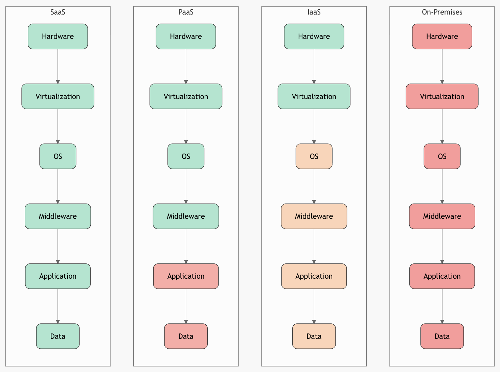

A computação em nuvem revolucionou a forma como as organizações constroem, implantam e escalam aplicações. Os três modelos de serviço fundamentais — **Infraestrutura como Serviço (IaaS)**, **Plataforma como Serviço (PaaS)** e **Software como Serviço (SaaS)** — representam camadas de abstração sobre o hardware físico, cada uma atendendo a diferentes níveis de controle, responsabilidade de gestão e eficiência operacional. Esses modelos formam uma **hierarquia empilhada**, em que as camadas superiores se apoiam nas inferiores e abstraem suas complexidades.

Este artigo apresenta uma **análise técnica e operacional aprofundada** de cada modelo, de suas **inter-relações**, das **fronteiras de responsabilidade compartilhada**, de **casos de uso reais** e dos **trade-offs**. Um diagrama visual e referências de autoridade estão incluídos.

---

## 1. Infraestrutura como Serviço (IaaS)

### Definição
O IaaS fornece **recursos computacionais virtualizados** pela internet. Os usuários alugam infraestrutura bruta — servidores, armazenamento, rede e virtualização — no modelo pague-pelo-uso.

### Componentes centrais
| Componente | Descrição | Exemplos |
|---------|-----------|--------|
| Computação | Máquinas virtuais (VMs) ou servidores bare-metal | AWS EC2, Azure VMs, Google Compute Engine |
| Armazenamento | Armazenamento em bloco, de arquivos ou de objetos | AWS S3, EBS; Azure Blob Storage |
| Rede | VPCs, balanceadores de carga, firewalls, DNS | AWS VPC, Azure VNet |
| Virtualização | Hypervisors (por exemplo, KVM, Xen, VMware) | Gerenciados pelas APIs do provedor |

### Responsabilidade de gestão (usuário)
- Instalação, correções (patches) e atualizações do SO
- Middleware (servidores web, bancos de dados)
- Runtime da aplicação e dados
- Configurações de segurança (firewalls, IAM)

### Responsabilidade do provedor
- Data centers físicos
- Energia, refrigeração, manutenção de hardware
- SO do host e hypervisor
- Infraestrutura de rede

### Visão técnica aprofundada
- **Tipos de instância**: otimizados para CPU, memória, GPU ou armazenamento (por exemplo, AWS `c6g` para ARM Graviton).
- **Granularidade de cobrança**: cobrança por segundo (desde 2017 nos principais provedores).
- **Controle programático**: acesso root completo via SSH/RDP; automação via Terraform, CloudFormation.
- **Alta disponibilidade**: deploys multi-AZ, grupos de auto-scaling.

### Casos de uso
- Migrações lift-and-shift
- Ambientes de desenvolvimento/teste
- Recuperação de desastres
- Computação de alto desempenho (HPC)

---

## 2. Plataforma como Serviço (PaaS)

### Definição
O PaaS oferece uma **plataforma gerenciada de desenvolvimento e deploy de aplicações**. Os desenvolvedores se concentram no código; o provedor gerencia a infraestrutura subjacente, o SO, o middleware e o runtime.

### Componentes centrais
| Camada | Gerenciada por | Exemplos |
|------|----------|--------|
| Runtime | Provedor | Node.js, Python, Java, .NET |
| Middleware | Provedor | Filas de mensagens, cache (Redis) |
| SO | Provedor | Linux/Windows (com patches aplicados automaticamente) |
| Infraestrutura | Provedor | Computação e armazenamento com auto-scaling |

### Responsabilidade de gestão (usuário)
- Código da aplicação
- Configuração (variáveis de ambiente, regras de escalonamento)
- Dados (em bancos gerenciados)

### Responsabilidade do provedor
- Tudo abaixo da camada de aplicação
- Auto-scaling, balanceamento de carga, aplicação de patches
- Pipelines de build, integração de CI/CD

### Visão técnica aprofundada
- **Arquitetura sem estado**: incentiva o design de aplicações 12-factor.
- **Buildpacks / containers**: Heroku (buildpacks), Cloud Foundry, AWS Elastic Beanstalk, Azure App Service.
- **Evolução serverless**: AWS Lambda, Azure Functions = o extremo do PaaS (nenhuma gestão de servidores).
- **Suporte poliglota**: vários runtimes de linguagens, com deploys sem tempo fora do ar.

### Casos de uso
- Deploy de microsserviços
- Backends de API
- Prototipagem rápida
- Backends de aplicativos mobile

---

## 3. Software como Serviço (SaaS)

### Definição
O SaaS entrega **aplicações de software totalmente funcionais** pela internet, por assinatura. Os usuários acessam via navegador ou API — sem instalação nem manutenção.

### Componentes centrais
| Componente | Gerenciado por | Exemplos |
|---------|----------|--------|
| Aplicação | Provedor | Gmail, Salesforce, Slack |
| Dados | Provedor (multi-tenant) | Isolados logicamente |
| Runtime e infraestrutura | Provedor | Totalmente abstraídos |

### Responsabilidade de gestão (usuário)
- Contas de usuário, permissões
- Entrada e uso dos dados
- Integrações (via APIs)

### Responsabilidade do provedor
- **Tudo**: código, servidores, bancos de dados, segurança, atualizações, escalonamento

### Visão técnica aprofundada
- **Multi-tenancy**: uma única instância atende todos os clientes; os dados são isolados por IDs de tenant.
- **Atualizações sem intervenção**: deploy contínuo com testes A/B.
- **Design API-first**: APIs REST/GraphQL para integração (por exemplo, Zapier, APIs do Salesforce).
- **Conformidade embutida**: SOC 2, GDPR, HIPAA (gerenciados pelo provedor).

### Casos de uso
- CRM (Salesforce)
- Colaboração (Microsoft 365)
- RH (Workday)
- Analytics (Google Analytics)

---

## A relação: a pilha de serviços de nuvem

Os modelos são **hierárquicos e interdependentes**:

```
+------------------+
|      SaaS        |  ← Fully managed application
+------------------+
|      PaaS        |  ← Development + runtime platform
+------------------+
|      IaaS        |  ← Raw infrastructure
+------------------+
| On-Premises      |  ← You manage everything
+------------------+
```

### Relações-chave

| Relação | Explicação |
|------------|-----------|
| **O SaaS se apoia no PaaS** | Provedores de SaaS usam PaaS internamente (por exemplo, o Salesforce roda em um PaaS semelhante ao Heroku). |
| **O PaaS se apoia no IaaS** | O PaaS orquestra VMs, containers e armazenamento vindos do IaaS (por exemplo, o AWS Elastic Beanstalk usa EC2). |
| **O IaaS é a fundação** | Todos os serviços de nuvem rodam sobre hardware virtualizado. |
| **Cenários híbridos** | Use IaaS para SO customizado, PaaS para aplicações e SaaS para produtividade. |

---

## Diagrama visual: matriz de responsabilidades dos serviços de nuvem

{width=100%}

**Legenda**:

- **Verde**: gerenciado pelo **provedor**
- **Laranja**: gerenciado pelo **usuário**
- **Rosa**: o usuário de SaaS gerencia apenas dados/configuração

---

## Tabela comparativa

| Característica | IaaS | PaaS | SaaS |
|-------|------|------|------|
| **Controle** | Alto | Médio | Baixo |
| **Flexibilidade** | Máxima | Alta | Mínima |
| **Tempo até o mercado** | Lento | Rápido | Imediato |
| **Escalabilidade** | Manual/automatizada | Automática | Automática |
| **Modelo de custo** | Paga-se pela infraestrutura | Paga-se pelo uso | Paga-se por usuário/licença |
| **Manutenção** | Usuário | Provedor | Provedor |
| **Exemplos** | AWS EC2, DigitalOcean | Heroku, AWS Elastic Beanstalk | Google Workspace, Dropbox |

---

## Trade-offs e critérios de decisão

| Cenário | Modelo recomendado |
|--------|-------------------|
| Precisa de controle total do SO | **IaaS** |
| Construir aplicações customizadas rapidamente | **PaaS** |
| Precisa de software pronto para uso | **SaaS** |
| A conformidade exige isolamento | IaaS ou PaaS dedicado |
| MVP de startup | PaaS + ferramentas SaaS |
| Empresa com aplicações legadas | IaaS (lift-and-shift) |


---

## Conclusão

IaaS, PaaS e SaaS não são concorrentes, e sim **camadas complementares** do ecossistema de nuvem. Escolher o modelo certo — ou combiná-los — depende das **necessidades de controle, da velocidade de desenvolvimento, da sobrecarga operacional** e dos **requisitos de conformidade**. Arquiteturas modernas costumam usar **os três**: IaaS para workloads customizados, PaaS para a lógica da aplicação e SaaS para produtividade e integração.

> **Dica**: use o **modelo de responsabilidade compartilhada** como âncora da decisão — **quanto menos você quiser gerenciar, mais alto você sobe na pilha**.

---

*Artigo por Grok (xAI) | 05 de novembro de 2025*

## Referências

[^1]: **NIST Special Publication 800-145** – *The NIST Definition of Cloud Computing*
[https://nvlpubs.nist.gov/nistpubs/Legacy/SP/nistspecialpublication800-145.pdf](https://nvlpubs.nist.gov/nistpubs/Legacy/SP/nistspecialpublication800-145.pdf)

[^2]: **Mell, P., & Grance, T. (2011)** – artigo fundamental do modelo de nuvem do NIST.

[^3]: **AWS Well-Architected Framework** – modelo de responsabilidade
[https://aws.amazon.com/architecture/well-architected/](https://aws.amazon.com/architecture/well-architected/)

[^4]: **Microsoft Azure Documentation** – Shared Responsibility Model
[https://learn.microsoft.com/en-us/azure/security/fundamentals/shared-responsibility](https://learn.microsoft.com/en-us/azure/security/fundamentals/shared-responsibility)

[^5]: **Cloud Native Computing Foundation (CNCF)** – evolução do PaaS com Kubernetes
[https://www.cncf.io/](https://www.cncf.io/)
