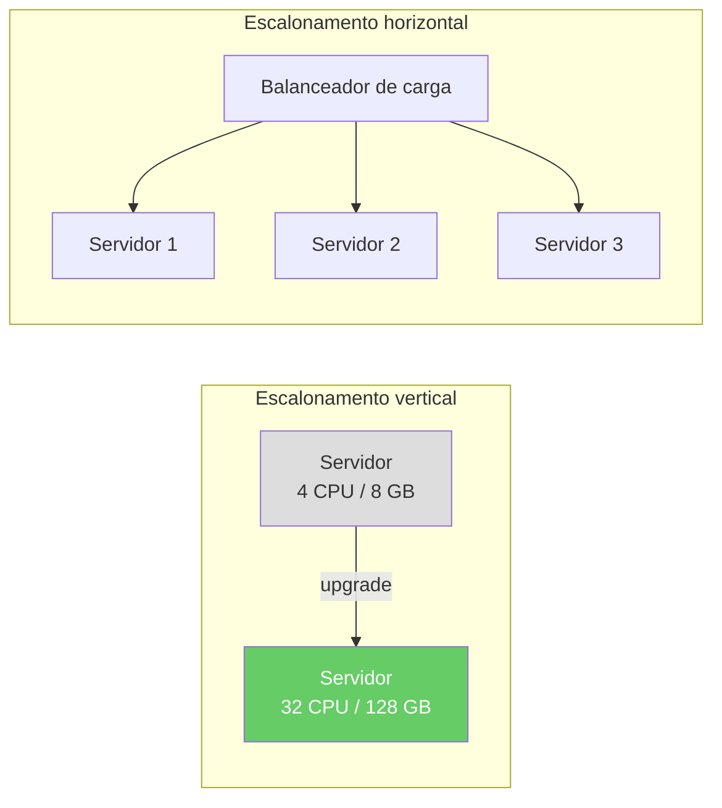
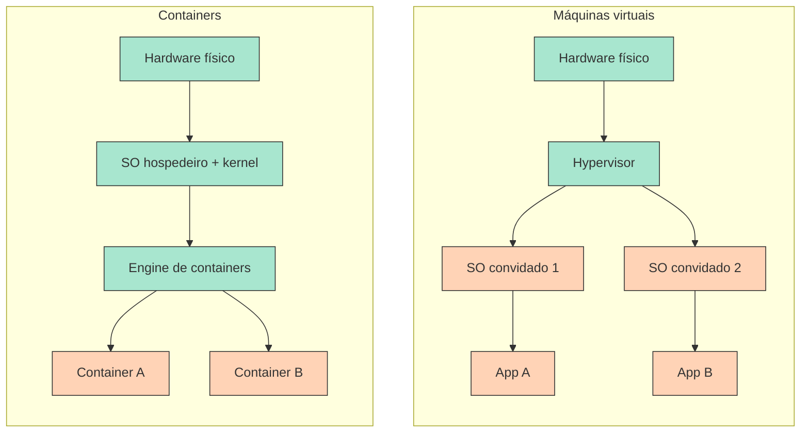
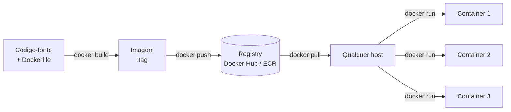

Quando um servidor não consegue lidar com o tráfego crescente, existem duas estratégias:

**Escalonamento vertical** (scale-up)
: Substituir o servidor por um mais potente — mais CPU, mais RAM, disco mais rápido. É simples, mas limitado: existe um limite físico para o tamanho de uma única máquina, e os upgrades exigem tempo fora do ar.

**Escalonamento horizontal** (scale-out)
: Adicionar mais servidores e distribuir a carga entre eles. Teoricamente ilimitado, mas introduz um problema crítico: a **consistência entre ambientes**.

Uma aplicação que funciona no notebook de um desenvolvedor pode falhar em produção por causa de versões diferentes do sistema operacional, de bibliotecas ou de variáveis de ambiente — o famoso problema do *"na minha máquina funciona"*. A **containerização** resolve isso empacotando a aplicação com todas as suas dependências em uma unidade portátil e autocontida, que roda de forma idêntica em qualquer lugar.

---

## Containers vs. máquinas virtuais

Tanto os containers quanto as máquinas virtuais (VMs) oferecem isolamento, mas em níveis diferentes da pilha:

:material-square:{ style="color:#a8e6cf" } Camada do provedor / compartilhada &nbsp;&nbsp; :material-square:{ style="color:#ffd3b6" } Camada da aplicação

| Aspecto | Containers Docker | Máquinas virtuais |
|---|---|---|
| **Isolamento** | Em nível de processo — compartilham o kernel do hospedeiro | Isolamento completo de SO — cada VM tem seu próprio kernel |
| **Sobrecarga de recursos** | Leve — nenhum SO duplicado por container | Maior — cada VM carrega um SO completo |
| **Tempo de inicialização** | Segundos | Minutos (boot completo do SO) |
| **Portabilidade** | Alta — a imagem empacota a aplicação e todas as dependências | Menor — configuração específica do SO |
| **Fronteira de segurança** | Mais fraca (kernel compartilhado) | Mais forte (kernel separado) |
| **Uso típico** | Microsserviços, CI/CD, escalonamento horizontal | SO convidado diferente, requisitos fortes de isolamento |

A ideia-chave: containers compartilham o kernel do hospedeiro, então iniciam em segundos e consomem muito menos memória. VMs carregam seu próprio kernel — o que dá um isolamento mais forte ao custo de uma sobrecarga maior.

---

## O ciclo de vida de um container

Um **Dockerfile** descreve como construir a imagem. Uma **imagem** é o artefato imutável — ela é versionada, armazenada em um registry e baixada (pull) em qualquer máquina. Um **container** é uma instância em execução de uma imagem — isolada, efêmera e descartável.

---

## Tópicos abordados

-   :fontawesome-brands-docker:{ .lg .middle } **Docker**

    ---

    Conceitos centrais do Docker: imagens, containers, o Docker Engine, Dockerfiles (incluindo builds multi-stage), comandos essenciais, redes e volumes.

    [:octicons-arrow-right-24: Docker](docker/index.md)

-   :material-file-code:{ .lg .middle } **Docker Compose**

    ---

    Orquestração declarativa de múltiplos containers com `compose.yaml`. Aborda definição de serviços, redes, volumes, variáveis de ambiente, health checks e ordem de dependências.

    [:octicons-arrow-right-24: Docker Compose](compose/index.md)

---

## Containerização na nuvem

Os provedores de nuvem oferecem serviços gerenciados de containers que acrescentam, sobre o modelo de containers, agendamento automático, escalonamento, balanceamento de carga e integração profunda com outros serviços de nuvem:

| Serviço | Provedor | Modelo |
|---|---|---|
| **ECS / Fargate** | AWS | Containers gerenciados — nenhum cluster para operar |
| **EKS** | AWS | Kubernetes gerenciado |
| **Cloud Run** | Google | Containers serverless — escala até zero |
| **GKE** | Google | Kubernetes gerenciado |
| **AKS** | Azure | Kubernetes gerenciado |

=== ":fontawesome-brands-google: Google"

    :fontawesome-brands-youtube:{ .youtube } [Por dentro de um data center do Google](https://youtu.be/XZmGGAbHqa0){:target='_blank'}

    [{ width=100% }](https://youtu.be/XZmGGAbHqa0){:target='_blank'}

=== ":fontawesome-brands-aws: AWS"

    :fontawesome-brands-youtube:{ .youtube } [Por dentro do enorme data center da Amazon](https://youtu.be/q6WlzHLxNKI){:target='_blank'}

    [{ width=100% }](https://youtu.be/q6WlzHLxNKI){:target='_blank'}

=== ":simple-tesla: Tesla"

    :fontawesome-brands-youtube:{ .youtube } [Por dentro do supercomputador Colossus de Elon Musk!](https://youtu.be/Tw696JVSxJQ){:target='_blank'}

    [{ width=100% }](https://youtu.be/Tw696JVSxJQ){:target='_blank'}

---

[^1]: [Docker Documentation](https://docs.docker.com/){:target="_blank"}
[^2]: [Docker vs. Virtual Machines: Differences You Should Know](https://cloudacademy.com/blog/docker-vs-virtual-machines-differences-you-should-know/){:target="_blank"}
[^3]: BURNS, B. et al. *Kubernetes: Up and Running*, 3rd ed. O'Reilly, 2022.
