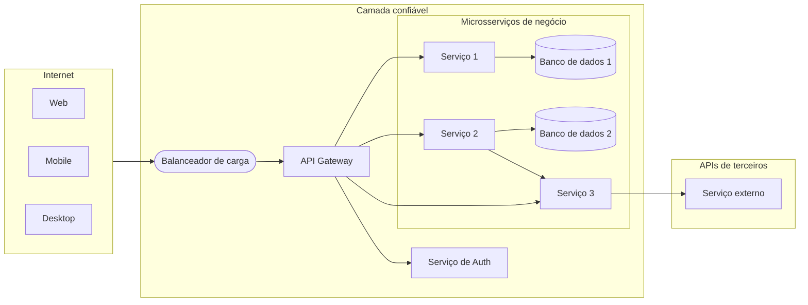

Um sistema de microsserviços em produção é mais do que uma coleção de serviços independentes. Ele exige um conjunto de **componentes de infraestrutura** que tratam das preocupações transversais — roteamento, segurança, descoberta, configuração e observabilidade — para que cada serviço possa se manter focado no seu domínio de negócio.

---

## Componentes

<figure markdown>
  {target="_blank"}
  <figcaption><i>Fonte: <a href="https://bytebytego.com/guides/what-does-a-typical-microservice-architecture-look-like/" target="_blank">System Design 101 — Microservice Architecture</a></i></figcaption>
</figure>

### Balanceador de carga (load balancer)

Distribui o tráfego de entrada entre várias instâncias de um serviço. Evita que uma única instância se torne um gargalo e desvia o tráfego das instâncias não saudáveis.

- **Camada 4 (TCP):** rápido, roteia por IP/porta — usado para vazão bruta.
- **Camada 7 (HTTP):** roteia por caminho da URL, cabeçalhos ou cookies — permite roteamento baseado em conteúdo e deploys canário.

### CDN (Content Delivery Network)

Uma rede de caches geograficamente distribuída que serve conteúdo estático (imagens, JS, CSS) a partir do local mais próximo do usuário. Reduz a latência para clientes no mundo inteiro e alivia o tráfego dos servidores de origem.

### API Gateway

O **ponto único de entrada** para todos os clientes externos. O gateway é responsável por:

| Preocupação | Como |
|---|---|
| **Roteamento** | `/orders/**` → Order Service, `/products/**` → Product Service |
| **Autenticação** | Valida os tokens JWT antes de encaminhar as requisições |
| **Limitação de taxa (rate limiting)** | Protege os serviços contra picos de tráfego ou clientes abusivos |
| **Transformação de requisição/resposta** | Acrescenta cabeçalhos, agrega chamadas a vários serviços |
| **Terminação SSL** | Trata o HTTPS; os serviços se comunicam em HTTP simples dentro da rede confiável |

O gateway é a fronteira entre a internet pública e a rede interna confiável.

### Provedor de identidade

Gerencia a autenticação e a autorização dos usuários usando protocolos padrão:

- **OAuth 2.0** — framework de delegação: um usuário concede a um cliente acesso aos seus recursos sem compartilhar sua senha.
- **OpenID Connect (OIDC)** — camada de identidade sobre o OAuth 2.0: fornece um token de identidade JWT (`id_token`) além do token de acesso.
- **JWT (JSON Web Token)** — um token assinado e autocontido que codifica claims (ID do usuário, papéis, expiração). Os serviços validam a assinatura sem chamar o provedor de identidade a cada requisição.

### Descoberta e registro de serviços

Em um ambiente dinâmico, em que instâncias de serviços sobem e descem e os endereços IP mudam, os serviços não podem ter endpoints fixos no código. Um **registro de serviços** (Consul, Eureka, DNS do Kubernetes) armazena a localização atual de todas as instâncias. Os serviços se registram ao iniciar e se descadastram ao encerrar.

- **Descoberta no lado do cliente:** quem chama consulta o registro e faz o próprio balanceamento de carga.
- **Descoberta no lado do servidor:** o balanceador de carga ou o gateway consulta o registro em nome de quem chama.

### Serviço de configuração

Centraliza a configuração de todos os serviços (Spring Cloud Config, AWS Parameter Store, Vault). As mudanças podem ser enviadas aos serviços em execução sem um novo deploy. Segredos (credenciais, chaves de API) são armazenados criptografados e injetados em tempo de execução.

---

## Nossa arquitetura

O diagrama abaixo mostra a arquitetura de referência usada neste curso:

Decisões de projeto importantes nesta arquitetura:

- **Todo o tráfego externo entra pelo gateway.** Os serviços internos não são alcançáveis pela internet.
- **A autenticação é um serviço separado.** O gateway delega a validação de tokens ao Serviço de Auth; os microsserviços de negócio confiam nas claims do JWT encaminhado.
- **Cada serviço tem seu próprio banco de dados.** Nenhum esquema compartilhado. Os serviços se comunicam por meio de APIs, não de tabelas compartilhadas.
- **Os serviços podem chamar uns aos outros.** O Serviço 2 chama o Serviço 3 para uma suboperação. Em fluxos síncronos, isso não é problema; para confiabilidade em escala, considere padrões orientados a eventos.

---

## Boas práticas

<figure markdown>
  { width="100%" }
  <figcaption><i>Fonte: <a href="https://bytebytego.com/guides/9-best-practices-for-developing-microservices/" target="_blank">System Design 101 — Microservice Best Practices</a></i></figcaption>
</figure>

| Prática | Por que importa |
|---|---|
| **Projete para a falha** | Qualquer chamada a um serviço downstream pode falhar. Use timeouts, retries com backoff e circuit breakers. |
| **Automatize tudo** | Deploys manuais em escala são propensos a erros. Pipelines de CI/CD, IaC e orquestração de containers são pré-requisitos. |
| **Seja dono dos seus dados** | Um serviço que compartilha seu banco de dados com outro serviço não consegue evoluir de forma independente. |
| **Assíncrono sempre que possível** | Cadeias síncronas ampliam a latência e acoplam a disponibilidade. Eventos desacoplam produtores de consumidores. |
| **Observe tudo** | Traces distribuídos, logs estruturados e métricas são a única forma de entender falhas que atravessam as fronteiras dos serviços. |
| **Versione suas APIs** | Os serviços são implantados de forma independente; mudanças incompatíveis na API precisam ser versionadas para não forçar deploys coordenados. |

---

[^1]: XU, A. [System Design 101](https://github.com/ByteByteGoHq/system-design-101){target="_blank"}
[^2]: NEWMAN, S. *Building Microservices*. O'Reilly, 2021.
