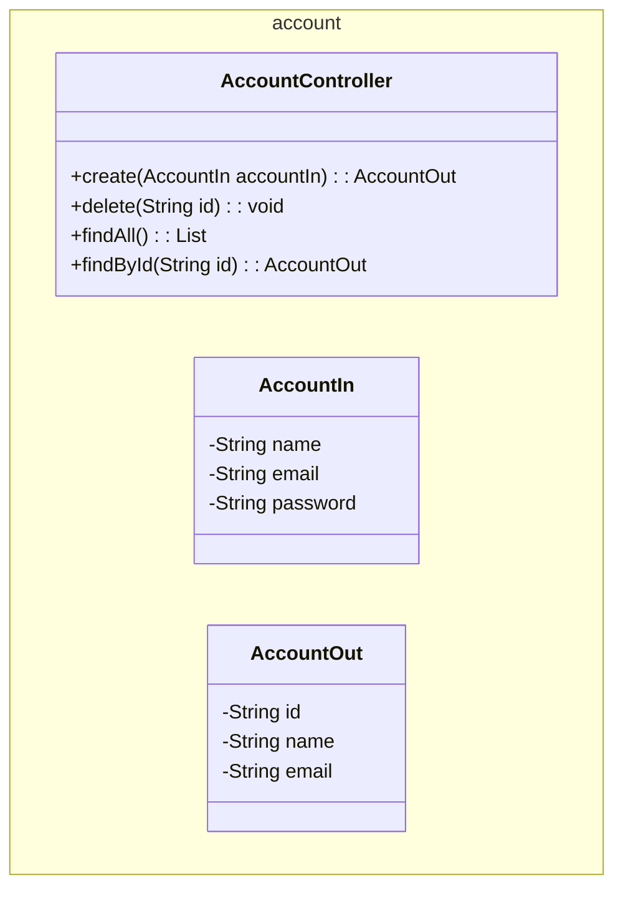
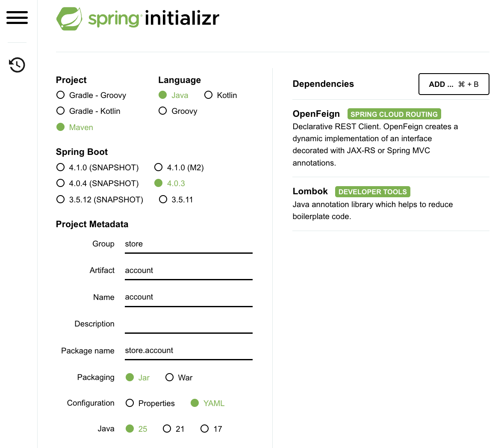

A interface do microsserviço Account é definida no módulo `account`, que contém a definição da API e os objetos de transferência de dados (DTOs) do microsserviço Account.

O objetivo principal desta seção é criar os seguintes endpoints da API:



## 1. Repositório

- a. No GitHub, crie um novo repositório para a interface Account. Exemplo: `account`.

- b. Em seguida, clone esse repositório como um submódulo na sua máquina local. Para isso, execute os seguintes comandos na raiz do projeto:

    ``` bash
    git submodule add <repository_url> api/account
    ```

Isso cria um novo diretório chamado `account` dentro do diretório `api`, que conterá o código da interface Account. A estrutura de diretórios resultante ficará assim:

``` tree
platform/
    api/
        account/
```


## 2. Código

Para codificar esse módulo de interface, vamos usar o framework Spring Boot por meio do Spring Initializr, em [https://start.spring.io/], uma ferramenta web que permite gerar um projeto Spring Boot com as dependências e configurações necessárias. 

<figure>
    
    <figcaption>Spring Initializr</figcaption>
</figure>

Observe:

- Project: Maven
- Language: Java
- Spring Boot: 4.0.3 (versão estável no momento)
- Group: store (o nome da empresa, por exemplo)
- Artifact: account (o nome do microsserviço)
- Package name: store.account
- Packaging: Jar
- Configuration: YAML
- Java: 25 (versão LTS no momento)

Além disso, precisamos adicionar as seguintes dependências:

- *Lombok*: uma biblioteca Java que ajuda a reduzir código repetitivo (boilerplate), gerando getters, setters, construtores e outros métodos comuns em tempo de compilação por meio de anotações.

- *OpenFeign*: um cliente declarativo de web services que simplifica o processo de fazer requisições HTTP a outros microsserviços. Ele permite definir interfaces para os nossos clientes de API e gera automaticamente a implementação em tempo de execução.

Depois, baixe o arquivo zip e extraia-o no diretório `api/account`. A estrutura de diretórios resultante ficará assim:

``` tree
api/
    account/
        src/
            main/
                java/
                    store/
                        account/
                            AccountApplication.java
            resources/
                application.yaml
        pom.xml
```

Neste caso, a classe `AccountApplication` é inútil, já que este módulo serve apenas para a interface e não será executado como uma aplicação independente. Portanto, podemos apagar essa classe e o arquivo `application.yaml`. Também podemos apagar o diretório `src/test`, já que não vamos escrever testes para este módulo. Além disso, não precisamos do diretório `src/main/resources`, pois não vamos adicionar nenhum recurso a este módulo; portanto, podemos apagá-lo também. A estrutura de diretórios resultante ficará assim:

Agora é hora de codificar a interface, que consiste na classe `AccountController`, que define os endpoints da API do microsserviço Account, e nas classes `AccountIn` e `AccountOut`, que são os DTOs de entrada e de saída dos endpoints, respectivamente. A estrutura de diretórios resultante ficará assim:

``` tree
api/
    account/
        src/
            main/
                java/
                    store/
                        account/
                            AccountController.java
                            AccountIn.java
                            AccountOut.java
        pom.xml
```

Uma possível implementação das classes `AccountController`, `AccountIn` e `AccountOut` é mostrada abaixo:

!!! example "Código-fonte"

    === "pom.xml"

        ``` { .yaml .copy .select linenums="1" }
        --8<-- "docs/2026.1/hands-on/1/controller/code/pom.xml"
        ```

    === "AccountController"

        ``` { .java title='AccountController.java' .copy .select linenums='1' }
        --8<-- "docs/2026.1/hands-on/1/controller/code/AccountController.java"
        ```

    === "AccountIn"

        ``` { .java title='AccountIn.java' .copy .select linenums='1' }
        --8<-- "docs/2026.1/hands-on/1/controller/code/AccountIn.java"
        ```

    === "AccountOut"

        ``` { .java title='AccountOut.java' .copy .select linenums='1' }
        --8<-- "docs/2026.1/hands-on/1/controller/code/AccountOut.java"
        ```


## 3. Empacotar e instalar

Depois de codificar a interface, precisamos instalar o pacote no repositório Maven local, para que ele possa ser usado por outros módulos do projeto. Para isso, execute o seguinte comando na raiz do projeto:

``` { bash }
mvn clean install
```

---

Pronto! A interface Account agora está pronta para ser usada por outros módulos do projeto.

Vamos para a próxima seção, na qual implementaremos o microsserviço Account usando a interface que acabamos de criar.

[Service](../service/){ .md-button .md-button }

<!--
## API

!!swagger-http http://127.0.0.1:8080/account/api-docs!! -->


<!--  -->
