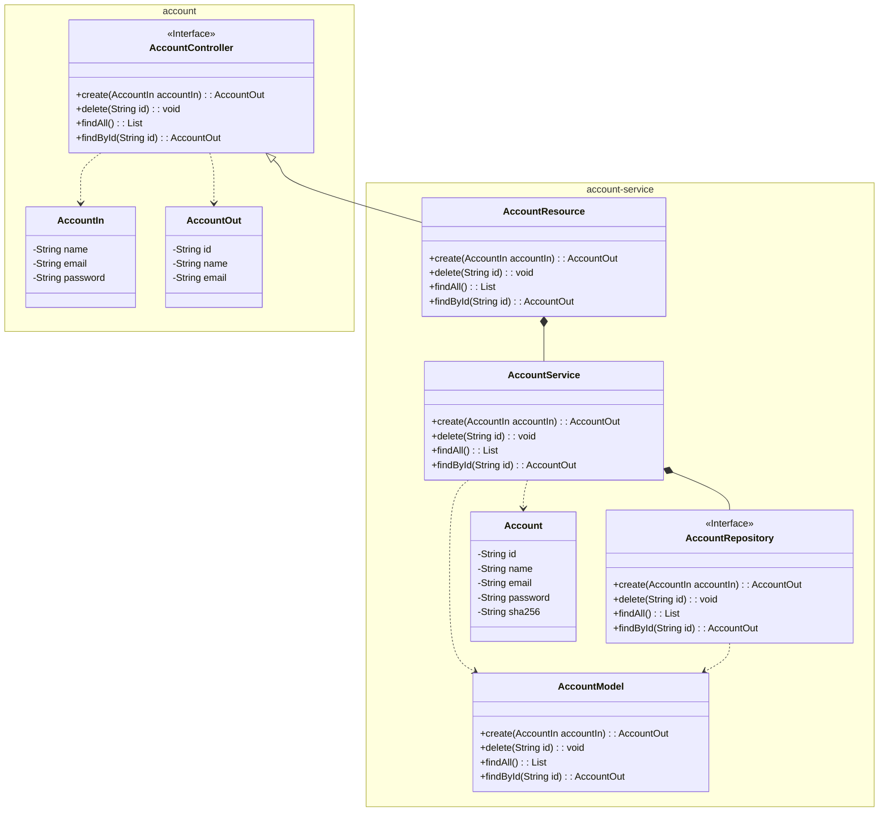
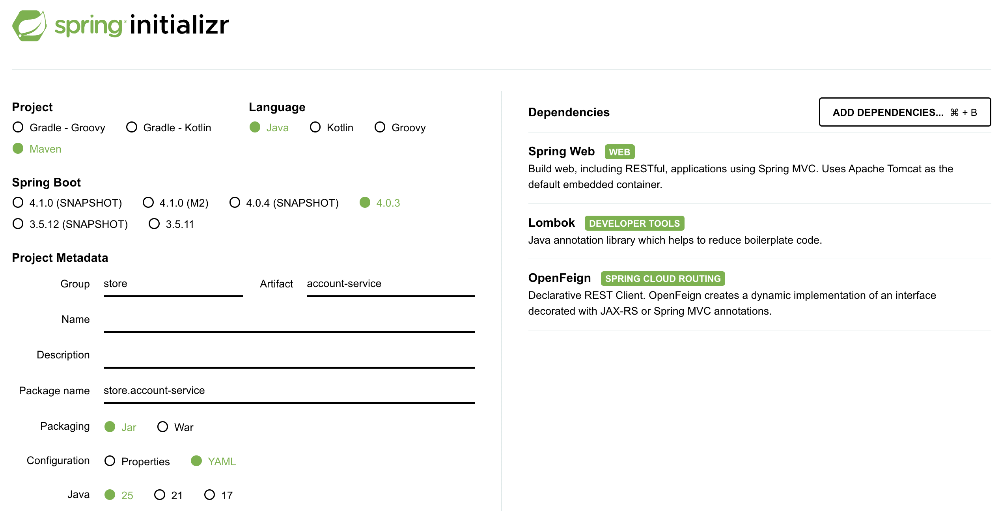

A implementação do microsserviço Account é definida no módulo `account-service`, que contém a implementação da API definida no módulo `account`, além do acesso ao banco de dados e da lógica de negócio do microsserviço Account. 



## 1. Repositório

Crie no GitHub o repositório da implementação do Account e clone-o como um submódulo na sua máquina local;

``` bash
git submodule add <repository_url> api/account-service
```

``` tree
api/
    account/
    account-service/
```

## 2. Código

Agora, vamos codificar a implementação do microsserviço Account, que é composta de várias classes. A estrutura de diretórios resultante ficará assim:

``` tree
api/
    account-service/
        src/
            main/
                java/
                    store/
                        account/
                            AccountApplication.java
                            AccountResource.java
                resources/
                    application.yaml
        pom.xml
```

| Classe | Descrição |
| --- | --- |
| `AccountResource` | Esta classe é responsável pelos endpoints da API do microsserviço Account: ela implementa a interface `AccountController`, definida no módulo `account`, e usa o `AccountService` para tratar a lógica de negócio dos endpoints. |
| `AccountApplication` | Esta é a classe principal do microsserviço Account, responsável por executar a aplicação Spring Boot. Ela contém o método `main`, que é o ponto de entrada da aplicação. |

Para codificar esse microsserviço, vamos usar o framework Spring Boot por meio do Spring Initializr, em [https://start.spring.io/], uma ferramenta web que permite gerar um projeto Spring Boot com as dependências e configurações necessárias. 

<figure>
    
    <figcaption>Spring Initializr</figcaption>
</figure>

Observe:

- Project: Maven
- Language: Java
- Spring Boot: 4.0.3 (versão estável no momento)
- Group: store (o nome da empresa, por exemplo)
- Artifact: account-service (o nome da implementação)
- Package name: store.account
- Packaging: Jar
- Configuration: YAML
- Java: 25 (versão LTS no momento)

Além disso, precisamos adicionar as seguintes dependências:

- *Spring Web*: uma dependência que permite criar web services RESTful com o framework Spring. Ela fornece as ferramentas e bibliotecas necessárias para tratar requisições e respostas HTTP, além de definir endpoints e controllers da API.

- *Lombok*: uma biblioteca Java que ajuda a reduzir código repetitivo (boilerplate), gerando getters, setters, construtores e outros métodos comuns em tempo de compilação por meio de anotações.

- *OpenFeign*: um cliente declarativo de web services que simplifica o processo de fazer requisições HTTP a outros microsserviços. Ele permite definir interfaces para os nossos clientes de API e gera automaticamente a implementação em tempo de execução.

Por enquanto, vamos criar apenas as classes `AccountResource` e `AccountApplication` e o arquivo de configuração `application.yaml`. A lógica de negócio e a persistência dos dados serão implementadas nas próximas seções.

No `AccountResource.java`, o único endpoint implementado por enquanto é o `health-check`, um endpoint simples que retorna o código de status `200 OK`, indicando que o microsserviço está no ar e funcionando.

!!! example "Código-fonte"

    === "pom.xml"

        ``` { .yaml .copy .select linenums="1" hl_lines="40-44"}
        --8<-- "docs/2026.1/hands-on/1/service/code/pom.xml"
        ```

    === "application.yaml"

        ``` { .yaml .copy .select linenums="1" }
        --8<-- "docs/2026.1/hands-on/1/service/code/application.yaml"
        ```

    === "AccountApplication.java"

        ``` { .java .copy .select linenums='1' }
        --8<-- "docs/2026.1/hands-on/1/service/code/AccountApplication.java"
        ```

    === "AccountResource.java"

        ``` { .java .copy .select linenums='1' hl_lines="23-26"}
        --8<-- "docs/2026.1/hands-on/1/service/code/AccountResource.java"
        ```


## 3. Empacotar e executar

``` { bash }
mvn clean package
java -jar target/account-service-1.0.0.jar
```

ou

``` { bash }
mvn clean package spring-boot:run
```

Verifique a saúde do microsserviço enviando uma requisição GET para o endpoint `health-check`:

``` { bash }
curl -X GET http://localhost:8080/health-check
```

Se tudo estiver funcionando corretamente, você deve receber o código de status `200 OK` na resposta, indicando que o microsserviço está no ar e funcionando.

---

Pronto! O microsserviço Account agora está pronto para ser usado no projeto.

Vamos para a próxima seção, na qual vamos containerizar o microsserviço Account com Docker e executá-lo com o Docker Compose.

[Containerização](../containerization/){ .md-button .md-button }
