As práticas de [DevOps](https://en.wikipedia.org/wiki/DevOps){:target="_blank"} buscam encurtar o ciclo de vida de desenvolvimento de software automatizando as etapas de build, teste e deploy. Duas práticas fundamentais sustentam essa automação[^1]:

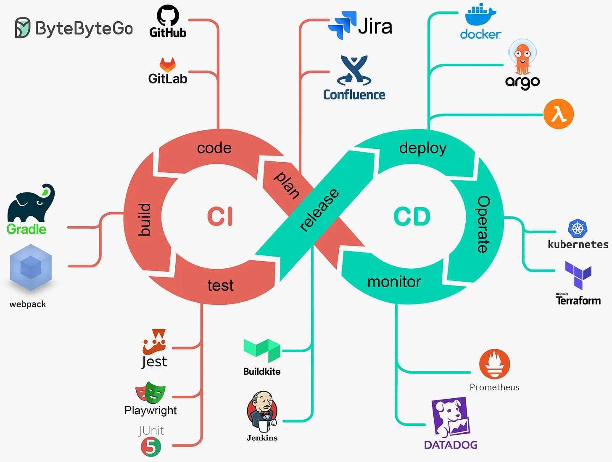
<small>Visão geral de CI/CD. Fonte: [ByteByteGo - A Crash Course in CI/CD](https://blog.bytebytego.com/p/a-crash-course-in-cicd){:target="_blank"}</small>

- **Integração Contínua (CI)** — os desenvolvedores fazem merge de mudanças com frequência; cada merge dispara um ciclo automatizado de build e teste.
- **Entrega Contínua (CD)** — toda mudança que passa pela CI é empacotada automaticamente e fica pronta para o deploy em qualquer ambiente.

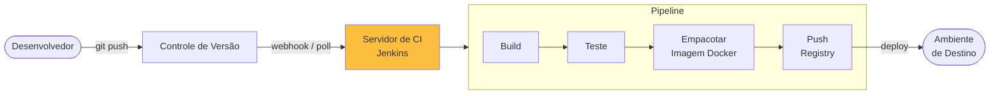

O [Jenkins](https://www.jenkins.io/){:target="_blank"} é um dos servidores de automação open source mais adotados. Ele orquestra pipelines de CI/CD por meio de um rico ecossistema de plugins e suporta **Pipeline as Code** — definições de pipeline versionadas no repositório, junto com o código da aplicação, em um arquivo chamado `Jenkinsfile`[^2].

## 1. Configuração — Jenkins em container

Executar o Jenkins dentro do Docker mantém a máquina hospedeira limpa e torna o ambiente reproduzível entre máquinas.

!!! info "Código-fonte"

    ``` { .tree .copy .select }
    api/
    jenkins/
        compose.yaml
    ```

    ``` { .yaml .copy .select linenums="1" title="compose.yaml" }
    --8<-- "docs/2026.1/hands-on/4/jenkins/code/compose.yaml"
    ```

O `compose.yaml` constrói uma imagem personalizada sobre `jenkins/jenkins:jdk25`, com ferramentas extras pré-instaladas:

| Ferramenta | Finalidade |
|---|---|
| Maven | Fazer o build de projetos Java |
| Docker CE | Construir e publicar imagens de container a partir dos pipelines |
| kubectl | Fazer o deploy em clusters Kubernetes |
| AWS CLI | Interagir com serviços da AWS (ECR, ECS, EKS …) |

O processo do Jenkins é adicionado ao grupo `docker` para que os pipelines possam executar comandos `docker` sem precisar de root. Para isso, o socket do Docker do host (`/var/run/docker.sock`) é montado (bind mount) dentro do container[^3].

!!! warning "Segurança do socket do Docker"
    Montar `/var/run/docker.sock` dá ao container controle total sobre o daemon Docker do host. Isso é aceitável em desenvolvimento local, mas deve ser reforçado (por exemplo, com Docker rootless ou um daemon de build dedicado) em ambientes compartilhados ou de produção.

**Inicie o servidor:**

``` { .bash .select }
jenkins/# docker compose up -d --build

[+] Running 2/2
 ✔ jenkins Created              0.1s
 ✔ Container jenkins Started    0.2s
```

O Jenkins agora está disponível em [http://localhost:9080/](http://localhost:9080/){target="_blank"}.

## 2. Configuração inicial

### Desbloqueie o Jenkins

Na primeira inicialização, o Jenkins gera uma *senha inicial de administrador* aleatória para impedir acessos não autorizados[^4]. Abra a interface e informe-a quando solicitado:

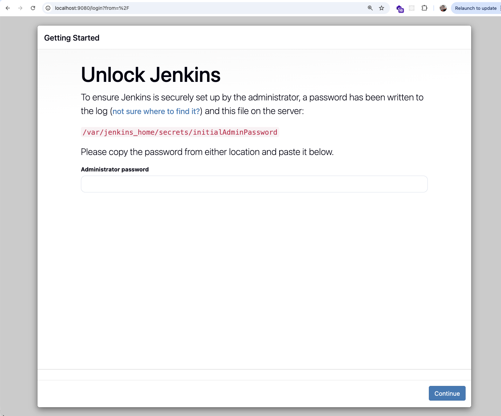{width=100%}

Recupere a senha com um dos comandos:

=== "Pelos logs do container"

    ``` { .bash .select }
    docker logs jenkins 2>&1 | grep -A 3 "initialAdminPassword"
    ```

=== "Pelo arquivo de segredos"

    ``` { .bash .select }
    docker exec jenkins cat /var/jenkins_home/secrets/initialAdminPassword
    ```

!!! warning "Windows — execute como Administrador"
    Abra o terminal como **Administrador** para evitar erros de permissão ao ler o diretório de segredos do Jenkins.

    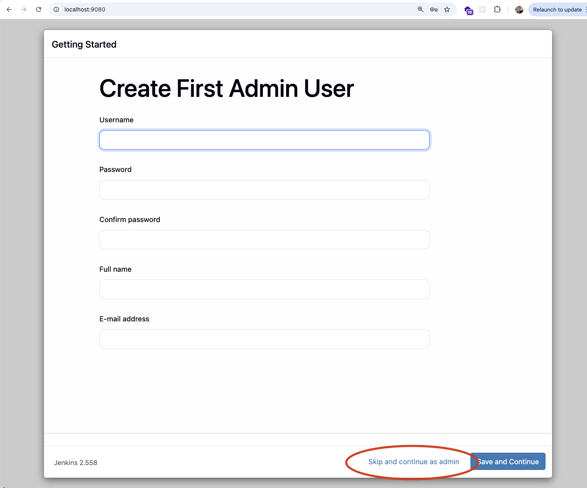{width=100%}

Depois de informar a senha, escolha **Install suggested plugins** e crie um usuário administrador.

### Número de executores

Um *executor* é um slot onde o Jenkins executa uma etapa (stage) de pipeline ou um job. O padrão é 2; aumentar esse número permite que vários jobs rodem em paralelo, o que é útil ao fazer o build de vários microsserviços na mesma instância.

**Manage Jenkins → Nodes → Built-In Node → Configure → Number of executors → 10**

=== "Nodes"

    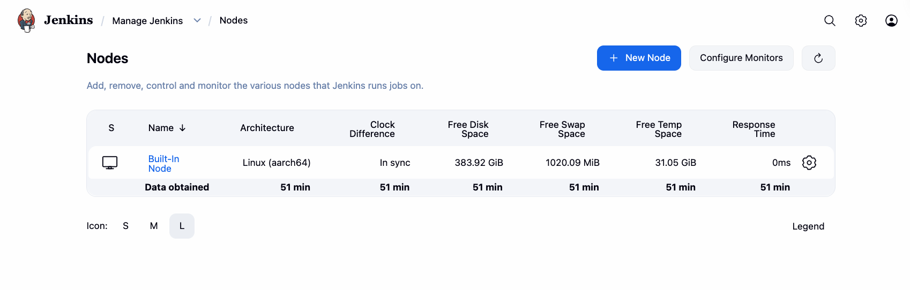

=== "Configure"

    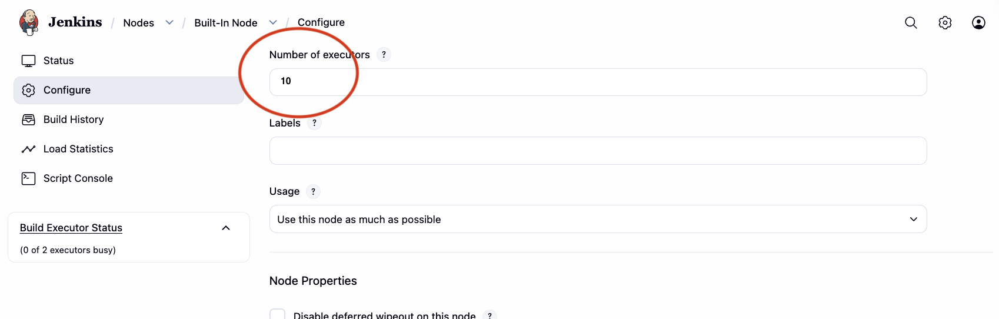

## 3. Credenciais

Antes de criar pipelines que publicam imagens Docker, armazene o segredo do Docker Hub no repositório de credenciais do Jenkins. As credenciais são injetadas nos pipelines em tempo de execução — nunca são gravadas em disco nem aparecem nos logs[^5].

**Manage Jenkins → Credentials → System → Global credentials → Add Credentials**

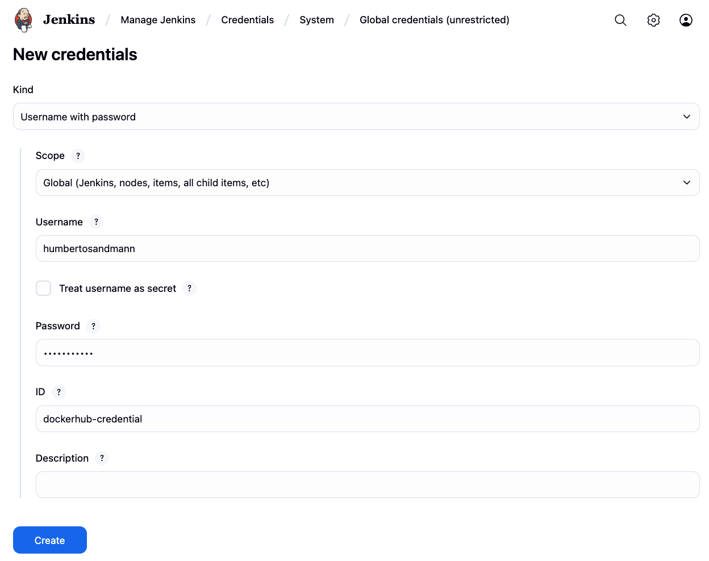{width=100%}

| Campo | Valor |
|---|---|
| Kind | Username with password |
| Username | Seu usuário do Docker Hub |
| Password | Access token do Docker Hub (veja a dica abaixo) |
| ID | `dockerhub-credential` |

!!! tip "Use access tokens, não a senha da sua conta"
    Crie um token dedicado com escopo **Read & Write** em **Docker Hub → Account Settings → Security → Access Tokens**. Se o token for comprometido, você pode revogá-lo sem mexer na senha da sua conta[^6].

## 4. Pipeline as Code

Um `Jenkinsfile` descreve o pipeline em uma DSL declarativa e fica na raiz do repositório. O Jenkins faz o checkout dele automaticamente quando um build é disparado, de modo que o pipeline evolui junto com o código[^7].

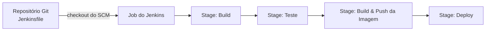

O Jenkins suporta duas sintaxes de pipeline:

| Sintaxe | Descrição |
|---|---|
| **Declarative** | DSL estruturada e opinativa — recomendada para a maioria dos projetos |
| **Scripted** | Groovy completo — máxima flexibilidade, curva de aprendizado mais íngreme |

Os exemplos abaixo usam a sintaxe **declarativa**.


## 5. Exemplos

### `account` — Apenas build

O primeiro pipeline compila o módulo `account` e gera o artefato:


!!! info "Código-fonte"

    ``` { .tree .copy .select }
    api/
        account/
            Jenkinsfile
    ```

    ``` { .groovy .copy .select linenums="1" title="Jenkinsfile" }
    --8<-- "docs/2026.1/hands-on/4/jenkins/code/Jenkinsfile.account"
    ```

A única etapa, `Build`, executa `mvn -B -DskipTests clean install`. A flag `-B` habilita o *batch mode* (sem prompts interativos), o que é necessário em ambientes de CI não interativos.

**Criando um job**

=== "Novo item"

    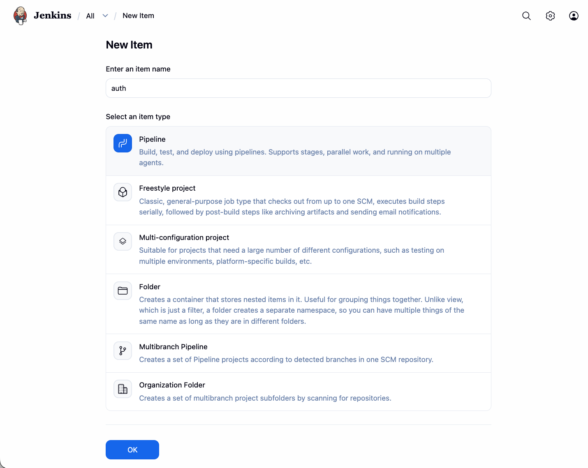

=== "Configurar o pipeline"

    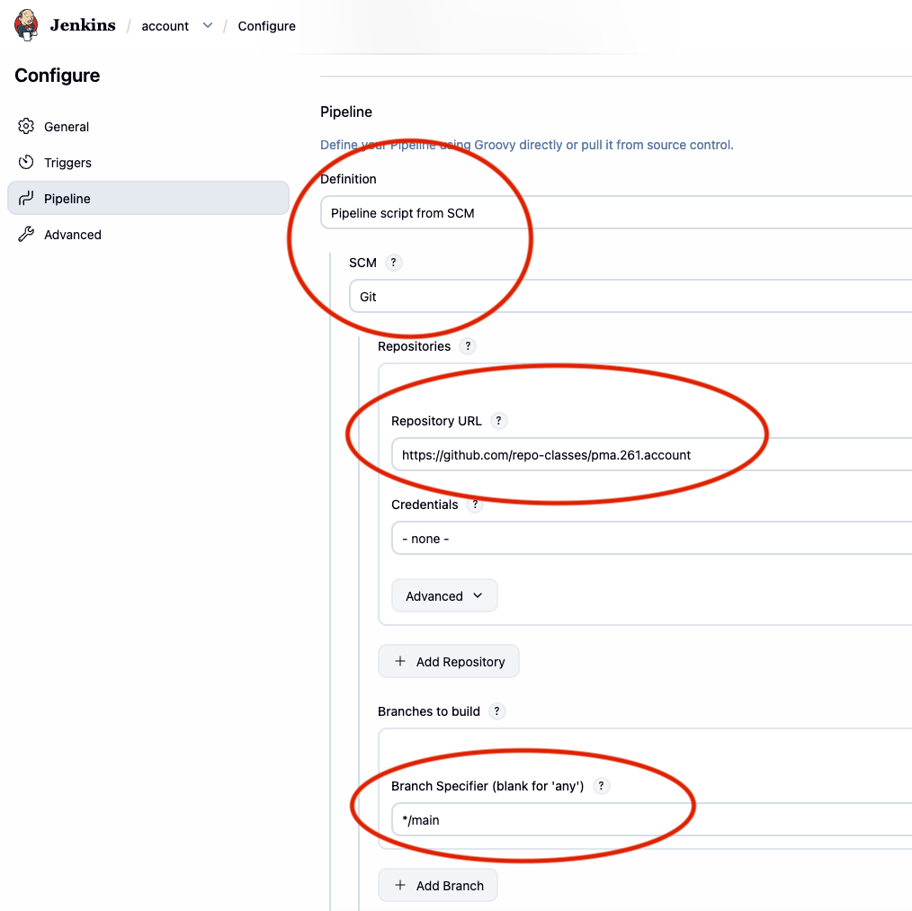

Crie um **New Item**, escolha o tipo **Pipeline** e defina a *Definition* como **Pipeline script from SCM**. O Jenkins vai clonar o repositório e ler o `Jenkinsfile` a cada build.

### `account-service` — Build, empacotamento e push

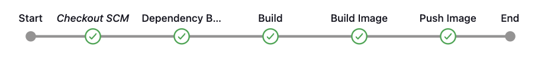{width=100%}

Um pipeline completo que faz o build do serviço, cria uma imagem Docker multiplataforma e a publica no Docker Hub:

!!! info "Código-fonte"

    ``` { .tree .copy .select }
    api/
        account-service/
            Jenkinsfile
    ```

    ``` { .groovy .copy .select linenums="1" title="Jenkinsfile" }
    --8<-- "docs/2026.1/hands-on/4/jenkins/code/Jenkinsfile.account-service"
    ```

#### Passo a passo

**Bloco `environment`**

```groovy
environment {
    SERVICE = 'account'
    NAME    = "humbertosandmann/${env.SERVICE}"
}
```

Declara duas variáveis válidas em todo o pipeline. `NAME` é o nome completo do repositório no Docker Hub. Referenciar `env.SERVICE` dentro de `NAME` evita duplicar o nome do serviço.

---

**Etapa `Dependencies`**

```groovy
stage('Dependencies') {
    steps {
        build job: 'account', wait: true
    }
}
```

Dispara jobs upstream do Jenkins antes de prosseguir. `wait: true` bloqueia até que cada job termine com sucesso, garantindo que os artefatos das dependências estejam atualizados antes do build do serviço atual.

---

**Etapa `Build`**

```groovy
sh 'mvn -B -DskipTests clean package'
```

Compila o projeto e gera o JAR executável. Os testes são pulados intencionalmente aqui — adicione uma etapa `Test` separada com `mvn test` se quiser que o pipeline exija a aprovação nos testes.

---

**Etapa `Build & Push Image`**

```groovy
withCredentials([usernamePassword(
    credentialsId: 'dockerhub-credential',
    usernameVariable: 'USERNAME',
    passwordVariable: 'TOKEN')]) {

    sh "docker login -u $USERNAME -p $TOKEN"
    sh "docker buildx create --use \
          --platform=linux/arm64,linux/amd64 \
          --node multi-platform-builder-${env.SERVICE} \
          --name multi-platform-builder-${env.SERVICE}"
    sh "docker buildx build \
          --platform=linux/arm64,linux/amd64 \
          --push \
          --tag ${env.NAME}:latest \
          --tag ${env.NAME}:${env.BUILD_ID} \
          -f Dockerfile ."
    sh "docker buildx rm --force multi-platform-builder-${env.SERVICE}"
}
```

- **`withCredentials`** — injeta no ambiente de build o token do Docker Hub armazenado no passo 3. Os valores são mascarados em todos os logs do Jenkins[^5].
- **`docker buildx`** — cria um builder *BuildKit* que faz a compilação cruzada de imagens tanto para `linux/arm64` (Apple Silicon, AWS Graviton) quanto para `linux/amd64` (x86-64 padrão)[^8].
- **Duas tags** — `:latest` oferece uma referência estável; `:<BUILD_ID>` fixa um build específico do Jenkins, de modo que qualquer imagem possa ser rastreada até o commit de origem.
- A instância do builder é removida após o push para liberar recursos do sistema.


[^1]: HUMBLE, J.; FARLEY, D. *Continuous Delivery: Reliable Software Releases through Build, Test, and Deployment Automation*. Addison-Wesley, 2010.

[^2]: [Jenkins — Pipeline overview](https://www.jenkins.io/doc/book/pipeline/){:target="_blank"}. Documentação do Jenkins.

[^3]: MERKEL, D. Docker: Lightweight Linux containers for consistent development and deployment. *Linux Journal*, 2014. Veja também a [Docker socket documentation](https://docs.docker.com/engine/reference/commandline/dockerd/#daemon-socket-option){:target="_blank"}.

[^4]: [Jenkins — Initial setup](https://www.jenkins.io/doc/book/installing/docker/#setup-wizard){:target="_blank"}. Documentação do Jenkins.

[^5]: [Jenkins — Using credentials](https://www.jenkins.io/doc/book/using/using-credentials/){:target="_blank"}. Documentação do Jenkins.

[^6]: [Docker Hub — Access tokens](https://docs.docker.com/docker-hub/access-tokens/){:target="_blank"}. Documentação do Docker.

[^7]: [Jenkins — Pipeline as Code](https://www.jenkins.io/doc/book/pipeline/pipeline-as-code/){:target="_blank"}. Documentação do Jenkins.

[^8]: [Docker Buildx — Multi-platform images](https://docs.docker.com/build/building/multi-platform/){:target="_blank"}. Documentação do Docker.
