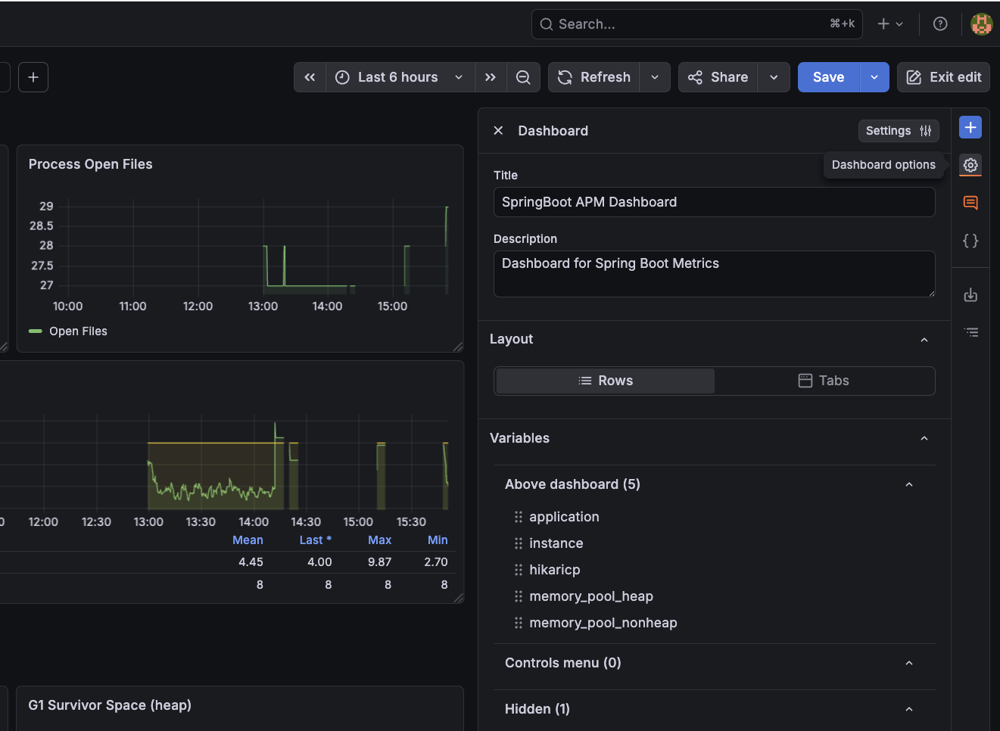
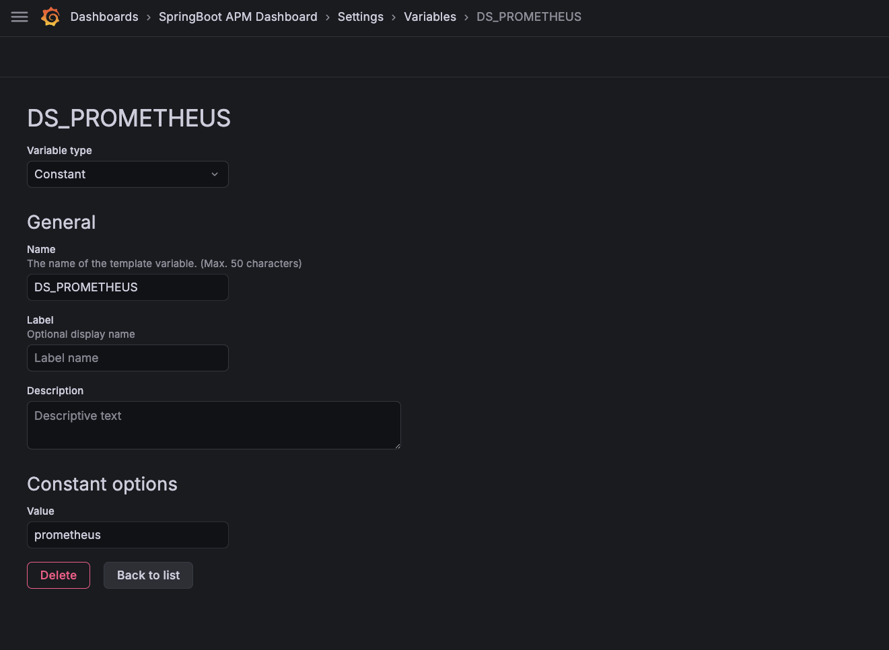

O [Grafana](https://grafana.com){target="_blank"} se conecta ao Prometheus como datasource e oferece dashboards ricos e interativos para visualizar as métricas coletadas.

Crie o arquivo de provisionamento do datasource em `setup/grafana/provisioning/datasources/datasources.yml`:

``` { .yaml .copy .select linenums="1" title="datasources.yml" }
apiVersion: 1
datasources:
  - name: Prometheus
    type: prometheus
    uid: prometheus
    access: proxy
    url: http://prometheus:9090
    isDefault: true
```

O Grafana carrega esse arquivo automaticamente na inicialização, conectando-se à instância do Prometheus na rede interna do Docker — sem necessidade de configuração manual pela interface.

Com a stack em execução, abra o Grafana no navegador:

[http://localhost:3000/](http://localhost:3000/){target="_blank" .md-button}

Faça login com as credenciais padrão:

| Campo    | Valor   |
|----------|---------|
| Usuário  | `admin` |
| Senha    | `admin` |

!!! tip "Marketplace de dashboards"

    O Grafana oferece uma grande biblioteca de dashboards prontos para stacks comuns. Para métricas do Spring Boot e do Micrometer, um bom ponto de partida é o dashboard **JVM (Micrometer)** (ID `4701`) ou o **SpringBoot APM Dashboard** (ID `12900`).

    Para importá-lo: vá em **Dashboards → Import**, informe o ID `4701` ou `12900` e selecione o datasource do Prometheus.

    Navegue pela biblioteca completa em [grafana.com/grafana/dashboards](https://grafana.com/grafana/dashboards/){target="_blank"}.

    Para que esses dashboards funcionem corretamente, garanta que o datasource do Prometheus provisionado esteja selecionado para a variável `DS_PROMETHEUS`. Para definir essa variável, vá em **Dashboard -> Edit -> Dashboard Options**:

    

    Clique em **Settings** e vá até a aba **Variables**. Crie uma nova variável constante chamada `DS_PROMETHEUS`, defina seu tipo como `Constant` e seu valor como `prometheus` (o uid definido em `datasources.yml`):

    

    Salve o dashboard e você verá todas as métricas começarem a ser preenchidas imediatamente. Explore os vários painéis para monitorar, em tempo real, taxas de requisições, uso de memória da JVM, latências de resposta e taxas de erro em toda a plataforma.
