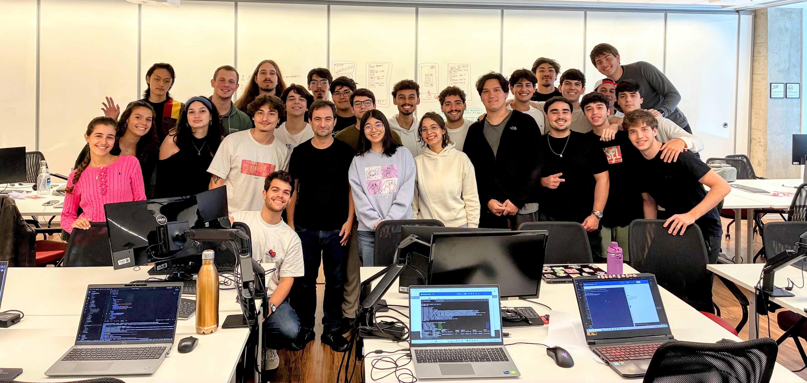

{ .rounded-corners }

## Encontros

| :octicons-location-24: | :fontawesome-regular-calendar: | :fontawesome-regular-clock: |
|-|:-:|:-:|
| Aula | Qua. | 12h00 :fontawesome-solid-arrow-right-long: 14h00 |
| Aula | Sex. | 12h00 :fontawesome-solid-arrow-right-long: 14h00 |
| Atendimento | Ter. | 12h00 :fontawesome-solid-arrow-right-long: 13h30 |


## Professores

<div class="grid cards" markdown>

-   :material-account-tie:{ .lg .middle } **Professor**

    ---

    **Humberto Sandmann**

    [:material-web:](https://hsandmann.github.io/){:target="_blank"}
    [:simple-github:](https://github.com/hsandmann){:target="_blank"}
    [:material-linkedin:](https://www.linkedin.com/in/hsandmann/){:target="_blank"}

-   :material-school:{ .lg .middle } **Monitor**

    ---

    **Lucas Abatepietro**

    [:simple-github:](https://github.com/luabatepietro){:target="_blank"}
    [:material-linkedin:](https://www.linkedin.com/in/lucas-abatepietro-286a03270/){:target="_blank"}

</div>


## Estudantes

<iframe src="https://docs.google.com/spreadsheets/d/e/2PACX-1vS3EF2nfXJsWgxtRItuWLGoA653AQOJACsYEIbut9if2qXwGpNi9HD8gRAiaWs7OT1ms0nWLzX50e7W/pubhtml?gid=1397413588&&amp;single=false&amp;widget=false&amp;headers=false" width="100%" height="750px"></iframe>


## Avaliação

$$
\text{Nota Final} = \left\{\begin{array}{lll}
    \text{Individual} \geq 5 \bigwedge \text{Equipe} \geq 5 &
    \implies &
    \displaystyle \frac{ \text{Individual} + \text{Equipe} } {2}
    \\
    \\
    \text{Caso contrário} &
    \implies &
    \min\left(\text{Individual}, \text{Equipe}\right)
    \end{array}\right.
$$

```python exec="1" html="1"
--8<-- "docs/2026.1/grade.py"
```

1. **Quizzes**: a disciplina terá 3 quizzes, e o quiz com a menor nota será descartado. A nota final de quizzes será a média simples das duas melhores notas:

    $$
    \text{Quizzes} = \frac{\text{Q}_1 + \text{Q}_2 + \text{Q}_3 - \min(\text{Q}_1, \text{Q}_2, \text{Q}_3)}{2}
    $$

1. **Microsserviço**: os estudantes terão de implementar um microsserviço. A nota é dada por conceito, com base nas `Notas da Engenharia`:

    | Conceito | Nota |
    |:-:|:-:|
    | A (+) | 9 (10) |
    | B (+) | 7 (8) |
    | C (+) | 5 (6) |
    | D | 4 |
    | I | 0 |


1. **Equipe**: a equipe deve ser composta **por 2 a 3 integrantes**. A nota da equipe será a mesma para todos os integrantes e será baseada na entrega do projeto e na documentação.

    !!! warning "Cadastro dos grupos"

        :fontawesome-regular-calendar: Prazo para o cadastro: ==**6 de março de 2026**==.

        :material-account-group: Equipes de 2 a 3 integrantes.

        :material-github: Crie um repositório no GitHub para compartilhar o código e a documentação do projeto.

        :material-form-select: Formulário para cadastrar os grupos: [https://forms.gle/DoRxGcnx5vb5ggkYA](https://forms.gle/DoRxGcnx5vb5ggkYA){target="_blank"}.

        :material-cloud: Isto é ==OBRIGATÓRIO== para organizar as equipes e as contas da AWS.

    !!! tip "Nome do repositório"

        O nome do repositório deve ser algo profissional, por exemplo: `platform`, `microservices` etc.

        Além disso, o repositório deve estar vinculado aos autores no GitHub.


1. **Documentação**: a documentação do projeto será avaliada pela sua qualidade e completude. Ela deve ser completa e cobrir todos os aspectos do projeto, incluindo a arquitetura, as decisões de design, os detalhes de implementação e a estratégia de testes. A documentação deve ser clara, concisa e fácil de entender, bem estruturada e seguir as boas práticas de documentação de software. O objetivo da documentação é servir de portfólio sobre o tema para potenciais empregadores ou colaboradores.

    !!! warning "Requisitos da documentação"

        :fontawesome-regular-calendar: Prazo de entrega: ==**29 de maio de 2026**==.

        :material-github: A documentação do projeto DEVE ser hospedada no GitHub Pages e deve ser pública;

        :simple-materialformkdocs: O formato para publicar a documentação é o [mkdocs](https://www.mkdocs.org/){target="_blank"}, e a documentação deve ser publicada no GitHub Pages;

        :octicons-project-template-16: Um template baseado no [material](https://squidfunk.github.io/mkdocs-material/){target="_blank"} está disponível para ajudar na documentação: [template de entrega](https://hsandmann.github.io/documentation.template/){target="_blank"}.

    !!! tip "Template"

        Um template baseado no [material](https://squidfunk.github.io/mkdocs-material/){target="_blank"} está disponível para ajudar na documentação: [template de entrega](https://hsandmann.github.io/documentation.template/){target="_blank"}.

        1. Faça um fork do repositório do template;
        1. Clone o repositório do fork;
        1. Edite a documentação;
        1. Faça o push das alterações para o repositório do fork;
        1. Publique a documentação no GitHub Pages.

        Há instruções mais detalhadas em [Using this template](https://hsandmann.github.io/documentation.template/thisdocumentation/){target="_blank"}.


## Planejamento

<iframe src="https://docs.google.com/spreadsheets/d/e/2PACX-1vSyTlMWIk3iQTAM0Vy_X_GXwRu4miSBmRCHWxwTR-8cf0zAlWvcY1HsxCZxV6MRmflvbWh2gCKJ647F/pubhtml?widget=true&amp;headers=false" width="100%" height="600px"></iframe>


## Repositórios

Principal (raiz): 

[https://github.com/repo-classes/pma.261](https://github.com/repo-classes/pma.261){target="_blank"}

API:

| Microsserviço | Interface | Implementação |
|-|-|-|
| Account | [account](https://github.com/repo-classes/pma.261.account){target="_blank"} | [account-service](https://github.com/repo-classes/pma.261.account-service){target="_blank"} |
| Auth | [auth](https://github.com/repo-classes/pma.261.auth){target="_blank"} | [auth-service](https://github.com/repo-classes/pma.261.auth-service){target="_blank"} |
| Gateway |  | [gateway-service](https://github.com/repo-classes/pma.261.gateway-service){target="_blank"} |

Frontend:

[site](https://github.com/repo-classes/pma.261.site){target="_blank"}
