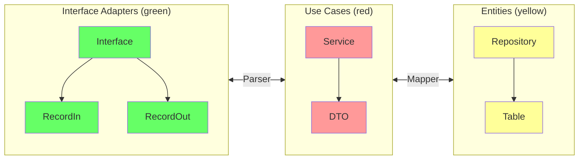
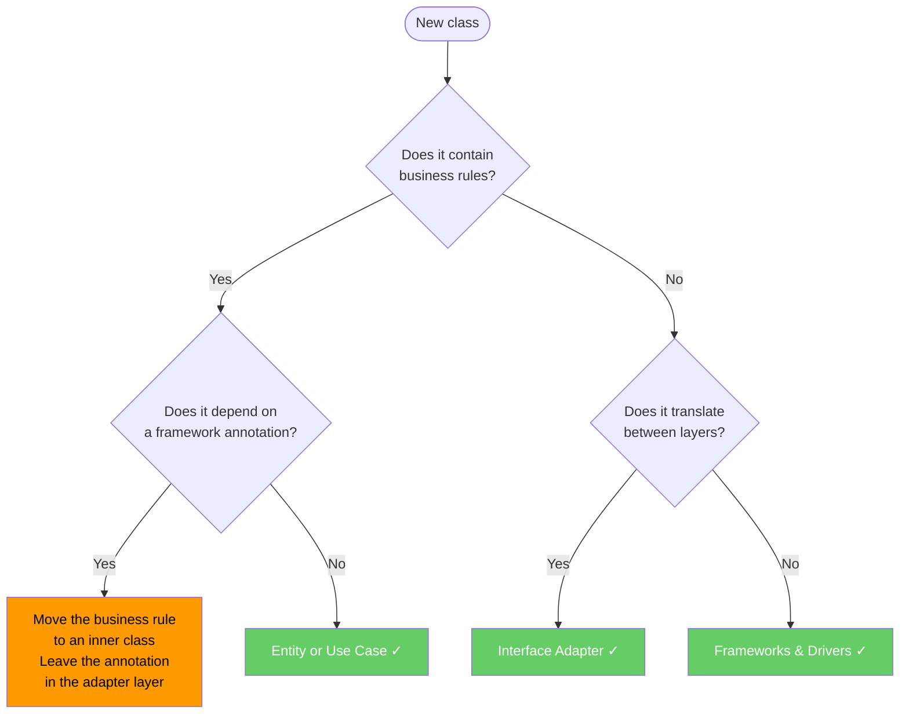
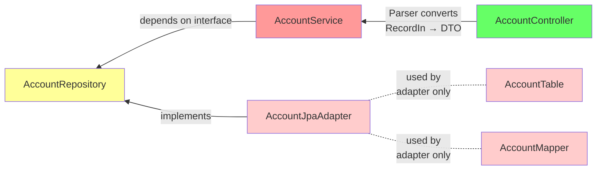
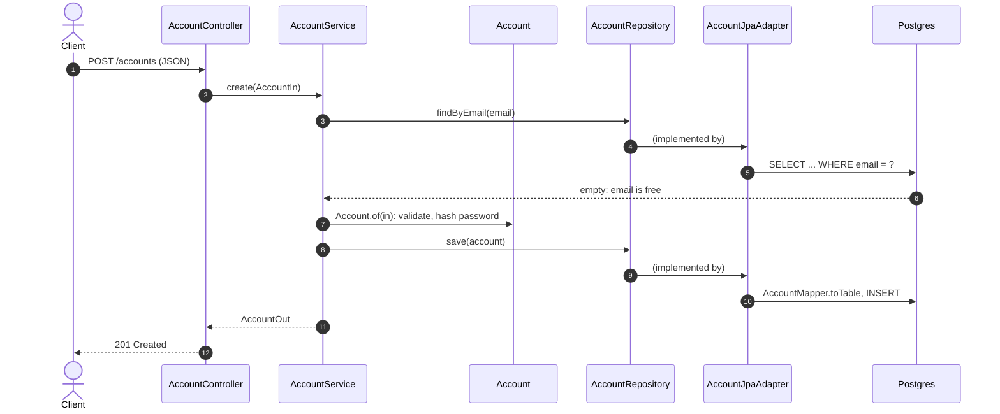

SOLID tells us how to design one class. But a service has dozens of classes, and the question becomes *where* each one goes and *which may import which*. In [Hands-on 1](../../../hands-on/1/index.md) the `account-service` already splits `AccountResource`, `AccountService`, `AccountRepository` and `AccountModel` — Clean Architecture is the set of rules that explains that split and keeps it from eroding as the service grows.

[Clean Architecture](https://blog.cleancoder.com/uncle-bob/2012/08/13/the-clean-architecture.html){:target="_blank"} was proposed by Robert C. Martin (Uncle Bob) in 2012 as a synthesis of several earlier architecture ideas — Hexagonal (Ports & Adapters), Onion, Screaming Architecture, DCI and BCE (Boundary–Control–Entity). Its central rule is the **Dependency Rule**: source-code dependencies must always point *inward*, toward higher-level policy[^1]. "Higher-level" means closer to the business and further from input/output devices.

<figure markdown>
  { width="80%" }
  <figcaption><i>Source: <a href="https://blog.cleancoder.com/uncle-bob/2012/08/13/the-clean-architecture.html" target="_blank">The Clean Code Blog — Robert C. Martin</a></i></figcaption>
</figure>

---

## Layers

| Layer | Also called | Responsibility |
|---|---|---|
| **Entities** | Domain | Enterprise-wide business rules and data structures. Independent of any application. |
| **Use Cases** | Application | Application-specific business rules. Orchestrates Entities; defines what the app *does*. |
| **Interface Adapters** | Adapters | Converts data between Use Cases and external formats: Controllers, Presenters, Gateways. |
| **Frameworks & Drivers** | Infrastructure | Web frameworks, databases, UI, external APIs. The outermost ring — all detail lives here. |

!!! info "The Dependency Rule"
    Nothing in an inner layer may reference anything in an outer layer. Data that crosses boundaries must be in simple structures — plain objects or records — **never** a framework type. An `@Entity` annotation or `HttpServletRequest` must never appear inside a Use Case or Entity class.

How can a Use Case save an account if it may not reference the database? Through **Dependency Inversion**: the Use Case declares the interface it needs (`AccountRepository`), and the outer layer implements it. At runtime the call goes *outward* (service → JPA → Postgres), but in the source code the dependency points *inward* (the JPA adapter imports the interface). This crossing of the boundary is the heart of the architecture.

### What belongs where

A practical heuristic for deciding which layer a class belongs to:

- **If it changes when the business changes** → Entity or Use Case
- **If it changes when the interface changes** (REST → gRPC, JSON → XML) → Interface Adapter
- **If it changes when a library is upgraded** (Spring Boot version, JPA dialect) → Frameworks & Drivers

---

## In our architecture

The diagram below shows how Clean Architecture layers map to the classes and packages used in the course's Spring Boot microservices:



The diagram is the course's simplified mapping. In Hands-on 1 the names are slightly different, and one shortcut is taken:

| Hands-on 1 class | Role in the diagram | Layer |
|---|---|---|
| `AccountController` (interface, in the `account` module) + `AccountResource` | Interface | Interface Adapters |
| `AccountIn`, `AccountOut` | RecordIn / RecordOut | Interface Adapters |
| `AccountParser` | Parser | boundary Adapters ↔ Use Cases |
| `AccountService` | Service | Use Cases |
| `Account` | DTO / domain object | Use Cases / Entities |
| `AccountRepository` (Spring Data `CrudRepository`) | Repository | persistence boundary |
| `AccountModel` (`@Entity`) | Table | persistence boundary |

!!! info "A pragmatic shortcut"
    In Hands-on 1, `AccountRepository` extends a Spring Data interface, so `AccountService` depends on a framework type — strictly, a violation of the Dependency Rule (see the *Leaking framework types inward* warning below). For a small CRUD service this is a reasonable trade: less code, and Spring Data is unlikely to be replaced. The [full example](#full-working-example) below shows the strict version, where the service depends on a plain interface and only the adapter knows JPA.

### Role of each component

**`RecordIn` / `RecordOut`**
: Input/output DTOs that live at the adapter boundary. They decouple the HTTP contract from the internal model, so changing a JSON field name or adding a validation annotation never touches the Use Case.

**`Parser`**
: Converts between `Record*` types and the Use Case DTOs. It is the only place that knows both worlds — keeping both sides of the boundary clean.

**`Service`**
: Implements the use-case logic. It depends only on repository *interfaces* declared in the Entities layer, never on JPA, Spring Data, or any other persistence detail.

**`Mapper`**
: Converts between Use Case DTOs and `@Entity` / `@Table` objects at the persistence boundary. The `@Entity` class — which carries ORM annotations — is confined to the Entities/Infrastructure boundary and never leaks into Service logic.

**`Repository`**
: A plain Java interface declared in the Entities layer. The JPA implementation (`AccountJpaAdapter`) lives in the outermost layer and is injected at runtime by Spring's dependency injection container.

### Suggested package layout

```
com.example.product/
├── domain/                  ← Entities layer
│   ├── Product.java         # Domain object (no framework annotations)
│   └── ProductRepository.java  # Repository interface (port)
├── application/             ← Use Cases layer
│   ├── ProductService.java  # Business logic
│   └── ProductDTO.java      # Data passed across the use-case boundary
├── adapter/                 ← Interface Adapters layer
│   ├── in/
│   │   ├── ProductController.java
│   │   ├── ProductRecordIn.java
│   │   └── ProductRecordOut.java
│   └── out/
│       ├── ProductJpaAdapter.java   # Implements ProductRepository
│       ├── ProductTable.java        # @Entity class
│       └── ProductMapper.java
```

---

## Practical benefits

**Testability without infrastructure**
: Business rules in the Use Case layer can be unit-tested with plain JUnit — no Spring context, no database, no web server. Mock the `Repository` interface and test the `Service` in milliseconds.

**Swappable delivery mechanism**
: The HTTP layer (REST, gRPC, GraphQL, CLI) can be swapped or run in parallel without touching the `Service` class. The adapter is the only thing that changes.

**Swappable persistence**
: Replace JPA with MongoDB, or an in-memory map for tests, by providing a new implementation of the `Repository` interface. The domain and application layers are unaffected.

**Parallel team work**
: Teams can develop the persistence adapter and the REST adapter independently, as long as they agree on the port interfaces. The `Service` can be developed — and fully tested — before any adapter exists.

---

## Where does this class belong?

A quick decision guide for placing a new class:



---

## Full working example

The files below show a complete `Account` microservice slice across all four layers, in the strict form. Notice that dependencies always point inward.



This is what happens, layer by layer, when a client calls `POST /accounts`:



The rule "email must be unique" lives in `AccountService` (an application rule); the rules "email must contain @" and "password has at least 8 characters" live in `Account` (domain invariants). Neither knows that Postgres exists. In this compact example, `AccountIn` and `AccountOut` are plain records used directly as the use case's input and output models, so no Parser is needed; add one when the HTTP contract and the use-case model start to differ.

=== "Account.java — domain entity"

    ``` { .java .copy .select linenums="1" }
    --8<-- "docs/2026.2/classes/architectures/clean/examples/Account.java"
    ```

=== "AccountRepository.java — port"

    ``` { .java .copy .select linenums="1" }
    --8<-- "docs/2026.2/classes/architectures/clean/examples/AccountRepository.java"
    ```

=== "AccountService.java — use case"

    ``` { .java .copy .select linenums="1" }
    --8<-- "docs/2026.2/classes/architectures/clean/examples/AccountService.java"
    ```

=== "AccountController.java — adapter in"

    ``` { .java .copy .select linenums="1" }
    --8<-- "docs/2026.2/classes/architectures/clean/examples/AccountController.java"
    ```

=== "AccountTable.java — @Entity"

    ``` { .java .copy .select linenums="1" }
    --8<-- "docs/2026.2/classes/architectures/clean/examples/AccountTable.java"
    ```

=== "AccountJpaAdapter.java — adapter out"

    ``` { .java .copy .select linenums="1" }
    --8<-- "docs/2026.2/classes/architectures/clean/examples/AccountJpaAdapter.java"
    ```

=== "AccountMapper.java — boundary converter"

    ``` { .java .copy .select linenums="1" }
    --8<-- "docs/2026.2/classes/architectures/clean/examples/AccountMapper.java"
    ```

---

## Common mistakes

!!! warning "Leaking framework types inward"
    Putting `@Entity`, `@Column`, `@JsonProperty`, or `HttpServletRequest` into a Use Case or Entity class violates the Dependency Rule immediately. The framework detail now dictates what the business rule looks like.

!!! warning "Fat controllers"
    Controllers that contain `if` statements, call multiple services, or orchestrate workflows have absorbed Use Case responsibilities. Controllers should translate and delegate — nothing more.

!!! warning "Anemic domain model"
    Entities that are pure data bags (only getters/setters) with all logic in the Service layer are a sign the layer boundary is not being used. Move invariant enforcement into the Entity — as `Account.of(...)` does with the email and password rules.

!!! warning "Mapping everything everywhere"
    Strict Clean Architecture means one model per layer and a mapper between each pair. In a CRUD service with no real business rules this is pure overhead. Keep the strict separation where the rules are, and accept shortcuts (like Hands-on 1's Spring Data repository) where they are not.

---

## Key takeaways

- The **Dependency Rule**: source code in an inner layer never references an outer layer; at runtime calls go outward, but compile-time dependencies point inward.
- Four rings: **Entities** (domain invariants), **Use Cases** (application rules), **Interface Adapters** (controllers, mappers), **Frameworks & Drivers** (Spring, JPA, the database).
- Crossing a boundary outward is done with **Dependency Inversion**: the inner layer declares the interface, the outer layer implements it.
- Framework types (`@Entity`, `HttpServletRequest`, Spring Data interfaces) stay in the outer rings; **Parsers and Mappers** translate at the boundaries.
- The payoff: use cases tested with plain JUnit, and delivery or persistence swapped without touching business rules. See [Hexagonal Architecture](../hexagonal/index.md) for the same idea seen from the boundary.

A step-by-step Spring Boot walkthrough of this architecture (in Portuguese) is available on video[^2].

---

[^1]: MARTIN, R. C. *Clean Architecture: A Craftsman's Guide to Software Structure and Design*. Prentice Hall, 2017. [:fontawesome-brands-amazon:](https://www.amazon.com.br/Clean-Architecture-Craftsmans-Software-Structure/dp/B075LRM681/){:target='_blank'}

[^2]: :fontawesome-brands-youtube:{ .youtube } [Criando um projeto Spring Boot com Arquitetura Limpa](https://youtu.be/hit0XHGt4WI){:target="_blank"} by [Giuliana Silva Bezerra](https://github.com/giuliana-bezerra){:target="_blank"}
