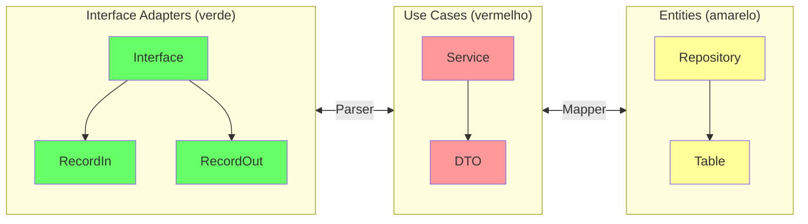
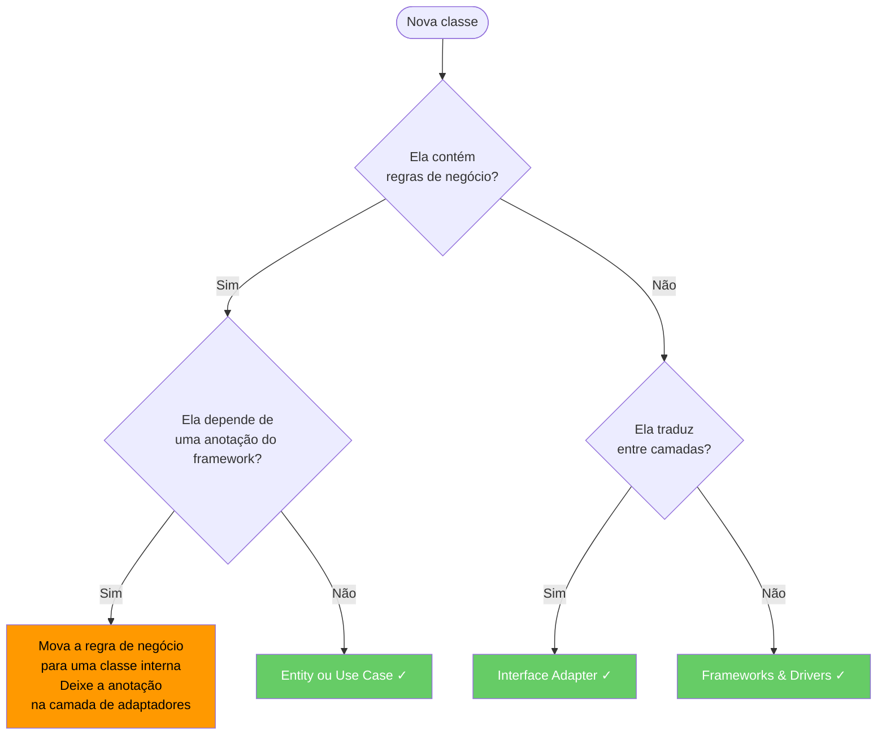
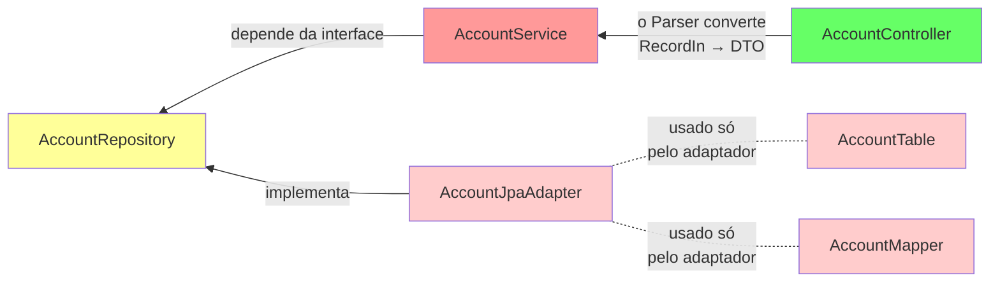
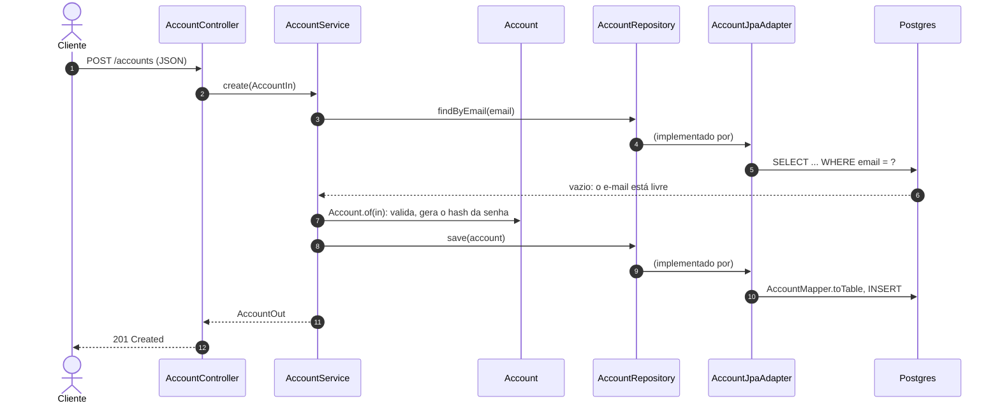

O SOLID nos diz como projetar uma classe. Mas um serviço tem dezenas de classes, e a pergunta passa a ser *onde* cada uma fica e *qual pode importar qual*. No [Hands-on 1](../../../hands-on/1/index.md), o `account-service` já separa `AccountResource`, `AccountService`, `AccountRepository` e `AccountModel` — a Clean Architecture é o conjunto de regras que explica essa separação e impede que ela se desgaste à medida que o serviço cresce.

A [Clean Architecture](https://blog.cleancoder.com/uncle-bob/2012/08/13/the-clean-architecture.html){:target="_blank"} (Arquitetura Limpa) foi proposta por Robert C. Martin (Uncle Bob) em 2012 como uma síntese de várias ideias de arquitetura anteriores — Hexagonal (Ports & Adapters), Onion, Screaming Architecture, DCI e BCE (Boundary–Control–Entity). A sua regra central é a **Regra de Dependência** (*Dependency Rule*): as dependências do código-fonte precisam sempre apontar *para dentro*, rumo às políticas de nível mais alto[^1]. "Nível mais alto" significa mais perto do negócio e mais longe dos dispositivos de entrada/saída.

<figure markdown>
  { width="80%" }
  <figcaption><i>Fonte: <a href="https://blog.cleancoder.com/uncle-bob/2012/08/13/the-clean-architecture.html" target="_blank">The Clean Code Blog — Robert C. Martin</a></i></figcaption>
</figure>

---

## Camadas

| Camada | Também chamada de | Responsabilidade |
|---|---|---|
| **Entities** (entidades) | Domínio | Regras de negócio e estruturas de dados de toda a empresa. Independentes de qualquer aplicação. |
| **Use Cases** (casos de uso) | Aplicação | Regras de negócio específicas da aplicação. Orquestram as Entities; definem o que a aplicação *faz*. |
| **Interface Adapters** (adaptadores de interface) | Adaptadores | Convertem dados entre os Use Cases e os formatos externos: Controllers, Presenters, Gateways. |
| **Frameworks & Drivers** | Infraestrutura | Frameworks web, bancos de dados, UI, APIs externas. O anel mais externo — todo detalhe mora aqui. |

!!! info "A Regra de Dependência"
    Nada em uma camada interna pode referenciar algo de uma camada externa. Os dados que atravessam as fronteiras precisam estar em estruturas simples — objetos simples ou records —, **nunca** em um tipo do framework. Uma anotação `@Entity` ou um `HttpServletRequest` nunca pode aparecer dentro de uma classe de Use Case ou de Entity.

Como um Use Case pode salvar uma conta se não pode referenciar o banco de dados? Por meio da **Inversão de Dependência**: o Use Case declara a interface de que precisa (`AccountRepository`), e a camada externa a implementa. Em tempo de execução, a chamada vai *para fora* (service → JPA → Postgres), mas no código-fonte a dependência aponta *para dentro* (o adaptador JPA importa a interface). Esse cruzamento da fronteira é o coração da arquitetura.

### O que vai onde

Uma heurística prática para decidir a que camada uma classe pertence:

- **Se ela muda quando o negócio muda** → Entity ou Use Case
- **Se ela muda quando a interface muda** (REST → gRPC, JSON → XML) → Interface Adapter
- **Se ela muda quando uma biblioteca é atualizada** (versão do Spring Boot, dialeto do JPA) → Frameworks & Drivers

---

## Na nossa arquitetura

O diagrama abaixo mostra como as camadas da Clean Architecture correspondem às classes e aos pacotes usados nos microsserviços Spring Boot do curso:



O diagrama é o mapeamento simplificado do curso. No Hands-on 1, os nomes são um pouco diferentes, e um atalho é tomado:

| Classe do Hands-on 1 | Papel no diagrama | Camada |
|---|---|---|
| `AccountController` (interface, no módulo `account`) + `AccountResource` | Interface | Interface Adapters |
| `AccountIn`, `AccountOut` | RecordIn / RecordOut | Interface Adapters |
| `AccountParser` | Parser | fronteira Adapters ↔ Use Cases |
| `AccountService` | Service | Use Cases |
| `Account` | DTO / objeto de domínio | Use Cases / Entities |
| `AccountRepository` (`CrudRepository` do Spring Data) | Repository | fronteira de persistência |
| `AccountModel` (`@Entity`) | Table | fronteira de persistência |

!!! info "Um atalho pragmático"
    No Hands-on 1, o `AccountRepository` estende uma interface do Spring Data, então o `AccountService` depende de um tipo do framework — a rigor, uma violação da Regra de Dependência (veja o alerta *Tipos do framework vazando para dentro* abaixo). Para um serviço CRUD pequeno, essa é uma troca razoável: menos código, e é improvável que o Spring Data seja substituído. O [exemplo completo](#full-working-example) abaixo mostra a versão estrita, em que o serviço depende de uma interface simples e só o adaptador conhece o JPA.

### Papel de cada componente

**`RecordIn` / `RecordOut`**
: DTOs de entrada/saída que vivem na fronteira dos adaptadores. Eles desacoplam o contrato HTTP do modelo interno, de modo que mudar o nome de um campo JSON ou adicionar uma anotação de validação nunca mexe no Use Case.

**`Parser`**
: Converte entre os tipos `Record*` e os DTOs do Use Case. É o único lugar que conhece os dois mundos — mantendo limpos os dois lados da fronteira.

**`Service`**
: Implementa a lógica do caso de uso. Depende apenas das *interfaces* de repositório declaradas na camada de Entities, nunca do JPA, do Spring Data ou de qualquer outro detalhe de persistência.

**`Mapper`**
: Converte entre os DTOs do Use Case e os objetos `@Entity` / `@Table` na fronteira de persistência. A classe `@Entity` — que carrega as anotações do ORM — fica confinada à fronteira Entities/Infraestrutura e nunca vaza para a lógica do Service.

**`Repository`**
: Uma interface Java simples, declarada na camada de Entities. A implementação JPA (`AccountJpaAdapter`) vive na camada mais externa e é injetada em tempo de execução pelo container de injeção de dependência do Spring.

### Estrutura de pacotes sugerida

```
com.example.product/
├── domain/                  ← Entities layer
│   ├── Product.java         # Domain object (no framework annotations)
│   └── ProductRepository.java  # Repository interface (port)
├── application/             ← Use Cases layer
│   ├── ProductService.java  # Business logic
│   └── ProductDTO.java      # Data passed across the use-case boundary
├── adapter/                 ← Interface Adapters layer
│   ├── in/
│   │   ├── ProductController.java
│   │   ├── ProductRecordIn.java
│   │   └── ProductRecordOut.java
│   └── out/
│       ├── ProductJpaAdapter.java   # Implements ProductRepository
│       ├── ProductTable.java        # @Entity class
│       └── ProductMapper.java
```

---

## Benefícios práticos

**Testabilidade sem infraestrutura**
: As regras de negócio da camada de Use Cases podem ser testadas com JUnit puro — sem contexto do Spring, sem banco de dados, sem servidor web. Faça um mock da interface `Repository` e teste o `Service` em milissegundos.

**Mecanismo de entrega substituível**
: A camada HTTP (REST, gRPC, GraphQL, CLI) pode ser trocada ou rodar em paralelo sem mexer na classe `Service`. O adaptador é a única coisa que muda.

**Persistência substituível**
: Troque o JPA pelo MongoDB, ou por um mapa em memória nos testes, fornecendo uma nova implementação da interface `Repository`. As camadas de domínio e de aplicação não são afetadas.

**Trabalho em paralelo entre times**
: Os times podem desenvolver o adaptador de persistência e o adaptador REST de forma independente, desde que concordem com as interfaces das portas. O `Service` pode ser desenvolvido — e totalmente testado — antes que qualquer adaptador exista.

---

## A que camada esta classe pertence?

Um guia rápido de decisão para posicionar uma nova classe:



---

## Exemplo completo { #full-working-example }

Os arquivos abaixo mostram uma fatia completa de um microsserviço `Account` atravessando as quatro camadas, na forma estrita. Repare que as dependências sempre apontam para dentro.



Veja o que acontece, camada por camada, quando um cliente chama `POST /accounts`:



A regra "o e-mail precisa ser único" vive no `AccountService` (uma regra da aplicação); as regras "o e-mail precisa conter @" e "a senha tem pelo menos 8 caracteres" vivem em `Account` (invariantes do domínio). Nenhuma delas sabe que o Postgres existe. Neste exemplo compacto, `AccountIn` e `AccountOut` são records simples usados diretamente como os modelos de entrada e saída do caso de uso, então nenhum Parser é necessário; adicione um quando o contrato HTTP e o modelo do caso de uso começarem a divergir.

=== "Account.java — entidade de domínio"

    ``` { .java .copy .select linenums="1" }
    --8<-- "docs/2026.2/classes/architectures/clean/examples/Account.java"
    ```

=== "AccountRepository.java — porta"

    ``` { .java .copy .select linenums="1" }
    --8<-- "docs/2026.2/classes/architectures/clean/examples/AccountRepository.java"
    ```

=== "AccountService.java — caso de uso"

    ``` { .java .copy .select linenums="1" }
    --8<-- "docs/2026.2/classes/architectures/clean/examples/AccountService.java"
    ```

=== "AccountController.java — adaptador de entrada"

    ``` { .java .copy .select linenums="1" }
    --8<-- "docs/2026.2/classes/architectures/clean/examples/AccountController.java"
    ```

=== "AccountTable.java — @Entity"

    ``` { .java .copy .select linenums="1" }
    --8<-- "docs/2026.2/classes/architectures/clean/examples/AccountTable.java"
    ```

=== "AccountJpaAdapter.java — adaptador de saída"

    ``` { .java .copy .select linenums="1" }
    --8<-- "docs/2026.2/classes/architectures/clean/examples/AccountJpaAdapter.java"
    ```

=== "AccountMapper.java — conversor de fronteira"

    ``` { .java .copy .select linenums="1" }
    --8<-- "docs/2026.2/classes/architectures/clean/examples/AccountMapper.java"
    ```

---

## Erros comuns

!!! warning "Tipos do framework vazando para dentro"
    Colocar `@Entity`, `@Column`, `@JsonProperty` ou `HttpServletRequest` em uma classe de Use Case ou de Entity viola imediatamente a Regra de Dependência. O detalhe do framework passa a ditar a forma da regra de negócio.

!!! warning "Controllers gordos"
    Controllers que contêm `if`s, chamam vários serviços ou orquestram fluxos absorveram responsabilidades de Use Case. Controllers devem traduzir e delegar — nada mais.

!!! warning "Modelo de domínio anêmico"
    Entidades que são puros sacos de dados (só getters/setters), com toda a lógica na camada de Service, são um sinal de que a fronteira entre camadas não está sendo usada. Leve a garantia das invariantes para a Entity — como faz `Account.of(...)` com as regras de e-mail e de senha.

!!! warning "Mapear tudo em todo lugar"
    A Clean Architecture estrita significa um modelo por camada e um mapper entre cada par. Em um serviço CRUD sem regras de negócio reais, isso é puro custo. Mantenha a separação estrita onde as regras estão, e aceite atalhos (como o repositório Spring Data do Hands-on 1) onde elas não estão.

---

## Pontos-chave

- A **Regra de Dependência**: o código-fonte de uma camada interna nunca referencia uma camada externa; em tempo de execução as chamadas vão para fora, mas as dependências de compilação apontam para dentro.
- Quatro anéis: **Entities** (invariantes do domínio), **Use Cases** (regras da aplicação), **Interface Adapters** (controllers, mappers), **Frameworks & Drivers** (Spring, JPA, o banco de dados).
- Cruzar uma fronteira para fora é feito com **Inversão de Dependência**: a camada interna declara a interface, a camada externa a implementa.
- Os tipos do framework (`@Entity`, `HttpServletRequest`, interfaces do Spring Data) ficam nos anéis externos; **Parsers e Mappers** traduzem nas fronteiras.
- O ganho: casos de uso testados com JUnit puro, e entrega ou persistência trocadas sem mexer nas regras de negócio. Veja a [Arquitetura Hexagonal](../hexagonal/index.md) para a mesma ideia vista a partir da fronteira.

Um passo a passo em Spring Boot desta arquitetura está disponível em vídeo[^2].

---

[^1]: MARTIN, R. C. *Clean Architecture: A Craftsman's Guide to Software Structure and Design*. Prentice Hall, 2017. [:fontawesome-brands-amazon:](https://www.amazon.com.br/Clean-Architecture-Craftsmans-Software-Structure/dp/B075LRM681/){:target='_blank'}

[^2]: :fontawesome-brands-youtube:{ .youtube } [Criando um projeto Spring Boot com Arquitetura Limpa](https://youtu.be/hit0XHGt4WI){:target="_blank"}, de [Giuliana Silva Bezerra](https://github.com/giuliana-bezerra){:target="_blank"}
