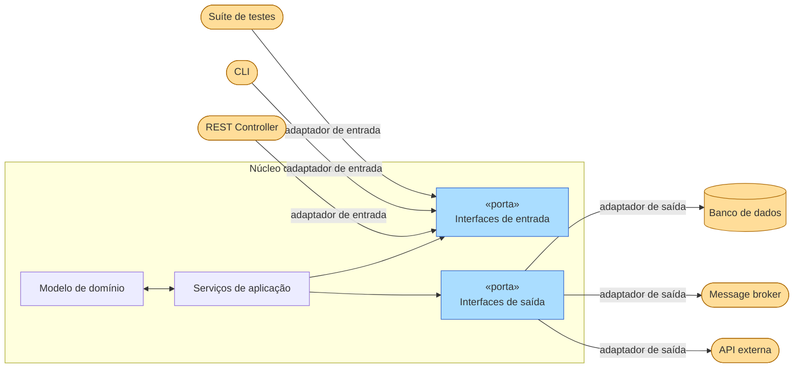
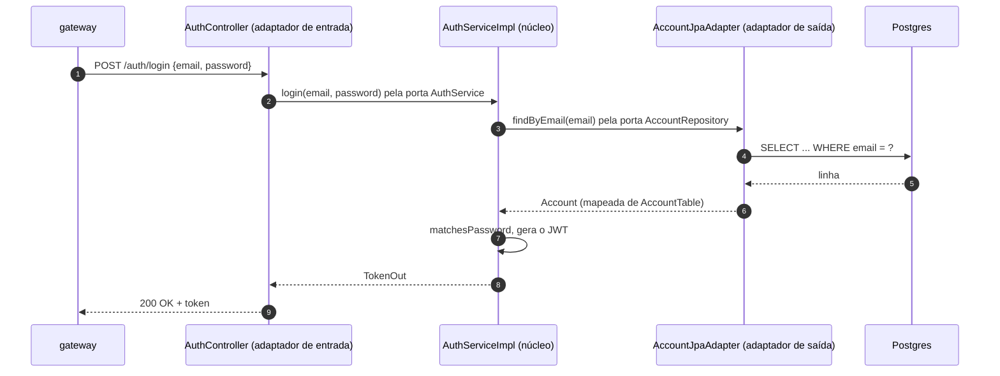
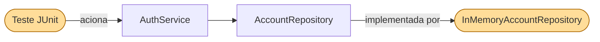

Olhe para o `auth-service` do [Hands-on 3](../../../hands-on/3/index.md) de fora. Ele é *chamado* pelo gateway via HTTP, e logo poderia ser chamado por um consumidor Kafka ou por uma ferramenta de linha de comando para administradores; os seus testes também querem chamá-lo. Ele *chama* outras coisas: o `account-service` via Feign, uma biblioteca de JWT, talvez o Redis para os tokens revogados. Os diagramas em camadas desenham o HTTP "em cima" e o banco de dados "embaixo", mas, para a lógica de negócio, eles são o mesmo tipo de coisa — **o mundo externo** — e cada um deles deveria ser substituível sem mexer nas regras de login.

A [Arquitetura Hexagonal](https://alistair.cockburn.us/hexagonal-architecture/){:target="_blank"} — também chamada de **Ports & Adapters** (portas e adaptadores) — foi apresentada por Alistair Cockburn em 2005. A ideia é colocar o núcleo da aplicação no centro e expô-lo por meio de *portas* (interfaces), às quais se conectam *adaptadores* externos. O formato de hexágono é arbitrário; ele indica que a aplicação tem vários pontos de entrada/saída equivalentes, sem nenhum lado privilegiado — não existe "em cima" e "embaixo", apenas **dentro** e **fora**[^1].



---

## Portas

Uma **porta** é uma interface pura — um contrato definido *pelo* núcleo da aplicação, e não pela tecnologia externa. Existem dois tipos:

| Tipo | Direção | Definida por | Implementada por | Exemplo |
|---|---|---|---|---|
| **Porta primária / de entrada** (*driving*) | Fora → Aplicação | A aplicação | A própria aplicação | Interface `AuthService` chamada pelo controller REST |
| **Porta secundária / de saída** (*driven*) | Aplicação → Fora | A aplicação | Um adaptador externo | `AccountRepository` implementada pelo adaptador JPA |

!!! info "A posse importa"
    Os dois tipos de porta *pertencem ao núcleo da aplicação e são definidos por ele*. O adaptador é a peça que vive do lado de fora e se encaixa na porta — **o núcleo nunca importa o adaptador**.

### Portas primárias (de entrada)

As portas primárias representam *o que a aplicação sabe fazer* — são a API dos casos de uso. Qualquer ator externo que queira interagir com a aplicação precisa passar por uma porta primária.

```java
// Defined inside the application core
public interface AuthService {
    TokenOut login(String email, String password);
    void logout(String token);
}
```

A implementação dessa interface também vive dentro do núcleo — é o serviço de aplicação:

```java
// Also inside the core — depends only on secondary ports
public class AuthServiceImpl implements AuthService {
    private final AccountRepository accounts; // ← secondary port
    private final JwtService jwt;

    @Override
    public TokenOut login(String email, String password) {
        Account account = accounts.findByEmail(email)
            .filter(a -> a.matchesPassword(password))
            .orElseThrow(InvalidCredentialsException::new);
        return new TokenOut(jwt.generate(account));
    }
}
```

### Portas secundárias (de saída)

As portas secundárias representam *o que a aplicação precisa* do mundo externo — persistência, mensageria, APIs externas. O núcleo define a interface; a infraestrutura fornece a implementação.

```java
// Defined inside the application core
public interface AccountRepository {
    Optional<Account> findByEmail(String email);
    Account save(Account account);
}
```

---

## Adaptadores

Um adaptador é uma classe que **traduz** entre uma tecnologia externa e o contrato de uma porta. Ele vive fora do núcleo e depende dele — nunca o contrário.

=== "Adaptador de entrada (REST)"

    ```java
    // Adapter: translates HTTP → primary port
    @RestController
    public class AuthController {
        private final AuthService authService; // ← primary port

        public AuthController(AuthService authService) {
            this.authService = authService;
        }

        @PostMapping("/auth/login")
        public ResponseEntity<TokenOut> login(@RequestBody LoginIn in) {
            TokenOut token = authService.login(in.email(), in.password());
            return ResponseEntity.ok(token);
        }
    }
    ```

=== "Adaptador de entrada (CLI)"

    ```java
    // Any driver can plug into the same primary port
    public class AuthCLI {
        private final AuthService authService;

        public void run(String[] args) {
            String email = args[0], password = args[1];
            TokenOut token = authService.login(email, password);
            System.out.println("Token: " + token.token());
        }
    }
    ```

=== "Adaptador de saída (JPA)"

    ```java
    // Adapter: translates secondary port → JPA
    @Repository
    public class AccountJpaAdapter implements AccountRepository {

        private final AccountJpaRepository jpa;

        @Override
        public Optional<Account> findByEmail(String email) {
            return jpa.findByEmail(email).map(AccountMapper::toDomain);
        }

        @Override
        public Account save(Account account) {
            AccountTable table = AccountMapper.toTable(account);
            return AccountMapper.toDomain(jpa.save(table));
        }
    }
    ```

=== "Adaptador de saída (em memória / teste)"

    ```java
    // Swap the JPA adapter for a map in tests — no Spring context needed
    public class InMemoryAccountRepository implements AccountRepository {
        private final Map<String, Account> store = new HashMap<>();

        @Override
        public Optional<Account> findByEmail(String email) {
            return Optional.ofNullable(store.get(email));
        }

        @Override
        public Account save(Account account) {
            store.put(account.email(), account);
            return account;
        }
    }
    ```

<figure markdown>
  { width="80%" }
  <figcaption><i>Fonte: <a href="https://en.wikipedia.org/wiki/Hexagonal_architecture_(software)" target="_blank">Wikipedia — Hexagonal Architecture</a></i></figcaption>
</figure>

---

### Uma requisição atravessando o hexágono

Um login atravessa o hexágono duas vezes: entra por uma porta primária, sai por uma porta secundária e volta.



Troque o primeiro participante por um teste e o quarto por `InMemoryAccountRepository`, e o núcleo roda exatamente o mesmo código — essa é toda a ideia.

### Os serviços da loja como hexágonos

| Ator externo | Tipo | Adaptador na loja |
|---|---|---|
| Gateway chamando `POST /auth/login` | entrada | `AuthResource` / `AuthController` (REST) |
| Tópico Kafka `accounts` (veja o [Hands-on 9](../../../hands-on/9/index.md)) | entrada | um consumidor `@KafkaListener` |
| Teste JUnit | entrada | a própria classe de teste |
| `account-service` | saída | cliente Feign (`AccountController` no Hands-on 3) |
| Postgres | saída | `AccountJpaAdapter` |
| Redis (cache, tokens revogados) | saída | um adaptador Redis (veja o [Hands-on 8](../../../hands-on/8/index.md)) |
| Kafka (publicando `AccountCreated`) | saída | um adaptador com `KafkaTemplate` |

!!! info "O Hands-on 3 sob esta ótica"
    No Hands-on 3, o `AuthService` chama diretamente a interface Feign `AccountController`. Essa interface é definida pelo módulo de API `account`, e não pelo núcleo de auth — então a porta é moldada pelo serviço remoto, e uma mudança na API do `account` chega até a lógica de login. A versão hexagonal estrita declara uma pequena porta no núcleo de auth (por exemplo, `AccountLookup.findByEmail`) e transforma o cliente Feign em um adaptador por trás dela.

---

## Exemplo completo

Os arquivos abaixo mostram a fatia completa de autenticação do `auth-service`. Cada arquivo está anotado com a sua localização em relação à fronteira do hexágono.

=== "AuthService.java — porta primária"

    ``` { .java .copy .select linenums="1" }
    --8<-- "docs/2026.2/classes/architectures/hexagonal/examples/AuthService.java"
    ```

=== "AuthServiceImpl.java — implementação no núcleo"

    ``` { .java .copy .select linenums="1" }
    --8<-- "docs/2026.2/classes/architectures/hexagonal/examples/AuthServiceImpl.java"
    ```

=== "AccountRepository.java — porta secundária"

    ``` { .java .copy .select linenums="1" }
    --8<-- "docs/2026.2/classes/architectures/hexagonal/examples/AccountRepository.java"
    ```

=== "AuthController.java — adaptador de entrada"

    ``` { .java .copy .select linenums="1" }
    --8<-- "docs/2026.2/classes/architectures/hexagonal/examples/AuthController.java"
    ```

=== "AccountJpaAdapter.java — adaptador de saída"

    ``` { .java .copy .select linenums="1" }
    --8<-- "docs/2026.2/classes/architectures/hexagonal/examples/AccountJpaAdapter.java"
    ```

=== "InMemoryAccountRepository.java — adaptador de teste"

    ``` { .java .copy .select linenums="1" }
    --8<-- "docs/2026.2/classes/architectures/hexagonal/examples/InMemoryAccountRepository.java"
    ```

---

## Estratégia de testes

A principal lição da Arquitetura Hexagonal para os testes é que o **núcleo da aplicação pode ser totalmente testado sem nenhuma infraestrutura**. Substitua cada adaptador de saída por um stub em memória e acione a porta primária diretamente a partir de um teste.



``` { .java .copy .select linenums="1" title="AuthServiceTest.java" }
--8<-- "docs/2026.2/classes/architectures/hexagonal/examples/AuthServiceTest.java"
```

Sem `@SpringBootTest`, sem H2, sem porta 8080 — o teste roda em milissegundos e cobre a regra de negócio diretamente.

---

## Estrutura de pacotes sugerida

```
com.example.auth/
├── domain/                         ← Domain Model
│   └── Account.java                # Aggregate root — no framework annotations
├── application/                    ← Application Services + Ports
│   ├── AuthService.java            # Primary port (interface)
│   ├── AuthServiceImpl.java        # Primary port implementation
│   └── port/
│       └── AccountRepository.java  # Secondary port (interface)
├── adapter/
│   ├── in/
│   │   └── AuthController.java     # Driving adapter (REST)
│   └── out/
│       ├── AccountJpaAdapter.java  # Driven adapter (JPA)
│       ├── AccountTable.java       # @Entity — stays in the adapter
│       └── AccountMapper.java
```

---

## Erros comuns

!!! warning "Portas definidas pelo adaptador"
    Se a interface `AccountRepository` espelha os nomes de métodos do `JpaRepository` do Spring Data, ela está sendo moldada pelo JPA, e não pelas necessidades da aplicação. Defina as portas em termos de conceitos do domínio, não de conceitos de persistência.

!!! warning "O núcleo importando o adaptador"
    Qualquer `import com.example.adapter.*` dentro do pacote de domínio ou de aplicação é uma violação imediata. A injeção de dependência (Spring, CDI) deve resolver o adaptador em tempo de execução, não em tempo de compilação.

!!! warning "Granularidade errada das portas"
    Uma porta *por método* (`FindAccountByEmailPort`, `SaveAccountPort`, `DeleteAccountPort`…) leva a uma explosão de interfaces. Agrupe as operações por coesão — `AccountRepository` é uma porta para um conceito. Do lado de entrada, uma interface por **caso de uso** (`RegisterAccountUseCase`, `LoginUseCase`) é um estilo legítimo, que mantém cada interface pequena (ISP); um único `AuthService` com alguns métodos relacionados também funciona. Escolha uma convenção por serviço e mantenha-a.

!!! warning "Vazando objetos de domínio pelo adaptador de entrada"
    Devolver o `Account` do domínio (com o seu `passwordHash`) diretamente do controller REST acopla o contrato HTTP ao domínio — e, aqui, vaza um segredo. Os adaptadores de entrada convertem os resultados do domínio em records de resposta (`TokenOut`, `AccountOut`).

---

## Pontos-chave

- A aplicação tem um **dentro** (domínio + serviços de aplicação) e um **fora** (todo o resto); não existe um "em cima" ou "embaixo" privilegiado.
- **Portas** são interfaces que pertencem ao núcleo: as portas **de entrada/primárias** dizem o que a aplicação *oferece*; as portas **de saída/secundárias** dizem do que ela *precisa*.
- **Adaptadores** traduzem entre uma tecnologia e uma porta: REST, CLI, listeners Kafka e testes *acionam* o núcleo; JPA, Feign, Redis e produtores Kafka são *acionados* por ele.
- As portas são nomeadas em **termos do domínio**, nunca moldadas pela tecnologia por trás delas.
- Trocar os adaptadores de saída por versões em memória permite testar o núcleo com JUnit puro em milissegundos — compare com as camadas da [Clean Architecture](../clean/index.md), que descrevem o interior do hexágono.

Introduções em vídeo: CodeOpinion[^2] (em inglês) e Fernanda Kipper[^3] (em português).

---

[^1]: COCKBURN, A. [Hexagonal Architecture](https://alistair.cockburn.us/hexagonal-architecture/){:target="_blank"}, 2005.

[^2]: :fontawesome-brands-youtube:{ .youtube } [Hexagonal Architecture — What Is It? Why Should You Use It?](https://www.youtube.com/watch?v=bDWApqAUjEI){:target="_blank"}, de CodeOpinion

[^3]: :fontawesome-brands-youtube:{ .youtube } [Arquitetura Hexagonal na Prática | Arquitetura com Java e Spring Boot](https://www.youtube.com/watch?v=UKSj5VJEzps){:target="_blank"}, de Fernanda Kipper
