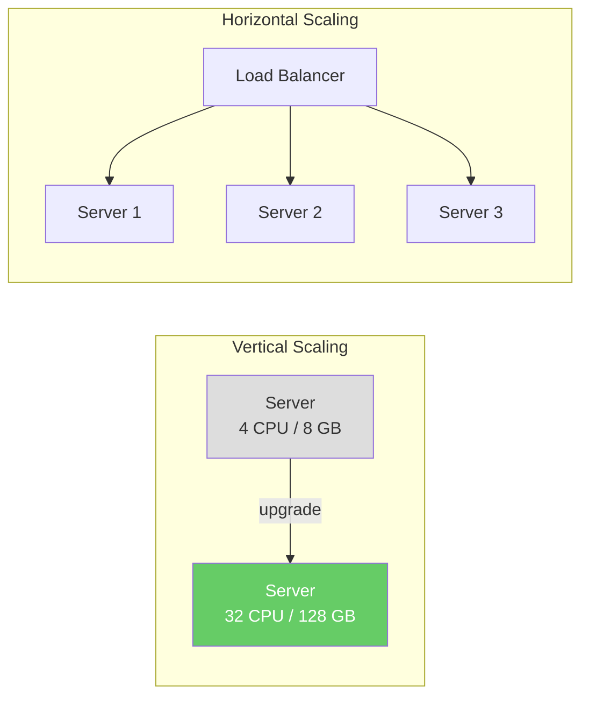
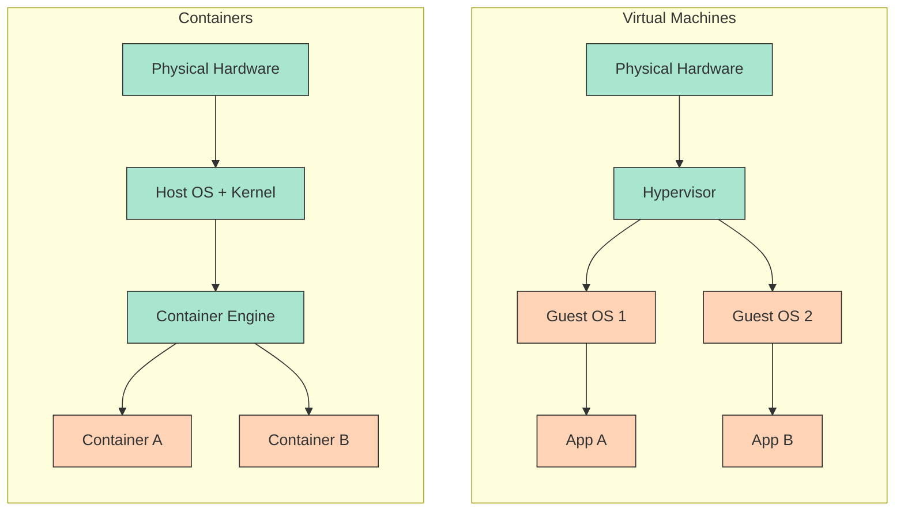
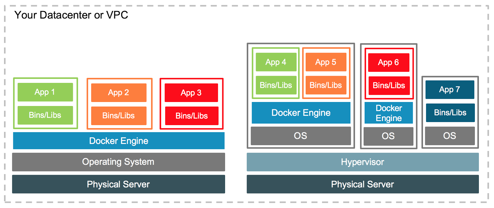
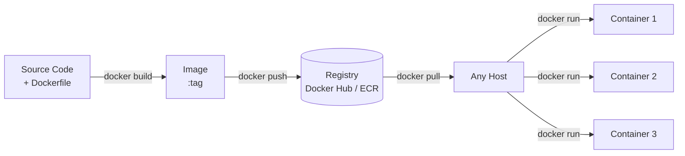

When a server cannot handle growing traffic, two strategies exist:

**Vertical scaling** (scale-up)
: Replace the server with a more powerful one — more CPU, RAM, faster disk. Simple, but bounded: there is a physical limit to how large a single machine can be, and upgrades require downtime.

**Horizontal scaling** (scale-out)
: Add more servers and distribute the load across them. Theoretically unbounded, but introduces a critical problem: **consistency across environments**.



With one server, you can install Java, configure the database driver and tune environment variables by hand. With ten servers behind a load balancer, every one of them must be **identical** — the same OS, the same Java version, the same libraries, the same configuration — or a request will behave differently depending on which server it lands on.

An application that works on a developer's laptop may fail in production because of different OS versions, library versions, or environment variables — the infamous *"it works on my machine"* problem.

{ width="35%" }

**Containerisation** solves this by packaging the application together with all its dependencies into a portable, self-contained unit — a **container image** — that runs identically everywhere: on your laptop, on the CI server and on every production node.

!!! abstract "Learning objectives"

    By the end of this class you should be able to:

    - **Explain** what a container is (an isolated process built on Linux namespaces, cgroups and a layered filesystem) and how it differs from a virtual machine.
    - **Write** a Dockerfile for a Spring Boot service, using a multi-stage build and a cache-friendly layer order.
    - **Run, inspect and debug** containers with the essential `docker` commands (ports, logs, `exec`, networks, volumes).
    - **Compose** a multi-service stack (service + PostgreSQL) with `compose.yaml`, `.env` files and health checks.
    - **Diagnose** common mistakes: `localhost` between containers, data lost without a volume, secrets committed in `.env`, unpinned `latest` tags.

## Roadmap

1. **This overview** — why containers, containers versus VMs, what a container really is, and the image lifecycle.
2. [Docker](docker/index.md) — Dockerfiles, multi-stage builds, layer caching, commands, networks and volumes.
3. [Docker Compose](compose/index.md) — describing and running a whole stack (gateway, services, database) in one file.
4. [Quiz](quiz.md) — check your understanding.

## Slides

<div class="slides-embed">
  <iframe src="slides/containerization.html" title="Slides: containerization" loading="lazy" allowfullscreen></iframe>
</div>

Click the slides and use ← → to move through them; **F** goes full screen and **P** opens the presenter view, with the notes.
[:material-presentation: Open the slides in a new tab](slides/containerization.html){:target="_blank"}

---

## Containers vs. Virtual Machines

Both containers and virtual machines (VMs) provide isolation, but at different levels of the stack:



:material-square:{ style="color:#a8e6cf" } Provider / shared layer &nbsp;&nbsp; :material-square:{ style="color:#ffd3b6" } Application layer

| Aspect | Docker Containers | Virtual Machines |
|---|---|---|
| **Isolation** | Process-level — share the host kernel | Full OS isolation — each VM has its own kernel |
| **Resource overhead** | Lightweight — no duplicate OS per container | Higher — each VM carries a complete OS |
| **Startup time** | Seconds | Minutes (full OS boot) |
| **Portability** | High — image bundles app and all dependencies | Lower — OS-specific configuration |
| **Security boundary** | Weaker (shared kernel) | Stronger (separate kernel) |
| **Typical use** | Microservices, CI/CD, horizontal scaling | Different guest OS, strong isolation requirements |

The key insight: containers share the host kernel, so they start in seconds and consume far less memory. VMs carry their own kernel — giving stronger isolation at the cost of higher overhead[^2].

In practice the two are **combined**, not opposed: a cloud provider rents you a VM (isolation between customers), and you run several containers on it (density and portability for your services).

{ width="100%" }

---

## What a container really is

A container is **not** a lightweight VM: it is an ordinary Linux **process** that the kernel shows a restricted view of the machine. Three kernel features make that possible:

| Feature | What it does | What you observe |
|---|---|---|
| **Namespaces** | Give the process its own view of a resource: process IDs (`pid`), network interfaces and ports (`net`), mounted filesystems (`mnt`), hostname (`uts`), users (`user`), IPC | Inside the container, `ps` shows your app as PID 1, and it has its own IP address and port 8080 |
| **cgroups** (control groups) | Limit and account for CPU, memory and I/O | `docker run --memory 512m` — the JVM is killed (OOM) if it exceeds 512 MB |
| **Layered filesystem** (OverlayFS) | Stack the read-only image layers and add a thin **writable layer** on top (copy-on-write) | Files you write inside the container disappear when the container is removed |

You can verify the "just a process" claim yourself:

``` bash
docker run --rm alpine ps                               # inside: ps is PID 1, nothing else is visible
docker run -d --name pg -e POSTGRES_PASSWORD=secret postgres:17
docker top pg                                           # from the host: the postgres processes, with host PIDs
```

!!! info "Docker on macOS and Windows"
    Namespaces and cgroups are **Linux** kernel features. Docker Desktop on macOS and Windows therefore runs a small Linux **VM** behind the scenes, and your containers run inside it. That is why bind-mounted files can be slower there, and why an image built for `linux/arm64` (Apple Silicon) may need `--platform linux/amd64` to match a cloud server.

!!! tip "Docker is one implementation of an open standard"
    Image format and runtime behaviour are standardised by the **Open Container Initiative (OCI)**. An image built with `docker build` also runs on Podman, on containerd, and on Kubernetes — which, since version 1.24, no longer talks to Docker and runs containers through containerd or CRI-O.

---

## The container lifecycle



A **Dockerfile** describes how to build the image. An **image** is the immutable artifact — it gets versioned, stored in a registry, and pulled onto any machine. A **container** is a running instance of an image — isolated, ephemeral, and disposable[^1].

!!! example "The lifecycle in the store"
    In [Hands-on 1](../../hands-on/1/containerization/index.md) the account service is packaged this way: `mvn package` produces the JAR, a Dockerfile copies it onto a Java base image, and `docker compose up --build` builds the image and starts it next to PostgreSQL. Later, in [Hands-on 4](../../hands-on/4/index.md), Jenkins runs the same build and pushes the image to a registry, and in [Hands-on 5](../../hands-on/5/index.md) Kubernetes pulls that image and runs several containers from it.

!!! warning "Pitfalls"
    - **Treating a container like a server.** Do not `docker exec` into a container to install packages or edit files: the change is lost on the next deploy. Change the Dockerfile and rebuild.
    - **Storing data in the container.** The writable layer disappears with the container — persist databases in a **volume** ([Docker › Volumes](docker/index.md#volumes)).
    - **Shipping `latest`.** `myapp:latest` points to whatever was pushed last; deploy explicit versions (`myapp:1.4.2` or a Git commit SHA) so you know exactly what runs and can roll back.
    - **Assuming a container is a security boundary.** All containers share the host kernel; a kernel exploit escapes them. Do not run untrusted code next to sensitive workloads without stronger isolation (VMs).

---

## Topics covered

<div class="grid cards" markdown>

-   :fontawesome-brands-docker:{ .lg .middle } **Docker**

    ---

    Core concepts of Docker: images, containers, the Docker Engine, Dockerfiles (including multi-stage builds), essential commands, networking, and volumes.

    [:octicons-arrow-right-24: Docker](docker/index.md)

-   :material-file-code:{ .lg .middle } **Docker Compose**

    ---

    Declarative multi-container orchestration with `compose.yaml`. Covers service definitions, networking, volumes, environment variables, health checks, and dependency ordering.

    [:octicons-arrow-right-24: Docker Compose](compose/index.md)

</div>

---

## Containerisation in the cloud

Docker and Compose run containers on **one** host. Running them across many hosts — restarting crashed containers, spreading replicas, rolling out new versions — is the job of an **orchestrator** such as Kubernetes[^3] ([Hands-on 5](../../hands-on/5/index.md)). Cloud providers offer managed container services that add automatic scheduling, scaling, load balancing, and deep integration with other cloud services on top of the container model:

| Service | Provider | Model |
|---|---|---|
| **ECS / Fargate** | AWS | Managed containers — no cluster to operate |
| **EKS** | AWS | Managed Kubernetes |
| **Cloud Run** | Google | Serverless containers — scales to zero |
| **GKE** | Google | Managed Kubernetes |
| **AKS** | Azure | Managed Kubernetes |

=== ":fontawesome-brands-google: Google"

    :fontawesome-brands-youtube:{ .youtube } [Inside a Google data center](https://youtu.be/XZmGGAbHqa0){:target='_blank'}

    [{ width=100% }](https://youtu.be/XZmGGAbHqa0){:target='_blank'}

=== ":fontawesome-brands-aws: AWS"

    :fontawesome-brands-youtube:{ .youtube } [Inside Amazon's Massive Data Center](https://youtu.be/q6WlzHLxNKI){:target='_blank'}

    [{ width=100% }](https://youtu.be/q6WlzHLxNKI){:target='_blank'}

=== ":simple-tesla: Tesla"

    :fontawesome-brands-youtube:{ .youtube } [Inside Elon Musk's Colossus Supercomputer!](https://youtu.be/Tw696JVSxJQ){:target='_blank'}

    [{ width=100% }](https://youtu.be/Tw696JVSxJQ){:target='_blank'}

---

## Connections

- [Hands-on 1 — Containerization](../../hands-on/1/containerization/index.md) — the account service and PostgreSQL in Docker Compose.
- [Hands-on 4](../../hands-on/4/index.md) — a CI pipeline that builds and publishes images.
- [Hands-on 5](../../hands-on/5/index.md) and the [MiniKube exercise](../../exercises/minikube/index.md) — running the same images on Kubernetes.
- [Cloud Service Models](../service_models/index.md) and [Cloud Deployment](../deployment/index.md) — where containers fit among IaaS, PaaS and managed container services.

## Key takeaways

- Horizontal scaling needs **identical environments**; a container image packages the app with all its dependencies and ends *"it works on my machine"*.
- A container is an isolated **Linux process** (namespaces + cgroups + layered filesystem), not a small VM: it shares the host kernel, starts in seconds and isolates less than a VM.
- **Dockerfile → image → registry → container**: the image is the immutable, versioned artifact; containers are disposable.
- Keep state out of containers (volumes) and ship explicit image versions, not `latest`.
- Docker and Compose run containers on one host; orchestrators and managed cloud services run them across many.

---

[^1]: [Docker Documentation](https://docs.docker.com/){:target="_blank"}
[^2]: [Docker vs. Virtual Machines: Differences You Should Know](https://cloudacademy.com/blog/docker-vs-virtual-machines-differences-you-should-know/){:target="_blank"}
[^3]: BURNS, B. et al. *Kubernetes: Up and Running*, 3rd ed. O'Reilly, 2022.
