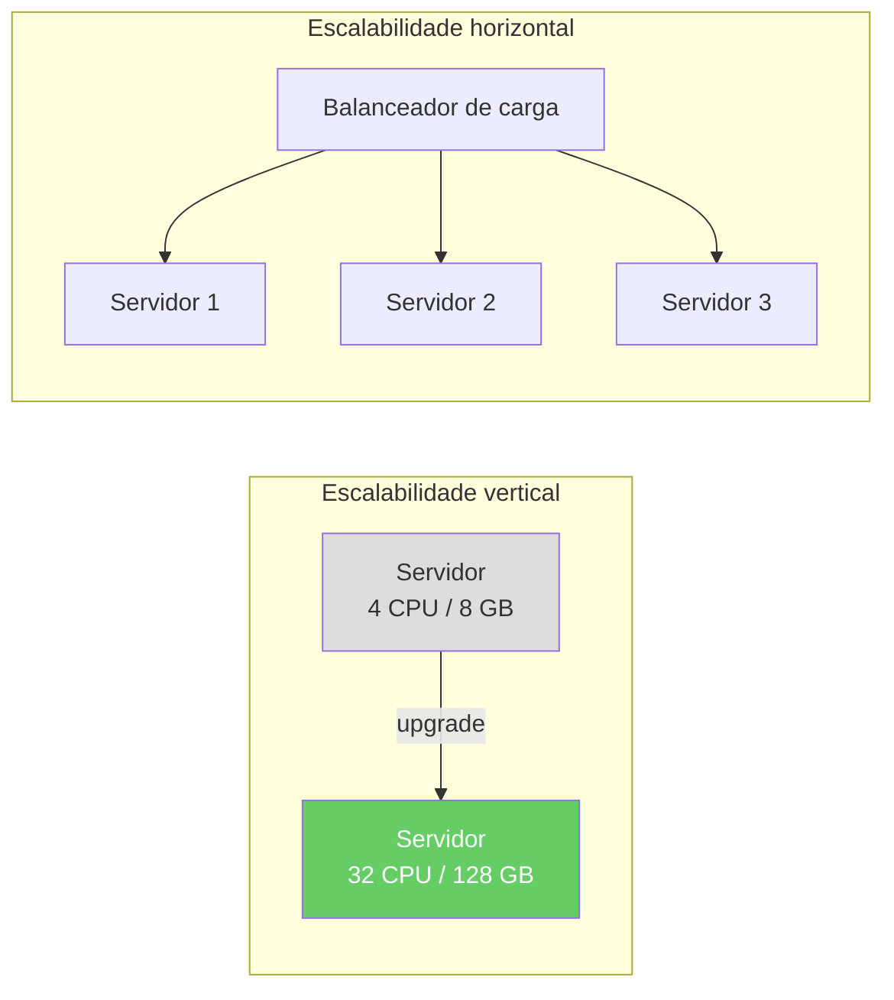
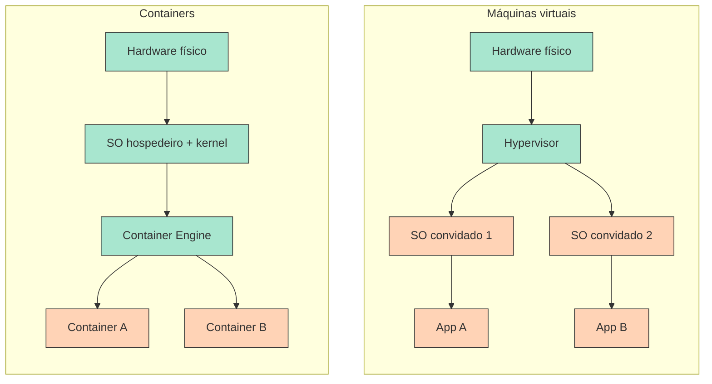
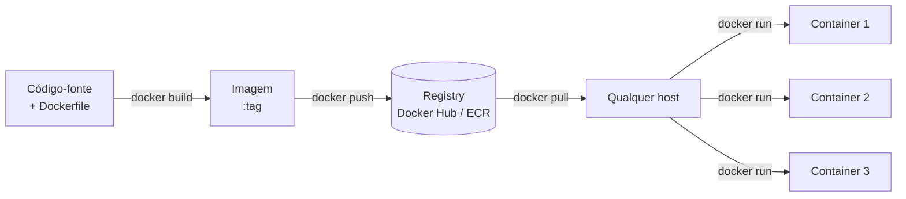

Quando um servidor não dá mais conta do tráfego crescente, existem duas estratégias:

**Escalabilidade vertical** (scale-up)
: Substituir o servidor por um mais potente — mais CPU, mais RAM, disco mais rápido. É simples, mas limitado: existe um limite físico para o tamanho de uma única máquina, e cada upgrade exige parada.

**Escalabilidade horizontal** (scale-out)
: Adicionar mais servidores e distribuir a carga entre eles. Em teoria não tem limite, mas traz um problema crítico: **consistência entre ambientes**.



Com um único servidor, dá para instalar o Java, configurar o driver do banco de dados e ajustar as variáveis de ambiente à mão. Com dez servidores atrás de um balanceador de carga, todos eles precisam ser **idênticos** — o mesmo sistema operacional, a mesma versão do Java, as mesmas bibliotecas, a mesma configuração —, ou uma requisição vai se comportar de forma diferente dependendo do servidor em que cair.

Uma aplicação que funciona no notebook do desenvolvedor pode falhar em produção por causa de versões diferentes do sistema operacional, das bibliotecas ou das variáveis de ambiente — o famoso problema do *"na minha máquina funciona"*.

{ width="35%" }

A **containerização** resolve isso empacotando a aplicação junto com todas as suas dependências em uma unidade portátil e autocontida — uma **imagem de container** — que roda de forma idêntica em qualquer lugar: no seu notebook, no servidor de CI e em cada nó de produção.

!!! abstract "Objetivos de aprendizagem"

    Ao final desta aula, você deve ser capaz de:

    - **Explicar** o que é um container (um processo isolado construído sobre namespaces do Linux, cgroups e um sistema de arquivos em camadas) e como ele difere de uma máquina virtual.
    - **Escrever** um Dockerfile para um serviço Spring Boot, usando um build multi-stage e uma ordem de camadas que aproveite o cache.
    - **Executar, inspecionar e depurar** containers com os comandos essenciais do `docker` (portas, logs, `exec`, redes, volumes).
    - **Compor** uma stack com vários serviços (serviço + PostgreSQL) com `compose.yaml`, arquivos `.env` e health checks.
    - **Diagnosticar** erros comuns: `localhost` entre containers, dados perdidos sem volume, segredos commitados no `.env`, tags `latest` sem versão fixa.

## Roteiro

1. **Esta visão geral** — por que containers, containers versus VMs, o que um container realmente é e o ciclo de vida da imagem.
2. [Docker](docker/index.md) — Dockerfiles, builds multi-stage, cache de camadas, comandos, redes e volumes.
3. [Docker Compose](compose/index.md) — como descrever e executar uma stack inteira (gateway, serviços, banco de dados) em um único arquivo.
4. [Quiz](quiz.md) — verifique o que você aprendeu.

## Slides

<div class="slides-embed">
  <iframe src="slides/containerization.pt.html" title="Slides: containerização" loading="lazy" allowfullscreen></iframe>
</div>

Clique nos slides e use ← → para navegar; **F** abre em tela cheia e **P** abre a visão do apresentador, com as notas.
[:material-presentation: Abrir os slides em uma nova aba](slides/containerization.pt.html){:target="_blank"}

---

## Containers vs. máquinas virtuais

Tanto containers quanto máquinas virtuais (VMs) oferecem isolamento, mas em níveis diferentes da pilha:



:material-square:{ style="color:#a8e6cf" } Camada do provedor / compartilhada &nbsp;&nbsp; :material-square:{ style="color:#ffd3b6" } Camada da aplicação

| Aspecto | Containers Docker | Máquinas virtuais |
|---|---|---|
| **Isolamento** | No nível de processo — compartilham o kernel do hospedeiro | Isolamento completo do SO — cada VM tem o próprio kernel |
| **Overhead de recursos** | Leve — nenhum SO duplicado por container | Maior — cada VM carrega um SO completo |
| **Tempo de inicialização** | Segundos | Minutos (boot completo do SO) |
| **Portabilidade** | Alta — a imagem empacota a aplicação e todas as dependências | Menor — configuração específica do SO |
| **Fronteira de segurança** | Mais fraca (kernel compartilhado) | Mais forte (kernel separado) |
| **Uso típico** | Microsserviços, CI/CD, escalabilidade horizontal | SO convidado diferente, requisitos fortes de isolamento |

A ideia central: containers compartilham o kernel do hospedeiro, por isso iniciam em segundos e consomem muito menos memória. VMs carregam o próprio kernel — o que dá um isolamento mais forte ao custo de um overhead maior[^2].

Na prática, os dois são **combinados**, e não opostos: um provedor de nuvem aluga uma VM para você (isolamento entre clientes), e você roda vários containers nela (densidade e portabilidade para os seus serviços).

{ width="100%" }

---

## O que um container realmente é { #what-a-container-really-is }

Um container **não** é uma VM leve: é um **processo** Linux comum ao qual o kernel mostra uma visão restrita da máquina. Três recursos do kernel tornam isso possível:

| Recurso | O que faz | O que você observa |
|---|---|---|
| **Namespaces** | Dão ao processo a própria visão de um recurso: IDs de processo (`pid`), interfaces de rede e portas (`net`), sistemas de arquivos montados (`mnt`), hostname (`uts`), usuários (`user`), IPC | Dentro do container, o `ps` mostra a sua aplicação como PID 1, e ela tem o próprio endereço IP e a porta 8080 |
| **cgroups** (control groups) | Limitam e contabilizam CPU, memória e I/O | `docker run --memory 512m` — a JVM é encerrada (OOM) se passar de 512 MB |
| **Sistema de arquivos em camadas** (OverlayFS) | Empilha as camadas somente leitura da imagem e adiciona uma fina **camada gravável** por cima (copy-on-write) | Os arquivos que você grava dentro do container desaparecem quando o container é removido |

Você mesmo pode verificar a afirmação de que é "só um processo":

``` bash
docker run --rm alpine ps                               # inside: ps is PID 1, nothing else is visible
docker run -d --name pg -e POSTGRES_PASSWORD=secret postgres:17
docker top pg                                           # from the host: the postgres processes, with host PIDs
```

!!! info "Docker no macOS e no Windows"
    Namespaces e cgroups são recursos do kernel **Linux**. Por isso, o Docker Desktop no macOS e no Windows roda uma pequena **VM** Linux por trás dos panos, e os seus containers rodam dentro dela. É por isso que arquivos em bind mount podem ser mais lentos ali, e que uma imagem construída para `linux/arm64` (Apple Silicon) pode precisar de `--platform linux/amd64` para corresponder a um servidor na nuvem.

!!! tip "Docker é uma implementação de um padrão aberto"
    O formato de imagem e o comportamento do runtime são padronizados pela **Open Container Initiative (OCI)**. Uma imagem construída com `docker build` também roda no Podman, no containerd e no Kubernetes — que, desde a versão 1.24, não conversa mais com o Docker e executa containers por meio do containerd ou do CRI-O.

---

## O ciclo de vida do container



Um **Dockerfile** descreve como construir a imagem. Uma **imagem** é o artefato imutável — ela é versionada, armazenada em um registry e baixada em qualquer máquina. Um **container** é uma instância em execução de uma imagem — isolada, efêmera e descartável[^1].

!!! example "O ciclo de vida na loja"
    No [Hands-on 1](../../hands-on/1/containerization/index.md), o serviço de contas é empacotado assim: `mvn package` gera o JAR, um Dockerfile o copia para uma imagem base Java, e `docker compose up --build` constrói a imagem e a inicia ao lado do PostgreSQL. Mais adiante, no [Hands-on 4](../../hands-on/4/index.md), o Jenkins executa o mesmo build e envia a imagem para um registry, e no [Hands-on 5](../../hands-on/5/index.md) o Kubernetes baixa essa imagem e executa vários containers a partir dela.

!!! warning "Armadilhas"
    - **Tratar um container como um servidor.** Não use `docker exec` para entrar em um container e instalar pacotes ou editar arquivos: a mudança se perde no próximo deploy. Altere o Dockerfile e faça o build de novo.
    - **Guardar dados no container.** A camada gravável desaparece com o container — persista bancos de dados em um **volume** ([Docker › Volumes](docker/index.md#volumes)).
    - **Publicar `latest`.** `myapp:latest` aponta para o que quer que tenha sido enviado por último; faça o deploy de versões explícitas (`myapp:1.4.2` ou o SHA de um commit do Git) para saber exatamente o que está rodando e poder fazer rollback.
    - **Supor que um container é uma fronteira de segurança.** Todos os containers compartilham o kernel do hospedeiro; um exploit no kernel escapa deles. Não rode código não confiável ao lado de workloads sensíveis sem um isolamento mais forte (VMs).

---

## Tópicos abordados

<div class="grid cards" markdown>

-   :fontawesome-brands-docker:{ .lg .middle } **Docker**

    ---

    Conceitos centrais do Docker: imagens, containers, o Docker Engine, Dockerfiles (incluindo builds multi-stage), comandos essenciais, redes e volumes.

    [:octicons-arrow-right-24: Docker](docker/index.md)

-   :material-file-code:{ .lg .middle } **Docker Compose**

    ---

    Orquestração declarativa de vários containers com `compose.yaml`. Aborda definição de serviços, redes, volumes, variáveis de ambiente, health checks e ordem de dependências.

    [:octicons-arrow-right-24: Docker Compose](compose/index.md)

</div>

---

## Containerização na nuvem

Docker e Compose rodam containers em **um** host. Rodá-los em muitos hosts — reiniciar containers que caíram, espalhar réplicas, publicar novas versões gradualmente — é o trabalho de um **orquestrador**, como o Kubernetes[^3] ([Hands-on 5](../../hands-on/5/index.md)). Os provedores de nuvem oferecem serviços gerenciados de containers que acrescentam, sobre o modelo de containers, agendamento automático, escalabilidade, balanceamento de carga e integração profunda com outros serviços de nuvem:

| Serviço | Provedor | Modelo |
|---|---|---|
| **ECS / Fargate** | AWS | Containers gerenciados — nenhum cluster para operar |
| **EKS** | AWS | Kubernetes gerenciado |
| **Cloud Run** | Google | Containers serverless — escala até zero |
| **GKE** | Google | Kubernetes gerenciado |
| **AKS** | Azure | Kubernetes gerenciado |

=== ":fontawesome-brands-google: Google"

    :fontawesome-brands-youtube:{ .youtube } [Inside a Google data center](https://youtu.be/XZmGGAbHqa0){:target='_blank'}

    [{ width=100% }](https://youtu.be/XZmGGAbHqa0){:target='_blank'}

=== ":fontawesome-brands-aws: AWS"

    :fontawesome-brands-youtube:{ .youtube } [Inside Amazon's Massive Data Center](https://youtu.be/q6WlzHLxNKI){:target='_blank'}

    [{ width=100% }](https://youtu.be/q6WlzHLxNKI){:target='_blank'}

=== ":simple-tesla: Tesla"

    :fontawesome-brands-youtube:{ .youtube } [Inside Elon Musk's Colossus Supercomputer!](https://youtu.be/Tw696JVSxJQ){:target='_blank'}

    [{ width=100% }](https://youtu.be/Tw696JVSxJQ){:target='_blank'}

---

## Conexões

- [Hands-on 1 — Containerização](../../hands-on/1/containerization/index.md) — o serviço de contas e o PostgreSQL no Docker Compose.
- [Hands-on 4](../../hands-on/4/index.md) — um pipeline de CI que constrói e publica imagens.
- [Hands-on 5](../../hands-on/5/index.md) e o [exercício de MiniKube](../../exercises/minikube/index.md) — executando as mesmas imagens no Kubernetes.
- [Modelos de serviço em nuvem](../service_models/index.md) e [Deploy na nuvem](../deployment/index.md) — onde os containers se encaixam entre IaaS, PaaS e serviços gerenciados de containers.

## Pontos-chave

- A escalabilidade horizontal exige **ambientes idênticos**; uma imagem de container empacota a aplicação com todas as suas dependências e acaba com o *"na minha máquina funciona"*.
- Um container é um **processo Linux** isolado (namespaces + cgroups + sistema de arquivos em camadas), não uma VM pequena: ele compartilha o kernel do hospedeiro, inicia em segundos e isola menos do que uma VM.
- **Dockerfile → imagem → registry → container**: a imagem é o artefato imutável e versionado; os containers são descartáveis.
- Mantenha o estado fora dos containers (volumes) e publique versões explícitas da imagem, não `latest`.
- Docker e Compose rodam containers em um host; orquestradores e serviços gerenciados de nuvem os rodam em muitos.

---

[^1]: [Docker Documentation](https://docs.docker.com/){:target="_blank"}
[^2]: [Docker vs. Virtual Machines: Differences You Should Know](https://cloudacademy.com/blog/docker-vs-virtual-machines-differences-you-should-know/){:target="_blank"}
[^3]: BURNS, B. et al. *Kubernetes: Up and Running*, 3rd ed. O'Reilly, 2022.
