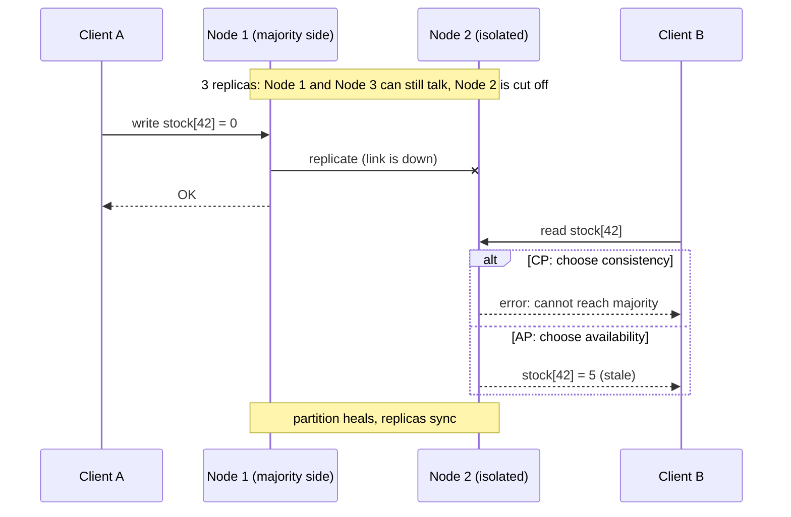

Suppose the product service of our store keeps its data in PostgreSQL replicated on two nodes, one in each data centre, so that the store survives the loss of a whole site. One afternoon the link between the two sites goes down, but both nodes are still alive and still receiving requests. A customer on site B asks for the stock of product 42, which was just updated on site A. Node B has two options: **answer with what it has** (possibly stale) or **refuse to answer** until it can talk to A again. There is no third option — and this is exactly what the CAP theorem formalises.

The **CAP Theorem**, proposed by Eric Brewer in 2000 and formally proven by Seth Gilbert and Nancy Lynch in 2002[^1], states that a distributed system that replicates data across nodes **cannot simultaneously guarantee all three** of the following properties[^3]:

--8<-- "docs/2026.2/classes/distributed_systems/cap/cap-venn.svg"

---

## The three properties

**Consistency (C)**
: Every read returns the most recent write, or an error. All nodes see the same data at the same time — equivalent to *linearisability* (the system behaves as if there were a single copy of the data and every operation took effect at one instant). In a consistent system, it is impossible to read stale data.

**Availability (A)**
: Every request received by a non-failing node receives a non-error response — even if the response may not contain the most recent write.

**Partition Tolerance (P)**
: The system continues to operate despite arbitrary network partitions — message drops or delays between nodes. A **partition** splits the nodes into groups that can still run but cannot talk to each other. Partitions are a fact of life in any real distributed network; hardware failures, congestion, and physical distances all cause them.

!!! warning "Partition Tolerance is not optional"
    In any real-world distributed system, network partitions *will* happen. The practical choice is therefore between **C** and **A** during a partition — not whether to include **P**.

!!! warning "The C in CAP is not the C in ACID"
    In ACID database transactions, *consistency* means "the transaction leaves the data valid according to the constraints" (foreign keys, `CHECK`, invariants). In CAP, *consistency* means **linearisability**: every replica answers as if there were only one copy. A single PostgreSQL server is ACID-consistent; the question CAP asks only appears when there are **replicas**.

---

## A partition, step by step

The same scenario played twice: once by a CP system and once by an AP system.



Neither answer is "wrong": the CP node refuses rather than lie; the AP node answers with the best value it has. Which one is acceptable depends on the **data**, not on the technology.

---

## System classes

### CP — Consistent and Partition-Tolerant

During a partition, the system refuses requests rather than returning potentially stale data. When the partition heals, consistency is restored before serving again.

**Examples:** Apache ZooKeeper, etcd, PostgreSQL with synchronous replication, MongoDB (with majority write concern and primary reads, the defaults).

**Use when:** correctness is non-negotiable — financial transactions, inventory systems, identity stores.

```
Node A ──── [partition] ──── Node B
   │                            │
Client                       Returns error
writes here                  (unavailable)
```

### AP — Available and Partition-Tolerant

During a partition, every node continues to respond, but nodes may diverge and return different data. After the partition heals, the system converges to a consistent state (*eventual consistency*).

**Examples:** Apache Cassandra, Amazon DynamoDB, CouchDB, DNS.

**Use when:** availability matters more than momentary accuracy — shopping carts, social media feeds, search indexes.

```
Node A ──── [partition] ──── Node B
   │                            │
Client A sees              Client B sees
version 5                  version 4 (stale)
         ← converge after partition heals →
```

### CA — Consistent and Available

Assumes no partitions, which is only realistic for single-machine systems or tightly controlled LANs. Not a practical category for distributed systems.

---

## Comparison table

| | CP | AP | CA |
|---|---|---|---|
| **Consistency** | ✅ Always | ❌ Eventually | ✅ Always |
| **Availability** | ❌ During partition | ✅ Always | ✅ Always |
| **Partition tolerance** | ✅ | ✅ | ❌ (unrealistic) |
| **Trade-off** | Reject requests during partition | Return possibly stale data | Only works on single node |
| **Examples** | ZooKeeper, etcd, PostgreSQL (sync replication) | Cassandra, DynamoDB, DNS | Single-node RDBMS |

!!! warning "CP and AP are labels for a configuration, not for a product"
    Most databases let you tune the trade-off per request: Cassandra reading and writing with `QUORUM` behaves much more like a CP system, and PostgreSQL serving reads from an *asynchronous* replica can return stale data. Many real systems are, strictly speaking, neither fully CP nor fully AP[^5]. Ask "how is it configured, and what happens to *my* requests during a partition?" rather than "is this database CP or AP?".

---

## The PACELC extension

The CAP theorem only addresses the partition scenario. **PACELC** (Daniel Abadi, 2010)[^2] extends it by asking: *even when there is no partition, what is the trade-off?*

```
If Partition:
  → choose between Availability and Consistency
Else (normal operation):
  → choose between Latency and Consistency
```

The reason is replication: to be consistent, a write must wait for other replicas to acknowledge it (a network round-trip, possibly to another region); to be fast, it must answer before they do — and accept that a replica may briefly lag behind.

| System | Partition behaviour | Normal behaviour | Classification |
|---|---|---|---|
| Cassandra | Favours A | Favours L (low latency) | PA/EL |
| DynamoDB | Favours A | Favours L | PA/EL |
| MongoDB (majority writes) | Favours C | Favours C | PC/EC |
| PostgreSQL (synchronous replication) | Favours C | Favours C | PC/EC |

PACELC[^4] is more useful than CAP for making day-to-day database choices, because most of the time there is no partition — yet the latency/consistency trade-off is always present.

!!! example "PACELC in the store: read replicas"
    A common way to scale reads is to add an **asynchronous read replica** to PostgreSQL and send `GET /products` to it. Reads become faster and the primary is relieved — the *EL* choice. The price is **replication lag**: right after an admin updates a price on the primary, the replica may still return the old one for a few milliseconds (or seconds under load). The Redis cache of [Hands-on 8](../../../hands-on/8/index.md) makes the same choice: a cached product can be stale until its TTL expires.

---

## Practical implications for system design

**E-commerce product catalogue** → AP
: Showing a product as in-stock when it has just gone out of stock is acceptable. A brief period of stale data does not harm correctness.

**Shopping cart** → AP
: Adding an item to a cart that temporarily diverges across replicas is fine; the cart can reconcile on checkout.

**Payment processing** → CP
: A double charge or missed debit cannot be reconciled after the fact. Consistency is required.

**User authentication** → CP
: A revoked token must be immediately invalid across all nodes. Stale auth state is a security vulnerability.

!!! tip "Most systems mix both"
    A single application can use an AP store (Cassandra) for user activity logs and a CP store (PostgreSQL) for financial records. Choose per data domain, not per application.

!!! warning "Common mistakes"
    - **"We chose CA."** If the data is on more than one machine, partitions can happen; CA only means "we never thought about what happens during one".
    - **Treating CAP as a permanent property.** The C/A choice only applies *during* a partition; the rest of the time the trade-off is latency (PACELC).
    - **Forgetting the cache.** Adding Redis in front of a CP database makes those reads AP-like: the cache can serve stale data.

---

## Connections

- [Consensus & Algorithms](../consensus/index.md) — how CP systems such as etcd actually stay consistent: majorities and Raft.
- [Hands-on 8](../../../hands-on/8/index.md) — a Redis cache, an explicit choice of latency over consistency.
- [Event-Driven Architecture](../../event_driven/index.md) — asynchronous events make services eventually consistent with each other.

## Key takeaways

- CAP: when the network **partitions**, a replicated store must choose between **consistency** (refuse) and **availability** (answer, maybe stale).
- P is not optional, so the real choice is **C or A during a partition**; CA only exists on a single node.
- CAP's C is linearisability — not ACID's C.
- **PACELC**: even without a partition, replication forces a choice between **latency** and **consistency**.
- Choose **per data domain** and per configuration: payments and auth CP, catalogue and cart AP.

---

[^1]: GILBERT, S.; LYNCH, N. [Brewer's Conjecture and the Feasibility of Consistent, Available, Partition-Tolerant Web Services](https://dl.acm.org/doi/10.1145/564585.564601){target="_blank"}. ACM SIGACT News, 2002.
[^2]: ABADI, D. [Consistency Tradeoffs in Modern Distributed Database System Design](https://cs.yale.edu/homes/abadi/papers/pacelc.pdf){target="_blank"}. IEEE Computer, 2012.
[^3]: [CAP Theorem — Wikipedia](https://en.wikipedia.org/wiki/CAP_theorem){target="_blank"}
[^4]: [PACELC Theorem](https://www.geeksforgeeks.org/operating-systems/pacelc-theorem/){target="_blank"}
[^5]: KLEPPMANN, M. [Please stop calling databases CP or AP](https://martin.kleppmann.com/2015/05/11/please-stop-calling-databases-cp-or-ap.html){target="_blank"}, 2015.
