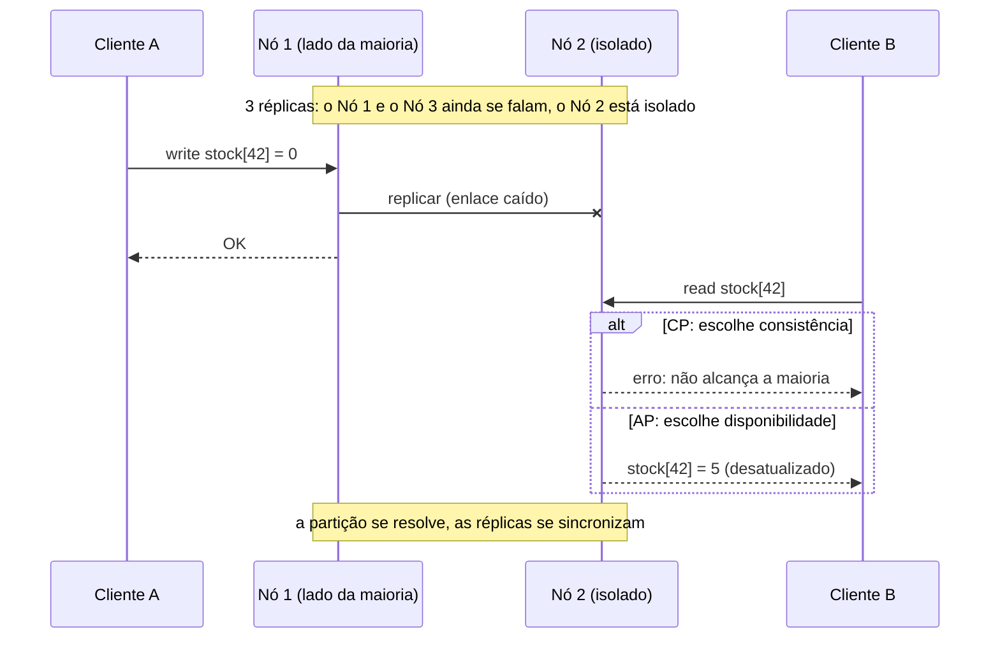
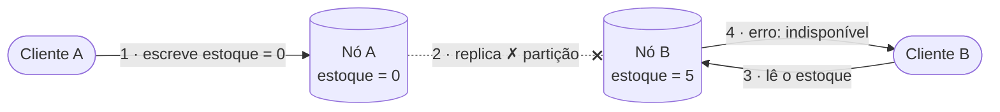
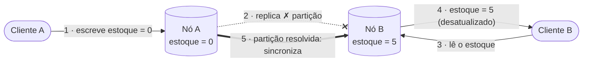
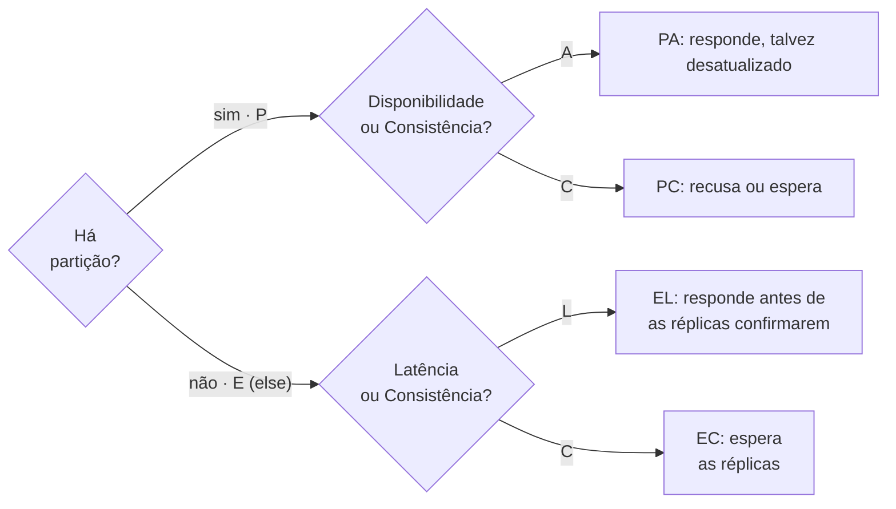

Suponha que o serviço de produtos da nossa loja guarde seus dados em um PostgreSQL replicado em dois nós, um em cada datacenter, para que a loja sobreviva à perda de um site inteiro. Certa tarde, o enlace entre os dois sites cai, mas os dois nós continuam vivos e recebendo requisições. Um cliente no site B pergunta o estoque do produto 42, que acabou de ser atualizado no site A. O nó B tem duas opções: **responder com o que tem** (possivelmente desatualizado) ou **recusar-se a responder** até conseguir falar com A de novo. Não existe terceira opção — e é exatamente isso que o teorema CAP formaliza.

O **Teorema CAP**, proposto por Eric Brewer em 2000 e provado formalmente por Seth Gilbert e Nancy Lynch em 2002[^1], afirma que um sistema distribuído que replica dados entre nós **não consegue garantir simultaneamente as três** propriedades a seguir[^3]:

--8<-- "docs/2026.2/classes/distributed_systems/cap/cap-venn.pt.svg"

---

## As três propriedades

**Consistência (C)**
: Toda leitura retorna a escrita mais recente, ou um erro. Todos os nós veem os mesmos dados ao mesmo tempo — o equivalente à *linearizabilidade* (o sistema se comporta como se houvesse uma única cópia dos dados e toda operação tivesse efeito em um único instante). Em um sistema consistente, é impossível ler dados desatualizados.

**Disponibilidade (A)**
: Toda requisição recebida por um nó que não falhou recebe uma resposta que não é um erro — mesmo que a resposta não contenha a escrita mais recente.

**Tolerância a partições (P)**
: O sistema continua operando apesar de partições arbitrárias na rede — mensagens perdidas ou atrasadas entre os nós. Uma **partição** divide os nós em grupos que continuam rodando, mas não conseguem falar uns com os outros. Partições são um fato da vida em qualquer rede distribuída real; falhas de hardware, congestionamento e distâncias físicas, tudo isso as provoca.

!!! warning "Tolerância a partições não é opcional"
    Em qualquer sistema distribuído do mundo real, partições de rede *vão* acontecer. A escolha prática, portanto, é entre **C** e **A** durante uma partição — e não se **P** será incluída ou não.

!!! warning "O C do CAP não é o C do ACID"
    Em transações de banco de dados ACID, *consistência* significa "a transação deixa os dados válidos de acordo com as restrições" (chaves estrangeiras, `CHECK`, invariantes). No CAP, *consistência* significa **linearizabilidade**: toda réplica responde como se houvesse uma única cópia. Um único servidor PostgreSQL é consistente no sentido ACID; a pergunta que o CAP faz só aparece quando existem **réplicas**.

---

## Uma partição, passo a passo

O mesmo cenário encenado duas vezes: uma por um sistema CP e outra por um sistema AP.

Nenhuma das respostas está "errada": o nó CP prefere recusar a mentir; o nó AP responde com o melhor valor que tem. Qual delas é aceitável depende dos **dados**, e não da tecnologia.

---

## Classes de sistemas

### CP — Consistente e tolerante a partições

Durante uma partição, o sistema recusa requisições em vez de devolver dados potencialmente desatualizados. Quando a partição se resolve, a consistência é restaurada antes de voltar a atender.

**Exemplos:** Apache ZooKeeper, etcd, PostgreSQL com replicação síncrona, MongoDB (com write concern de maioria e leituras no primário, os padrões).

**Use quando:** a correção é inegociável — transações financeiras, sistemas de estoque, repositórios de identidade.

### AP — Disponível e tolerante a partições

Durante uma partição, todos os nós continuam respondendo, mas podem divergir e devolver dados diferentes. Depois que a partição se resolve, o sistema converge para um estado consistente (*consistência eventual*).

**Exemplos:** Apache Cassandra, Amazon DynamoDB, CouchDB, DNS.

**Use quando:** a disponibilidade importa mais do que a precisão momentânea — carrinhos de compras, feeds de redes sociais, índices de busca.

### CA — Consistente e disponível

Pressupõe que não há partições, o que só é realista em sistemas de uma única máquina ou em redes locais rigidamente controladas. Não é uma categoria prática para sistemas distribuídos.

---

## Tabela comparativa

| | CP | AP | CA |
|---|---|---|---|
| **Consistência** | ✅ Sempre | ❌ Eventual | ✅ Sempre |
| **Disponibilidade** | ❌ Durante a partição | ✅ Sempre | ✅ Sempre |
| **Tolerância a partições** | ✅ | ✅ | ❌ (irrealista) |
| **Trade-off** | Rejeita requisições durante a partição | Devolve dados possivelmente desatualizados | Só funciona em um único nó |
| **Exemplos** | ZooKeeper, etcd, PostgreSQL (replicação síncrona) | Cassandra, DynamoDB, DNS | SGBD relacional em um único nó |

!!! warning "CP e AP são rótulos de uma configuração, não de um produto"
    A maioria dos bancos de dados permite ajustar o trade-off por requisição: o Cassandra lendo e escrevendo com `QUORUM` se comporta muito mais como um sistema CP, e um PostgreSQL que atende leituras a partir de uma réplica *assíncrona* pode devolver dados desatualizados. Muitos sistemas reais, a rigor, não são nem totalmente CP nem totalmente AP[^5]. Pergunte "como ele está configurado e o que acontece com as *minhas* requisições durante uma partição?" em vez de "este banco é CP ou AP?".

---

## A extensão PACELC

O teorema CAP trata apenas do cenário de partição. O **PACELC** (Daniel Abadi, 2010)[^2] o estende perguntando: *mesmo quando não há partição, qual é o trade-off?*

O motivo é a replicação: para ser consistente, uma escrita precisa esperar que as outras réplicas a confirmem (uma ida e volta pela rede, possivelmente até outra região); para ser rápida, ela precisa responder antes disso — e aceitar que uma réplica fique brevemente defasada.

| Sistema | Comportamento na partição | Comportamento normal | Classificação |
|---|---|---|---|
| Cassandra | Favorece A | Favorece L (baixa latência) | PA/EL |
| DynamoDB | Favorece A | Favorece L | PA/EL |
| MongoDB (escritas por maioria) | Favorece C | Favorece C | PC/EC |
| PostgreSQL (replicação síncrona) | Favorece C | Favorece C | PC/EC |

O PACELC[^4] é mais útil do que o CAP para as escolhas de banco de dados do dia a dia, porque na maior parte do tempo não há partição — mas o trade-off entre latência e consistência está sempre presente.

!!! example "PACELC na loja: réplicas de leitura"
    Uma forma comum de escalar leituras é adicionar uma **réplica de leitura assíncrona** ao PostgreSQL e enviar o `GET /products` para ela. As leituras ficam mais rápidas e o primário é aliviado — a escolha *EL*. O preço é o **atraso de replicação** (replication lag): logo depois que um administrador atualiza um preço no primário, a réplica ainda pode devolver o preço antigo por alguns milissegundos (ou segundos, sob carga). O cache Redis do [Hands-on 8](../../../hands-on/8/index.md) faz a mesma escolha: um produto em cache pode estar desatualizado até o seu TTL expirar.

---

## Implicações práticas para o projeto de sistemas

**Catálogo de produtos de um e-commerce** → AP
: Mostrar um produto como disponível quando ele acabou de esgotar é aceitável. Um breve período de dados desatualizados não compromete a correção.

**Carrinho de compras** → AP
: Adicionar um item a um carrinho que diverge temporariamente entre réplicas não é problema; o carrinho pode ser reconciliado no checkout.

**Processamento de pagamentos** → CP
: Uma cobrança em dobro ou um débito perdido não podem ser reconciliados depois do fato. Consistência é obrigatória.

**Autenticação de usuários** → CP
: Um token revogado precisa ficar inválido imediatamente em todos os nós. Um estado de autenticação desatualizado é uma vulnerabilidade de segurança.

!!! tip "A maioria dos sistemas mistura os dois"
    Uma única aplicação pode usar um armazenamento AP (Cassandra) para os logs de atividade dos usuários e um armazenamento CP (PostgreSQL) para os registros financeiros. Escolha por domínio de dados, não por aplicação.

!!! warning "Erros comuns"
    - **"Escolhemos CA."** Se os dados estão em mais de uma máquina, partições podem acontecer; CA só significa "nunca pensamos no que acontece durante uma".
    - **Tratar o CAP como uma propriedade permanente.** A escolha entre C e A só vale *durante* uma partição; no resto do tempo, o trade-off é a latência (PACELC).
    - **Esquecer o cache.** Colocar um Redis na frente de um banco CP torna essas leituras parecidas com AP: o cache pode servir dados desatualizados.

---

## Conexões

- [Consenso e algoritmos](../consensus/index.md) — como sistemas CP como o etcd de fato se mantêm consistentes: maiorias e Raft.
- [Hands-on 8](../../../hands-on/8/index.md) — um cache Redis, uma escolha explícita de latência em vez de consistência.
- [Arquitetura orientada a eventos](../../event_driven/index.md) — eventos assíncronos tornam os serviços eventualmente consistentes entre si.

## Pontos-chave

- CAP: quando a rede sofre uma **partição**, um armazenamento replicado precisa escolher entre **consistência** (recusar) e **disponibilidade** (responder, talvez com dados desatualizados).
- P não é opcional, então a escolha real é **C ou A durante uma partição**; CA só existe em um único nó.
- O C do CAP é linearizabilidade — não o C do ACID.
- **PACELC**: mesmo sem partição, a replicação força uma escolha entre **latência** e **consistência**.
- Escolha **por domínio de dados** e por configuração: pagamentos e autenticação CP, catálogo e carrinho AP.

---

[^1]: GILBERT, S.; LYNCH, N. [Brewer's Conjecture and the Feasibility of Consistent, Available, Partition-Tolerant Web Services](https://dl.acm.org/doi/10.1145/564585.564601){target="_blank"}. ACM SIGACT News, 2002.
[^2]: ABADI, D. [Consistency Tradeoffs in Modern Distributed Database System Design](https://cs.yale.edu/homes/abadi/papers/pacelc.pdf){target="_blank"}. IEEE Computer, 2012.
[^3]: [CAP Theorem — Wikipedia](https://en.wikipedia.org/wiki/CAP_theorem){target="_blank"}
[^4]: [PACELC Theorem](https://www.geeksforgeeks.org/operating-systems/pacelc-theorem/){target="_blank"}
[^5]: KLEPPMANN, M. [Please stop calling databases CP or AP](https://martin.kleppmann.com/2015/05/11/please-stop-calling-databases-cp-or-ap.html){target="_blank"}, 2015.
