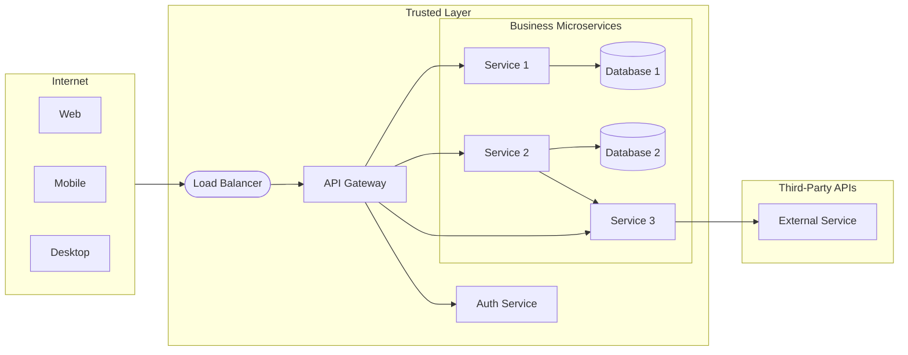
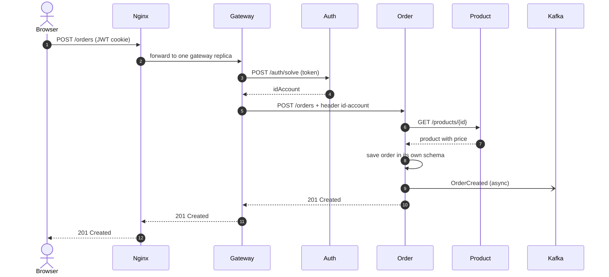

The store now has six services. Each of them needs HTTPS, must check who the user is, must be found by the others even though its containers come and go, needs configuration and secrets, and must produce logs and metrics. If every team solves these problems inside its own service, the platform ends up with six slightly different (and slightly wrong) implementations of the same thing. The answer is to move these **cross-cutting concerns** — concerns that every service has, but that are not part of any business domain — into shared infrastructure.

A production microservices system is more than a collection of independent services. It requires a set of **infrastructure components** that handle cross-cutting concerns — routing, security, discovery, configuration, and observability — so that individual services can stay focused on their business domain[^1].

---

## Components

<figure markdown>
  {target="_blank"}
  <figcaption><i>Source: <a href="https://bytebytego.com/guides/what-does-a-typical-microservice-architecture-look-like/" target="_blank">System Design 101 — Microservice Architecture</a></i></figcaption>
</figure>

### Load Balancer

Distributes incoming traffic across multiple instances of a service. Prevents any single instance from becoming a bottleneck and routes traffic away from unhealthy instances.

- **Layer 4 (TCP):** Fast, routes by IP/port — used for raw throughput.
- **Layer 7 (HTTP):** Routes by URL path, headers, or cookies — enables content-based routing and canary deployments.

In the course, [Hands-on 7](../../../hands-on/7/index.md) puts **Nginx** in front of several gateway replicas, using the `least_conn` algorithm (each new request goes to the replica with the fewest active connections).

### CDN (Content Delivery Network)

A geographically distributed network of caches that serves static assets (images, JS, CSS) from the location nearest to the user. Reduces latency for clients worldwide and offloads traffic from origin servers.

### API Gateway

The **single entry point** for all external clients. The gateway is responsible for:

| Concern | How |
|---|---|
| **Routing** | `/orders/**` → Order Service, `/products/**` → Product Service |
| **Authentication** | Validates JWT tokens before forwarding requests |
| **Rate limiting** | Protects services from traffic spikes or abusive clients |
| **Request/response transformation** | Adds headers, aggregates multiple service calls |
| **SSL termination** | Handles HTTPS; services communicate in plain HTTP inside the trusted network |

The gateway is the boundary between the public internet and the trusted internal network. In the course it is a **Spring Cloud Gateway** application ([Hands-on 2](../../../hands-on/2/index.md)); routes are declared in `application.yaml`, e.g. `Path=/accounts/**` → `http://account:8080`.

!!! info "Gateway or load balancer?"
    Both forward requests, but at different levels. A **load balancer** spreads requests for *one* service across its identical replicas and knows nothing about the application. A **gateway** decides *which* service a request is for and applies application rules (authentication, rate limits). The course uses both: Nginx balances the gateway replicas, and the gateway routes to the services.

### Identity Provider

Manages user authentication and authorisation using standard protocols:

- **OAuth 2.0** — delegation framework: a user grants a client access to their resources without sharing their password.
- **OpenID Connect (OIDC)** — identity layer on top of OAuth 2.0: provides a JWT identity token (`id_token`) in addition to the access token.
- **JWT (JSON Web Token)** — a signed, self-contained token that encodes claims (user ID, roles, expiry). Services validate the signature without calling the identity provider on every request.

In the course, the **auth service** plays this role in a simplified form: it registers and logs users in, issues a JWT (stored in a cookie), and resolves a token back to an account id for the gateway ([Hands-on 3](../../../hands-on/3/index.md)). OAuth 2.0 and OIDC are covered in [Security](../../security/index.md).

### Service Discovery & Registry

In a dynamic environment where service instances scale up/down and IP addresses change, services cannot hard-code endpoints. A **service registry** (Consul, Eureka, Kubernetes DNS) stores the current locations of all service instances. Services register on startup and deregister on shutdown.

- **Client-side discovery:** the caller queries the registry and load-balances itself.
- **Server-side discovery:** the load balancer or gateway queries the registry on behalf of the caller.

In the course, the **platform's DNS** is the registry. Docker Compose gives every service a hostname equal to its name, so the gateway route and the Feign client both simply use `http://account:8080`; with several replicas, the name resolves to all of them. In Kubernetes ([Hands-on 5](../../../hands-on/5/index.md)), a `Service` object gets a stable DNS name and spreads traffic over the pods behind it — server-side discovery, with no Eureka or Consul to run.

### Configuration Service

Centralises configuration for all services (Spring Cloud Config, AWS Parameter Store, Vault). Changes can be pushed to running services without redeployment. Secrets (credentials, API keys) are stored encrypted and injected at runtime.

In the course, configuration follows the **twelve-factor** rule of keeping it in the environment[^3]: `application.yaml` reads variables such as `${DATABASE_HOST}`, whose values come from the `.env` file and `compose.yaml`, and later from Kubernetes **ConfigMaps** and **Secrets**. The same image runs in every environment; only the environment changes.

### Message Broker

Carries events between services asynchronously, so that the producer does not wait for — or even know — its consumers. The course uses **Apache Kafka**: the order service publishes `OrderCreated` to the `order-events` topic and the notification service consumes it ([Hands-on 9](../../../hands-on/9/index.md), [Event-Driven Architecture](../../event_driven/index.md)).

### Distributed Cache

An in-memory store shared by all replicas of a service, used to avoid repeating expensive calls or queries. With several gateway replicas, a local cache in each JVM would hold different data; **Redis** gives them one shared cache ([Hands-on 8](../../../hands-on/8/index.md)).

### Observability Stack

With dozens of processes, "look at the log" no longer works. The platform collects **metrics** (Prometheus scrapes each service's `/actuator/prometheus`; Grafana draws dashboards — [Hands-on 6](../../../hands-on/6/index.md)) and **traces** that follow one request across services (OpenTelemetry + Jaeger — [Hands-on 10](../../../hands-on/10/index.md)). See [Observability](../../observability/index.md).

### Summary: the course's platform

| Component | Common options | In our platform | Hands-on |
|---|---|---|---|
| Load balancer | Nginx, HAProxy, cloud load balancers | Nginx in front of the gateway replicas | [7](../../../hands-on/7/index.md) |
| API gateway | Spring Cloud Gateway, Kong, cloud API gateways | Spring Cloud Gateway (`gateway-service`) | [2](../../../hands-on/2/index.md), [3](../../../hands-on/3/index.md) |
| Identity provider | Keycloak, Auth0, Amazon Cognito | `auth-service` issuing JWTs | [3](../../../hands-on/3/index.md) |
| Service discovery | Eureka, Consul, Kubernetes DNS | Docker Compose DNS, then Kubernetes Services | [1](../../../hands-on/1/index.md), [5](../../../hands-on/5/index.md) |
| Configuration | Spring Cloud Config, Vault, ConfigMaps | `.env` + environment variables, then ConfigMaps and Secrets | [5](../../../hands-on/5/index.md) |
| Message broker | Kafka, RabbitMQ | Kafka | [9](../../../hands-on/9/index.md) |
| Cache | Redis, Memcached | Redis | [8](../../../hands-on/8/index.md) |
| Observability | Prometheus, Grafana, OpenTelemetry, Jaeger | Prometheus + Grafana, OpenTelemetry + Jaeger | [6](../../../hands-on/6/index.md), [10](../../../hands-on/10/index.md) |

---

## Our architecture

The diagram below shows the reference architecture used in this course:

In the store, the business microservices are account, product and order; the exchange service is the one that calls a third-party API.

Key design decisions in this architecture:

- **All external traffic enters through the gateway.** Internal services are not reachable from the internet.
- **Auth is a separate service.** The gateway delegates token validation to the Auth Service (`POST /auth/solve`) and forwards the caller's identity in the `id-account` header; business microservices trust that header and never parse the JWT themselves.
- **Each service has its own database.** No shared schema. Services communicate through APIs, not through shared tables.
- **Services can call each other.** Service 2 calls Service 3 for a sub-operation. In synchronous flows, this is fine; for reliability at scale, consider event-driven patterns.

### Following one request

A logged-in user places an order. Every component above plays its part, in this order:

- **1–2** The **load balancer** picks a gateway replica.
- **3–4** The **gateway** checks the token with the **auth service** and learns who the user is.
- **5** It routes to the order service, adding the `id-account` header.
- **6–7** The order service asks the **product API** (never the product table) for the price.
- **8–9** It saves the order in its own schema and publishes an event to the **broker**, without waiting for the notification service.
- **10–12** The response travels back. A trace in Jaeger shows exactly these hops as spans.

!!! warning "Common architecture pitfalls"
    - **Bypassing the gateway**: if a business service's port is published to the internet, anyone can call it and **forge the `id-account` header**. Only the gateway (or the load balancer in front of it) may be exposed, and the gateway must overwrite any identity header the client sends.
    - **A single gateway instance**: the entry point becomes a single point of failure and a bottleneck — run replicas behind a load balancer ([Hands-on 7](../../../hands-on/7/index.md)).
    - **Business logic in the gateway**: the gateway should route and enforce cross-cutting rules, not compute order totals. Otherwise every domain change needs a gateway deployment.
    - **"Trusted network" as the only defence**: plain HTTP inside the cluster is a simplification; production platforms often add mutual TLS between services ([Security](../../security/index.md)).

---

## Best practices

<figure markdown>
  { width="100%" }
  <figcaption><i>Source: <a href="https://bytebytego.com/guides/9-best-practices-for-developing-microservices/" target="_blank">System Design 101 — Microservice Best Practices</a></i></figcaption>
</figure>

| Practice | Why it matters |
|---|---|
| **Design for failure** | Any downstream call can fail. Use timeouts, retries with backoff, and circuit breakers. |
| **Automate everything** | Manual deployments at scale are error-prone. CI/CD pipelines, IaC, and container orchestration are prerequisites. |
| **Own your data** | A service that shares its database with another service cannot evolve independently. |
| **Async where possible** | Synchronous chains amplify latency and couple availability. Events decouple producers from consumers. |
| **Observe everything** | Distributed traces, structured logs, and metrics are the only way to understand failures across service boundaries. |
| **Version your APIs** | Services are deployed independently; breaking API changes must be versioned to avoid forcing coordinated deployments. |

These practices are developed in their own classes: [Resilience Patterns](../../reliability/patterns/index.md), [Deployment](../../deployment/index.md), [Observability](../../observability/index.md) and [REST versioning](../../api/rest/index.md#versioning)[^2].

---

## Key takeaways

- **Cross-cutting concerns** (routing, authentication, discovery, configuration, observability) belong in shared infrastructure, not in each service.
- The **gateway** is the single entry point and the trust boundary; the **load balancer** spreads load over identical replicas.
- In the course, the gateway resolves the JWT through the auth service and forwards `id-account`; services never parse tokens.
- **Discovery** is the platform's DNS (Docker Compose, then Kubernetes Services); **configuration** comes from the environment.
- Kafka, Redis, Prometheus/Grafana and OpenTelemetry/Jaeger complete the platform — each one is built in a hands-on.

## Connections

- Build the components: [Hands-on 2 — Gateway](../../../hands-on/2/index.md), [3 — Security](../../../hands-on/3/index.md), [5 — Orchestration](../../../hands-on/5/index.md), [6 — Observability](../../../hands-on/6/index.md), [7 — Load Balancer](../../../hands-on/7/index.md), [8 — Cache](../../../hands-on/8/index.md), [9 — Kafka](../../../hands-on/9/index.md), [10 — Tracing](../../../hands-on/10/index.md).
- Why and where to split: [Microservices](../index.md), [Domain-Driven Design](../ddd/index.md).
- Deploying all of it: [Project](../../../exercises/project/index.md).

---

[^1]: XU, A. [System Design 101](https://github.com/ByteByteGoHq/system-design-101){target="_blank"}
[^2]: NEWMAN, S. *Building Microservices*. O'Reilly, 2021.
[^3]: WIGGINS, A. [The Twelve-Factor App — III. Config](https://12factor.net/config){target="_blank"}.
