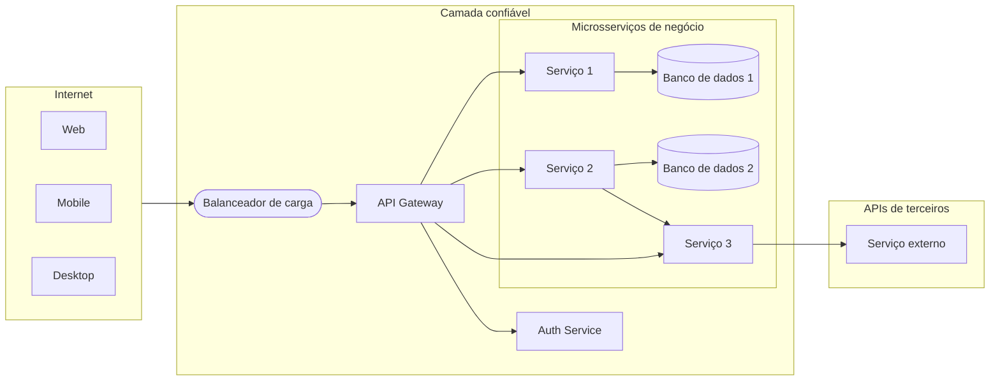
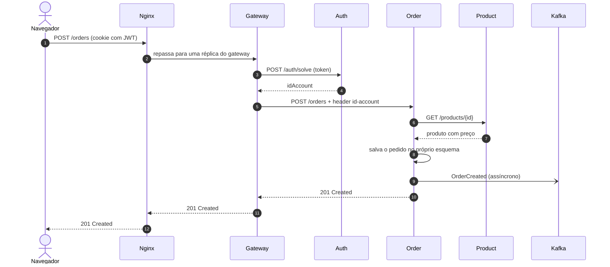

A loja agora tem seis serviços. Cada um deles precisa de HTTPS, precisa verificar quem é o usuário, precisa ser encontrado pelos outros mesmo que os seus containers subam e desçam, precisa de configuração e de segredos, e precisa produzir logs e métricas. Se cada time resolver esses problemas dentro do próprio serviço, a plataforma acaba com seis implementações ligeiramente diferentes (e ligeiramente erradas) da mesma coisa. A resposta é levar essas **preocupações transversais** (*cross-cutting concerns*) — preocupações que todo serviço tem, mas que não fazem parte de nenhum domínio de negócio — para uma infraestrutura compartilhada.

Um sistema de microsserviços em produção é mais do que uma coleção de serviços independentes. Ele exige um conjunto de **componentes de infraestrutura** que cuidam das preocupações transversais — roteamento, segurança, descoberta, configuração e observabilidade — para que cada serviço possa se manter focado no seu domínio de negócio[^1].

---

## Componentes

<figure markdown>
  {target="_blank"}
  <figcaption><i>Fonte: <a href="https://bytebytego.com/guides/what-does-a-typical-microservice-architecture-look-like/" target="_blank">System Design 101 — Microservice Architecture</a></i></figcaption>
</figure>

### Balanceador de carga

Distribui o tráfego de entrada entre várias instâncias de um serviço. Impede que uma única instância vire gargalo e desvia o tráfego das instâncias não saudáveis.

- **Camada 4 (TCP):** rápido, roteia por IP/porta — usado para vazão bruta.
- **Camada 7 (HTTP):** roteia por caminho da URL, headers ou cookies — permite roteamento baseado em conteúdo e canary deployments.

No curso, o [Hands-on 7](../../../hands-on/7/index.md) coloca o **Nginx** na frente de várias réplicas do gateway, usando o algoritmo `least_conn` (cada nova requisição vai para a réplica com o menor número de conexões ativas).

### CDN (Content Delivery Network)

Uma rede de caches distribuída geograficamente que serve arquivos estáticos (imagens, JS, CSS) a partir do local mais próximo do usuário. Reduz a latência para clientes no mundo todo e alivia o tráfego dos servidores de origem.

### API Gateway

O **ponto de entrada único** para todos os clientes externos. O gateway é responsável por:

| Preocupação | Como |
|---|---|
| **Roteamento** | `/orders/**` → Order Service, `/products/**` → Product Service |
| **Autenticação** | Valida os tokens JWT antes de repassar as requisições |
| **Rate limiting** | Protege os serviços de picos de tráfego ou de clientes abusivos |
| **Transformação de requisição/resposta** | Adiciona headers, agrega chamadas a vários serviços |
| **Terminação SSL** | Cuida do HTTPS; os serviços se comunicam em HTTP simples dentro da rede confiável |

O gateway é a fronteira entre a internet pública e a rede interna confiável. No curso, ele é uma aplicação **Spring Cloud Gateway** ([Hands-on 2](../../../hands-on/2/index.md)); as rotas são declaradas no `application.yaml`, por exemplo `Path=/accounts/**` → `http://account:8080`.

!!! info "Gateway ou balanceador de carga?"
    Os dois repassam requisições, mas em níveis diferentes. Um **balanceador de carga** distribui as requisições de *um* serviço entre as suas réplicas idênticas e não sabe nada sobre a aplicação. Um **gateway** decide para *qual* serviço vai uma requisição e aplica regras da aplicação (autenticação, limites de taxa). O curso usa os dois: o Nginx balanceia as réplicas do gateway, e o gateway roteia para os serviços.

### Provedor de identidade

Gerencia a autenticação e a autorização dos usuários usando protocolos padrão:

- **OAuth 2.0** — framework de delegação: um usuário concede a um cliente acesso aos seus recursos sem compartilhar a senha.
- **OpenID Connect (OIDC)** — camada de identidade sobre o OAuth 2.0: fornece um token de identidade JWT (`id_token`) além do token de acesso.
- **JWT (JSON Web Token)** — um token assinado e autocontido que codifica claims (ID do usuário, papéis, expiração). Os serviços validam a assinatura sem chamar o provedor de identidade a cada requisição.

No curso, o **serviço de autenticação** cumpre esse papel de forma simplificada: ele cadastra e autentica usuários, emite um JWT (guardado em um cookie) e resolve um token de volta para um id de conta para o gateway ([Hands-on 3](../../../hands-on/3/index.md)). OAuth 2.0 e OIDC são abordados em [Segurança](../../security/index.md).

### Descoberta e registro de serviços

Em um ambiente dinâmico, em que as instâncias dos serviços escalam para cima e para baixo e os endereços IP mudam, os serviços não podem ter endpoints fixos no código. Um **registro de serviços** (Consul, Eureka, DNS do Kubernetes) armazena a localização atual de todas as instâncias. Os serviços se registram ao iniciar e se descadastram ao desligar.

- **Descoberta no cliente (*client-side*):** quem chama consulta o registro e faz o próprio balanceamento de carga.
- **Descoberta no servidor (*server-side*):** o balanceador de carga ou o gateway consulta o registro em nome de quem chama.

No curso, o **DNS da plataforma** é o registro. O Docker Compose dá a cada serviço um hostname igual ao seu nome, então a rota do gateway e o cliente Feign simplesmente usam `http://account:8080`; com várias réplicas, o nome resolve para todas elas. No Kubernetes ([Hands-on 5](../../../hands-on/5/index.md)), um objeto `Service` ganha um nome DNS estável e distribui o tráfego entre os pods por trás dele — descoberta no servidor, sem Eureka nem Consul para operar.

### Serviço de configuração

Centraliza a configuração de todos os serviços (Spring Cloud Config, AWS Parameter Store, Vault). As mudanças podem ser enviadas aos serviços em execução sem um novo deploy. Os segredos (credenciais, chaves de API) são armazenados criptografados e injetados em tempo de execução.

No curso, a configuração segue a regra **twelve-factor** de mantê-la no ambiente[^3]: o `application.yaml` lê variáveis como `${DATABASE_HOST}`, cujos valores vêm do arquivo `.env` e do `compose.yaml`, e depois dos **ConfigMaps** e **Secrets** do Kubernetes. A mesma imagem roda em todos os ambientes; só o ambiente muda.

### Message broker

Transporta eventos entre os serviços de forma assíncrona, para que o produtor não espere — nem sequer conheça — os seus consumidores. O curso usa o **Apache Kafka**: o serviço de pedidos publica `OrderCreated` no tópico `order-events` e o serviço de notificação o consome ([Hands-on 9](../../../hands-on/9/index.md), [Arquitetura orientada a eventos](../../event_driven/index.md)).

### Cache distribuído

Um armazenamento em memória compartilhado por todas as réplicas de um serviço, usado para evitar repetir chamadas ou consultas caras. Com várias réplicas do gateway, um cache local em cada JVM guardaria dados diferentes; o **Redis** dá a elas um único cache compartilhado ([Hands-on 8](../../../hands-on/8/index.md)).

### Stack de observabilidade

Com dezenas de processos, "olhar o log" não funciona mais. A plataforma coleta **métricas** (o Prometheus coleta o `/actuator/prometheus` de cada serviço; o Grafana desenha os dashboards — [Hands-on 6](../../../hands-on/6/index.md)) e **traces** que acompanham uma requisição através dos serviços (OpenTelemetry + Jaeger — [Hands-on 10](../../../hands-on/10/index.md)). Veja [Observabilidade](../../observability/index.md).

### Resumo: a plataforma do curso

| Componente | Opções comuns | Na nossa plataforma | Hands-on |
|---|---|---|---|
| Balanceador de carga | Nginx, HAProxy, balanceadores de carga da nuvem | Nginx na frente das réplicas do gateway | [7](../../../hands-on/7/index.md) |
| API gateway | Spring Cloud Gateway, Kong, API gateways da nuvem | Spring Cloud Gateway (`gateway-service`) | [2](../../../hands-on/2/index.md), [3](../../../hands-on/3/index.md) |
| Provedor de identidade | Keycloak, Auth0, Amazon Cognito | `auth-service` emitindo JWTs | [3](../../../hands-on/3/index.md) |
| Descoberta de serviços | Eureka, Consul, DNS do Kubernetes | DNS do Docker Compose, depois Services do Kubernetes | [1](../../../hands-on/1/index.md), [5](../../../hands-on/5/index.md) |
| Configuração | Spring Cloud Config, Vault, ConfigMaps | `.env` + variáveis de ambiente, depois ConfigMaps e Secrets | [5](../../../hands-on/5/index.md) |
| Message broker | Kafka, RabbitMQ | Kafka | [9](../../../hands-on/9/index.md) |
| Cache | Redis, Memcached | Redis | [8](../../../hands-on/8/index.md) |
| Observabilidade | Prometheus, Grafana, OpenTelemetry, Jaeger | Prometheus + Grafana, OpenTelemetry + Jaeger | [6](../../../hands-on/6/index.md), [10](../../../hands-on/10/index.md) |

---

## Nossa arquitetura

O diagrama abaixo mostra a arquitetura de referência usada neste curso:

Na loja, os microsserviços de negócio são account, product e order; o serviço de câmbio é o que chama uma API de terceiros.

Principais decisões de projeto desta arquitetura:

- **Todo o tráfego externo entra pelo gateway.** Os serviços internos não são acessíveis pela internet.
- **A autenticação é um serviço separado.** O gateway delega a validação do token ao Auth Service (`POST /auth/solve`) e repassa a identidade de quem chamou no header `id-account`; os microsserviços de negócio confiam nesse header e nunca interpretam o JWT por conta própria.
- **Cada serviço tem o próprio banco de dados.** Sem esquema compartilhado. Os serviços se comunicam por APIs, não por tabelas compartilhadas.
- **Os serviços podem chamar uns aos outros.** O Serviço 2 chama o Serviço 3 para uma suboperação. Em fluxos síncronos, isso é aceitável; para confiabilidade em escala, considere padrões orientados a eventos.

### Acompanhando uma requisição

Um usuário autenticado faz um pedido. Cada componente acima cumpre o seu papel, nesta ordem:

- **1–2** O **balanceador de carga** escolhe uma réplica do gateway.
- **3–4** O **gateway** verifica o token com o **serviço de autenticação** e descobre quem é o usuário.
- **5** Ele roteia para o serviço de pedidos, adicionando o header `id-account`.
- **6–7** O serviço de pedidos pergunta o preço à **API de produtos** (nunca à tabela de produtos).
- **8–9** Ele salva o pedido no próprio esquema e publica um evento no **broker**, sem esperar o serviço de notificação.
- **10–12** A resposta faz o caminho de volta. Um trace no Jaeger mostra exatamente esses saltos como spans.

!!! warning "Armadilhas comuns de arquitetura"
    - **Contornar o gateway**: se a porta de um serviço de negócio for publicada na internet, qualquer pessoa pode chamá-lo e **forjar o header `id-account`**. Somente o gateway (ou o balanceador de carga na frente dele) pode ser exposto, e o gateway precisa sobrescrever qualquer header de identidade enviado pelo cliente.
    - **Uma única instância do gateway**: o ponto de entrada vira um ponto único de falha e um gargalo — rode réplicas atrás de um balanceador de carga ([Hands-on 7](../../../hands-on/7/index.md)).
    - **Lógica de negócio no gateway**: o gateway deve rotear e aplicar regras transversais, não calcular o total dos pedidos. Caso contrário, toda mudança de domínio exige um deploy do gateway.
    - **"Rede confiável" como única defesa**: HTTP simples dentro do cluster é uma simplificação; plataformas em produção costumam adicionar TLS mútuo entre os serviços ([Segurança](../../security/index.md)).

---

## Boas práticas

<figure markdown>
  { width="100%" }
  <figcaption><i>Fonte: <a href="https://bytebytego.com/guides/9-best-practices-for-developing-microservices/" target="_blank">System Design 101 — Microservice Best Practices</a></i></figcaption>
</figure>

| Prática | Por que importa |
|---|---|
| **Projete para a falha** | Qualquer chamada a outro serviço pode falhar. Use timeouts, retries com backoff e circuit breakers. |
| **Automatize tudo** | Deploys manuais em escala são propensos a erros. Pipelines de CI/CD, IaC e orquestração de containers são pré-requisitos. |
| **Seja dono dos seus dados** | Um serviço que compartilha o banco de dados com outro serviço não consegue evoluir de forma independente. |
| **Assíncrono sempre que possível** | Cadeias síncronas amplificam a latência e acoplam a disponibilidade. Eventos desacoplam produtores de consumidores. |
| **Observe tudo** | Traces distribuídos, logs estruturados e métricas são a única forma de entender falhas que atravessam as fronteiras dos serviços. |
| **Versione as suas APIs** | Os serviços são implantados de forma independente; mudanças incompatíveis na API precisam ser versionadas para não forçar deploys coordenados. |

Essas práticas são desenvolvidas em aulas próprias: [Padrões de resiliência](../../reliability/patterns/index.md), [Deploy](../../deployment/index.md), [Observabilidade](../../observability/index.md) e [Versionamento REST](../../api/rest/index.md#versioning)[^2].

---

## Pontos-chave

- As **preocupações transversais** (roteamento, autenticação, descoberta, configuração, observabilidade) pertencem à infraestrutura compartilhada, não a cada serviço.
- O **gateway** é o ponto de entrada único e a fronteira de confiança; o **balanceador de carga** distribui a carga entre réplicas idênticas.
- No curso, o gateway resolve o JWT por meio do serviço de autenticação e repassa o `id-account`; os serviços nunca interpretam tokens.
- A **descoberta** é o DNS da plataforma (Docker Compose, depois Services do Kubernetes); a **configuração** vem do ambiente.
- Kafka, Redis, Prometheus/Grafana e OpenTelemetry/Jaeger completam a plataforma — cada um é construído em um hands-on.

## Conexões

- Construa os componentes: [Hands-on 2 — Gateway](../../../hands-on/2/index.md), [3 — Segurança](../../../hands-on/3/index.md), [5 — Orquestração](../../../hands-on/5/index.md), [6 — Observabilidade](../../../hands-on/6/index.md), [7 — Balanceador de carga](../../../hands-on/7/index.md), [8 — Cache](../../../hands-on/8/index.md), [9 — Kafka](../../../hands-on/9/index.md), [10 — Rastreamento](../../../hands-on/10/index.md).
- Por que e onde dividir: [Microsserviços](../index.md), [Domain-Driven Design](../ddd/index.md).
- Fazendo o deploy de tudo: [Projeto](../../../exercises/project/index.md).

---

[^1]: XU, A. [System Design 101](https://github.com/ByteByteGoHq/system-design-101){target="_blank"}
[^2]: NEWMAN, S. *Building Microservices*. O'Reilly, 2021.
[^3]: WIGGINS, A. [The Twelve-Factor App — III. Config](https://12factor.net/config){target="_blank"}.
