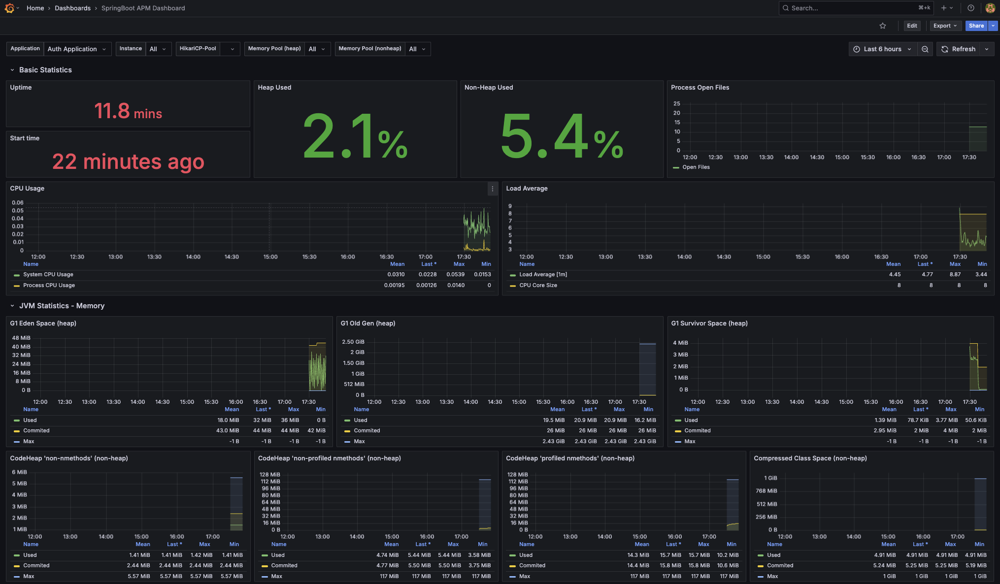

Para entregar uma aplicação de alto desempenho, você precisa identificar e tratar os possíveis gargalos do seu sistema. Este documento apresenta alguns gargalos comuns e como mitigá-los.

| Gargalo | Descrição | Mitigação |
| --- | --- | --- |
| Cache | Armazenar em memória os dados acessados com frequência para reduzir a carga no banco de dados. | Use bancos de dados em memória como Redis ou Memcached. |
| Observabilidade | Monitorar o estado interno do sistema para identificar problemas de desempenho. | Use ferramentas como Prometheus e Grafana para monitoramento. |
| Mensageria | Desacoplar componentes para tratar tarefas assíncronas. | Use filas de mensagens como RabbitMQ ou Apache Kafka. |
| Balanceamento de carga | Distribuir o tráfego de entrada entre vários servidores para evitar sobrecarga. | Use balanceadores de carga como Nginx ou HAProxy. |
| Varredura de vulnerabilidades | Identificar e corrigir vulnerabilidades de segurança na aplicação. | Use ferramentas como SonarQube, OWASP ZAP ou Snyk para varredura de vulnerabilidades. |
| Processamento de pagamentos | Tratar transações de pagamento de forma eficiente e segura. | Use gateways de pagamento de terceiros como Stripe ou PayPal, e garanta integração e tratamento de erros adequados. |
| Autenticação e autorização | Gerenciar permissões de usuários e controle de acesso de forma eficiente. | Implemente controle de acesso baseado em papéis (RBAC). Ou use OAuth2 para autenticação baseada em token. |

## Cache

Bancos de dados em memória são uma ótima forma de melhorar o desempenho da sua aplicação. Eles podem armazenar os dados acessados com frequência, reduzindo a necessidade de consultar o banco de dados a cada requisição. Exemplos de bancos de dados em memória incluem Redis e Memcached.

<iframe width="100%" height="470" src="https://www.youtube.com/embed/YcI9b-lgi7w" allowfullscreen></iframe>


## Observabilidade

Observabilidade é a capacidade de medir e entender o estado interno de um sistema a partir de suas saídas externas. Ela é essencial para identificar e diagnosticar problemas de desempenho na sua aplicação. Ferramentas como Prometheus e Grafana ajudam a monitorar o desempenho da aplicação e a identificar gargalos.

- [Set Up Prometheus and Grafana for Spring Boot Monitoring](https://medium.com/simform-engineering/revolutionize-monitoring-empowering-spring-boot-applications-with-prometheus-and-grafana-e99c5c7248cf){target="_blank"}

- [Monitor a Spring Boot App Using Prometheus](https://www.baeldung.com/spring-boot-prometheus){target="_blank"}

- <iframe width="100%" height="470" src="https://www.youtube.com/embed/K_EI1SxVQ5Q" allowfullscreen></iframe>


!!! tip "Spring + Prometheus + Grafana"

    Esta dica traz uma configuração básica para integrar o Spring Boot com Prometheus e Grafana para fins de monitoramento.

    Estrutura de arquivos sugerida:

    ``` { .tree }
    microservice
        src
            main
                resources
                    application.yaml
        pom.xml
    volume
        prometheus
            prometheus.yml
        grafana
            provisioning
                datasources
                    datasources.yml
    .env # (1)!
    compose.yaml
    ```

    1. VOLUME=./volume

    === "1. pom.xml"

        Adicione as seguintes dependências ao seu arquivo `pom.xml`:

        ``` { .xml .lineno="1" }
        --8<-- "./docs/2026.2/exercises/bottlenecks/observability/pom.xml"
        ```

    === "2. application.yaml"

        Configure o arquivo `application.yaml` para habilitar o actuator e o endpoint do Prometheus:

        ``` { .yaml .lineno="1" }
        --8<-- "./docs/2026.2/exercises/bottlenecks/observability/application.yaml"
        ```

    === "3. compose.yaml"

        Inclua no arquivo `compose.yaml` a configuração do Prometheus e do Grafana:

        ``` { .yaml .lineno="1" }
        --8<-- "./docs/2026.2/exercises/bottlenecks/observability/compose.yaml"
        ```

    === "4. prometheus.yml"

        Conecte o Prometheus à sua aplicação Spring Boot criando um arquivo `prometheus.yaml`:

        ```{ .yaml .lineno="1" }
        --8<-- "./docs/2026.2/exercises/bottlenecks/observability/prometheus.yml"
        ```

    === "5. Grafana com Prometheus"

        Para conectar o Grafana ao Prometheus, crie um arquivo `datasources.yml` no diretório `provisioning/datasources`:

        ```{ .yaml .lineno="1" }
        --8<-- "./docs/2026.2/exercises/bottlenecks/observability/datasources.yml"
        ```

    === "6. Acessar o Grafana"

        Depois de subir os containers e mapear as portas para a sua máquina local, você pode acessar o Grafana em `http://localhost:3000` com o usuário padrão `admin` e a senha `admin`. Em seguida, crie ou importe dashboards para visualizar as métricas coletadas da sua aplicação Spring Boot.

        Para saber mais sobre como criar dashboards no Grafana, consulte a [documentação do Grafana](https://grafana.com/docs/grafana/latest/getting-started/getting-started-grafana/){target="_blank"}.

        !!! tip "Um bom dashboard para Spring Boot"

            Você encontra um bom dashboard para aplicações Spring Boot no repositório de dashboards do Grafana: [SpringBoot APM Dashboard](https://grafana.com/grafana/dashboards/12900){target="_blank"}.

            {width="100%"}


## Mensageria

Filas de mensagens são uma ótima forma de desacoplar a sua aplicação e melhorar o desempenho dela. Elas podem tratar tarefas assíncronas, como enviar e-mails ou processar jobs em segundo plano. Exemplos de filas de mensagens incluem RabbitMQ e Apache Kafka.

<iframe width="100%" height="470" src="https://www.youtube.com/embed/97TF2xZgAhU" allowfullscreen></iframe>


## Balanceamento de carga

Balanceamento de carga é o processo de distribuir o tráfego de rede de entrada entre vários servidores. Isso garante que nenhum servidor fique sobrecarregado de requisições, melhorando o desempenho geral e a confiabilidade da sua aplicação. Ferramentas como Nginx e HAProxy ajudam a implementar o balanceamento de carga na sua aplicação.

- [How To Configure Nginx as a Reverse Proxy on Ubuntu](https://www.digitalocean.com/community/tutorials/how-to-configure-nginx-as-a-reverse-proxy-on-ubuntu-22-04){target="_blank"}
- <iframe width="100%" height="470" src="https://www.youtube.com/embed/5YOEIV-xPdc" allowfullscreen></iframe>


## Varredura de vulnerabilidades

Varredura de vulnerabilidades é o processo de identificar e corrigir vulnerabilidades de segurança na sua aplicação. Ferramentas como OWASP ZAP e Snyk ajudam a identificar possíveis problemas de segurança no seu código e nas suas dependências.

<iframe width="100%" height="470" src="https://www.youtube.com/embed/361bfIvXMBI" allowfullscreen></iframe>
