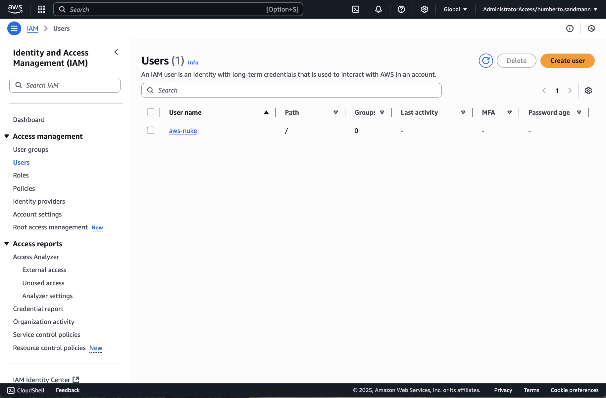
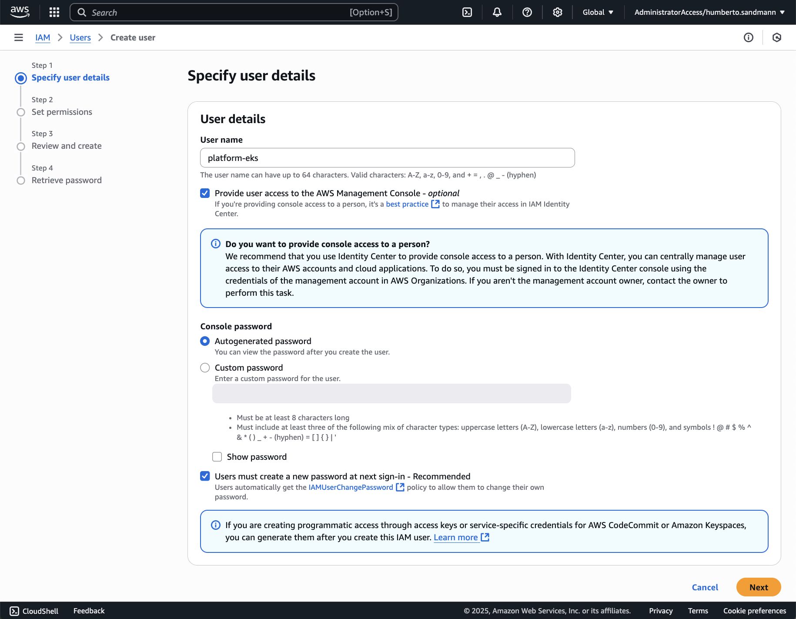
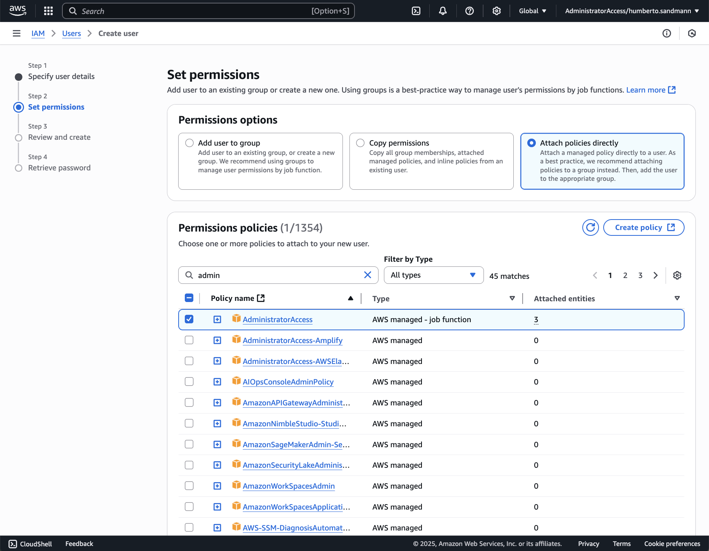
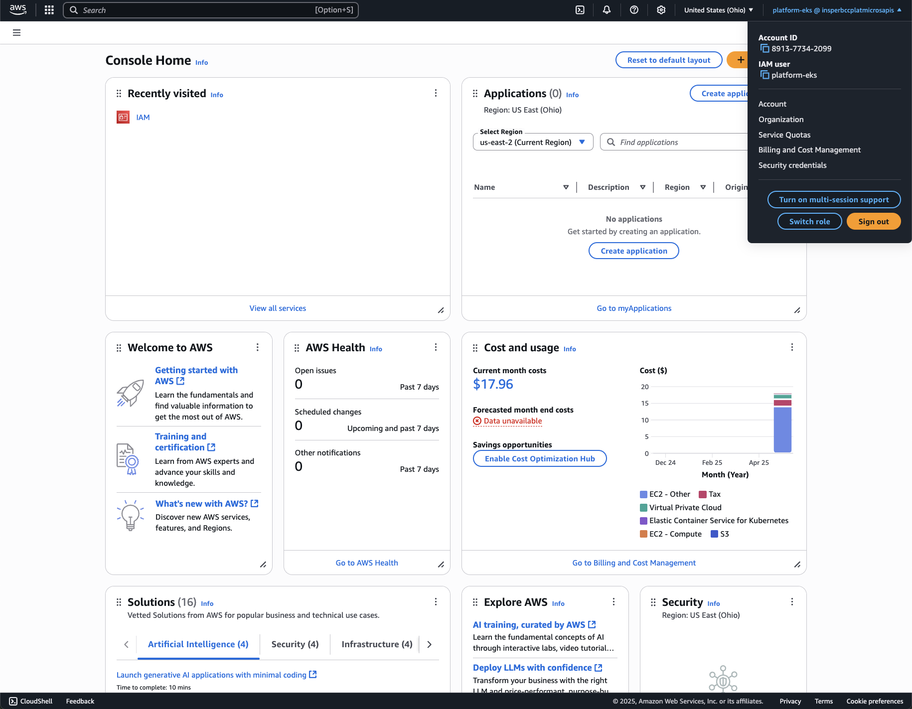
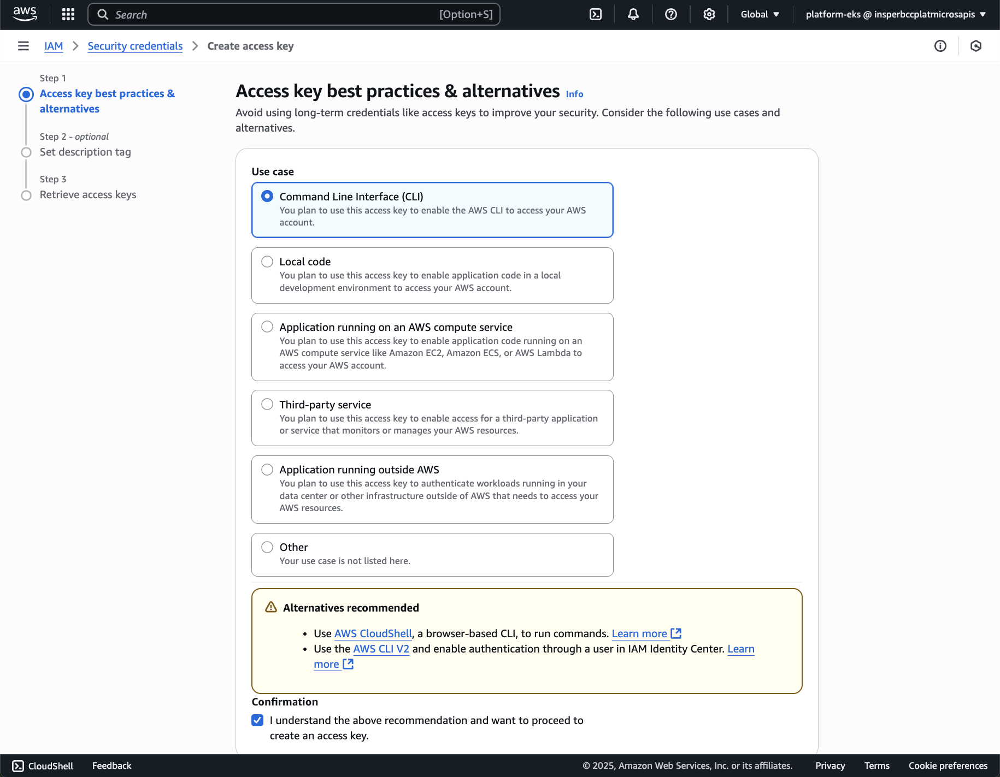
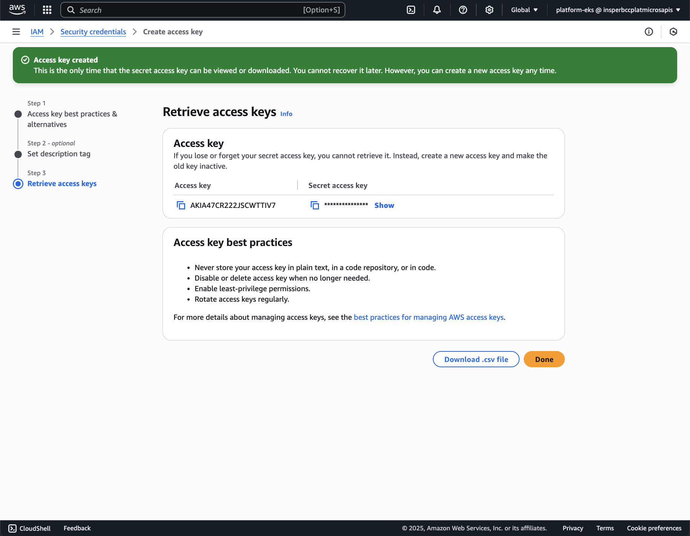

## Configuração da AWS

A AWS é uma plataforma de computação em nuvem que oferece uma ampla gama de serviços, incluindo computação, armazenamento, banco de dados, análise, rede, mobilidade, ferramentas de desenvolvedor, gerenciamento e segurança. Para configurar a AWS, você precisará criar uma conta e configurar os serviços necessários para o seu projeto.

!!! tip "Roteiro"

    **Este roteiro não é completo e pode não cobrir todos os passos necessários para configurar o seu ambiente AWS. Ele é um bom começo para ajudar você a entender os passos para configurar o seu ambiente AWS. Você encontra mais informações sobre cada passo na documentação da AWS.**

    Crie uma conta na AWS e configure a AWS CLI. Com a AWS CLI, você gerencia os seus serviços AWS pela linha de comando.
    
    === "1. Criar usuário"

        { width=100% }
        { width=100% }
        { width=100% }

    === "2. Login no AWS Dashboard"

        Faça login no AWS Dashboard com o usuário criado.

    === "3. Criar chave de acesso"

        { width=100% }
        { width=100% }
        { width=100% }

    === "4. Configurar a AWS CLI"

        [AWS CLI](https://docs.aws.amazon.com/cli/latest/userguide/getting-started-install.html){target="_blank"}
