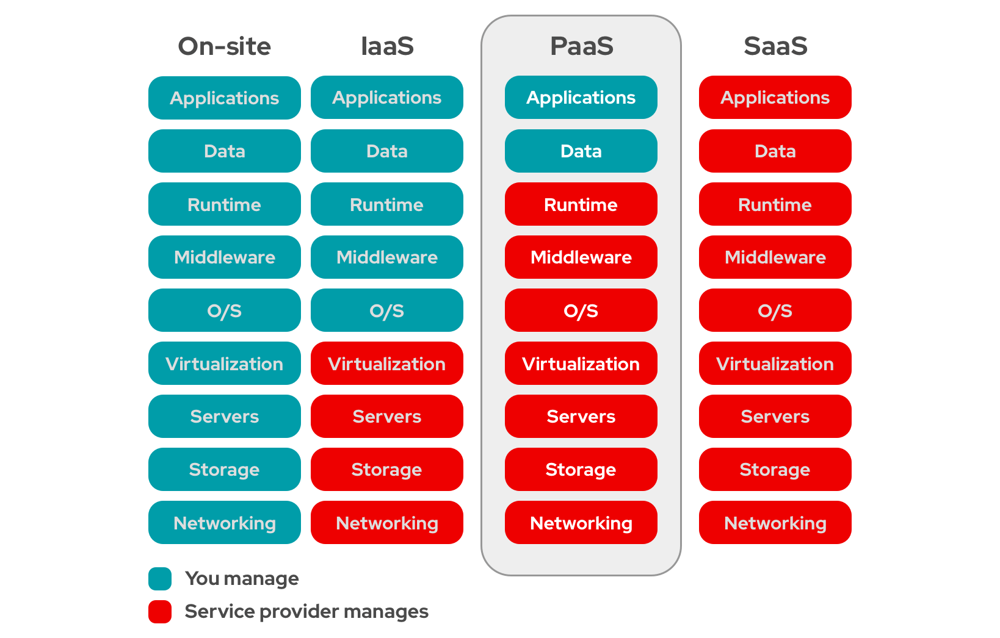

## Costs

Cost analysis is an important part of software development, as it helps ensure that your project stays within budget. Several tools are available to help with cost analysis, including AWS Cost Explorer[^1] and AWS Budgets[^2].

!!! info "TO DO"

    Put together a cost plan for your project, including the costs of using EKS, RDS and the other AWS services you are using. Use the AWS pricing calculator to estimate your project's costs.

## PaaS

Platform as a Service (PaaS) is a cloud computing model that provides a platform to develop, run and manage applications without the complexity of building and maintaining the infrastructure usually associated with developing and launching applications.

{ width=100% }

!!! info "TO DO"

    Describe where your group used PaaS and how it was used.

[^1]: [AWS Cost Explorer](https://aws.amazon.com/aws-cost-management/aws-cost-explorer/){target="_blank"}
[^2]: [AWS Budgets](https://aws.amazon.com/aws-cost-management/aws-budgets/){target="_blank"}
