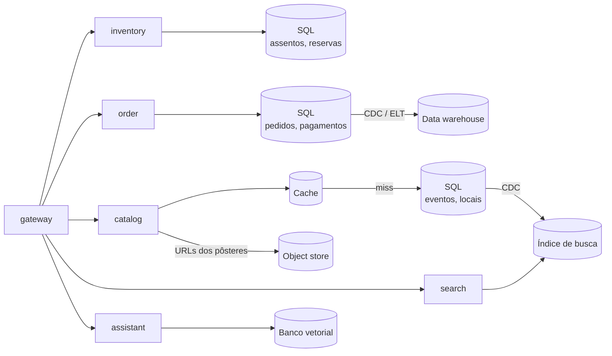
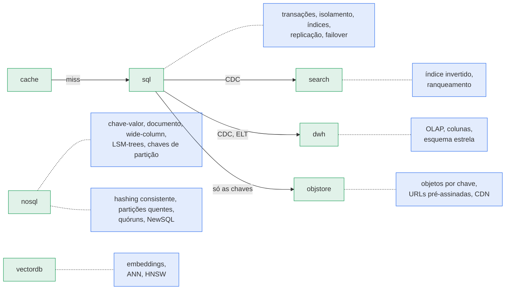

O BoxOffice começou como a maioria dos produtos: um serviço e um banco PostgreSQL guardando tudo — eventos, locais, assentos, pedidos, usuários e até as imagens dos pôsteres em colunas `bytea`. Funcionou por um ano. Então o show no estádio abriu as vendas às 10:00. Dois milhões de fãs abriram a página do evento, a caixa de busca foi martelada com "taylor", o time de marketing rodou um relatório de "vendas por minuto" no mesmo banco, e 60.000 assentos precisavam ser vendidos **exatamente uma vez cada**. Às 10:02 a CPU do banco estava em 100%, a consulta do relatório segurou locks por 40 segundos, e dois fãs receberam ingressos para o assento `A-12`.

Não havia nada "errado" com o PostgreSQL. O problema era que **dados diferentes têm formas diferentes**, e pediu-se a um único armazenamento que fosse bom em todas elas ao mesmo tempo. Esta aula trata de reconhecer essas formas e de escolher — e escalar — o armazenamento certo para cada uma.

!!! abstract "Objetivos de aprendizagem"

    Ao final desta aula, você deve ser capaz de:

    - **Classificar** os dados de um sistema por padrão de acesso, volume, necessidade de consistência e flexibilidade de consulta, e **mapear** cada tipo para um componente de armazenamento (SQL, NoSQL, busca, object store, data warehouse, banco vetorial).
    - **Comparar** os modelos relacional, chave-valor, documento, wide-column e grafo, e **justificar** uma escolha entre SQL e NoSQL com um guia de decisão em vez de um slogan.
    - **Explicar** como funcionam os motores de armazenamento B-tree e LSM-tree e os índices, e **prever** seu efeito no custo de leitura e de escrita.
    - **Diagnosticar** anomalias de isolamento (*lost update*, *write skew*, fantasmas) e **corrigir** um bug de venda duplicada com `SELECT … FOR UPDATE`, updates condicionais, locking otimista ou constraints.
    - **Projetar** replicação (líder-seguidor, multi-líder, sem líder) e particionamento (por faixa, por hash, hashing consistente) para uma carga, e **antecipar** o atraso de replicação, as partições quentes e o resharding.
    - **Decidir** quando um motor de busca, um object storage, um data warehouse ou um banco vetorial pertence à arquitetura, e como os dados chegam até ele (CDC, ETL/ELT, embeddings).

## Roteiro

1. **Esta visão geral** — o mapa de dados do BoxOffice, as perguntas que escolhem um armazenamento, persistência poliglota e a escada de escalabilidade do banco de dados.
2. [Modelos de Dados e Motores de Armazenamento](models/index.md) — relacional, chave-valor, documento, wide-column, grafo; o guia de decisão SQL vs NoSQL; B-trees vs LSM-trees; índices e `EXPLAIN`.
3. [Transações e Isolamento](transactions/index.md) — ACID, níveis de isolamento e suas anomalias, o bug da venda duplicada e quatro maneiras de corrigi-lo, reservas de assento.
4. [Replicação](replication/index.md) — líder-seguidor, síncrona vs assíncrona, atraso de replicação, failover, multi-líder e quóruns sem líder.
5. [Particionamento e NewSQL](partitioning/index.md) — por faixa, por hash e hashing consistente, partições quentes, índices secundários, resharding, Spanner e CockroachDB.
6. [Armazenamentos Especializados](specialized/index.md) — motores de busca, object storage, data warehouses e lakehouses, bancos vetoriais.
7. [Quiz](quiz.md) — verifique seu entendimento.

## Slides

  <iframe src="slides/databases.html" title="Slides: bancos de dados e sistemas de dados" loading="lazy" allowfullscreen></iframe>

Clique nos slides e use ← → para navegar; **F** abre em tela cheia e **P** abre a visão do apresentador, com as notas.
[:material-presentation: Abrir os slides em uma nova aba](slides/databases.html){:target="_blank"}

---

## Dados têm forma

Antes de escolher um banco de dados, descreva os dados. Quatro propriedades decidem quase tudo:

| Propriedade | Pergunta a fazer | Por que importa |
|---|---|---|
| **Padrão de acesso** | Como os dados são lidos e escritos? Por chave? Por faixa? Texto livre? Agregações sobre milhões de linhas? | Cada armazenamento é rápido para alguns padrões e lento para o resto. |
| **Proporção leitura/escrita e volume** | Quantas leituras e escritas por segundo, no pico? Quantos bytes, crescendo a que ritmo? | Decide se um nó basta, e se é preciso escalar leituras (réplicas, cache) ou escritas (particionamento). |
| **Necessidade de consistência** | O que quebra se um leitor vê dados com alguns segundos de atraso? E se dois escritores competirem? | Dinheiro e estoque exigem garantias fortes; um contador de "visualizações", não. |
| **Flexibilidade de consulta** | As consultas são conhecidas de antemão, ou os analistas vão inventar novas toda semana? | Consultas fixas permitem tabelas NoSQL desnormalizadas; consultas ad hoc pedem SQL e índices. |

Aplicá-las ao BoxOffice produz um **mapa de dados**. Os volumes abaixo são suposições ilustrativas para uma empresa de ingressos de porte médio — o que importa é a ordem de grandeza e o contraste entre as linhas, não os valores exatos.

| Dado | Exemplo | Volume (suposto) | Padrão de acesso | Necessidade de consistência | Componente da paleta |
|---|---|---|---|---|---|
| Estoque de assentos e reservas | o assento `A-12` do evento 42 está `HELD` pela Alice até 10:07 | 60 mil linhas por evento de estádio; rajadas de milhares de escritas/s na abertura das vendas | leitura/atualização pontual por `(event_id, seat_id)`; varredura por faixa de "melhor disponível" | **forte** — nunca vender um assento duas vezes | [`sql`](../../reference/components/storage/index.md#sql) |
| Pedidos e pagamentos | pedido 9001: 2 ingressos, R$ 980, `PAID` | ~100 mil pedidos/dia (≈ 36 M/ano) × ~1 KB ≈ 37 GB/ano | por id, por cliente; joins com ingressos | **forte** — dinheiro | `sql` |
| Catálogo de eventos | nome, local, data, atrações, preços | ~20 mil eventos/ano, alguns KB cada | leitura intensa (≫ 100 leituras por escrita), por id e por listagem | atraso de segundos é aceitável | `sql` + [`cache`](../../reference/components/storage/index.md#cache) |
| Busca | "taylor são paulo dezembro" | os mesmos eventos, como índice invertido | texto livre, tolerante a erros de digitação, ranqueado, autocompletar | eventual (segundos) | [`search`](../../reference/components/compute/index.md#search) |
| Pôsteres de eventos e ingressos em PDF | `posters/42/hero.webp`, 2 MB | pôsteres: ~20 mil eventos × ~5 imagens ≈ 100 GB/ano; PDFs de ingressos: ~7 TB/ano (ou gerados sob demanda) | objeto inteiro por chave, servido por uma CDN | escreve uma vez, lê muitas | [`objstore`](../../reference/components/storage/index.md#objstore) |
| Clickstream e análise de vendas | eventos `page_view`, `add_to_cart`, `purchase` | ~100 M eventos/dia × ~200 B ≈ 20 GB/dia | agregações ao longo de meses ("vendas por minuto por cidade") | minutos de atraso são aceitáveis | [`dwh`](../../reference/components/storage/index.md#dwh) |
| Sessões, contadores de rate limit, posição na sala de espera | `session:abc → user 7` | milhões de chaves pequenas | busca por chave, abaixo de um milissegundo, com TTL | perder algumas é tolerável | `cache` / [`nosql`](../../reference/components/storage/index.md#nosql) |
| Conhecimento do assistente | trechos do FAQ, política de reembolso, descrições de eventos como embeddings | ~100 mil vetores × 1.024 dimensões × 4 B ≈ 400 MB | vizinho mais próximo por significado | eventual | [`vectordb`](../../reference/components/storage/index.md#vectordb) |

Repare que as linhas diferem em **ordens de grandeza** em todas as colunas. Um armazenamento ajustado para a primeira linha (pequena, quente, transacional) é uma escolha ruim para a sexta (enorme, só de inserção, varrida em massa), e vice-versa.

Isso é **persistência poliglota** (*polyglot persistence*): cada serviço guarda seus dados no armazenamento que se encaixa no seu padrão de acesso, e os dados fluem entre armazenamentos por fluxos de mudanças, e não por tabelas compartilhadas.

??? question "Pense antes: o índice de busca é uma segunda fonte da verdade?"

    Não. O banco SQL do catálogo é o **sistema de registro** (*system of record*); o índice de busca, o cache, o warehouse e o banco vetorial são **dados derivados** — podem ser reconstruídos a partir do sistema de registro. Essa distinção diz para onde vão as escritas (apenas para o sistema de registro), o que precisa de backup cuidadoso e o que você pode jogar fora e reconstruir depois de um bug. Kleppmann chama essa divisão de "sistemas de registro vs dados derivados"[^1].

---

## Cinco perguntas que escolhem um armazenamento { #five-questions }

Quando chega um requisito — numa revisão de design ou numa entrevista — percorra estas perguntas em ordem. Na maioria das vezes a resposta é "um banco relacional", e você só sai dele com um motivo.

1. **Qual é o sistema de registro, e quais são os seus invariantes?** Assentos nunca podem ser vendidos duas vezes; o total de um pedido deve ser igual à soma dos seus itens. Invariantes que abrangem várias linhas pedem **transações** — um banco relacional é o padrão.
2. **Quais são as 3 principais consultas, e elas são conhecidas de antemão?** Buscas por chave conhecidas, em escala enorme, combinam com um armazenamento chave-valor ou wide-column; consultas desconhecidas, ad hoc, combinam com SQL.
3. **Qual o tamanho, qual a velocidade, crescendo como?** Estime o QPS de pico e os bytes (veja [Estimativas](../estimation/numbers/index.md)). Se um nó com réplicas aguenta os próximos dois ou três anos, você ainda não precisa particionar.
4. **Quão desatualizada uma leitura pode estar?** Segundos de atraso liberam réplicas, caches e índices assíncronos — as ferramentas de escala mais baratas que existem.
5. **O que o time consegue operar?** Um PostgreSQL gerenciado que todo mundo entende vence um armazenamento exótico que só uma pessoa consegue depurar às 3 da manhã.

!!! example "BoxOffice: aplicando as perguntas ao estoque de assentos"

    1. Invariante: um assento, no máximo uma reserva ou ingresso válido → exige check-and-set atômico → **transações**.
    2. Principais consultas: reservar assento por `(event_id, seat_id)`; listar os assentos disponíveis de um setor; liberar reservas expiradas → conhecidas, mas a segunda é uma varredura por faixa → **SQL com um índice composto** serve.
    3. Volume: todo o estoque de um evento de estádio são 60 mil linhas — minúsculo. O desafio são as **rajadas de escrita** sobre um único evento, não o tamanho.
    4. Atraso: o *mapa* de assentos mostrado aos fãs pode ter segundos de atraso; a decisão da *reserva* precisa ler o estado atual.
    5. Time: o PostgreSQL está em todos os hands-ons do curso.

    Decisão: PostgreSQL para o estoque, com locking por linha (veja [Transações](transactions/index.md)) e um mapa de assentos em cache, levemente desatualizado, para exibição.

---

## A escada de escalabilidade do banco de dados { #scaling-ladder }

O banco de dados costuma ser o primeiro componente a saturar, porque é o único componente difícil de tornar stateless. O erro clássico é pular direto para o sharding. Suba a escada um degrau por vez, e meça antes de cada degrau[^2]:

| Degrau | O que você faz | O que ganha | O que custa |
|---|---|---|---|
| 1. Corrigir as consultas | Criar o índice que falta, remover consultas N+1, ler o `EXPLAIN` | Muitas vezes 10–100× na consulta lenta | Quase nada |
| 2. Pool de conexões | PgBouncer ou o pool do driver; limitar conexões por serviço | Impede o banco de se afogar em conexões | Um arquivo de configuração |
| 3. Escalar verticalmente | Instância maior: mais RAM (working set em memória), SSD mais rápido | 2–4× sem mudar código | Dinheiro; existe uma instância máxima |
| 4. Cache de leituras | Cache-aside para dados quentes e majoritariamente lidos ([Cache](../caching/index.md)) | Remove a maior parte do tráfego de leitura | Dados desatualizados e invalidação |
| 5. Réplicas de leitura | Rotear leituras para seguidores ([Replicação](replication/index.md)) | Vazão de leitura × réplicas | Atraso de replicação; leituras podem estar desatualizadas |
| 6. Dividir por função | Um banco por serviço (catalog, inventory, order) | Isola cargas; bancos menores | Sem joins nem transações entre serviços |
| 7. Particionar (sharding) | Espalhar uma tabela por vários nós segundo uma chave ([Particionamento](partitioning/index.md)) | Vazão de escrita e armazenamento × shards | Consultas entre shards, resharding, operação |
| 8. Armazenamentos especializados | Busca, warehouse, object store, banco vetorial para dados derivados | Cada consulta no motor feito para ela | Mais sistemas e pipelines para operar |

Os degraus 1–5 são baratos e reversíveis; os degraus 6–8 mudam a arquitetura. Em 2026, um único nó relacional bem ajustado, com algumas réplicas, atende com folga a grande maioria dos produtos; o sharding é para os poucos que o superam, e o SQL distribuído gerenciado (veja [NewSQL](partitioning/index.md#newsql)) tornou esse último degrau menos doloroso do que costumava ser.

**Experimente.** O cenário abaixo é o ponto de partida com um nó: cliente → app → SQL. Aumente a carga até o banco saturar e observe a latência p99 se curvar para cima (o "joelho" de [Filas](../estimation/queueing/index.md)). Depois pense em qual degrau da escada você subiria primeiro — e confira no cenário `db-replicas` da página de [Replicação](replication/index.md).

O simulador completo, com todos os componentes de armazenamento da paleta, está no [Playground](../../../playground/index.md).

---

## Um banco por serviço, ou um banco para tudo?

Dois conselhos opostos coexistem, e ambos estão certos no seu contexto.

**Banco por serviço.** Numa arquitetura de microsserviços, cada serviço é dono dos seus dados e ninguém mais lê as suas tabelas ([Computação e Serviços](../compute/services/index.md)). O catálogo pode mudar seu esquema sem quebrar o estoque; uma consulta analítica lenta não consegue travar as tabelas de pedidos. O preço: nada de joins nem de transações entre serviços — você precisa de eventos, sagas e do transactional outbox ([Padrões de mensageria](../messaging/patterns/index.md)).

**"Use só o Postgres".** O PostgreSQL moderno cobre um leque surpreendente[^3]: documentos JSONB com índices GIN, busca textual (`tsvector`), dados geoespaciais (PostGIS), séries temporais (tabelas particionadas, TimescaleDB), filas (`SELECT … FOR UPDATE SKIP LOCKED`) e busca vetorial (`pgvector`). Menos sistemas significa menos coisas para operar, fazer backup, proteger e aprender.

| | Um motor para muitas necessidades | Um armazenamento especializado por necessidade |
|---|---|---|
| Operação | uma coisa para rodar, monitorar e fazer backup | um sistema a mais por necessidade |
| Consistência | pode atualizar tudo numa só transação | armazenamentos derivados ficam para trás (CDC, ETL) |
| Desempenho máximo | bom o bastante até a média escala | o melhor para aquele padrão de acesso em grande escala |
| Funcionalidades | busca textual básica, busca vetorial básica | ajuste de relevância, facetas, bilhões de vetores, varreduras colunares |
| Habilidades do time | um conjunto de habilidades | vários |

O caminho pragmático para o BoxOffice: começar com PostgreSQL por serviço (esquemas próprios, bancos separados ou ao menos usuários separados) e **acrescentar um armazenamento especializado quando surgir uma necessidade medida** — o time de relevância de busca precisa de facetas e tolerância a erros de digitação, os analistas precisam varrer dois anos de cliques, o assistente precisa de dezenas de milhões de vetores.

## O mapa de conceitos de bancos de dados { #concept-map }

Cada componente de armazenamento é feito para uma família de padrões de acesso; o sistema de registro alimenta os armazenamentos derivados por streams de mudanças. O mapa liga cada **componente da paleta** (verde) aos **conceitos** em que ele se apoia (azul):

| Componente da paleta | Pergunta que responde | Conceitos | Ensinado em | Cenários |
|---|---|---|---|---|
| [`sql`](../../reference/components/storage/index.md#sql) | Onde moram os dados com invariantes? | ACID, níveis de isolamento, `UPDATE` condicional, `SELECT … FOR UPDATE`, índices, `EXPLAIN` | [Modelos de Dados](models/index.md#relational), [Transações](transactions/index.md) | `monolith`, `flash-sale` |
| [`sql`](../../reference/components/storage/index.md#sql) (réplicas) | Como escalar leituras e sobreviver a um líder morto? | líder–seguidor, síncrona vs assíncrona, atraso de replicação, ler as próprias escritas, pooling, failover | [Replicação](replication/index.md) | `db-replicas` |
| [`nosql`](../../reference/components/storage/index.md#nosql) | Que padrão de acesso nos tira de um banco relacional? | chave-valor, documento, wide-column, grafo, LSM-trees, chaves de partição e de ordenação | [Modelos de Dados — guia de decisão](models/index.md#decision-guide) | `sharding` |
| [`nosql`](../../reference/components/storage/index.md#nosql) (particionado) | Como escritas e armazenamento crescem além de um nó? | faixa vs hash, hashing consistente, partições quentes, resharding, quóruns sem líder, NewSQL | [Particionamento](partitioning/index.md), [Replicação — sem líder](replication/index.md#leaderless) | `sharding` |
| [`search`](../../reference/components/compute/index.md#search) | Como os fãs encontram "rock em São Paulo"? | índice invertido, ranqueamento, sincronizado por CDC, dado derivado | [Especializados — motores de busca](specialized/index.md#search-engines) | `search-autocomplete` |
| [`objstore`](../../reference/components/storage/index.md#objstore) | Onde moram os pôsteres e os PDFs dos ingressos? | objetos por chave, URLs pré-assinadas, uma CDN na frente | [Especializados — object storage](specialized/index.md#object-storage) | `cdn-static`, `video-streaming` |
| [`dwh`](../../reference/components/storage/index.md#dwh) | Onde rodam as consultas dos analistas? | OLTP vs OLAP, armazenamento colunar, esquema estrela, ETL/ELT, lakehouse | [Especializados — warehouses](specialized/index.md#data-warehouses) | `event-fanout` |
| [`vectordb`](../../reference/components/storage/index.md#vectordb) | Como o assistente encontra textos pelo significado? | embeddings, busca exata vs aproximada, HNSW, pgvector primeiro | [Especializados — bancos vetoriais](specialized/index.md#vector-databases) | `ai-assistant` |
| [`cache`](../../reference/components/storage/index.md#cache) · [`stream`](../../reference/components/messaging/index.md#stream) | Como as leituras evitam o banco, e os derivados ficam sincronizados? | a escada de escalabilidade, cache-aside, CDC, outbox | [esta visão geral](#scaling-ladder), [Caching](../caching/index.md) | `read-heavy-cache` |

!!! tip "Na entrevista"

    Entrevistadores prestam atenção ao *porquê* da sua escolha, não a nomes de marcas. Um padrão forte é: "**Assentos e pedidos vão para um banco relacional** porque o invariante 'um assento, um ingresso' precisa de transações; o catálogo é de leitura intensa, então um **cache** na frente dele; a busca vai para um **índice invertido** alimentado por CDC; os pôsteres em **object storage** atrás da CDN; a análise num **warehouse**, nunca no banco OLTP." Depois estime: "60 mil assentos por evento é minúsculo — o problema é a contenção de escrita, não o tamanho", o que mostra que você sabe *qual* dimensão é difícil.

!!! warning "Armadilhas comuns"

    - **Sharding primeiro.** Particionar um banco de 50 GB adiciona meses de complexidade para resolver um problema que um índice e uma réplica teriam resolvido.
    - **Análise no banco OLTP.** Um relatório que varre milhões de linhas disputa CPU, I/O e locks com o checkout. Leve-o no mínimo para uma réplica, de preferência para um warehouse.
    - **Blobs no banco.** Imagens e PDFs incham os backups e o buffer pool; guarde-os em object storage e mantenha só a chave.
    - **Escolher NoSQL "para escalar" sem conhecer as consultas.** Tabelas NoSQL são projetadas em torno dos padrões de acesso; se você ainda não os conhece, vai projetar a tabela errada.
    - **Tratar dados derivados como fonte da verdade.** Se o índice de busca ou o cache é o único lugar onde um valor existe, uma reconstrução perde dados.

---

## Conexões

- [Modelos de Dados e Motores de Armazenamento](models/index.md) continua esta página com o guia de decisão SQL vs NoSQL.
- [Sistemas Distribuídos](../distributed/index.md) — replicação e particionamento dependem dos seus modelos de consistência, quóruns e consenso.
- [Cache](../caching/index.md) — o degrau 4 da escada, e a próxima aula.
- [Mensageria e Arquitetura Orientada a Eventos](../messaging/index.md) — CDC e o transactional outbox mantêm os armazenamentos derivados sincronizados.
- [Sistemas de IA](../ai-systems/rag-memory/index.md) — o banco vetorial dentro de um pipeline de RAG.

**Relacionados:** [Hands-on 6 — Dados em escala](../../hands-on/6/index.md) (reservas de assento, réplica de leitura, PgBouncer, `EXPLAIN`) · [Hands-on 1 — Primeiro serviço](../../hands-on/1/index.md) (catálogo em PostgreSQL + Flyway) · [Exercício: cache + banco de dados](../../exercises/cache-db/index.md) · [Estudo de caso: venda de ingressos do BoxOffice](../case-studies/ticketing/index.md) · [Estudo de caso: encurtador de URL](../case-studies/url-shortener/index.md) · [Preparação para entrevistas](../../support/interview/index.md) · Catálogo de componentes: [Armazenamento](../../reference/components/storage/index.md).

## Principais conclusões

- Descreva os dados por **padrão de acesso, volume, necessidade de consistência e flexibilidade de consulta** antes de escolher um armazenamento.
- Separe o **sistema de registro** dos **dados derivados** (cache, índice de busca, warehouse, vetores), que podem ser reconstruídos.
- O banco relacional é o padrão para dados com **invariantes**; saia dele por um motivo medido.
- Suba a **escada de escalabilidade** em ordem: consultas e índices → pool de conexões → escala vertical → cache → réplicas → divisão por função → sharding → armazenamentos especializados.
- A persistência poliglota compra desempenho por padrão de acesso ao preço de operação e pipelines.

---

[^1]: KLEPPMANN, M.; RICCOMINI, C. *Designing Data-Intensive Applications*. 2ª ed. O'Reilly. Capítulo sobre dados derivados; a 1ª edição (2017) chama a divisão de "Systems of Record and Derived Data" (Parte III).
[^2]: XU, A. *System Design Interview – An Insider's Guide*. Vol. 1. Byte Code LLC, 2020. Capítulo 1, "Scale from zero to millions of users".
[^3]: PostgreSQL Global Development Group. [PostgreSQL Documentation](https://www.postgresql.org/docs/current/){target="_blank"}.
