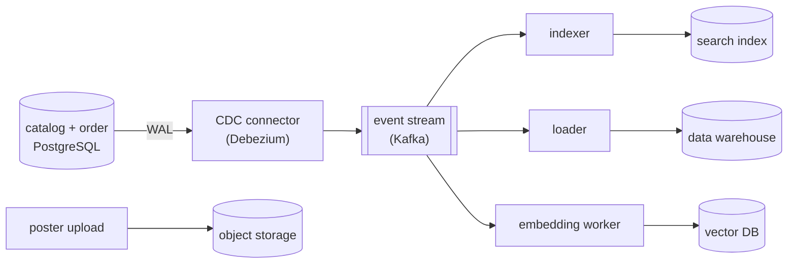
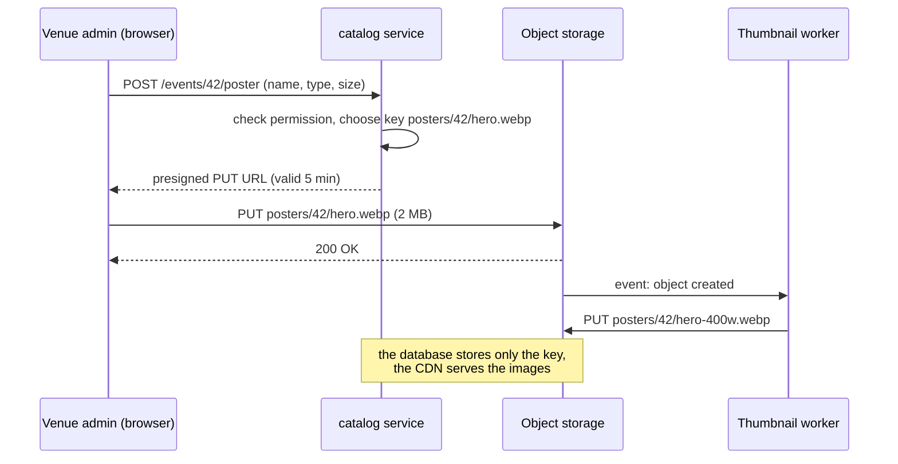
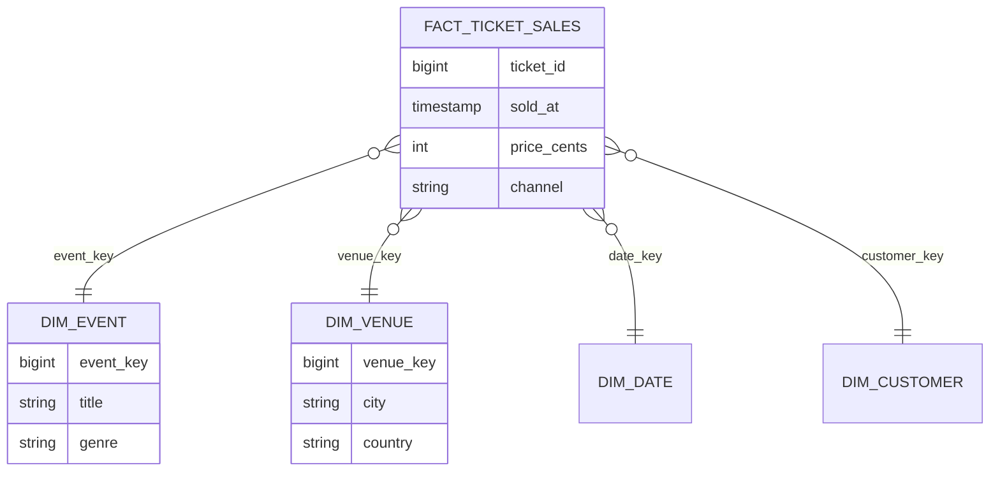
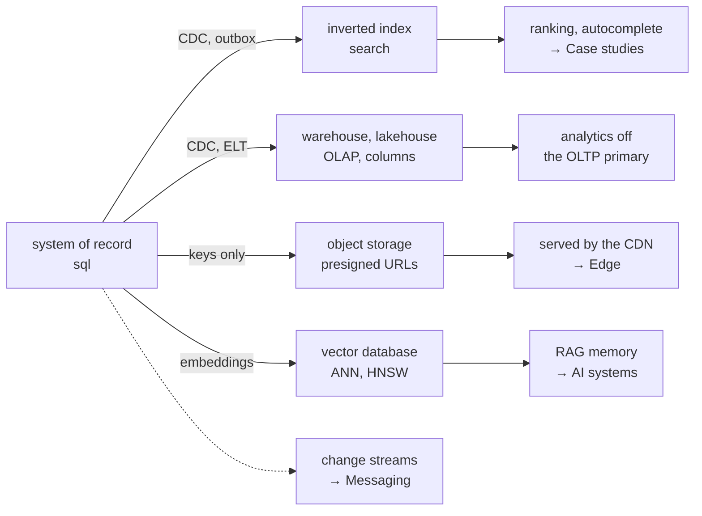

A fan types "tayler swift sp dezembro" into the BoxOffice search box. Marketing wants "tickets sold per minute, per city, for the last two years" every morning. The event page shows a 2 MB poster to millions of visitors. The support assistant must find the refund policy paragraph that answers "can I get my money back if the show moves to another date?" — a sentence that shares almost no words with the policy text.

A relational database *can* do a weak version of each of these, and that is often the right start. But each one has an engine designed for it: a **search engine**, **object storage**, a **data warehouse** and a **vector database**. All four hold **derived data** (see the [overview](../index.md)): copies of the system of record, reshaped for one kind of question.

---

## How derived data flows

The system of record stays in the services' relational databases. Changes flow out to the specialized stores through **change data capture** (CDC): a connector reads the database's log (the PostgreSQL WAL, the MySQL binlog) and publishes every insert, update and delete as an event.



Why not have the service write to the database *and* to the search index directly (a **dual write**)? Because the two writes can fail independently or arrive in different orders under concurrency, leaving the stores permanently inconsistent. CDC (or the transactional outbox, see [Messaging patterns](../../messaging/patterns/index.md)) gives one ordered source of changes, and any derived store can be rebuilt by replaying it.

---

## Search engines { #search-engines }

### Why `LIKE '%taylor%'` is not search

```sql title="The naive search"
SELECT id, title FROM events
WHERE title ILIKE '%tayler%' AND title ILIKE '%dezembro%';
```

It scans the whole table (a leading `%` defeats B-tree indexes), finds nothing for the typo "tayler", does not know that "SP" means "São Paulo", ignores accents and plurals, and returns results in arbitrary order. Users expect **typo tolerance, relevance ranking, prefix autocomplete and facets** ("filter by city, date, genre") in tens of milliseconds.

### The inverted index

A search engine builds an **inverted index**: for each term, the list (**postings list**) of documents that contain it — the index at the back of a book[^1].

| Term | Postings (event ids) |
|---|---|
| `taylor` | 42, 77 |
| `swift` | 42 |
| `sao` | 42, 51, 77 |
| `paulo` | 42, 51, 77 |
| `stadium` | 42, 51 |

A query intersects or unions postings lists, which is fast because they are sorted and compressed. Before indexing, text goes through an **analyzer**:

1. **Tokenize**: `"Taylor Swift — São Paulo"` → `Taylor`, `Swift`, `São`, `Paulo`.
2. **Normalize**: lowercase and strip accents → `taylor`, `swift`, `sao`, `paulo`.
3. **Stem** (language-specific): `shows` → `show`, `ingressos` → `ingress`.
4. **Synonyms**: `sp` ↔ `sao paulo`.

The same analyzer runs on the query, so "SÃO PAULO" and "sao paulo" match the same terms. **Fuzzy matching** accepts terms within an edit distance (`tayler` → `taylor`, distance 1), and **edge n-grams** or completion suggesters index prefixes (`tay`, `tayl`, …) for autocomplete.

### Ranking

Matching documents are scored for **relevance**. The default in Elasticsearch, OpenSearch and Lucene is **BM25**[^2], which grows with how often a query term appears in a document (with diminishing returns), shrinks for terms common to every document (`show`, `ingresso`), and normalizes for document length. Products then blend it with business signals: popularity, date proximity, ticket availability.

=== "Elasticsearch / OpenSearch"

    ```json title="POST /events/_search"
    {
      "query": {
        "function_score": {
          "query": {
            "multi_match": {
              "query": "tayler swift sp dezembro",
              "fields": ["title^3", "lineup^2", "city", "description"],
              "fuzziness": "AUTO"
            }
          },
          "functions": [
            { "field_value_factor": { "field": "popularity", "modifier": "log1p" } }
          ]
        }
      },
      "aggs": { "by_city": { "terms": { "field": "city.keyword" } } }
    }
    ```

=== "PostgreSQL full-text"

    ```sql title="Good enough for a small catalog"
    ALTER TABLE events ADD COLUMN search tsvector
      GENERATED ALWAYS AS (
        setweight(to_tsvector('portuguese', unaccent_immutable(title)), 'A') ||
        setweight(to_tsvector('portuguese', unaccent_immutable(coalesce(description, ''))), 'B')
      ) STORED;
    CREATE INDEX events_search_idx ON events USING GIN (search);

    SELECT id, title, ts_rank(search, q) AS rank
    FROM events, websearch_to_tsquery('portuguese', 'taylor swift dezembro') q
    WHERE search @@ q
    ORDER BY rank DESC
    LIMIT 20;
    -- unaccent_immutable: an IMMUTABLE wrapper around unaccent(), required in generated columns
    ```

### Running a search cluster

- An index is split into **shards** (fixed at creation, see [Partitioning](../partitioning/index.md#consistent-hashing)) with **replicas** for availability and read throughput. A query fans out to one copy of every shard and merges the top results — scatter/gather.
- Search is **near real time**: new documents become searchable after a refresh (1 second by default in Elasticsearch), and the CDC pipeline adds its own lag. The event the venue just created may take a few seconds to appear — acceptable for search, not for inventory.
- The index is **derived**: when the mapping or analyzer changes, build a new index from the stream or a snapshot and switch an alias to it.

**Try it.** The `search-autocomplete` scenario puts a search service and a cache behind the gateway. Run it and watch what fraction of keystrokes the cache absorbs (popular prefixes like "tay" repeat a lot); then raise the load and see which component saturates first when the cache is cold.

<div class="sdp" data-scenario="search-autocomplete" data-mode="compact" data-height="520"></div>

The full design — top-k prefix tries, debouncing on the client, per-prefix caching — is in the [search autocomplete case study](../../case-studies/search-autocomplete/index.md).

---

## Object storage { #object-storage }

**Object storage** keeps **blobs** — images, videos, PDFs, backups, data-lake files — as immutable **objects** in **buckets**, addressed by a **key** and accessed over HTTP (`PUT`, `GET`, `DELETE`, `LIST`)[^3]. The namespace is flat: `posters/42/hero.webp` looks like a path, but there are no real directories.

| Property | Object storage | Block storage (a disk) | Database |
|---|---|---|---|
| Unit | whole object (bytes to terabytes) | 4 KiB blocks | rows |
| Access | HTTP API, from anywhere | mounted by one machine | query language |
| Update | replace the whole object | in place | in place, transactional |
| Scale | effectively unlimited | one volume | one cluster |
| Cost per GB | lowest, with cold tiers | medium | highest |
| Durability | Amazon S3 is designed for 99.999999999% (11 nines) per year, by storing copies across several facilities | one volume, replicate yourself | your replication and backups |

Since 2020, Amazon S3 offers strong read-after-write consistency for all operations, and the other major clouds do as well. What object storage does **not** do: append to an object, rename cheaply (rename = copy + delete), lock, or query inside objects (except through engines that read files, like a warehouse).

The pattern that keeps blobs off your servers is the **presigned URL**: the service authorizes the upload, but the bytes go straight from the browser to the bucket.



```python title="Presigned upload URL (boto3; works with any S3-compatible store)"
import boto3

s3 = boto3.client("s3")

def poster_upload_url(event_id: int) -> str:
    return s3.generate_presigned_url(
        "put_object",
        Params={"Bucket": "boxoffice-media",
                "Key": f"posters/{event_id}/hero.webp",
                "ContentType": "image/webp"},
        ExpiresIn=300,  # seconds
    )
```

Reads go through the **CDN** (see [DNS & CDN](../../edge/dns-cdn/index.md)) with long cache lifetimes and versioned keys (`hero.v3.webp`), so the bucket sees a tiny fraction of the traffic. **Lifecycle rules** move old objects to cheaper tiers (infrequent access, archive) and delete temporary ones automatically; **multipart upload** sends large files in parallel parts that can be retried individually.

=== "AWS"

    Amazon S3 (storage classes Standard, Intelligent-Tiering, Glacier), CloudFront as CDN.

=== "GCP"

    Google Cloud Storage (Standard, Nearline, Coldline, Archive), Cloud CDN.

=== "Azure"

    Azure Blob Storage (Hot, Cool, Cold, Archive tiers), Azure Front Door.

=== "Open source / self-hosted"

    S3-compatible servers such as Ceph Object Gateway, SeaweedFS or Garage — useful in labs and on-premises; the S3 API is the de facto standard.

---

## Data warehouses and lakehouses { #data-warehouses }

### OLTP vs OLAP

The services run **OLTP** (online transaction processing): many small reads and writes of individual rows, by key, with transactions. Analysts run **OLAP** (online analytical processing): few, huge queries that aggregate millions of rows over a few columns. They want opposite things from storage[^4]:

| | OLTP (inventory, order) | OLAP (warehouse) |
|---|---|---|
| Typical query | `UPDATE seats … WHERE event_id = 42 AND seat_id = 'A-12'` | `SELECT city, date_trunc('minute', sold_at), count(*) … GROUP BY 1, 2` over 2 years |
| Rows touched | a few, by index | millions to billions, scanned |
| Columns touched | most of the row | a few of many |
| Latency target | milliseconds | seconds to minutes |
| Writers | the application, constantly | batch or streaming loads |
| Layout | row-oriented | **column-oriented** |
| Data | current state | history, often append-only |

### Why columns

A **column store** keeps each column in its own files. A query that reads 3 of 30 columns reads about a tenth of the bytes, and a column of similar values (`city`, `status`) compresses extremely well (dictionary and run-length encoding)[^5]. With illustrative numbers for BoxOffice's clickstream — 20 GB/day for two years ≈ 15 TB raw:

| Layout | Bytes read for a query on 3 of 30 columns |
|---|---|
| Row store | ~15 TB (every row, every column) |
| Column store | ~1.5 TB (3 columns of 30) |
| Column store + compression (assume 5–10×) | ~150–300 GB |
| + partition pruning (last 30 days only) | a few GB |

That difference — and running the scan in parallel on many machines — is why a warehouse answers in seconds what would take hours on the OLTP database (while hurting checkout).

### Modelling: the star schema

Warehouses are usually modelled as a **star schema**: a central **fact table** of events (one row per ticket sold) with foreign keys to **dimension tables** that describe them.



```sql title="Sales per minute per city on on-sale day (warehouse SQL)"
SELECT v.city,
       date_trunc('minute', f.sold_at) AS minute,
       count(*)                        AS tickets,
       sum(f.price_cents) / 100.0      AS revenue
FROM fact_ticket_sales f
JOIN dim_venue v ON v.venue_key = f.venue_key
WHERE f.sold_at >= '2027-03-01 10:00' AND f.sold_at < '2027-03-01 12:00'
GROUP BY 1, 2
ORDER BY 2, 1;
```

### Getting data in: ETL, ELT, streaming

| Approach | How | Freshness | Typical tools |
|---|---|---|---|
| **ETL** (extract, transform, load) | transform outside, load clean tables | hours (batch) | Spark, custom jobs, Airflow |
| **ELT** (extract, load, transform) | load raw data, transform *inside* the warehouse with SQL | hours to minutes | Fivetran / Airbyte + dbt |
| **Streaming CDC** | change events continuously appended | seconds to minutes | Debezium + Kafka, cloud streaming ingestion |

### Lakes and lakehouses

A **data lake** stores raw files — usually **Parquet**, a columnar file format — in object storage, cheaply and in any shape. The weakness of a plain lake is that files have no transactions or schema. **Open table formats** — Apache **Iceberg**, **Delta Lake**, Apache Hudi — add a transaction log, schema evolution and time travel on top of those files, so several engines (Spark, Trino, Flink, DuckDB, cloud warehouses) can query the same tables. That combination is the **lakehouse**[^6].

=== "AWS"

    Amazon Redshift (warehouse), Athena (SQL on S3), S3 Tables / Iceberg.

=== "GCP"

    BigQuery (serverless warehouse, also over Iceberg tables in Cloud Storage).

=== "Azure"

    Microsoft Fabric / Azure Synapse, Azure Databricks.

=== "Open source / independent"

    ClickHouse, DuckDB (in-process), Apache Spark, Trino; Snowflake and Databricks run on all three clouds.

---

## Vector databases { #vector-databases }

### Embeddings: meaning as geometry

An **embedding model** turns a piece of text (or an image) into a vector of numbers — typically hundreds to a few thousand dimensions — such that texts with similar **meaning** end up **close** to each other. "Can I get my money back if the show moves to another date?" and "Refunds for rescheduled events" share few words but have nearby embeddings. Closeness is usually measured with **cosine similarity**:

$$
\cos(\mathbf{a}, \mathbf{b}) = \frac{\mathbf{a} \cdot \mathbf{b}}{\lVert\mathbf{a}\rVert \, \lVert\mathbf{b}\rVert}
$$

This powers **semantic search** and the retrieval step of **RAG** (retrieval-augmented generation), where the BoxOffice assistant fetches the most relevant policy chunks and gives them to the language model (see [AI Systems — RAG & memory](../../ai-systems/rag-memory/index.md)).


### Exact vs approximate search

The exact answer compares the query with **every** vector: for 10 million vectors of 1,024 dimensions, that is about 10 billion multiply-adds per query — fine offline, too slow for interactive traffic. Vector databases use **approximate nearest neighbour** (ANN) indexes that look at a small fraction of the vectors and accept missing a few true neighbours. The quality measure is **recall@k**: of the true k nearest, how many did the index return?

- **IVF** (inverted file): cluster the vectors (e.g. with k-means); at query time scan only the `nprobe` clusters closest to the query.
- **HNSW** (hierarchical navigable small world)[^7]: a layered graph in which each vector links to its near neighbours; a search starts at the sparse top layer and greedily walks toward the query, layer by layer. Very good recall/latency trade-off, at the cost of memory for the graph and slower inserts. Parameters: `m` (links per node), `ef_construction`, and `ef_search` (how wide the search is — the recall knob at query time).
- **Quantization** (product quantization, scalar or binary) compresses vectors 4–32× to fit more in memory, trading a little recall.

A small, real experiment makes the trade-off visible: 20,000 synthetic 64-dimensional vectors around 200 topics, an IVF index with one bucket per topic, and 60 queries. Each point is a value of `nprobe`:

```python exec="1" html="1"
import matplotlib.pyplot as plt
import numpy as np
from io import StringIO

# A tiny, real experiment: 20,000 synthetic "embeddings" (64 dimensions) drawn
# around 200 topics. IVF index: vectors are bucketed by nearest topic centroid;
# a query scans only the `nprobe` closest buckets instead of everything.
rng = np.random.default_rng(7)
dim, n, topics = 64, 20000, 200
centers = rng.normal(size=(topics, dim))
labels = rng.integers(0, topics, n)
data = centers[labels] + 1.5 * rng.normal(size=(n, dim))
data /= np.linalg.norm(data, axis=1, keepdims=True)
cent = centers / np.linalg.norm(centers, axis=1, keepdims=True)
bucket = np.argmax(data @ cent.T, axis=1)

queries = data[rng.choice(n, 60, replace=False)] + 0.3 * rng.normal(size=(60, dim)) / np.sqrt(dim)
k = 10
exact = np.argsort(-(queries @ data.T), axis=1)[:, :k]

probes = [1, 2, 4, 8, 16, 32, 64]
recall, scanned = [], []
for p in probes:
    hits, work = 0, 0
    for qi, q in enumerate(queries):
        near = np.argsort(-(cent @ q))[:p]
        cand = np.where(np.isin(bucket, near))[0]
        work += len(cand)
        top = cand[np.argsort(-(data[cand] @ q))[:k]]
        hits += len(set(top) & set(exact[qi]))
    recall.append(100 * hits / (k * len(queries)))
    scanned.append(100 * work / (n * len(queries)))

fig, ax = plt.subplots(figsize=(9, 4.2))
fig.patch.set_alpha(0)
ax.plot(scanned, recall, "o-", color="#4C78A8", lw=2.5)
for p, x, y in zip(probes, scanned, recall):
    ax.annotate(f"nprobe={p}", (x, y), textcoords="offset points", xytext=(6, -14), color="#888", fontsize=8)
ax.axhline(100, color="#888", ls=":", lw=1.5)
ax.set_ylim(60, 102)
ax.set_xscale("log")
ax.set_xticks([0.5, 1, 2, 4, 8, 16, 32])
ax.set_xticklabels(["0.5%", "1%", "2%", "4%", "8%", "16%", "32%"])
ax.minorticks_off()
ax.set_xlabel("% of vectors compared per query (exact search = 100%)")
ax.set_ylabel("recall@10 (%)")
ax.set_title("Approximate search: a little recall for a lot less work")
ax.grid(True, which="both", alpha=0.25)
ax.set_facecolor("none")
for item in [ax.title, ax.xaxis.label, ax.yaxis.label] + ax.get_xticklabels() + ax.get_yticklabels():
    item.set_color("#888")
for s in ax.spines.values():
    s.set_color("#888")
ax.tick_params(colors="#888", which="both")
plt.tight_layout()

buffer = StringIO()
plt.savefig(buffer, format="svg", transparent=True)
print(buffer.getvalue())
plt.close()
```

Comparing about 8% of the vectors already returns roughly 9 of the 10 true neighbours; each extra point of recall costs more work. Real embeddings and HNSW behave differently in detail, but the shape — a tunable recall-versus-cost curve — is the same, and it is a product decision: for RAG, a reranker after the ANN step forgives a slightly lower recall.

### Where to keep vectors

```sql title="pgvector: vectors next to the data they describe"
CREATE EXTENSION IF NOT EXISTS vector;

CREATE TABLE kb_chunks (
    id        BIGSERIAL PRIMARY KEY,
    doc_id    TEXT NOT NULL,          -- 'refund-policy'
    content   TEXT NOT NULL,
    embedding vector(1024) NOT NULL
);

CREATE INDEX kb_chunks_embedding_idx
    ON kb_chunks USING hnsw (embedding vector_cosine_ops)
    WITH (m = 16, ef_construction = 64);

SET hnsw.ef_search = 40;              -- recall knob at query time
SELECT doc_id, content
FROM kb_chunks
ORDER BY embedding <=> :question_embedding   -- cosine distance
LIMIT 5;
```

| Option | Good when | Watch out for |
|---|---|---|
| **pgvector** in the existing PostgreSQL | up to millions of vectors; you want filters, joins and transactions with the rest of the data | index build time and memory on the primary; tune `ef_search` |
| Search engine kNN (Elasticsearch, OpenSearch) | you already run one; **hybrid search** (BM25 + vectors) in one query | memory per shard |
| Dedicated vector DB (Qdrant, Weaviate, Milvus, Pinecone) | hundreds of millions of vectors, heavy filtering, multi-tenant | one more system to run and keep in sync |
| Redis / Valkey vector search | small, hot sets with very low latency | memory cost |

Sizing, as a worked example: 100 k chunks × 1,024 dimensions × 4 bytes (float32) ≈ **400 MB** of raw vectors, plus the HNSW graph (with `m = 16`, roughly a few hundred bytes per vector) — it fits comfortably in the catalog database. At 100 M vectors (≈ 400 GB raw) quantization or a dedicated cluster becomes worth discussing.

---

## Choosing among them

| Store | Answers | Fed by | Freshness | Not for |
|---|---|---|---|---|
| Search engine | "which documents match these words, ranked?" | CDC / indexer | ~seconds | system of record, transactions |
| Object storage | "give me this blob" | direct upload (presigned URL) | immediate | small records, queries inside objects |
| Data warehouse / lakehouse | "aggregate history across millions of rows" | ELT / streaming CDC | minutes to hours | serving the app's hot path |
| Vector database | "what is closest in meaning?" | embedding worker | ~seconds | exact matches, structured filters alone |

!!! example "BoxOffice: the specialized stores in place"

    - **Search**: OpenSearch index of events, fed by Debezium from the catalog database; Portuguese analyzer, `sp` ↔ `sao paulo` synonym, fuzzy matching, popularity boost; autocomplete prefixes cached.
    - **Object storage**: posters uploaded with presigned URLs, resized by a worker, served through the CDN with versioned keys; ticket PDFs generated on demand and stored for 1 year by a lifecycle rule.
    - **Warehouse**: order and clickstream events land in Iceberg tables on object storage; dbt builds the star schema; the "sales per minute" dashboard reads the warehouse, never the order database.
    - **Vectors**: the assistant's knowledge base (policies, FAQs, event descriptions) in pgvector in its own PostgreSQL, with an HNSW index; re-embedded by a worker whenever a document changes.

!!! tip "In the interview"

    - For any "search" requirement, say **inverted index** and how it is kept in sync (**CDC**, eventual consistency of seconds) — and that the index is derived data you can rebuild.
    - Images, video and files → **object storage + CDN + presigned URLs**; the database stores only keys and metadata.
    - "Analytics" or "reports" → **OLAP in a warehouse**, column storage, fed by CDC/ELT — "never on the OLTP primary".
    - Semantic search or RAG → **embeddings + ANN index (HNSW)**, and mention **recall vs latency** and the option of pgvector before a dedicated product.

!!! warning "Common pitfalls"

    - **Dual writes** from the application to the database and the index: they drift apart; use CDC or an outbox.
    - **Treating the search index as the source of truth**: a mapping change or a corrupted index must be fixable by a rebuild.
    - **Serving blobs through the application servers**: every image byte costs app CPU and bandwidth; use presigned URLs and the CDN.
    - **Reports on the production database**: long scans compete with checkout; use the warehouse (or at least a replica).
    - **Vectors without a re-embedding plan**: when the embedding model changes, every vector must be recomputed — old and new vectors are not comparable.

## How it connects { #how-it-connects }



**Palette components:** [`search`](../../../reference/components/compute/index.md#search) · [`objstore`](../../../reference/components/storage/index.md#objstore) · [`dwh`](../../../reference/components/storage/index.md#dwh) · [`vectordb`](../../../reference/components/storage/index.md#vectordb) (the four derived stores — rebuildable from the source) · [`sql`](../../../reference/components/storage/index.md#sql) (the system of record; pgvector before a dedicated product) · [`cdn`](../../../reference/components/edge/index.md#cdn) (in front of the object store) · [`kafka`](../../../reference/components/messaging/index.md#kafka) (Debezium CDC into the index and the warehouse) · [`analytics`](../../../reference/components/compute/index.md#analytics) (reads the warehouse, never the primary) · [`memory`](../../../reference/components/ai/index.md#memory) (the assistant's retrieval layer). **Scenarios:** `search-autocomplete`, `video-streaming`, `ai-assistant`, `event-fanout`. **Continues in:** [Edge — DNS & CDN](../../edge/dns-cdn/index.md), [Messaging — patterns](../../messaging/patterns/index.md) (outbox, CDC), [AI systems — RAG and memory](../../ai-systems/rag-memory/index.md), [Case study: search autocomplete](../../case-studies/search-autocomplete/index.md), [Case study: video streaming](../../case-studies/video-streaming/index.md).

---

[^1]: MANNING, C. D.; RAGHAVAN, P.; SCHÜTZE, H. *Introduction to Information Retrieval*. Cambridge University Press, 2008.
[^2]: ROBERTSON, S.; ZARAGOZA, H. The Probabilistic Relevance Framework: BM25 and Beyond. *Foundations and Trends in Information Retrieval*, 3(4), 2009.
[^3]: Amazon Web Services. [Amazon S3 User Guide](https://docs.aws.amazon.com/AmazonS3/latest/userguide/Welcome.html){target="_blank"} — data consistency model and durability.
[^4]: KIMBALL, R.; ROSS, M. *The Data Warehouse Toolkit*. 3rd ed. Wiley, 2013.
[^5]: STONEBRAKER, M. et al. C-Store: A Column-oriented DBMS. *VLDB*, 2005.
[^6]: ARMBRUST, M. et al. Lakehouse: A New Generation of Open Platforms that Unify Data Warehousing and Advanced Analytics. *CIDR*, 2021.
[^7]: MALKOV, Y. A.; YASHUNIN, D. A. Efficient and Robust Approximate Nearest Neighbor Search Using Hierarchical Navigable Small World Graphs. *IEEE TPAMI*, 42(4), 2020 (arXiv:1603.09320, 2016).
