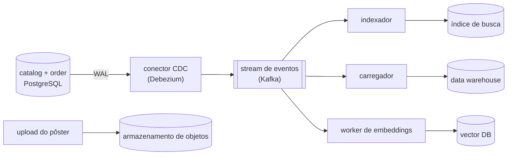
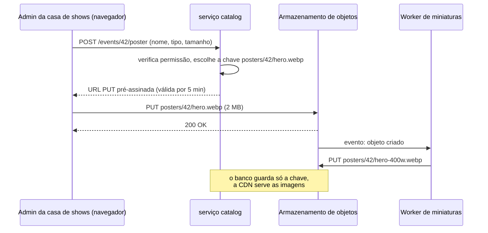
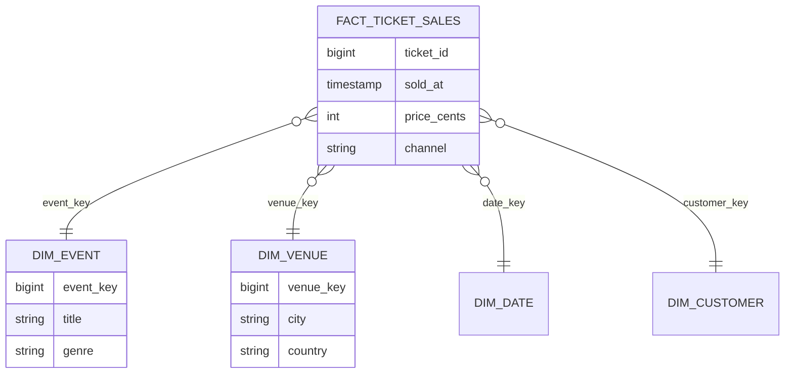
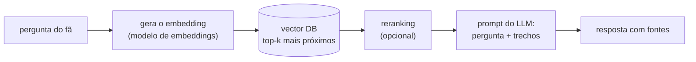
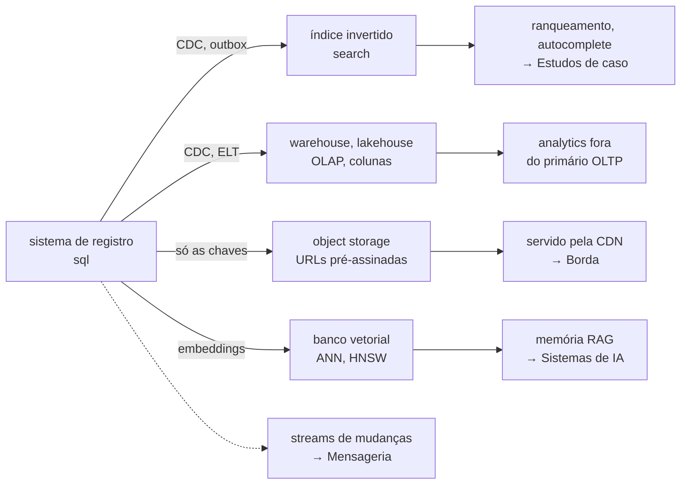

Um fã digita "tayler swift sp dezembro" na caixa de busca da BoxOffice. O marketing quer "ingressos vendidos por minuto, por cidade, nos últimos dois anos" toda manhã. A página do evento mostra um pôster de 2 MB para milhões de visitantes. O assistente de suporte precisa achar o parágrafo da política de reembolso que responde "posso ter meu dinheiro de volta se o show mudar de data?" — uma frase que quase não compartilha palavras com o texto da política.

Um banco de dados relacional *consegue* fazer uma versão fraca de cada uma dessas coisas, e muitas vezes esse é o começo certo. Mas cada uma tem um motor projetado para ela: um **mecanismo de busca**, um **armazenamento de objetos**, um **data warehouse** e um **banco de dados vetorial**. Os quatro guardam **dados derivados** (veja a [visão geral](../index.md)): cópias do sistema de registro, remodeladas para um tipo de pergunta.

---

## Como os dados derivados fluem

O sistema de registro continua nos bancos relacionais dos serviços. As mudanças saem para os armazenamentos especializados por **captura de dados de mudança** (*change data capture*, CDC): um conector lê o log do banco (o WAL do PostgreSQL, o binlog do MySQL) e publica cada insert, update e delete como um evento.



Por que não fazer o serviço escrever no banco *e* no índice de busca diretamente (uma **escrita dupla**, *dual write*)? Porque as duas escritas podem falhar de forma independente ou chegar em ordens diferentes sob concorrência, deixando os armazenamentos permanentemente inconsistentes. O CDC (ou o transactional outbox, veja [Padrões de mensageria](../../messaging/patterns/index.md)) oferece uma única fonte ordenada de mudanças, e qualquer armazenamento derivado pode ser reconstruído reproduzindo-a.

---

## Mecanismos de busca { #search-engines }

### Por que `LIKE '%taylor%'` não é busca

```sql title="The naive search"
SELECT id, title FROM events
WHERE title ILIKE '%tayler%' AND title ILIKE '%dezembro%';
```

Ela varre a tabela inteira (um `%` no início anula os índices B-tree), não encontra nada para o erro de digitação "tayler", não sabe que "SP" significa "São Paulo", ignora acentos e plurais e devolve os resultados em ordem arbitrária. Os usuários esperam **tolerância a erros de digitação, ranking por relevância, autocomplete por prefixo e facetas** ("filtrar por cidade, data, gênero") em dezenas de milissegundos.

### O índice invertido

Um mecanismo de busca constrói um **índice invertido** (*inverted index*): para cada termo, a lista (**lista de postings**) dos documentos que o contêm — o índice remissivo no fim de um livro[^1].

| Termo | Postings (ids de eventos) |
|---|---|
| `taylor` | 42, 77 |
| `swift` | 42 |
| `sao` | 42, 51, 77 |
| `paulo` | 42, 51, 77 |
| `stadium` | 42, 51 |

Uma consulta faz a interseção ou a união de listas de postings, o que é rápido porque elas são ordenadas e comprimidas. Antes de ser indexado, o texto passa por um **analisador**:

1. **Tokenizar**: `"Taylor Swift — São Paulo"` → `Taylor`, `Swift`, `São`, `Paulo`.
2. **Normalizar**: minúsculas e remoção de acentos → `taylor`, `swift`, `sao`, `paulo`.
3. **Stemming** (específico do idioma): `shows` → `show`, `ingressos` → `ingress`.
4. **Sinônimos**: `sp` ↔ `sao paulo`.

O mesmo analisador roda sobre a consulta, então "SÃO PAULO" e "sao paulo" casam com os mesmos termos. O **casamento aproximado** (*fuzzy matching*) aceita termos dentro de uma distância de edição (`tayler` → `taylor`, distância 1), e **edge n-grams** ou *completion suggesters* indexam prefixos (`tay`, `tayl`, …) para o autocomplete.

### Ranking

Os documentos que casam recebem uma pontuação de **relevância**. O padrão no Elasticsearch, no OpenSearch e no Lucene é o **BM25**[^2], que cresce com a frequência de um termo da consulta no documento (com retornos decrescentes), diminui para termos comuns a todos os documentos (`show`, `ingresso`) e normaliza pelo tamanho do documento. Os produtos então combinam esse valor com sinais de negócio: popularidade, proximidade da data, disponibilidade de ingressos.

=== "Elasticsearch / OpenSearch"

    ```json title="POST /events/_search"
    {
      "query": {
        "function_score": {
          "query": {
            "multi_match": {
              "query": "tayler swift sp dezembro",
              "fields": ["title^3", "lineup^2", "city", "description"],
              "fuzziness": "AUTO"
            }
          },
          "functions": [
            { "field_value_factor": { "field": "popularity", "modifier": "log1p" } }
          ]
        }
      },
      "aggs": { "by_city": { "terms": { "field": "city.keyword" } } }
    }
    ```

=== "Full-text no PostgreSQL"

    ```sql title="Good enough for a small catalog"
    ALTER TABLE events ADD COLUMN search tsvector
      GENERATED ALWAYS AS (
        setweight(to_tsvector('portuguese', unaccent_immutable(title)), 'A') ||
        setweight(to_tsvector('portuguese', unaccent_immutable(coalesce(description, ''))), 'B')
      ) STORED;
    CREATE INDEX events_search_idx ON events USING GIN (search);

    SELECT id, title, ts_rank(search, q) AS rank
    FROM events, websearch_to_tsquery('portuguese', 'taylor swift dezembro') q
    WHERE search @@ q
    ORDER BY rank DESC
    LIMIT 20;
    -- unaccent_immutable: an IMMUTABLE wrapper around unaccent(), required in generated columns
    ```

### Operando um cluster de busca

- Um índice é dividido em **shards** (fixados na criação, veja [Particionamento](../partitioning/index.md#consistent-hashing)) com **réplicas** para disponibilidade e vazão de leitura. Uma consulta se espalha para uma cópia de cada shard e combina os melhores resultados — scatter/gather.
- A busca é **quase em tempo real**: documentos novos ficam pesquisáveis após um *refresh* (1 segundo por padrão no Elasticsearch), e o pipeline de CDC acrescenta seu próprio atraso. O evento que a casa de shows acabou de criar pode levar alguns segundos para aparecer — aceitável para busca, não para inventário.
- O índice é **derivado**: quando o mapeamento ou o analisador muda, construa um índice novo a partir do stream ou de um snapshot e troque um *alias* para ele.

**Experimente.** O cenário `search-autocomplete` coloca um serviço de busca e um cache atrás do gateway. Rode-o e observe que fração das teclas digitadas o cache absorve (prefixos populares como "tay" se repetem muito); depois aumente a carga e veja qual componente satura primeiro quando o cache está frio.

<div class="sdp" data-scenario="search-autocomplete" data-mode="compact" data-height="520"></div>

O projeto completo — tries de prefixo com top-k, *debouncing* no cliente, cache por prefixo — está no [estudo de caso de autocomplete de busca](../../case-studies/search-autocomplete/index.md).

---

## Armazenamento de objetos { #object-storage }

O **armazenamento de objetos** (*object storage*) guarda **blobs** — imagens, vídeos, PDFs, backups, arquivos de data lake — como **objetos** imutáveis em **buckets**, endereçados por uma **chave** e acessados por HTTP (`PUT`, `GET`, `DELETE`, `LIST`)[^3]. O espaço de nomes é plano: `posters/42/hero.webp` parece um caminho, mas não existem diretórios de verdade.

| Propriedade | Armazenamento de objetos | Armazenamento em bloco (um disco) | Banco de dados |
|---|---|---|---|
| Unidade | objeto inteiro (de bytes a terabytes) | blocos de 4 KiB | linhas |
| Acesso | API HTTP, de qualquer lugar | montado por uma máquina | linguagem de consulta |
| Atualização | substitui o objeto inteiro | no lugar | no lugar, transacional |
| Escala | praticamente ilimitada | um volume | um cluster |
| Custo por GB | o menor, com camadas frias | médio | o maior |
| Durabilidade | o Amazon S3 é projetado para 99,999999999% (11 noves) ao ano, guardando cópias em várias instalações | um volume; replique você mesmo | sua replicação e seus backups |

Desde 2020, o Amazon S3 oferece consistência forte de leitura após escrita para todas as operações, e as outras grandes nuvens também. O que o armazenamento de objetos **não** faz: anexar dados a um objeto, renomear de forma barata (renomear = copiar + apagar), travar (*lock*) ou consultar o conteúdo dos objetos (exceto por motores que leem arquivos, como um warehouse).

O padrão que mantém os blobs longe dos seus servidores é a **URL pré-assinada** (*presigned URL*): o serviço autoriza o upload, mas os bytes vão direto do navegador para o bucket.



```python title="Presigned upload URL (boto3; works with any S3-compatible store)"
import boto3

s3 = boto3.client("s3")

def poster_upload_url(event_id: int) -> str:
    return s3.generate_presigned_url(
        "put_object",
        Params={"Bucket": "boxoffice-media",
                "Key": f"posters/{event_id}/hero.webp",
                "ContentType": "image/webp"},
        ExpiresIn=300,  # seconds
    )
```

As leituras passam pela **CDN** (veja [DNS & CDN](../../edge/dns-cdn/index.md)) com tempos de cache longos e chaves versionadas (`hero.v3.webp`), de modo que o bucket vê uma fração mínima do tráfego. **Regras de ciclo de vida** movem objetos antigos para camadas mais baratas (acesso infrequente, arquivo) e apagam os temporários automaticamente; o **upload multipart** envia arquivos grandes em partes paralelas que podem ser reenviadas individualmente.

=== "AWS"

    Amazon S3 (classes de armazenamento Standard, Intelligent-Tiering, Glacier), CloudFront como CDN.

=== "GCP"

    Google Cloud Storage (Standard, Nearline, Coldline, Archive), Cloud CDN.

=== "Azure"

    Azure Blob Storage (camadas Hot, Cool, Cold, Archive), Azure Front Door.

=== "Código aberto / auto-hospedado"

    Servidores compatíveis com S3, como Ceph Object Gateway, SeaweedFS ou Garage — úteis em laboratórios e em ambientes on-premises; a API do S3 é o padrão de fato.

---

## Data warehouses e lakehouses { #data-warehouses }

### OLTP vs OLAP

Os serviços rodam **OLTP** (*online transaction processing*): muitas leituras e escritas pequenas de linhas individuais, por chave, com transações. Os analistas rodam **OLAP** (*online analytical processing*): poucas consultas enormes que agregam milhões de linhas sobre poucas colunas. Eles querem coisas opostas do armazenamento[^4]:

| | OLTP (inventory, order) | OLAP (warehouse) |
|---|---|---|
| Consulta típica | `UPDATE seats … WHERE event_id = 42 AND seat_id = 'A-12'` | `SELECT city, date_trunc('minute', sold_at), count(*) … GROUP BY 1, 2` sobre 2 anos |
| Linhas tocadas | poucas, via índice | de milhões a bilhões, varridas |
| Colunas tocadas | a maior parte da linha | poucas entre muitas |
| Meta de latência | milissegundos | de segundos a minutos |
| Quem escreve | a aplicação, o tempo todo | cargas em lote ou em streaming |
| Layout | orientado a linhas | **orientado a colunas** |
| Dados | estado atual | histórico, muitas vezes só de inserção |

### Por que colunas

Um **armazenamento colunar** (*column store*) guarda cada coluna em seus próprios arquivos. Uma consulta que lê 3 de 30 colunas lê cerca de um décimo dos bytes, e uma coluna de valores parecidos (`city`, `status`) comprime extremamente bem (codificação por dicionário e *run-length*)[^5]. Com números ilustrativos para o clickstream da BoxOffice — 20 GB/dia por dois anos ≈ 15 TB brutos:

| Layout | Bytes lidos por uma consulta sobre 3 de 30 colunas |
|---|---|
| Armazenamento por linhas | ~15 TB (todas as linhas, todas as colunas) |
| Armazenamento colunar | ~1,5 TB (3 colunas de 30) |
| Colunar + compressão (suponha 5–10×) | ~150–300 GB |
| + poda de partições (só os últimos 30 dias) | alguns GB |

Essa diferença — somada à varredura em paralelo em muitas máquinas — é o motivo pelo qual um warehouse responde em segundos o que levaria horas no banco OLTP (enquanto prejudica o checkout).

### Modelagem: o esquema estrela

Warehouses costumam ser modelados como um **esquema estrela** (*star schema*): uma **tabela fato** central de eventos (uma linha por ingresso vendido) com chaves estrangeiras para **tabelas dimensão** que os descrevem.



```sql title="Sales per minute per city on on-sale day (warehouse SQL)"
SELECT v.city,
       date_trunc('minute', f.sold_at) AS minute,
       count(*)                        AS tickets,
       sum(f.price_cents) / 100.0      AS revenue
FROM fact_ticket_sales f
JOIN dim_venue v ON v.venue_key = f.venue_key
WHERE f.sold_at >= '2027-03-01 10:00' AND f.sold_at < '2027-03-01 12:00'
GROUP BY 1, 2
ORDER BY 2, 1;
```

### Colocando dados dentro: ETL, ELT, streaming

| Abordagem | Como | Atualidade | Ferramentas típicas |
|---|---|---|---|
| **ETL** (*extract, transform, load*) | transforma fora, carrega tabelas limpas | horas (lote) | Spark, jobs próprios, Airflow |
| **ELT** (*extract, load, transform*) | carrega os dados brutos e transforma *dentro* do warehouse com SQL | de horas a minutos | Fivetran / Airbyte + dbt |
| **CDC em streaming** | eventos de mudança anexados continuamente | de segundos a minutos | Debezium + Kafka, ingestão em streaming das nuvens |

### Lakes e lakehouses

Um **data lake** guarda arquivos brutos — geralmente **Parquet**, um formato de arquivo colunar — no armazenamento de objetos, de forma barata e em qualquer formato. A fraqueza de um lake simples é que os arquivos não têm transações nem esquema. **Formatos de tabela abertos** — Apache **Iceberg**, **Delta Lake**, Apache Hudi — acrescentam um log de transações, evolução de esquema e *time travel* sobre esses arquivos, de modo que vários motores (Spark, Trino, Flink, DuckDB, warehouses das nuvens) consultam as mesmas tabelas. Essa combinação é o **lakehouse**[^6].

=== "AWS"

    Amazon Redshift (warehouse), Athena (SQL sobre o S3), S3 Tables / Iceberg.

=== "GCP"

    BigQuery (warehouse serverless, também sobre tabelas Iceberg no Cloud Storage).

=== "Azure"

    Microsoft Fabric / Azure Synapse, Azure Databricks.

=== "Código aberto / independentes"

    ClickHouse, DuckDB (in-process), Apache Spark, Trino; Snowflake e Databricks rodam nas três nuvens.

---

## Bancos de dados vetoriais { #vector-databases }

### Embeddings: significado como geometria

Um **modelo de embeddings** transforma um trecho de texto (ou uma imagem) em um vetor de números — tipicamente de centenas a alguns milhares de dimensões — de modo que textos com **significado** parecido fiquem **próximos** uns dos outros. "Posso ter meu dinheiro de volta se o show mudar de data?" e "Reembolso de eventos remarcados" compartilham poucas palavras, mas têm embeddings vizinhos. A proximidade costuma ser medida pela **similaridade de cosseno**:

$$
\cos(\mathbf{a}, \mathbf{b}) = \frac{\mathbf{a} \cdot \mathbf{b}}{\lVert\mathbf{a}\rVert \, \lVert\mathbf{b}\rVert}
$$

Isso viabiliza a **busca semântica** e a etapa de recuperação do **RAG** (*retrieval-augmented generation*, geração aumentada por recuperação), em que o assistente da BoxOffice busca os trechos de política mais relevantes e os entrega ao modelo de linguagem (veja [Sistemas de IA — RAG e memória](../../ai-systems/rag-memory/index.md)).



### Busca exata vs aproximada

A resposta exata compara a consulta com **todos** os vetores: para 10 milhões de vetores de 1.024 dimensões, são cerca de 10 bilhões de multiplicações-e-somas por consulta — aceitável offline, lento demais para tráfego interativo. Bancos de dados vetoriais usam índices de **vizinho mais próximo aproximado** (*approximate nearest neighbour*, ANN) que olham uma pequena fração dos vetores e aceitam perder alguns vizinhos verdadeiros. A medida de qualidade é o **recall@k**: dos k vizinhos verdadeiros mais próximos, quantos o índice devolveu?

- **IVF** (*inverted file*): agrupa os vetores em clusters (por exemplo, com k-means); na consulta, varre só os `nprobe` clusters mais próximos dela.
- **HNSW** (*hierarchical navigable small world*)[^7]: um grafo em camadas no qual cada vetor se liga aos seus vizinhos próximos; a busca começa na camada esparsa do topo e caminha gulosamente em direção à consulta, camada por camada. Ótimo equilíbrio entre recall e latência, ao custo de memória para o grafo e inserções mais lentas. Parâmetros: `m` (ligações por nó), `ef_construction` e `ef_search` (a largura da busca — o botão de recall na hora da consulta).
- **Quantização** (*product quantization*, escalar ou binária) comprime os vetores 4–32× para caber mais em memória, trocando um pouco de recall.

Um experimento pequeno e real torna o trade-off visível: 20.000 vetores sintéticos de 64 dimensões em torno de 200 tópicos, um índice IVF com um bucket por tópico e 60 consultas. Cada ponto é um valor de `nprobe`:

```python exec="1" html="1"
import matplotlib.pyplot as plt
import numpy as np
from io import StringIO

# A tiny, real experiment: 20,000 synthetic "embeddings" (64 dimensions) drawn
# around 200 topics. IVF index: vectors are bucketed by nearest topic centroid;
# a query scans only the `nprobe` closest buckets instead of everything.
rng = np.random.default_rng(7)
dim, n, topics = 64, 20000, 200
centers = rng.normal(size=(topics, dim))
labels = rng.integers(0, topics, n)
data = centers[labels] + 1.5 * rng.normal(size=(n, dim))
data /= np.linalg.norm(data, axis=1, keepdims=True)
cent = centers / np.linalg.norm(centers, axis=1, keepdims=True)
bucket = np.argmax(data @ cent.T, axis=1)

queries = data[rng.choice(n, 60, replace=False)] + 0.3 * rng.normal(size=(60, dim)) / np.sqrt(dim)
k = 10
exact = np.argsort(-(queries @ data.T), axis=1)[:, :k]

probes = [1, 2, 4, 8, 16, 32, 64]
recall, scanned = [], []
for p in probes:
    hits, work = 0, 0
    for qi, q in enumerate(queries):
        near = np.argsort(-(cent @ q))[:p]
        cand = np.where(np.isin(bucket, near))[0]
        work += len(cand)
        top = cand[np.argsort(-(data[cand] @ q))[:k]]
        hits += len(set(top) & set(exact[qi]))
    recall.append(100 * hits / (k * len(queries)))
    scanned.append(100 * work / (n * len(queries)))

fig, ax = plt.subplots(figsize=(9, 4.2))
fig.patch.set_alpha(0)
ax.plot(scanned, recall, "o-", color="#4C78A8", lw=2.5)
for p, x, y in zip(probes, scanned, recall):
    ax.annotate(f"nprobe={p}", (x, y), textcoords="offset points", xytext=(6, -14), color="#888", fontsize=8)
ax.axhline(100, color="#888", ls=":", lw=1.5)
ax.set_ylim(60, 102)
ax.set_xscale("log")
ax.set_xticks([0.5, 1, 2, 4, 8, 16, 32])
ax.set_xticklabels(["0.5%", "1%", "2%", "4%", "8%", "16%", "32%"])
ax.minorticks_off()
ax.set_xlabel("% of vectors compared per query (exact search = 100%)")
ax.set_ylabel("recall@10 (%)")
ax.set_title("Approximate search: a little recall for a lot less work")
ax.grid(True, which="both", alpha=0.25)
ax.set_facecolor("none")
for item in [ax.title, ax.xaxis.label, ax.yaxis.label] + ax.get_xticklabels() + ax.get_yticklabels():
    item.set_color("#888")
for s in ax.spines.values():
    s.set_color("#888")
ax.tick_params(colors="#888", which="both")
plt.tight_layout()

buffer = StringIO()
plt.savefig(buffer, format="svg", transparent=True)
print(buffer.getvalue())
plt.close()
```

Comparar cerca de 8% dos vetores já devolve aproximadamente 9 dos 10 vizinhos verdadeiros; cada ponto extra de recall custa mais trabalho. Embeddings reais e o HNSW se comportam de forma diferente nos detalhes, mas o formato — uma curva ajustável de recall versus custo — é o mesmo, e é uma decisão de produto: no RAG, um reranker depois da etapa ANN perdoa um recall um pouco menor.

### Onde guardar os vetores

```sql title="pgvector: vectors next to the data they describe"
CREATE EXTENSION IF NOT EXISTS vector;

CREATE TABLE kb_chunks (
    id        BIGSERIAL PRIMARY KEY,
    doc_id    TEXT NOT NULL,          -- 'refund-policy'
    content   TEXT NOT NULL,
    embedding vector(1024) NOT NULL
);

CREATE INDEX kb_chunks_embedding_idx
    ON kb_chunks USING hnsw (embedding vector_cosine_ops)
    WITH (m = 16, ef_construction = 64);

SET hnsw.ef_search = 40;              -- recall knob at query time
SELECT doc_id, content
FROM kb_chunks
ORDER BY embedding <=> :question_embedding   -- cosine distance
LIMIT 5;
```

| Opção | Boa quando | Cuidado com |
|---|---|---|
| **pgvector** no PostgreSQL existente | até milhões de vetores; você quer filtros, joins e transações com o resto dos dados | tempo de construção do índice e memória no primário; ajuste `ef_search` |
| kNN do mecanismo de busca (Elasticsearch, OpenSearch) | você já opera um; **busca híbrida** (BM25 + vetores) em uma única consulta | memória por shard |
| Vector DB dedicado (Qdrant, Weaviate, Milvus, Pinecone) | centenas de milhões de vetores, filtragem pesada, multi-tenant | mais um sistema para operar e manter sincronizado |
| Busca vetorial no Redis / Valkey | conjuntos pequenos e quentes com latência muito baixa | custo de memória |

Dimensionamento, como exemplo resolvido: 100 mil trechos × 1.024 dimensões × 4 bytes (float32) ≈ **400 MB** de vetores brutos, mais o grafo HNSW (com `m = 16`, algumas centenas de bytes por vetor) — cabe com folga no banco do catalog. Com 100 milhões de vetores (≈ 400 GB brutos), quantização ou um cluster dedicado passam a valer a discussão.

---

## Escolhendo entre eles

| Armazenamento | Responde | Alimentado por | Atualidade | Não serve para |
|---|---|---|---|---|
| Mecanismo de busca | "quais documentos casam com estas palavras, ranqueados?" | CDC / indexador | ~segundos | sistema de registro, transações |
| Armazenamento de objetos | "me dê este blob" | upload direto (URL pré-assinada) | imediata | registros pequenos, consultas dentro dos objetos |
| Data warehouse / lakehouse | "agregue o histórico de milhões de linhas" | ELT / CDC em streaming | de minutos a horas | servir o caminho quente da aplicação |
| Banco de dados vetorial | "o que é mais próximo em significado?" | worker de embeddings | ~segundos | casamentos exatos, filtros estruturados sozinhos |

!!! example "BoxOffice: os armazenamentos especializados no lugar"

    - **Busca**: índice OpenSearch de eventos, alimentado pelo Debezium a partir do banco do catalog; analisador de português, sinônimo `sp` ↔ `sao paulo`, casamento aproximado, reforço por popularidade; prefixos do autocomplete em cache.
    - **Armazenamento de objetos**: pôsteres enviados com URLs pré-assinadas, redimensionados por um worker, servidos pela CDN com chaves versionadas; PDFs de ingressos gerados sob demanda e guardados por 1 ano por uma regra de ciclo de vida.
    - **Warehouse**: eventos de pedidos e de clickstream chegam a tabelas Iceberg no armazenamento de objetos; o dbt constrói o esquema estrela; o painel de "vendas por minuto" lê o warehouse, nunca o banco do order.
    - **Vetores**: a base de conhecimento do assistente (políticas, FAQs, descrições de eventos) no pgvector, em um PostgreSQL próprio, com índice HNSW; um worker gera os embeddings de novo sempre que um documento muda.

!!! tip "Na entrevista"

    - Para qualquer requisito de "busca", diga **índice invertido** e como ele é mantido em sincronia (**CDC**, consistência eventual de segundos) — e que o índice é um dado derivado que você pode reconstruir.
    - Imagens, vídeos e arquivos → **armazenamento de objetos + CDN + URLs pré-assinadas**; o banco guarda só chaves e metadados.
    - "Analytics" ou "relatórios" → **OLAP em um warehouse**, armazenamento colunar, alimentado por CDC/ELT — "nunca no primário OLTP".
    - Busca semântica ou RAG → **embeddings + índice ANN (HNSW)**, e mencione **recall vs latência** e a opção do pgvector antes de um produto dedicado.

!!! warning "Armadilhas comuns"

    - **Escritas duplas** da aplicação no banco e no índice: eles se desalinham; use CDC ou um outbox.
    - **Tratar o índice de busca como fonte da verdade**: uma mudança de mapeamento ou um índice corrompido precisa poder ser corrigido com uma reconstrução.
    - **Servir blobs pelos servidores de aplicação**: cada byte de imagem custa CPU e banda da aplicação; use URLs pré-assinadas e a CDN.
    - **Relatórios no banco de produção**: varreduras longas competem com o checkout; use o warehouse (ou pelo menos uma réplica).
    - **Vetores sem um plano de regeração**: quando o modelo de embeddings muda, todos os vetores precisam ser recalculados — vetores antigos e novos não são comparáveis.

## Como se conecta { #how-it-connects }



**Componentes da paleta:** [`search`](../../../reference/components/compute/index.md#search) · [`objstore`](../../../reference/components/storage/index.md#objstore) · [`dwh`](../../../reference/components/storage/index.md#dwh) · [`vectordb`](../../../reference/components/storage/index.md#vectordb) (os quatro armazenamentos derivados — reconstruíveis a partir da fonte) · [`sql`](../../../reference/components/storage/index.md#sql) (o sistema de registro; pgvector antes de um produto dedicado) · [`cdn`](../../../reference/components/edge/index.md#cdn) (na frente do object store) · [`kafka`](../../../reference/components/messaging/index.md#kafka) (CDC com Debezium para o índice e o warehouse) · [`analytics`](../../../reference/components/compute/index.md#analytics) (lê o warehouse, nunca o primário) · [`memory`](../../../reference/components/ai/index.md#memory) (a camada de recuperação do assistente). **Cenários:** `search-autocomplete`, `video-streaming`, `ai-assistant`, `event-fanout`. **Continua em:** [Borda — DNS e CDN](../../edge/dns-cdn/index.md), [Mensageria — padrões](../../messaging/patterns/index.md) (outbox, CDC), [Sistemas de IA — RAG e memória](../../ai-systems/rag-memory/index.md), [Estudo de caso: autocomplete de busca](../../case-studies/search-autocomplete/index.md), [Estudo de caso: streaming de vídeo](../../case-studies/video-streaming/index.md).

---

[^1]: MANNING, C. D.; RAGHAVAN, P.; SCHÜTZE, H. *Introduction to Information Retrieval*. Cambridge University Press, 2008.
[^2]: ROBERTSON, S.; ZARAGOZA, H. The Probabilistic Relevance Framework: BM25 and Beyond. *Foundations and Trends in Information Retrieval*, 3(4), 2009.
[^3]: Amazon Web Services. [Amazon S3 User Guide](https://docs.aws.amazon.com/AmazonS3/latest/userguide/Welcome.html){target="_blank"} — modelo de consistência de dados e durabilidade.
[^4]: KIMBALL, R.; ROSS, M. *The Data Warehouse Toolkit*. 3. ed. Wiley, 2013.
[^5]: STONEBRAKER, M. et al. C-Store: A Column-oriented DBMS. *VLDB*, 2005.
[^6]: ARMBRUST, M. et al. Lakehouse: A New Generation of Open Platforms that Unify Data Warehousing and Advanced Analytics. *CIDR*, 2021.
[^7]: MALKOV, Y. A.; YASHUNIN, D. A. Efficient and Robust Approximate Nearest Neighbor Search Using Hierarchical Navigable Small World Graphs. *IEEE TPAMI*, 42(4), 2020 (arXiv:1603.09320, 2016).
