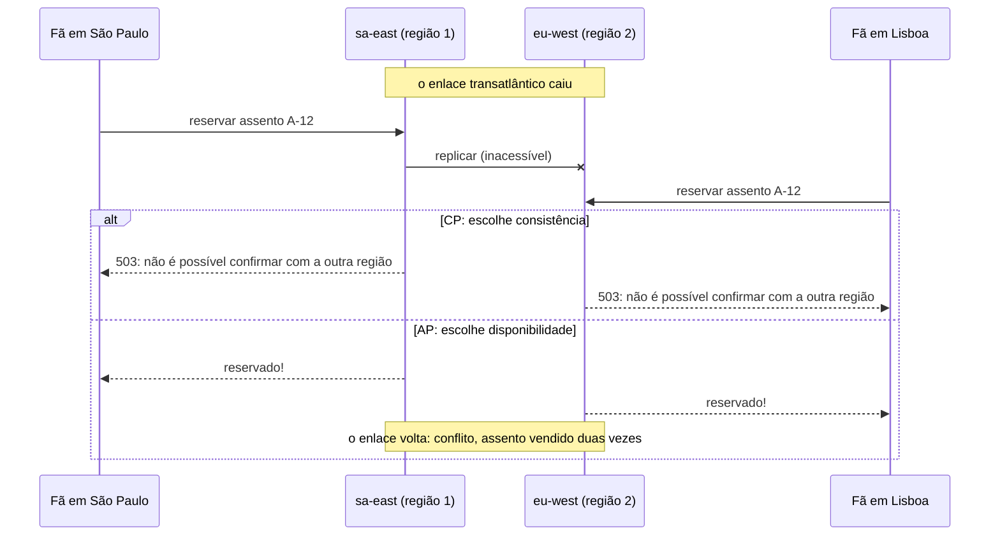
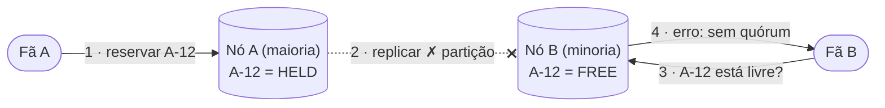
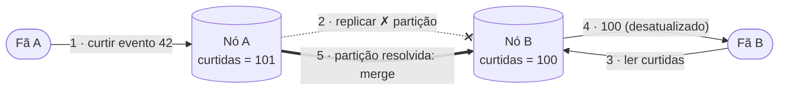
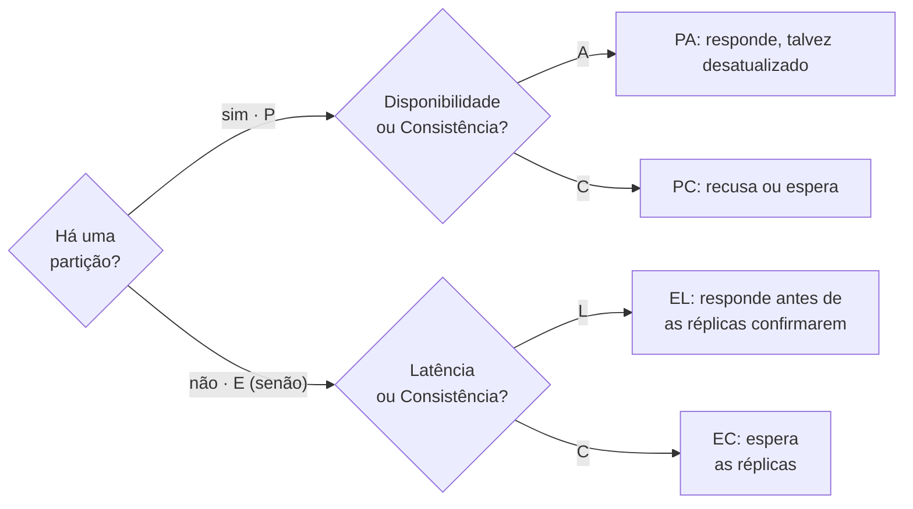
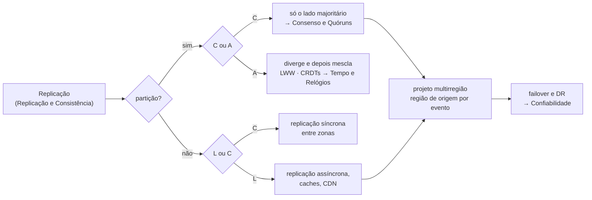

O BoxOffice chega à Europa. Para dar aos fãs em Lisboa a mesma experiência rápida dos fãs em São Paulo, o time roda o banco do `inventory` em **duas regiões**, cada uma com uma cópia completa dos assentos, replicando entre si. Numa tarde, durante a abertura das vendas de um festival, o enlace transatlântico entre as regiões degrada e depois cai. As duas regiões estão vivas; as duas continuam recebendo requisições *"Reservar assento A-12"*. Cada região tem agora duas opções para cada requisição: **responder com o que sabe** (e arriscar vender o assento A-12 dos dois lados do oceano) ou **recusar** até o enlace voltar (e perder a venda). Não há terceira opção. É esse dilema que o teorema CAP formaliza.

O **teorema CAP**, conjecturado por Eric Brewer em 2000 e provado por Seth Gilbert e Nancy Lynch em 2002[^1], afirma que um armazenamento de dados replicado **não consegue garantir ao mesmo tempo** as três propriedades a seguir:

--8<-- "docs/2027.1/classes/distributed/cap-pacelc/cap-venn.pt.svg"

---

## As três propriedades

**Consistência (C)**
: Toda leitura devolve a escrita mais recente, ou um erro. No CAP, "consistência" significa **linearizabilidade**: as réplicas se comportam como se houvesse uma única cópia (veja [Linearizabilidade](../consistency/index.md#linearizability)).

**Disponibilidade (A, *availability*)**
: Toda requisição recebida por um nó **que não falhou** recebe uma resposta **que não é erro** — mesmo que ela não contenha a escrita mais recente. Note o rigor: *todo* nó que não falhou, não "na maior parte do tempo".

**Tolerância a partições (P)**
: O sistema continua operando quando a rede se **particiona** — divide os nós em grupos que estão vivos, mas não conseguem trocar mensagens (ou as trocam com atraso ilimitado).

!!! warning "P não é opcional"
    Partições não são uma escolha de projeto; elas acontecem — um switch falha, um cabo é cortado, o enlace de uma região de nuvem degrada, uma pausa longa de GC faz um nó parecer inacessível. Qualquer sistema cujos dados vivem em mais de uma máquina precisa decidir o que fazer *quando* elas acontecem. Então a escolha real é **C ou A, durante uma partição**. O próprio Brewer, doze anos depois, ressaltou que partições são raras e que o trabalho de projeto interessante está em **detectá-las**, operar em modo limitado enquanto duram e **se recuperar** depois[^4].

!!! warning "O C do CAP não é o C do ACID"
    Em transações ACID, *consistência* significa "a transação preserva as invariantes" (restrições, chaves estrangeiras, `CHECK`). No CAP significa linearizabilidade. Um único servidor PostgreSQL é consistente no sentido ACID e o CAP nem se aplica a ele — o CAP trata de **réplicas**.

---

## Uma partição, passo a passo

A mesma requisição, tratada por um sistema que escolhe consistência (CP) e por um que escolhe disponibilidade (AP):

Nenhuma das respostas é "errada" em abstrato: o sistema CP recusa em vez de arriscar uma venda em dobro; o sistema AP atende todo fã e precisa **reconciliar** depois. Qual das duas é aceitável depende dos **dados e do negócio** — não da marca do banco de dados.

??? question "Pense antes: existe um jeito de continuar vendendo assentos dos dois lados do oceano *e* nunca vender um assento duas vezes?"

    Sim — **não replicando a decisão**. Dê a cada evento uma **região de origem** (a região do local do show) e mande toda reserva daquele evento para o primário da sua região de origem. Dentro de uma região, os dados são consistentes; entre regiões, não há decisão compartilhada sobre a qual discordar. Durante uma partição transatlântica, uma fã em Lisboa comprando um show em São Paulo não alcança a região de origem e é recusada (CP para aquele evento), mas todo evento cuja origem está acessível continua vendendo. Você não escapou do CAP — você **reduziu o raio de impacto** da escolha entre C e A às requisições que realmente atravessam a partição. Veja [Projetos multirregião](#multi-region).

---

## Sistemas CP e AP

### CP — consistente e tolerante a partições

Durante uma partição, os nós que não conseguem confirmar o estado mais recente (tipicamente o lado **minoritário**) recusam requisições. Quando a partição se resolve, eles se atualizam antes de voltar a atender.

- **Exemplos:** etcd, ZooKeeper, Consul, Spanner, CockroachDB; PostgreSQL com replicação síncrona; MongoDB com leituras e escritas por maioria.
- **Use quando:** uma resposta errada é pior do que nenhuma resposta — estoque, dinheiro, identidade, liderança, locks.

### AP — disponível e tolerante a partições

Durante uma partição, todo nó continua respondendo com os dados que tem. As réplicas divergem e **convergem** depois que a partição se resolve (consistência eventual), resolvendo conflitos com LWW, vetores de versão ou CRDTs ([Consistência eventual](../consistency/index.md#eventual)).

- **Exemplos:** Cassandra e DynamoDB nas configurações padrão, CouchDB, Riak, DNS, CDNs, a maioria dos caches.
- **Use quando:** uma resposta um pouco desatualizada é melhor do que nenhuma — catálogo, recomendações, contadores, carrinhos, feeds.

### "CA"

Um sistema consistente e disponível **enquanto não houver partições** — na prática, um único nó, ou um cluster que simplesmente não decidiu o que fazer numa partição. Não é uma terceira opção real para um sistema distribuído.

| | CP | AP |
|---|---|---|
| **Durante uma partição** | O lado minoritário recusa (erros, timeouts) | Todo nó responde, talvez desatualizado |
| **Depois da partição** | A minoria se atualiza, nada a reconciliar | As réplicas convergem; conflitos precisam ser resolvidos |
| **Garantia** | Linearizável | Eventual (ou causal, no máximo) |
| **Falha visível ao usuário** | "Tente novamente mais tarde" | Dado errado ou desatualizado, corrigido depois |
| **Exemplos** | etcd, ZooKeeper, Spanner, CockroachDB, PostgreSQL com replicação síncrona | Cassandra, DynamoDB (padrão), DNS, CDN, caches |
| **Dados do BoxOffice** | Assentos, reservas, pedidos, pagamentos, sessões de autenticação | Catálogo, imagens, contadores, recomendações |

!!! warning "CP e AP descrevem uma configuração, não um produto"
    A maioria dos bancos de dados permite ajustar o trade-off — até por requisição. O Cassandra com leituras e escritas `QUORUM` se comporta muito mais como um sistema CP; o PostgreSQL servindo leituras de uma réplica *assíncrona* devolve dados desatualizados durante uma partição. Muitos sistemas reais não são, a rigor, nem CP nem AP: podem ficar indisponíveis *e* devolver dados desatualizados em alguns modos de falha[^2]. Pergunte *"como ele está configurado, e o que minhas requisições veem durante uma partição?"* em vez de *"este banco é CP ou AP?"*.

---

## PACELC: o trade-off que você paga todo dia { #pacelc }

O CAP só fala de **partições**, que são raras. O **PACELC** de Daniel Abadi (2010–2012)[^3] acrescenta o trade-off que existe **o tempo todo**:

> Se há uma **P**artição, escolha entre disponibilidade (**A**) e **C**onsistência; **E**, senão (*else*, operação normal), escolha entre **L**atência e **C**onsistência.

O ramo *else* existe por causa da própria replicação: para ser consistente, uma escrita precisa esperar outras réplicas confirmarem (uma ou mais idas e voltas pela rede, talvez até outro continente); para ser rápida, precisa responder antes delas e aceitar que uma réplica pode ficar brevemente para trás.

### Quanta latência a consistência custa?

A resposta é "uma ida e volta até onde estiverem as outras réplicas". Os tempos de ida e volta (RTT, *round-trip time*) abaixo são ordens de grandeza típicas, usadas aqui como **suposições ilustrativas**:

| Onde estão as réplicas que confirmam | RTT típico | Custo de uma escrita EC (uma ida e volta a mais) |
|---|---|---|
| Mesma máquina / mesmo rack | < 0,5 ms | Desprezível |
| Outra zona de disponibilidade, mesma região | ~1–2 ms | Pequeno: o padrão para bancos de produção |
| Outra região, mesmo continente | ~10–40 ms | Perceptível em toda escrita |
| Outro continente (por exemplo, São Paulo ↔ Europa) | ~150–200 ms | Domina a requisição; um checkout com 5 escritas custa um segundo |

Essa tabela explica por que a maioria dos sistemas escolhe **EC dentro de uma região** (replicação síncrona ou por quórum entre zonas custa um ou dois milissegundos) e **EL entre regiões** (replicação assíncrona, ou particionar os dados por região de origem).

| Sistema (configuração típica) | Durante a partição | Senão | PACELC |
|---|---|---|---|
| Cassandra, ScyllaDB (`ONE`) | A | L | PA/EL |
| DynamoDB (leituras eventualmente consistentes) | A | L | PA/EL |
| MongoDB (read/write concern majority) | C | C | PC/EC |
| PostgreSQL + standby síncrono | C | C | PC/EC |
| Spanner, CockroachDB | C | C | PC/EC |
| PostgreSQL + réplicas de leitura assíncronas, leituras nas réplicas | (o failover pode perder escritas) | L | —/EL |

---

## Projetos multirregião { #multi-region }

Regiões falham — raramente, mas por inteiro — e o BoxOffice quer sobreviver a isso. Os trade-offs entre C, A e L ficam concretos em cinco topologias comuns:

| Topologia | Escritas | Durante a perda de uma região | Consistência | Custo e complexidade |
|---|---|---|---|---|
| **Uma região, várias zonas** | Um primário, standby síncrono em outra zona | Região fora = BoxOffice fora | Forte | O menor; o ponto de partida padrão |
| **Ativo–passivo (warm standby)** | Só na região primária; réplica assíncrona na região 2 | Failover (DNS) para a região 2; perde os últimos segundos de escritas (RPO > 0) | Forte em operação normal | Moderado; o failover precisa ser ensaiado |
| **Ativo–ativo, particionado por origem** | Cada registro tem uma região de origem; as escritas vão para lá | Registros com origem na região morta ficam indisponíveis; os outros não são afetados | Forte por registro | Maior; roteamento por região de origem |
| **Ativo–ativo, tudo em todo lugar** | Qualquer região escreve qualquer registro | Todas as regiões continuam escrevendo | Eventual; conflitos a resolver | O maior; só para dados que toleram conflitos |
| **Banco de dados globalmente consistente** | Consenso entre regiões (Spanner, CockroachDB) | Sobrevive a uma região se a maioria das réplicas restar | Forte em todo lugar | Latência de escrita ≥ RTT entre regiões; custo premium |

**Experimente.** No cenário `multi-region`, rode o perfil `load` e depois derrube a região primária. Observe quanto tempo o DNS leva para desviar o tráfego (o TTL), quantas requisições falham durante a troca e o que acontece com as escritas que ainda não tinham sido replicadas. Depois reduza o TTL do DNS e repita.

[:material-open-in-new: Abrir o playground completo](../../../../playground/index.md)

!!! example "BoxOffice: o projeto escolhido"
    - **Assentos, reservas, pedidos, pagamentos** — *ativo–ativo particionado por região de origem*: o estoque de cada evento vive na região do local do show, em um primário PostgreSQL com um **standby síncrono em outra zona** (PC/EC dentro da região). Uma fã em Lisboa comprando um show em São Paulo paga uma ida e volta transatlântica na reserva — aceitável para uma ação ocasional.
    - **Catálogo, imagens, índice de busca** — replicados de forma assíncrona para todas as regiões e cacheados na CDN (PA/EL). Um evento novo aparece na Europa alguns segundos depois; ninguém percebe.
    - **Contas / autenticação** — majoritariamente leitura; replicadas em todo lugar, com escritas (troca de senha, logout em todos os dispositivos) indo para uma região de origem.
    - **Recuperação de desastres** — o banco de cada região envia backups e uma réplica assíncrona para outra região (ativo–passivo por região); as metas de RPO/RTO são discutidas em [Confiabilidade — recuperação de desastres](../../reliability/disaster-recovery/index.md).

!!! tip "Na entrevista"
    Nunca diga "vou escolher CP" (ou AP) **para o sistema inteiro**. Diga por dado, e diga o que o usuário vê: *"O estoque de assentos é CP: durante uma partição, o lado minoritário devolve 503 e o app diz 'tente novamente'; reserva em dobro é inaceitável. O catálogo é AP: pode estar segundos desatualizado."* Depois traga o **PACELC** — o entrevistador normalmente se importa mais com a latência do dia a dia do que com partições: *"dentro de uma região eu replico de forma síncrona entre zonas (~1–2 ms); entre regiões eu particiono por região de origem em vez de pagar 150 ms por escrita."* Mencionar que o C do CAP é linearizabilidade (e não o C do ACID) é um sinal forte e barato.

!!! warning "Armadilhas"
    - **"Escolhemos CA."** Se os dados vivem em mais de uma máquina, partições vão acontecer; "CA" só significa que ninguém decidiu o que acontece nesse caso.
    - **Tratar o CAP como um rótulo permanente.** A escolha entre C e A só vale *durante* uma partição; o trade-off diário é a latência (PACELC).
    - **Esquecer caches e réplicas.** Um cache na frente de um armazenamento CP torna essas leituras AP; uma réplica de leitura assíncrona as torna EL.
    - **Replicação síncrona entre regiões por padrão.** Faz *toda* escrita pagar uma ida e volta intercontinental — e um enlace degradado deixa o sistema inteiro lento.
    - **Failover não ensaiado.** Ativo–passivo só funciona se o failover (e o failback) for testado; caso contrário, a região passiva é uma teoria.

## Como se conecta { #how-it-connects }

**Componentes da paleta em que a escolha entre C, A e L é feita:** [`sql`](../../../reference/components/storage/index.md#sql) (standby síncrono ou réplicas assíncronas) · [`nosql`](../../../reference/components/storage/index.md#nosql) (quóruns ajustáveis) · [`cache`](../../../reference/components/storage/index.md#cache) e [`cdn`](../../../reference/components/edge/index.md#cdn) (sempre EL) · [`dns`](../../../reference/components/edge/index.md#dns) (failover entre regiões, cenário `multi-region`). **Continua em:** [Consenso e Quóruns](../consensus/index.md), [Confiabilidade — recuperação de desastres](../../reliability/disaster-recovery/index.md), [Tráfego e Borda — DNS](../../edge/dns-cdn/index.md).

## Pontos-chave

- **CAP**: durante uma **partição** de rede, um armazenamento replicado precisa escolher entre **consistência** (recusar) e **disponibilidade** (responder, talvez desatualizado). P não é opcional.
- O C do CAP é **linearizabilidade**, não o C do ACID; "CA" não é uma opção para dados distribuídos.
- **PACELC**: *senão* (sem partição), a escolha é **latência vs consistência** — e você a paga em toda requisição.
- Escolha **por domínio de dados**: assentos, dinheiro e identidade CP/EC; catálogo e contadores AP/EL.
- Em projetos multirregião, **particionar os dados por região de origem** mantém a consistência forte local e limita o raio de impacto de uma partição.

---

[^1]: GILBERT, S.; LYNCH, N. [Brewer's Conjecture and the Feasibility of Consistent, Available, Partition-Tolerant Web Services](https://dl.acm.org/doi/10.1145/564585.564601){target="_blank"}. ACM SIGACT News, 2002.
[^2]: KLEPPMANN, M. [Please stop calling databases CP or AP](https://martin.kleppmann.com/2015/05/11/please-stop-calling-databases-cp-or-ap.html){target="_blank"}, 2015.
[^3]: ABADI, D. [Consistency Tradeoffs in Modern Distributed Database System Design](https://cs.yale.edu/homes/abadi/papers/pacelc.pdf){target="_blank"}. IEEE Computer, 2012.
[^4]: BREWER, E. [CAP Twelve Years Later: How the "Rules" Have Changed](https://www.infoq.com/articles/cap-twelve-years-later-how-the-rules-have-changed/){target="_blank"}. IEEE Computer / InfoQ, 2012.
