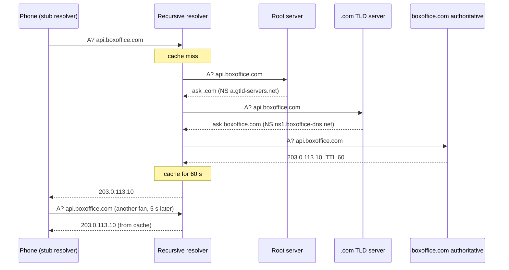
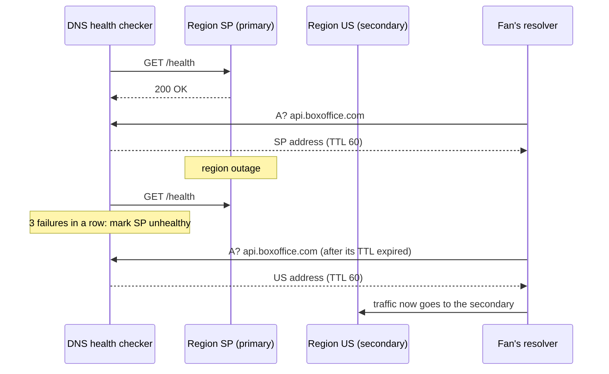
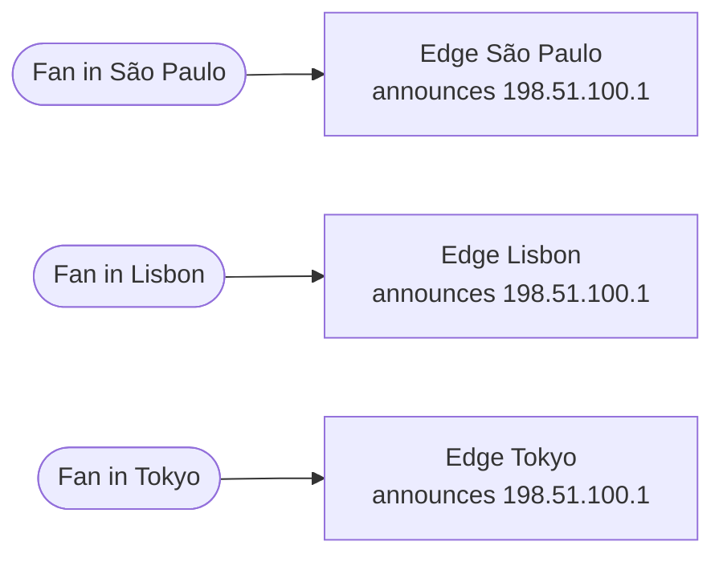
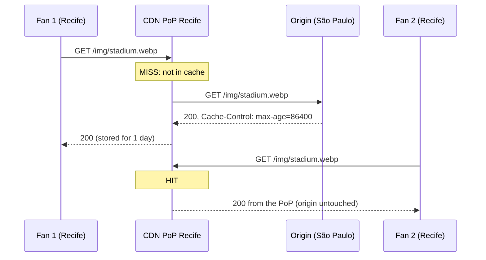
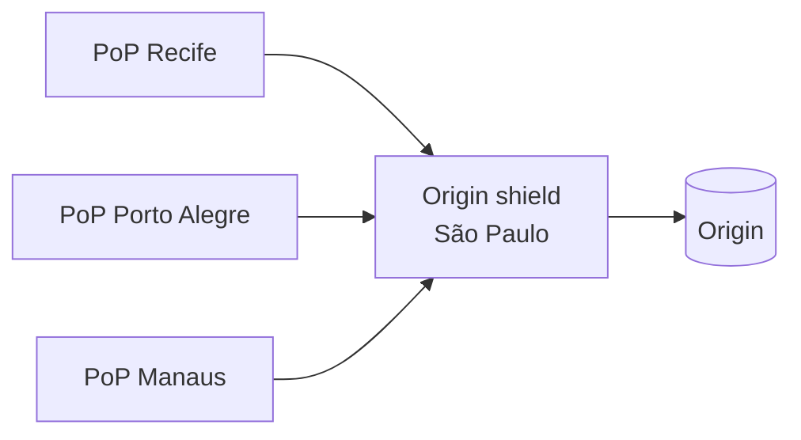
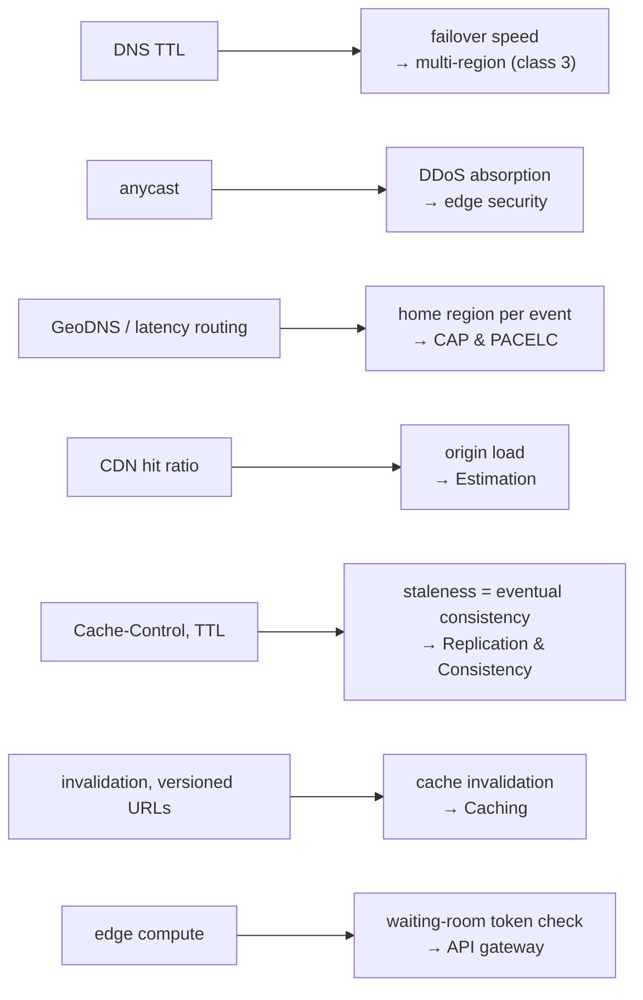

At 10:00 the BoxOffice stadium sale opens and 2 million phones ask the same two questions almost at once: *"where is `boxoffice.com`?"* and *"give me the event page"*. If both questions travel all the way to the BoxOffice servers in São Paulo, the servers drown before a single seat is sold. The **Domain Name System** (DNS) and a **Content Delivery Network** (CDN) exist so that most of those questions are answered close to the fan, by machines that BoxOffice does not even operate.

This page covers the first two hops of the [request's journey](../index.md#the-request-journey): DNS decides **where** a client goes; the CDN decides whether the request needs to go **any further**.

---

## DNS: the Internet's phone book { #dns }

Computers talk to IP addresses (`203.0.113.10`, `2001:db8::10`); people type names (`boxoffice.com`). DNS translates the name into addresses. It is one of the oldest and largest distributed systems in existence: a **hierarchical, delegated, heavily cached** database[^1].

- **Hierarchical**: names are read from right to left. The root (`.`) knows who is responsible for `com.`; `com.` knows who is responsible for `boxoffice.com.`; `boxoffice.com.` knows the address of `api.boxoffice.com`.
- **Delegated**: each level is run by a different organisation. BoxOffice controls only its own zone, `boxoffice.com`, through its **authoritative** name servers (usually a managed service such as Route 53 or Cloudflare DNS).
- **Cached**: every answer carries a **TTL** (time to live, in seconds). Resolvers keep the answer for that long, so the vast majority of lookups never reach the authoritative servers.

### Resolution, step by step { #resolution }

When the fan's phone needs `api.boxoffice.com`, it does not walk the hierarchy itself. A tiny **stub resolver** in the operating system asks a **recursive resolver** (the one from the mobile carrier, or a public one such as `1.1.1.1` or `8.8.8.8`), which does the work and caches the results:



A cold lookup costs several round trips (tens to hundreds of milliseconds); a cached one costs a single round trip to the resolver, or nothing at all when the answer is in the operating system or browser cache. In practice the root and `.com` answers are almost always cached too (their TTLs are one to two days), so a typical miss costs just one trip from the resolver to the authoritative server.

??? question "Think first: 2 million fans look up `boxoffice.com` at 10:00. How many queries reach BoxOffice's authoritative servers?"
    Far fewer than 2 million. Fans share a few thousand recursive resolvers (their mobile carriers, ISPs and public resolvers). Each resolver asks the authoritative server **once per TTL** and serves everyone else from its cache. With a 60 s TTL and, say, 5 000 active resolvers, the authoritative servers see on the order of 5 000 queries per minute — about 80 per second. DNS caching is the first and most effective load shield on the Internet.

### Record types { #record-types }

| Type | Maps | Example | Used for |
|---|---|---|---|
| **A** | name → IPv4 address | `api.boxoffice.com → 203.0.113.10` | the basic lookup |
| **AAAA** | name → IPv6 address | `api.boxoffice.com → 2001:db8::10` | IPv6 clients (most mobile networks) |
| **CNAME** | name → another name (alias) | `www.boxoffice.com → d123.cloudfront.net` | pointing at a CDN or load balancer whose IPs change |
| **ALIAS / ANAME** | apex name → another name (provider feature) | `boxoffice.com → my-alb.amazonaws.com` | a CNAME is not allowed at the zone apex; providers flatten it |
| **NS** | zone → its name servers | `boxoffice.com → ns1.boxoffice-dns.net` | delegation |
| **MX** | domain → mail servers | `boxoffice.com → mail.provider.com` | receiving e-mail |
| **TXT** | name → free text | `v=spf1 include:…` | domain ownership proofs, SPF/DKIM/DMARC for e-mail |
| **SRV** | service → host + port | `_sip._tcp.boxoffice.com` | service discovery (Kubernetes DNS uses it internally) |
| **CAA** | domain → allowed certificate authorities | `0 issue "letsencrypt.org"` | restricts who may issue TLS certificates for the domain |

### TTL: freshness versus load { #ttl }

The TTL is a classic trade-off between **how fast a change propagates** and **how much load and latency** the lookups cost:

| TTL | Change propagates in | Lookup load / latency | Good for |
|---|---|---|---|
| 5–60 s | about a minute | many more queries; more cold lookups for users | failover records, records you plan to change |
| 5–60 min | about an hour | low | ordinary records |
| 1–2 days | days | minimal | NS records, things that never change |

!!! tip "Lower the TTL before a migration"
    If you are going to move `api.boxoffice.com` to a new load balancer next Tuesday, lower its TTL from 1 hour to 60 seconds **on Monday** (at least one old TTL in advance). Resolvers that cached the old record with the 1-hour TTL will have expired it by Tuesday, and the switch will take about a minute instead of an hour. Raise the TTL again after the migration.

### Routing with DNS: GeoDNS, latency, weights and failover { #dns-routing }

Because the authoritative server chooses the answer, it can give **different answers to different clients**. Managed DNS services offer several routing policies[^4]:

| Policy | The answer depends on | BoxOffice use |
|---|---|---|
| **Simple** | nothing; always the same records | development environments |
| **Geolocation (GeoDNS)** | the client's country or continent (estimated from the resolver's IP, or from the EDNS Client Subnet option) | send fans in Europe to the EU region for data-residency rules |
| **Latency-based** | the region with the lowest measured latency from the client's network | São Paulo fans to `sa-east-1`, Lisbon fans to `eu-west-1` |
| **Weighted** | a configured percentage | send 5% of traffic to a new region or stack (DNS-level canary) |
| **Failover** | the result of a **health check** | the secondary region answers only when the primary is unhealthy |

**DNS failover** is the simplest form of multi-region disaster recovery: the DNS provider probes `https://sa.boxoffice.com/health` every 10–30 s from several locations; after a few failures it stops returning the primary's address and returns the secondary's.



!!! warning "DNS failover is not instant"
    The time to fail over is roughly **detection + TTL**: with a 30 s health-check interval, 3 failures to declare the primary down and a 60 s TTL, clients move after about 90 s + 60 s = **2.5 minutes** in the best case. In practice it is longer: some resolvers and clients **ignore low TTLs** (ISP resolvers that enforce a minimum TTL, applications that resolve a name once and keep the address in a connection pool, older devices), and long-lived connections keep talking to the dead region until they break. DNS failover is good for **regional** disasters; for failing *servers* inside a region, use a load balancer with health checks, which reacts in seconds ([Load Balancing](../load-balancing/index.md)).

**Try it.** Open the multi-region scenario and run the **load** profile. Then trigger the outage of the primary region (chaos **high**, or disable the region in the panel). Watch how long errors last before DNS sends traffic to the secondary, and change the DNS TTL to see how it stretches or shortens that window.

<div class="sdp" data-scenario="multi-region" data-mode="compact" data-height="520" data-profile="load"></div>

[:material-open-in-new: Open the full playground](../../../../playground/index.md)

### Anycast { #anycast }

With ordinary (**unicast**) addressing, one IP address belongs to one place. With **anycast**, the *same* IP address is announced over BGP (the Border Gateway Protocol that glues the Internet's networks together) from many locations at once, and each packet is delivered by the network to the **nearest** one, in routing terms.



Anycast gives three things at once, without any DNS trick:

- **Low latency**: every client reaches a nearby location.
- **Automatic failover**: if a location stops announcing the address, routing converges to the next-nearest one, typically within seconds.
- **DDoS absorption**: an attack from a global botnet is split among all the locations instead of hitting one (see [edge security](../index.md#ddos)).

The root DNS servers, public resolvers like `1.1.1.1` and `8.8.8.8`, and every large CDN use anycast. Anycast works best with short, mostly stateless exchanges (DNS over UDP, HTTP requests at an edge cache); a route change in the middle of a long TCP connection can break it, which large providers mitigate with careful routing.

---

## CDN: bring the content to the fan { #cdn }

A **CDN** is a network of caching reverse proxies — **points of presence** (PoPs), hundreds of them around the world — that store copies of your content close to users[^3]. A fan in Recife who asks for the BoxOffice logo receives it from a PoP in Recife or Fortaleza, not from the origin in São Paulo; a fan in Lisbon receives it from Lisbon, not from across the Atlantic.

A CDN does three jobs at once[^5]:

1. **Latency**: content travels a few kilometres instead of thousands. A round trip across the Atlantic costs around 100–150 ms; to a PoP in the same city, a few milliseconds.
2. **Offload**: every cache hit is a request the **origin** (your servers) never sees. This is often the main reason for a CDN in a system design.
3. **Protection**: the CDN's capacity and anycast network absorb traffic spikes and attacks before they reach you.



### Pull versus push { #pull-push }

| Model | How content gets to the PoPs | Pros | Cons | Good for |
|---|---|---|---|---|
| **Pull (origin pull)** | the PoP fetches from the origin on the first miss, then caches it | zero upload work; only popular content occupies the cache | the first request in each PoP is slow (a miss) | websites, APIs, almost everything |
| **Push** | you upload content to the CDN storage in advance | no cold misses; predictable | you manage uploads, versions and deletion | large files known in advance: video, software downloads, game patches |

Most designs use **pull** in front of an origin, and that origin is frequently an **object store** (S3, Cloud Storage, Azure Blob — the `objstore` component) for static files and media.

### The cache key { #cache-key }

The CDN stores each response under a **cache key** — by default, the host plus the URL path plus the query string. Two requests with the same key share the cached copy. Getting the key right is most of the work:

- **Too specific** a key fragments the cache: `/events/42?utm_source=instagram` and `/events/42?utm_source=email` are the same page, but with the default key they are cached twice and both miss. Remove tracking parameters from the key, or sort query parameters.
- **Too generic** a key leaks data: if the response depends on a cookie (`session=…`) or a header (`Accept-Language`) that is *not* in the key, one fan may receive a page personalised for another.
- The **`Vary`** response header tells caches which request headers change the response (`Vary: Accept-Encoding` is normal; `Vary: Cookie` effectively disables shared caching).

### `Cache-Control`: the origin decides { #cache-control }

The origin tells every cache — the browser, the CDN, any proxy in between — what it may do with a response through the `Cache-Control` header[^2]:

| Directive | Meaning |
|---|---|
| `max-age=N` | the response is fresh for N seconds (in any cache) |
| `s-maxage=N` | freshness for **shared** caches (CDN, proxies) only; overrides `max-age` there |
| `public` / `private` | may be stored by shared caches / only by the user's browser |
| `no-cache` | may be stored, but must be **revalidated** with the origin before each use |
| `no-store` | must not be stored anywhere (personal data, payment pages) |
| `stale-while-revalidate=N` | after expiry, serve the stale copy for up to N s **while** fetching a fresh one in the background |
| `stale-if-error=N` | if the origin fails, keep serving the stale copy for up to N s |
| `immutable` | the content will never change at this URL; do not even revalidate |

Revalidation uses **validators**: the origin sends an `ETag` (a version identifier) or `Last-Modified`; the cache asks `If-None-Match: "v42"`, and the origin answers `304 Not Modified` with no body when nothing changed — cheap for both sides.

```http title="Typical BoxOffice responses"
# fingerprinted JavaScript bundle: cache "forever"
Cache-Control: public, max-age=31536000, immutable

# event page HTML: short in browsers, longer at the CDN, survive origin hiccups
Cache-Control: public, max-age=60, s-maxage=300, stale-while-revalidate=60, stale-if-error=3600

# seat availability JSON during the sale: micro-cache at the CDN for one second
Cache-Control: public, max-age=0, s-maxage=1, stale-while-revalidate=1

# the fan's order and payment pages: never cache
Cache-Control: private, no-store
```

### Invalidation: purge or version? { #invalidation }

The event's poster image changed. How do the 300 PoPs learn about it? There are two strategies:

- **Purge (invalidation)**: call the CDN API to remove `/img/stadium.webp` (or a tag, or a prefix) from every PoP. The next request misses and fetches the new version. Purges are not instantaneous — they propagate in seconds to minutes, depending on the provider — and browsers that already cached the old version with `max-age` will not be purged at all.
- **Versioned (fingerprinted) URLs**: never change a file in place. The build produces `app.3f9a1c.js`; a new build produces `app.b71e02.js` and the HTML references the new name. Old and new versions coexist, caches never serve the wrong one, and the files can be cached with `immutable` for a year. Only the small HTML that references them needs a short TTL.

Prefer versioned URLs for every static asset and keep purges for the exceptional cases (an error on a published page, legal take-downs). This is the edge version of the oldest joke in computing — *there are only two hard things in computer science: cache invalidation and naming things* — and versioned URLs solve the first by doing the second. Invalidation in general is studied in the [caching class](../../caching/index.md).

### Origin shield and tiered caching { #origin-shield }

With 300 PoPs, a new file can cause **300 misses** — one per PoP — that all hit the origin. A **tiered cache** (or **origin shield**) adds a middle layer: PoPs ask a regional cache, and only the regional cache asks the origin. The origin sees one request per object instead of one per PoP, and request collapsing at the shield merges simultaneous misses for the same object into a single origin fetch.



### How much does the hit ratio matter? { #hit-ratio }

The fraction of requests the CDN serves from cache is the **hit ratio**. The load on the origin is the **miss** fraction times the traffic, so every extra "nine" of hit ratio divides the origin load by ten. Suppose (illustrative assumption) 200 000 requests per second reach the edge during the sale:

```python exec="1" html="1"
import matplotlib.pyplot as plt
import numpy as np
from io import StringIO
plt.rcParams.update({"text.color": "#888", "axes.labelcolor": "#888", "xtick.color": "#888",
                     "ytick.color": "#888", "axes.edgecolor": "#888", "font.size": 10})

total = 200_000                      # requests per second at the edge (illustrative)
hit = np.linspace(0.50, 0.999, 400)  # CDN hit ratio
origin = total * (1 - hit)

fig, ax = plt.subplots(figsize=(8, 4))
ax.plot(hit * 100, origin, color="#2f6fed", linewidth=2)
ax.set_yscale("log")
ax.set_xlabel("CDN hit ratio (%)")
ax.set_ylabel("requests/s reaching the origin (log)")
ax.set_title("200 k req/s at the edge: origin load vs hit ratio")
for h, c in [(0.90, "#f59e0b"), (0.99, "#1e9e5a"), (0.999, "#e5484d")]:
    o = total * (1 - h)
    ax.scatter([h * 100], [o], color=c, zorder=3)
    ax.annotate(f"{h:.1%} hit -> {o:,.0f} req/s", (h * 100, o), textcoords="offset points",
                xytext=(-170, -4), color=c)
ax.grid(True, which="both", alpha=0.2)
ax.set_xlim(50, 100)

buf = StringIO()
plt.savefig(buf, format="svg", transparent=True, bbox_inches="tight")
print(buf.getvalue())
plt.close()
```

Going from 90% to 99% hit ratio looks like a small improvement ("only nine points"), but it cuts the origin load from **20 000** to **2 000** requests per second — ten times fewer servers. When you discuss a CDN in an interview, talk about the **miss rate**, not the hit rate: it is the number that sizes the origin.

**Try it.** Load the CDN scenario and run the **load** profile. Lower the CDN hit ratio (or the TTL) step by step and watch the request rate and p99 latency at the app servers grow; then raise it and see how few app replicas you need. Finally, purge the cache during the run: the sudden wave of misses is a small-scale stampede on the origin.

<div class="sdp" data-scenario="cdn-static" data-mode="compact" data-height="520" data-profile="load"></div>

[:material-open-in-new: Open the full playground](../../../../playground/index.md)

### Caching dynamic content: micro-caching { #micro-caching }

"Dynamic" does not mean "uncacheable". The seat-availability JSON of the stadium show changes all the time, but nobody is harmed if it is **one second old**. If every PoP caches it for 1 s (`s-maxage=1`), the origin receives at most one request per second **per PoP** (or per shield, with tiered caching), no matter how many fans are polling. With 2 million fans polling every 5 seconds — 400 000 requests per second — and 50 PoPs serving Brazil, the origin sees about **50 requests per second** for that endpoint. The seat map is at most a second stale; the hold itself (`POST /api/holds`) is never cached and is checked against the database, so a stale map can never cause a double booking.

### Edge compute { #edge-compute }

Modern CDNs also run **your code** in the PoPs: Cloudflare Workers, AWS CloudFront Functions and Lambda@Edge, Fastly Compute, Akamai EdgeWorkers. These are small functions (milliseconds of CPU, limited memory, usually JavaScript or WebAssembly) executed on each request, before the cache or the origin. Good uses:

- **Validate a waiting-room token** or a JWT signature at the edge and reject invalid requests before they cross the ocean.
- **Rewrite and redirect**: A/B tests, language redirects, normalising the cache key (removing `utm_*` parameters).
- **Assemble responses** from cached fragments, or add security headers.
- Serve a **waiting-room page** entirely from the edge while the origin is protected.

Bad uses: anything that needs your database on every request (the function is far from the data, so each call crosses the network anyway), long computations, and business logic that would be better tested and versioned in a service.

=== "AWS"

    - **DNS**: Route 53 (latency, geolocation, weighted and failover routing; health checks).
    - **CDN**: CloudFront, with CloudFront Functions and Lambda@Edge for edge compute; Origin Shield.
    - **Origin**: S3 for static files and media; Application Load Balancer for APIs.
    - **Protection**: AWS WAF and AWS Shield (Standard is included; Advanced is paid).

=== "GCP"

    - **DNS**: Cloud DNS (with geolocation and failover routing policies).
    - **CDN**: Cloud CDN, attached to the global external Application Load Balancer; Media CDN for video.
    - **Origin**: Cloud Storage buckets or backend services behind the load balancer.
    - **Protection**: Cloud Armor (WAF rules and DDoS protection).

=== "Azure"

    - **DNS**: Azure DNS; Traffic Manager for DNS-based routing (performance, priority, weighted, geographic).
    - **CDN**: Azure Front Door (global L7 entry point with CDN, WAF and routing).
    - **Origin**: Blob Storage, App Service, AKS behind Application Gateway.
    - **Protection**: Azure WAF and Azure DDoS Protection.

=== "Open source / other"

    - **DNS**: BIND, PowerDNS, CoreDNS (the DNS inside Kubernetes); managed: Cloudflare DNS, NS1.
    - **CDN**: Cloudflare, Akamai, Fastly, Bunny; self-hosted caching with Varnish or Nginx `proxy_cache`.
    - **Edge compute**: Cloudflare Workers, Fastly Compute, Akamai EdgeWorkers.

---

## Trade-offs at a glance { #trade-offs }

| Decision | Option A | Option B | Choose A when… |
|---|---|---|---|
| DNS TTL | short (30–60 s) | long (hours) | you need fast failover or plan a change |
| Routing | latency-based / GeoDNS | anycast | you need per-region control (data residency, canaries) |
| Failover | DNS failover | anycast / global LB | a few minutes of failover time is acceptable and cheap matters |
| CDN model | pull | push | content is requested unpredictably (most web traffic) |
| Freshness | purge on change | versioned URLs | the URL cannot change (the HTML page itself, an API) |
| Dynamic data | micro-cache (1–5 s) | no cache | slightly stale data is acceptable and the endpoint is hot |
| Logic | edge function | origin service | the logic is small, stateless and must run before the origin |

!!! example "BoxOffice: DNS and CDN for the stadium sale"
    - `boxoffice.com` and `www` → **ALIAS/CNAME** to the CDN, which answers from anycast addresses. `api.boxoffice.com` has **latency-based** records for the São Paulo and Virginia regions, with **failover** health checks and a 60 s TTL.
    - Static assets (JavaScript, CSS, fonts) are **fingerprinted** and cached for a year with `immutable`. Event posters live in the object store and are cached for a day; the rare change uses a new file name.
    - The event page HTML: `s-maxage=300, stale-while-revalidate=60, stale-if-error=3600`. If the origin goes down during the sale, fans still see the page.
    - Seat availability: **micro-cached for 1 s** at the CDN, with an origin shield in São Paulo. Holds, orders and payments: `private, no-store`, never cached, always go to the origin.
    - An **edge function** checks the waiting-room token on every `/api/*` request; requests without a valid token receive the waiting-room page from the edge.

    Back-of-the-envelope: 2 M fans × (1 page + 30 assets) at the opening, plus polling, is millions of requests per minute; with a 99% hit ratio on assets and micro-caching on the seat map, the origin sees a few thousand requests per second, almost all of them holds and orders — the requests that actually *need* the origin.

!!! tip "In the interview"
    - Say **what** you cache at the CDN and **for how long**: "static assets and images with versioned URLs and long TTLs; the event page for minutes with `stale-while-revalidate`; the seat map micro-cached for 1 s; nothing user-specific."
    - Quantify with the **miss rate**: "at 99% hit ratio, 200 k req/s at the edge become 2 k at the origin."
    - Mention **DNS** in one sentence — "latency-based DNS to the nearest region, with health-checked failover" — and know its limit: failover takes about **detection + TTL**, minutes, not seconds.
    - For a global, read-heavy system (news feed, video streaming, URL shortener redirects), the CDN is often *the* most important component of the design.

!!! warning "Pitfalls"
    - **Caching personalised responses** in a shared cache because a cookie or `Authorization` header is not in the cache key: one user sees another's data. Mark them `private` or `no-store`.
    - **Purging as a deploy strategy**: purges are slow, can fail and do not reach browsers. Use versioned file names.
    - **Cache-busting by accident**: random query parameters, timestamps in URLs or `Vary: Cookie` silently drop the hit ratio to zero.
    - **Thundering herd on expiry**: if a hot object expires in every PoP at the same time, they all miss together. Origin shield, request collapsing and `stale-while-revalidate` prevent it.
    - **Trusting DNS failover for fast recovery**: low TTLs are not always respected; long-lived connections do not re-resolve.
    - **Forgetting that the CDN is a dependency**: a CDN outage takes your site down too. Very large sites use two CDNs (multi-CDN) with DNS steering between them.

---

## How it connects { #how-it-connects }



**Palette components:** [`dns`](../../../reference/components/edge/index.md#dns) · [`cdn`](../../../reference/components/edge/index.md#cdn) · [`objstore`](../../../reference/components/storage/index.md#objstore) (the usual CDN origin for images and video) · [`cache`](../../../reference/components/storage/index.md#cache) (the next cache layer behind the CDN). **Scenarios:** `cdn-static`, `multi-region`, `video-streaming`. **Continues in:** [Caching — patterns](../../caching/patterns/index.md), [Distributed Systems — CAP & PACELC](../../distributed/cap-pacelc/index.md#multi-region), [Case study: video streaming](../../case-studies/video-streaming/index.md).

## Key takeaways

- DNS is a **hierarchical, delegated, cached** database; caching by recursive resolvers means the authoritative servers see one query per resolver per TTL.
- The **TTL** trades change propagation against lookup load; lower it *before* a planned change.
- DNS can route by **geography, latency, weight or health**; DNS failover takes about **detection + TTL**, and some clients ignore TTLs.
- **Anycast** announces the same IP from many locations: low latency, fast failover and DDoS absorption.
- A **CDN** cuts latency, offloads the origin and absorbs attacks; most CDNs **pull** from the origin and cache by a **cache key** you must design.
- The origin controls caching with **`Cache-Control`**; prefer **versioned URLs** to purges; **micro-caching** makes hot dynamic endpoints cheap.
- Every extra nine of **hit ratio** divides the origin load by ten.

---

[^1]: MOCKAPETRIS, P. [RFC 1034 — Domain Names: Concepts and Facilities](https://www.rfc-editor.org/rfc/rfc1034){target="_blank"} and [RFC 1035 — Implementation and Specification](https://www.rfc-editor.org/rfc/rfc1035){target="_blank"}. IETF, 1987.
[^2]: FIELDING, R.; NOTTINGHAM, M.; RESCHKE, J. [RFC 9111 — HTTP Caching](https://www.rfc-editor.org/rfc/rfc9111){target="_blank"}. IETF, 2022. See also NOTTINGHAM, M. [RFC 5861 — HTTP Cache-Control Extensions for Stale Content](https://www.rfc-editor.org/rfc/rfc5861){target="_blank"}, 2010.
[^3]: CLOUDFLARE. [What is a CDN?](https://www.cloudflare.com/learning/cdn/what-is-a-cdn/){target="_blank"} and [What is anycast?](https://www.cloudflare.com/learning/cdn/glossary/anycast-network/){target="_blank"} — Cloudflare Learning Center.
[^4]: AWS. [Amazon Route 53 — Choosing a routing policy](https://docs.aws.amazon.com/Route53/latest/DeveloperGuide/routing-policy.html){target="_blank"}. AWS Documentation.
[^5]: XU, A. *System Design Interview — An Insider's Guide*, vol. 1, ch. 1 (CDN, DNS). Byte Code LLC, 2020.
