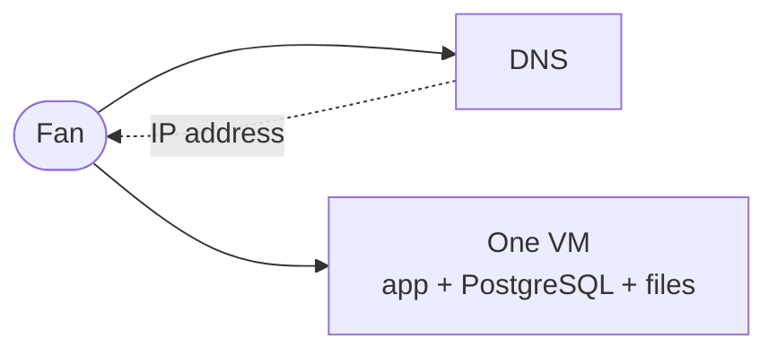
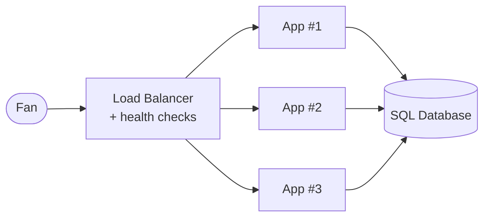
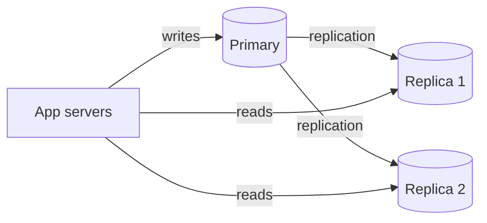
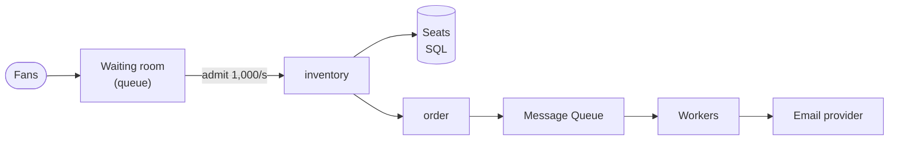
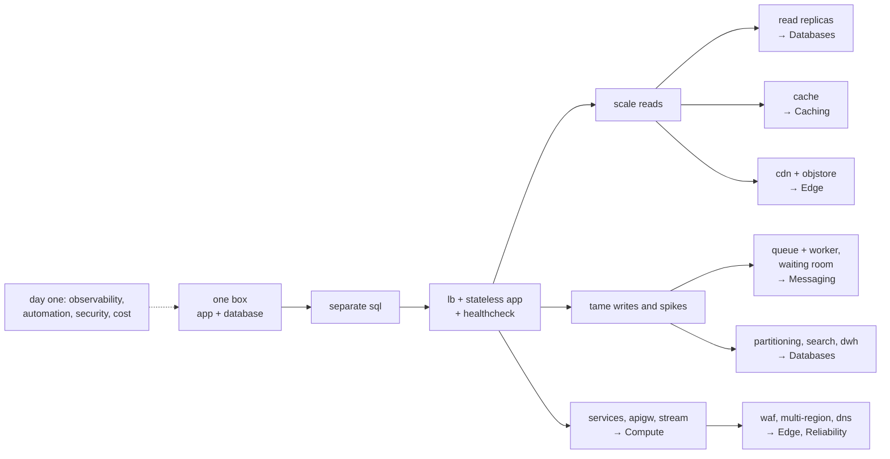

Most famous architectures were not designed; they **evolved**. They started as one program and one database on one machine, and each new component was added because a specific symptom — a saturated CPU, a slow page, an outage during a deploy — made it necessary. This page follows BoxOffice along that path, from its first user to ten million, one symptom at a time[^1].

Two rules guide the whole journey:

1. **Add a component only when a measured symptom calls for it.** Every component has a price: money, latency, new failure modes, and something else to operate.
2. **Every fix creates a new problem.** A replica brings replication lag; a cache brings invalidation; a queue brings duplicate messages. Knowing the next problem *before* you meet it is what separates design from guesswork.

| Stage | Scale (illustrative) | Symptom | What is added | New problem it brings |
|---|---|---|---|---|
| 0 | first users | — | one server: app + database | everything fails together |
| 1 | ~10 k users | app and DB fight for CPU and memory | separate **SQL Database** | network hop; two things to run |
| 2 | ~100 k daily users | a deploy or a crash takes the site down | **Load Balancer** + stateless **App Server** replicas + **Health Check** | session state must leave the server |
| 3 | ~1 M daily users | database CPU high, mostly reads | **read replicas** | replication lag, stale reads |
| 4 | same | catalog p99 grows with traffic | **Cache** | invalidation, cold cache, stampede |
| 5 | same | bandwidth bill and page weight | **CDN** + **Object Store** | cache invalidation at the edge |
| 6 | first big on-sale | checkout slowed by e-mail; spike crushes inventory | **Message Queue** + **Worker**; waiting room | duplicates, backlog, ordering |
| 7 | many teams, many features | one bug or one deploy affects everything | split into **services**; **API Gateway**; **Event Stream** | network calls fail; distributed data |
| 8 | ~10 M daily users | one database is too big / too hot | **partitioning**, **Search**, **Data Warehouse** | hot partitions, cross-shard queries |
| 9 | national scale | bots, attacks, a region outage | **WAF**, rate limiting, **multi-region** + **DNS** failover | data replication across regions |

The numbers are orders of magnitude for a read-heavy web product, not thresholds: a different workload hits each wall at a different point. **Measure, then decide.**

---

## Stage 0 — one box

The first version of BoxOffice is a single Spring Boot application and a PostgreSQL database **on the same virtual machine**. DNS points the domain to its IP address.

This is the **right** architecture for the first users: one thing to deploy, monitor and back up; transactions are local; there is no network between the code and the data. It is also fragile: the machine is a **single point of failure** (SPOF), and the application and the database compete for the same CPU, memory and disk.

## Stage 1 — separate the database

**Symptom**: under load, the database's buffer cache and the JVM fight for memory; a heavy report slows down every page; restarting the app for a deploy also risks the database.

**Change**: move PostgreSQL to its own machine — or better, a **managed** database service that handles backups, patches and failover. Now the web tier and the data tier can be sized and scaled **independently**: the app needs CPU, the database needs memory and fast disks.

**New problem**: every query now crosses the network (about 0.5 ms round trip inside a data centre — see [class 2](../../estimation/numbers/index.md)). Code that runs 200 queries per page (the classic N+1 problem) suddenly takes 100 ms more.

## Stage 2 — load balancer and stateless replicas

**Symptom**: BoxOffice is now a real business. A single app server is a SPOF: a crash, or simply a deploy, means downtime. At the peak hour the CPU sits at 85% and the p99 latency climbs.

**Change**: put a **load balancer** in front of two or more identical **app server** replicas. The load balancer spreads requests, runs **health checks**, and stops sending traffic to a replica that fails them. Deploys become rolling: update one replica at a time.

**New problem — state**: if the logged-in session or the shopping cart lives in the memory of App #1, the next request may land on App #2 and the fan is "logged out". The fix is to make app servers **stateless**: keep session data in a signed token (JWT) or a shared store (Redis), never in the server. Statelessness is the precondition for horizontal scaling — any replica can serve any request, so you can add or kill replicas freely.

You explored this stage in the overview with the `scale-out` scenario: replicas multiply app capacity, but **the single database stays a single database**.

## Stage 3 — read replicas

**Symptom**: the database CPU is at 70% at the peak hour. Looking at the query log, **~95% of the queries are reads** — event pages, venue info, seat maps.

**Change**: add **read replicas**. The primary receives all writes and streams its changes to the replicas; reads go to the replicas. Read capacity grows with each replica; write capacity does not change.

**New problem — replication lag**: replicas are a few milliseconds (or, under load, seconds) behind the primary. A fan pays, is redirected to "My orders", the page reads from a replica… and the order is not there yet. Fixes include **read-your-writes** (read the fan's own recent data from the primary) or routing whole critical flows to the primary. And the seat inventory, which must never be stale, keeps reading from the primary.

**Try it:** add read replicas and watch the primary's utilization fall; then increase the replication lag and look for stale reads. Which BoxOffice pages could tolerate them?

## Stage 4 — a cache

**Symptom**: even with replicas, every event page runs the same five queries — for data that changes a few times a day. Catalog p99 grows with traffic, and each new replica costs a full database machine.

**Change**: add a **cache** (Redis) in front of the database, using **cache-aside**: the app looks in the cache first; on a miss it reads the database and stores the result with a TTL (time to live).

The arithmetic is what makes caches the most powerful tool in the palette. With a **hit ratio** of 90%, only 10% of reads reach the database — a **10× reduction**. At 99%, it is 100×. And a cache hit costs well under a millisecond, versus several milliseconds for a query.

**New problems**: *invalidation* (when the organizer changes a price, the cached page is stale until the TTL expires or the key is deleted), *cold start* (an empty cache after a restart sends 100% of reads to the database at once), and *stampede* (a popular key expires and 1,000 requests miss at the same instant). [Class 7](../../caching/index.md) is dedicated to them.

**Try it:** vary the hit ratio from 0% to 90% to 99% and watch database utilization and p99. Then flush the cache under load — what happens in the first seconds?

## Stage 5 — CDN and object storage

**Symptom**: event pages carry posters and venue photos — about 1 MB per page view. At 1,000 page views per second that is **1 GB/s (8 Gbit/s)** leaving BoxOffice's servers, most of it identical bytes sent again and again. Fans far from the data centre wait for every image.

**Change**: move images and static files (JavaScript, CSS) to an **object store** (S3-like: cheap, durable, unlimited) and serve them through a **CDN** (*Content Delivery Network*), a network of edge servers near the users that cache those files. The origin serves each file once per edge location instead of once per fan.

**New problem**: a changed poster stays cached at hundreds of edge locations. The common fix is **versioned file names** (`poster.v2.jpg`, or a content hash) instead of trying to purge every edge.

**Try it:** run the scenario with and without the CDN in front of the origin and compare origin bandwidth and latency for distant users.

## Stage 6 — asynchronous work and the first on-sale

**Symptom 1**: checkout takes 2–3 s, and most of it is not paying — it is generating the PDF ticket and sending the e-mail *while the fan waits*. When the e-mail provider is slow, checkout is slow; when it is down, **checkout fails**.

**Change**: anything that does not need to finish before the response goes to a **message queue**. Checkout writes the order, publishes a `TicketIssued` message and answers immediately; **workers** consume the queue, render the PDF and send the e-mail at their own pace, retrying on failure.

**Symptom 2 — the first stadium on-sale**: 2 M fans arrive in one minute. Even a perfectly cached catalog cannot make 60,000 seats accept 2 million concurrent holds: the inventory rows are **hot** — everyone wants the same front sections.

**Change**: a **waiting room** — itself a queue. Fans get a place in line and are admitted at the rate the inventory can sustain (say, 1,000 per second). The spike becomes a long, flat, predictable load. [Class 2](../../estimation/queueing/index.md) computes how long the line is with Little's Law.

**New problems**: queues deliver messages **at least once**, so consumers must be **idempotent** (sending the same ticket twice must not create two tickets); a backlog can grow faster than workers drain it; ordering is not guaranteed. [Class 8](../../messaging/index.md) covers all of them.

**Try it:** run the `spike` profile and watch the queue backlog grow and drain. Add workers: how does the drain time change?

## Stage 7 — services where they pay off

**Symptom**: BoxOffice has now five teams working in one codebase. A memory leak in the recommendations code takes down checkout. Every deploy needs coordination across teams. The on-sale traffic hammers the inventory code, but scaling it means scaling the whole application.

**Change**: extract **services** along business boundaries — first the ones with clearly different needs: `inventory` (hot, strongly consistent, scaled for on-sales), `notification` (asynchronous), `search` (a different database). An **API Gateway** becomes the single entry point (routing, authentication, rate limiting). Services communicate through APIs and through an **event stream** (Kafka) for facts like `OrderPaid`, which several consumers (notification, analytics, search) react to.

**New problems**: what used to be a function call is now a network call that can be slow or fail; a transaction across services is no longer a database transaction (sagas, outbox — class 8); a request touches several services, so you need distributed tracing to debug it (class 10).

!!! warning "Monolith first"

    Splitting into services is a **response to organizational and scaling symptoms**, not a starting point. Teams that start with microservices pay the full cost of distribution — network failures, distributed data, many deployables, a platform to run them — before they know where the real boundaries of their domain are[^2]. A well-structured **modular monolith** (clear modules with explicit interfaces inside one deployable) gets most of the benefits and keeps the option to extract a module later, when a symptom justifies it. [Class 5](../../compute/index.md) discusses this in depth.

## Stage 8 — partition the data and specialize storage

**Symptom**: the orders table has billions of rows and the primary's disk and write throughput are near their limits; full-text search with `LIKE '%rock%'` scans millions of rows; the organizers' sales dashboards run heavy aggregations on the production database.

**Change**: use the right store for each job, and **partition** what must grow:

- **Partitioning (sharding)** splits data across several database nodes by a key — orders by `fanId`, seat inventory by `eventId` — so writes scale with the number of shards.
- A **search engine** (inverted index) for full-text and faceted search, fed asynchronously from catalog events.
- A **data warehouse** for analytics, fed by change data capture (CDC) or events, so dashboards never touch the transactional database.

**New problems**: a **hot partition** (one stadium on-sale lands all writes on one shard), queries across shards, rebalancing when adding nodes. [Class 6](../../databases/index.md).

## Stage 9 — the edge and multiple regions

**Symptom**: bots buy 30% of the tickets for popular shows in the first second; a DDoS attack hits the week of a big on-sale; a cloud region outage takes BoxOffice down for four hours.

**Change**: a **WAF** (*Web Application Firewall*) and bot mitigation at the edge; **rate limiting** in the API Gateway (per fan, per IP, per card); deployment across **multiple availability zones** first, then **multiple regions** with **DNS** failover.

**New problem**: data now lives far apart. Replicating the seat inventory across regions synchronously costs tens of milliseconds per write (the speed of light is a hard limit); asynchronously, it risks selling a seat twice during a failover. The usual compromise: each event's inventory has **one home region**, and other regions forward holds to it. Class 3 explains why there is no free lunch here (CAP and PACELC).

**Try it:** the final scenario puts several of these components together for the 10:00 on-sale — waiting room, inventory in SQL, payment. Run the `spike` profile and find the first bottleneck.

---

## What is constant along the journey

Some things do not belong to any single stage — they must be there from **day one** and grow with the system:

- **Observability** — metrics, logs and traces. Every decision above starts with "the symptom is…": without measurement, there is no symptom, only opinions.
- **Automation** — infrastructure as code, CI/CD, automated tests. Ten servers configured by hand are ten different servers.
- **Security** — authentication, least privilege, secrets out of the code, from the first commit.
- **Cost awareness** — knowing what each component costs per month, and per ticket sold.

??? question "Think first: in which order would you add components for a *write-heavy* system?"

    Consider an IoT platform that receives a temperature reading from 1 million sensors every 10 seconds (100,000 writes/s) and shows dashboards to a few hundred users.

    **Answer sketch**: the read-side components of stages 3–5 (replicas, cache, CDN) barely help — reads are rare. The early moves are a **queue or event stream** to absorb and batch writes (stage 6), a **write-optimized, partitioned store** (time-series or wide-column, stage 8), and **pre-aggregation** for the dashboards. The journey above is the typical order for read-heavy web products, not a universal recipe: **the workload decides the order**.

!!! tip "In the interview"

    Interviewers often ask *"how would this evolve?"* or *"what changes at 10× the traffic?"*. Use the journey as a mental checklist, but always **tie each step to a symptom and a number**: "At ~1,000 catalog reads/s the primary's CPU would be the bottleneck; with a 95% cache hit ratio only 50 reads/s reach it, so I'd add Redis before adding replicas." Start the high-level design **simple** (one service, one database, a cache) and add complexity only where the requirements or your estimates demand it — an interviewer is more impressed by a justified simple design than by an unjustified complex one.

!!! warning "Common pitfalls"

    - **Résumé-driven architecture**: Kafka, Kubernetes and twelve microservices for a system with 100 users.
    - **Scaling the wrong tier**: adding app replicas when the database is the bottleneck.
    - **Stateful app servers**: sessions in memory make horizontal scaling and rolling deploys break users.
    - **Ignoring the new problem**: adding a replica without handling lag, a cache without an invalidation plan, a queue without idempotent consumers.
    - **Treating the stages as fixed**: they are a typical sequence for read-heavy systems; measure your own workload.

---

## How it connects { #how-it-connects }

**Palette components**, in order of arrival: [`app`](../../../reference/components/compute/index.md#app) · [`sql`](../../../reference/components/storage/index.md#sql) · [`lb`](../../../reference/components/edge/index.md#lb) · [`healthcheck`](../../../reference/components/observability/index.md#healthcheck) · [`cache`](../../../reference/components/storage/index.md#cache) · [`cdn`](../../../reference/components/edge/index.md#cdn) · [`objstore`](../../../reference/components/storage/index.md#objstore) · [`queue`](../../../reference/components/messaging/index.md#queue) (also the waiting room) · [`worker`](../../../reference/components/compute/index.md#worker) · [`apigw`](../../../reference/components/edge/index.md#apigw) · [`stream`](../../../reference/components/messaging/index.md#stream) · [`nosql`](../../../reference/components/storage/index.md#nosql) (partitions) · [`search`](../../../reference/components/compute/index.md#search) · [`dwh`](../../../reference/components/storage/index.md#dwh) · [`waf`](../../../reference/components/edge/index.md#waf) · [`dns`](../../../reference/components/edge/index.md#dns) (failover). **Scenarios:** `monolith`, `scale-out`, `db-replicas`, `read-heavy-cache`, `cdn-static`, `async-queue`, `flash-sale`, `multi-region`. **Continues in:** [Compute — services](../../compute/services/index.md) (monolith first), [Databases — replication](../../databases/replication/index.md), [Caching — patterns](../../caching/patterns/index.md), [Messaging — queues and pub/sub](../../messaging/queues-pubsub/index.md), [Databases — partitioning](../../databases/partitioning/index.md), [Traffic & Edge](../../edge/index.md), [Hands-on 3](../../../hands-on/3/index.md).

## Key takeaways

- Architectures **evolve**: start with the simplest thing (one app, one database) and add components **only when a measured symptom requires it**.
- Each component solves one symptom and **creates a new problem** — replicas → lag, cache → invalidation, queue → duplicates, services → network failures, shards → hot partitions.
- **Stateless** app servers are the precondition for horizontal scaling.
- Caching, CDN and replicas scale **reads**; queues, partitioning and waiting rooms tame **writes and spikes**.
- **Monolith first**; extract services when organizational or scaling symptoms justify the cost of distribution.

---

[^1]: XU, A. *System Design Interview — An Insider's Guide*, vol. 1. Byte Code LLC, 2020. Chapter 1 (scale from zero to millions of users).
[^2]: FOWLER, M. [MonolithFirst](https://martinfowler.com/bliki/MonolithFirst.html){target="_blank"}, 2015.
