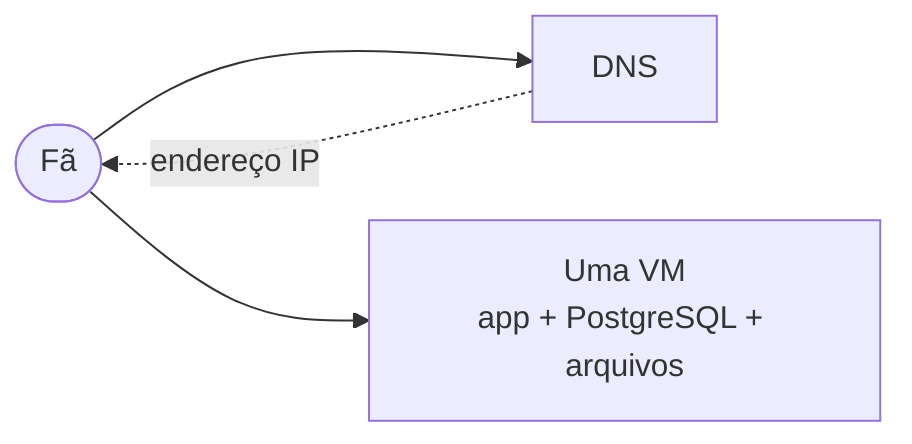
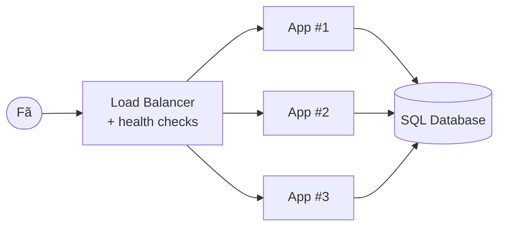
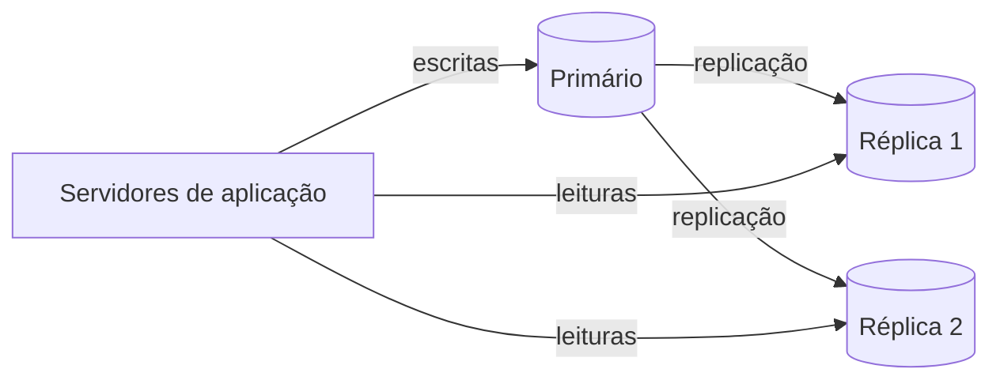
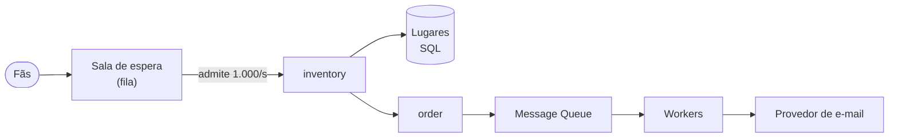
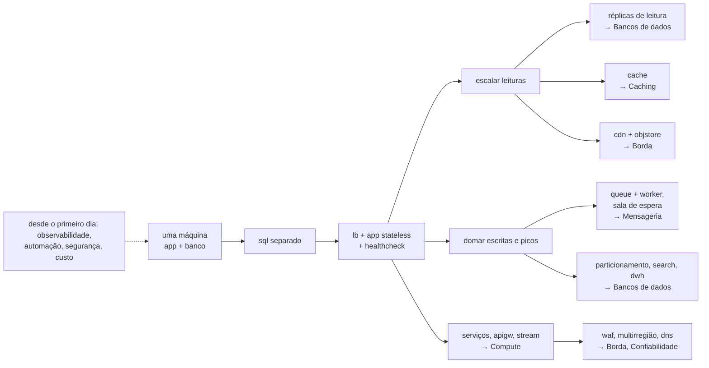

A maioria das arquiteturas famosas não foi projetada; ela **evoluiu**. Começou como um programa e um banco de dados numa máquina, e cada novo componente foi acrescentado porque um sintoma específico — uma CPU saturada, uma página lenta, uma queda durante um deploy — o tornou necessário. Esta página acompanha a BoxOffice por esse caminho, do primeiro usuário aos dez milhões, um sintoma de cada vez[^1].

Duas regras guiam toda a jornada:

1. **Acrescente um componente só quando um sintoma medido pedir por ele.** Todo componente tem um preço: dinheiro, latência, novos modos de falha e mais uma coisa para operar.
2. **Toda correção cria um problema novo.** Uma réplica traz atraso de replicação; um cache traz invalidação; uma fila traz mensagens duplicadas. Conhecer o próximo problema *antes* de encontrá-lo é o que separa design de chute.

| Etapa | Escala (ilustrativa) | Sintoma | O que é acrescentado | Problema novo que traz |
|---|---|---|---|---|
| 0 | primeiros usuários | — | um servidor: aplicação + banco | tudo falha junto |
| 1 | ~10 mil usuários | aplicação e banco disputam CPU e memória | **SQL Database** separado | salto de rede; duas coisas para rodar |
| 2 | ~100 mil usuários diários | um deploy ou uma queda derruba o site | **Load Balancer** + réplicas sem estado de **App Server** + **Health Check** | o estado de sessão precisa sair do servidor |
| 3 | ~1 M de usuários diários | CPU do banco alta, quase tudo leitura | **réplicas de leitura** | atraso de replicação, leituras desatualizadas |
| 4 | idem | p99 do catálogo cresce com o tráfego | **Cache** | invalidação, cache frio, estouro (*stampede*) |
| 5 | idem | conta de banda e peso das páginas | **CDN** + **Object Store** | invalidação de cache na borda |
| 6 | primeira grande abertura de vendas | checkout atrasado pelo e-mail; o pico esmaga o inventário | **Message Queue** + **Worker**; sala de espera | duplicatas, backlog, ordenação |
| 7 | muitas equipes, muitas funcionalidades | um bug ou um deploy afeta tudo | divisão em **serviços**; **API Gateway**; **Event Stream** | chamadas de rede falham; dados distribuídos |
| 8 | ~10 M de usuários diários | um banco grande demais / quente demais | **particionamento**, **Search**, **Data Warehouse** | partições quentes, consultas entre shards |
| 9 | escala nacional | robôs, ataques, queda de uma região | **WAF**, rate limiting, **multi-região** + failover por **DNS** | replicação de dados entre regiões |

Os números são ordens de grandeza para um produto web dominado por leituras, não limiares: uma carga de trabalho diferente bate em cada parede num ponto diferente. **Meça, depois decida.**

---

## Etapa 0 — uma caixa só

A primeira versão da BoxOffice é uma única aplicação Spring Boot e um banco PostgreSQL **na mesma máquina virtual**. O DNS aponta o domínio para o endereço IP dela.

Esta é a arquitetura **certa** para os primeiros usuários: uma coisa só para publicar, monitorar e fazer backup; as transações são locais; não há rede entre o código e os dados. Ela também é frágil: a máquina é um **ponto único de falha** (*SPOF*, *single point of failure*), e a aplicação e o banco disputam a mesma CPU, memória e disco.

## Etapa 1 — separar o banco de dados

**Sintoma**: sob carga, o buffer cache do banco e a JVM brigam por memória; um relatório pesado deixa todas as páginas lentas; reiniciar a aplicação para um deploy também coloca o banco em risco.

**Mudança**: mover o PostgreSQL para uma máquina própria — ou, melhor ainda, para um serviço de banco **gerenciado**, que cuida de backups, atualizações e failover. Agora a camada web e a camada de dados podem ser dimensionadas e escaladas **de forma independente**: a aplicação precisa de CPU, o banco precisa de memória e discos rápidos.

**Problema novo**: toda consulta agora atravessa a rede (cerca de 0,5 ms de ida e volta dentro de um data centre — veja a [aula 2](../../estimation/numbers/index.md)). Um código que roda 200 consultas por página (o clássico problema N+1) de repente leva 100 ms a mais.

## Etapa 2 — load balancer e réplicas sem estado

**Sintoma**: a BoxOffice agora é um negócio de verdade. Um único servidor de aplicação é um SPOF: uma queda, ou simplesmente um deploy, significa indisponibilidade. No horário de pico, a CPU fica em 85% e a latência p99 sobe.

**Mudança**: colocar um **load balancer** na frente de duas ou mais réplicas idênticas do **servidor de aplicação**. O load balancer distribui as requisições, executa **health checks** e para de enviar tráfego a uma réplica que falha neles. Os deploys passam a ser graduais (*rolling*): uma réplica de cada vez.

**Problema novo — estado**: se a sessão do usuário logado ou o carrinho vivem na memória do App #1, a próxima requisição pode cair no App #2 e o fã é "deslogado". A correção é tornar os servidores de aplicação **sem estado** (*stateless*): guardar os dados de sessão num token assinado (JWT) ou num armazenamento compartilhado (Redis), nunca no servidor. Não ter estado é a pré-condição da escala horizontal — qualquer réplica pode atender qualquer requisição, então você pode acrescentar ou matar réplicas à vontade.

Você explorou esta etapa na visão geral com o cenário `scale-out`: as réplicas multiplicam a capacidade da aplicação, mas **o banco único continua sendo um banco único**.

## Etapa 3 — réplicas de leitura

**Sintoma**: a CPU do banco está em 70% no horário de pico. Olhando o log de consultas, **~95% delas são leituras** — páginas de eventos, informações dos locais, mapas de lugares.

**Mudança**: acrescentar **réplicas de leitura**. O primário recebe todas as escritas e transmite suas alterações para as réplicas; as leituras vão para as réplicas. A capacidade de leitura cresce a cada réplica; a capacidade de escrita não muda.

**Problema novo — atraso de replicação** (*replication lag*): as réplicas ficam alguns milissegundos (ou, sob carga, segundos) atrás do primário. Um fã paga, é redirecionado para "Meus pedidos", a página lê de uma réplica… e o pedido ainda não está lá. As correções incluem **ler as próprias escritas** (*read-your-writes*: ler do primário os dados recentes do próprio fã) ou mandar fluxos críticos inteiros para o primário. E o inventário de lugares, que nunca pode estar desatualizado, continua lendo do primário.

**Experimente:** acrescente réplicas de leitura e veja a utilização do primário cair; depois aumente o atraso de replicação e procure leituras desatualizadas. Quais páginas da BoxOffice poderiam tolerá-las?

## Etapa 4 — um cache

**Sintoma**: mesmo com réplicas, toda página de evento roda as mesmas cinco consultas — para dados que mudam algumas vezes por dia. O p99 do catálogo cresce com o tráfego, e cada nova réplica custa uma máquina de banco inteira.

**Mudança**: acrescentar um **cache** (Redis) na frente do banco, usando **cache-aside**: a aplicação procura primeiro no cache; numa falta (*miss*), lê do banco e guarda o resultado com um TTL (*time to live*, tempo de vida).

A aritmética é o que faz dos caches a ferramenta mais poderosa da paleta. Com uma **taxa de acerto** (*hit ratio*) de 90%, só 10% das leituras chegam ao banco — uma **redução de 10×**. Com 99%, é 100×. E um acerto no cache custa bem menos de um milissegundo, contra vários milissegundos de uma consulta.

**Problemas novos**: *invalidação* (quando o organizador muda um preço, a página em cache fica desatualizada até o TTL expirar ou a chave ser apagada), *partida a frio* (um cache vazio depois de um reinício manda 100% das leituras para o banco de uma vez) e *estouro* (*stampede*: uma chave popular expira e 1.000 requisições falham no cache no mesmo instante). A [aula 7](../../caching/index.md) é dedicada a eles.

**Experimente:** varie a taxa de acerto de 0% para 90% e 99% e observe a utilização do banco e o p99. Depois esvazie o cache sob carga — o que acontece nos primeiros segundos?

## Etapa 5 — CDN e armazenamento de objetos

**Sintoma**: as páginas de eventos carregam pôsteres e fotos dos locais — cerca de 1 MB por visualização de página. A 1.000 visualizações por segundo, isso dá **1 GB/s (8 Gbit/s)** saindo dos servidores da BoxOffice, quase tudo bytes idênticos enviados de novo e de novo. Fãs longe do data centre esperam por cada imagem.

**Mudança**: mover imagens e arquivos estáticos (JavaScript, CSS) para um **object store** (do tipo S3: barato, durável, ilimitado) e servi-los por uma **CDN** (*Content Delivery Network*), uma rede de servidores de borda perto dos usuários que guardam esses arquivos em cache. A origem envia cada arquivo uma vez por ponto de presença da borda, em vez de uma vez por fã.

**Problema novo**: um pôster alterado continua em cache em centenas de pontos de borda. A correção comum são **nomes de arquivo versionados** (`poster.v2.jpg`, ou um hash do conteúdo), em vez de tentar limpar todas as bordas.

**Experimente:** rode o cenário com e sem a CDN na frente da origem e compare a banda da origem e a latência para usuários distantes.

## Etapa 6 — trabalho assíncrono e a primeira abertura de vendas

**Sintoma 1**: o checkout leva 2–3 s, e a maior parte não é o pagamento — é gerar o PDF do ingresso e enviar o e-mail *enquanto o fã espera*. Quando o provedor de e-mail está lento, o checkout fica lento; quando ele cai, **o checkout falha**.

**Mudança**: tudo o que não precisa terminar antes da resposta vai para uma **fila de mensagens**. O checkout grava o pedido, publica uma mensagem `TicketIssued` e responde imediatamente; **workers** consomem a fila, geram o PDF e enviam o e-mail no próprio ritmo, tentando de novo em caso de falha.

**Sintoma 2 — a primeira abertura de vendas num estádio**: 2 M de fãs chegam em um minuto. Nem um catálogo perfeitamente cacheado consegue fazer 60.000 lugares aceitarem 2 milhões de reservas simultâneas: as linhas do inventário estão **quentes** — todo mundo quer os mesmos setores da frente.

**Mudança**: uma **sala de espera** (*waiting room*) — ela mesma uma fila. Os fãs ganham um lugar na fila e são admitidos no ritmo que o inventário aguenta (digamos, 1.000 por segundo). O pico vira uma carga longa, plana e previsível. A [aula 2](../../estimation/queueing/index.md) calcula o tamanho da fila com a Lei de Little.

**Problemas novos**: filas entregam mensagens **pelo menos uma vez** (*at least once*), então os consumidores precisam ser **idempotentes** (enviar o mesmo ingresso duas vezes não pode criar dois ingressos); um backlog pode crescer mais rápido do que os workers o esvaziam; a ordem não é garantida. A [aula 8](../../messaging/index.md) trata de todos eles.

**Experimente:** rode o perfil `spike` e observe o backlog da fila crescer e esvaziar. Acrescente workers: como muda o tempo para esvaziar?

## Etapa 7 — serviços onde eles compensam

**Sintoma**: a BoxOffice agora tem cinco equipes trabalhando numa base de código só. Um vazamento de memória no código de recomendações derruba o checkout. Todo deploy exige coordenação entre equipes. O tráfego da abertura de vendas castiga o código do inventário, mas escalá-lo significa escalar a aplicação inteira.

**Mudança**: extrair **serviços** seguindo as fronteiras do negócio — primeiro os que têm necessidades claramente diferentes: `inventory` (quente, com consistência forte, escalado para as aberturas de vendas), `notification` (assíncrono), `search` (outro banco de dados). Um **API Gateway** vira o ponto único de entrada (roteamento, autenticação, rate limiting). Os serviços se comunicam por APIs e por um **event stream** (Kafka) para fatos como `OrderPaid`, aos quais vários consumidores (notification, analytics, search) reagem.

**Problemas novos**: o que era uma chamada de função agora é uma chamada de rede que pode ser lenta ou falhar; uma transação entre serviços não é mais uma transação de banco (sagas, outbox — aula 8); uma requisição passa por vários serviços, então você precisa de tracing distribuído para depurá-la (aula 10).

!!! warning "Primeiro o monólito"

    Dividir em serviços é uma **resposta a sintomas organizacionais e de escala**, não um ponto de partida. Equipes que começam com microsserviços pagam o custo inteiro da distribuição — falhas de rede, dados distribuídos, muitos artefatos para publicar, uma plataforma para rodá-los — antes de saber onde estão as fronteiras reais do domínio[^2]. Um **monólito modular** bem estruturado (módulos claros com interfaces explícitas dentro de um único artefato) obtém a maior parte dos benefícios e mantém a opção de extrair um módulo depois, quando um sintoma justificar. A [aula 5](../../compute/index.md) discute isso em profundidade.

## Etapa 8 — particionar os dados e especializar o armazenamento

**Sintoma**: a tabela de pedidos tem bilhões de linhas e o disco e o throughput de escrita do primário estão perto do limite; a busca textual com `LIKE '%rock%'` varre milhões de linhas; os painéis de vendas dos organizadores rodam agregações pesadas no banco de produção.

**Mudança**: usar o armazenamento certo para cada trabalho, e **particionar** o que precisa crescer:

- **Particionamento (sharding)** divide os dados entre vários nós de banco por uma chave — pedidos por `fanId`, inventário de lugares por `eventId` —, de modo que as escritas escalem com o número de shards.
- Um **motor de busca** (índice invertido) para busca textual e por facetas, alimentado de forma assíncrona pelos eventos do catálogo.
- Um **data warehouse** para analytics, alimentado por captura de dados alterados (CDC, *change data capture*) ou por eventos, para que os painéis nunca toquem o banco transacional.

**Problemas novos**: uma **partição quente** (*hot partition*: a abertura de vendas de um estádio concentra todas as escritas num shard), consultas entre shards, rebalanceamento ao acrescentar nós. [Aula 6](../../databases/index.md).

## Etapa 9 — a borda e múltiplas regiões

**Sintoma**: robôs compram 30% dos ingressos dos shows populares no primeiro segundo; um ataque DDoS acerta a semana de uma grande abertura de vendas; a queda de uma região da nuvem deixa a BoxOffice fora do ar por quatro horas.

**Mudança**: um **WAF** (*Web Application Firewall*) e mitigação de robôs na borda; **rate limiting** no API Gateway (por fã, por IP, por cartão); implantação em **várias zonas de disponibilidade** primeiro, depois em **várias regiões** com failover por **DNS**.

**Problema novo**: os dados agora ficam longe uns dos outros. Replicar o inventário de lugares entre regiões de forma síncrona custa dezenas de milissegundos por escrita (a velocidade da luz é um limite rígido); de forma assíncrona, arrisca vender um lugar duas vezes durante um failover. O meio-termo usual: o inventário de cada evento tem **uma região-sede**, e as outras regiões encaminham as reservas para ela. A aula 3 explica por que não existe almoço grátis aqui (CAP e PACELC).

**Experimente:** o cenário final junta vários desses componentes para a abertura de vendas das 10:00 — sala de espera, inventário em SQL, pagamento. Rode o perfil `spike` e encontre o primeiro gargalo.

---

## O que é constante ao longo da jornada

Algumas coisas não pertencem a nenhuma etapa — elas precisam estar lá **desde o primeiro dia** e crescer com o sistema:

- **Observabilidade** — métricas, logs e traces. Toda decisão acima começa com "o sintoma é…": sem medição não há sintoma, só opiniões.
- **Automação** — infraestrutura como código, CI/CD, testes automatizados. Dez servidores configurados à mão são dez servidores diferentes.
- **Segurança** — autenticação, privilégio mínimo, segredos fora do código, desde o primeiro commit.
- **Consciência de custo** — saber quanto cada componente custa por mês, e por ingresso vendido.

??? question "Pense antes: em que ordem você acrescentaria componentes num sistema *dominado por escritas*?"

    Considere uma plataforma de IoT que recebe uma leitura de temperatura de 1 milhão de sensores a cada 10 segundos (100.000 escritas/s) e mostra painéis para algumas centenas de usuários.

    **Esboço de resposta**: os componentes do lado de leitura das etapas 3–5 (réplicas, cache, CDN) quase não ajudam — as leituras são raras. Os primeiros movimentos são uma **fila ou event stream** para absorver e agrupar as escritas (etapa 6), um **armazenamento particionado e otimizado para escrita** (séries temporais ou wide-column, etapa 8) e **pré-agregação** para os painéis. A jornada acima é a ordem típica para produtos web dominados por leituras, não uma receita universal: **a carga de trabalho decide a ordem**.

!!! tip "Na entrevista"

    Os entrevistadores costumam perguntar *"como isso evoluiria?"* ou *"o que muda com 10× o tráfego?"*. Use a jornada como lista de verificação mental, mas sempre **ligue cada passo a um sintoma e a um número**: "Com ~1.000 leituras/s no catálogo, a CPU do primário seria o gargalo; com 95% de acerto no cache, só 50 leituras/s chegam a ele, então eu acrescentaria o Redis antes das réplicas." Comece o design de alto nível **simples** (um serviço, um banco, um cache) e acrescente complexidade só onde os requisitos ou as suas estimativas exigirem — um entrevistador se impressiona mais com um design simples e justificado do que com um complexo e injustificado.

!!! warning "Armadilhas comuns"

    - **Arquitetura orientada a currículo**: Kafka, Kubernetes e doze microsserviços para um sistema com 100 usuários.
    - **Escalar a camada errada**: acrescentar réplicas da aplicação quando o banco é o gargalo.
    - **Servidores de aplicação com estado**: sessões em memória fazem a escala horizontal e os deploys graduais quebrarem os usuários.
    - **Ignorar o problema novo**: acrescentar uma réplica sem tratar o atraso, um cache sem plano de invalidação, uma fila sem consumidores idempotentes.
    - **Tratar as etapas como fixas**: elas são uma sequência típica para sistemas dominados por leituras; meça a sua própria carga.

---

## Como se conecta { #how-it-connects }

**Componentes da paleta**, em ordem de chegada: [`app`](../../../reference/components/compute/index.md#app) · [`sql`](../../../reference/components/storage/index.md#sql) · [`lb`](../../../reference/components/edge/index.md#lb) · [`healthcheck`](../../../reference/components/observability/index.md#healthcheck) · [`cache`](../../../reference/components/storage/index.md#cache) · [`cdn`](../../../reference/components/edge/index.md#cdn) · [`objstore`](../../../reference/components/storage/index.md#objstore) · [`queue`](../../../reference/components/messaging/index.md#queue) (também a sala de espera) · [`worker`](../../../reference/components/compute/index.md#worker) · [`apigw`](../../../reference/components/edge/index.md#apigw) · [`stream`](../../../reference/components/messaging/index.md#stream) · [`nosql`](../../../reference/components/storage/index.md#nosql) (partições) · [`search`](../../../reference/components/compute/index.md#search) · [`dwh`](../../../reference/components/storage/index.md#dwh) · [`waf`](../../../reference/components/edge/index.md#waf) · [`dns`](../../../reference/components/edge/index.md#dns) (failover). **Cenários:** `monolith`, `scale-out`, `db-replicas`, `read-heavy-cache`, `cdn-static`, `async-queue`, `flash-sale`, `multi-region`. **Continua em:** [Compute — serviços](../../compute/services/index.md) (monólito primeiro), [Bancos de dados — replicação](../../databases/replication/index.md), [Caching — padrões](../../caching/patterns/index.md), [Mensageria — filas e pub/sub](../../messaging/queues-pubsub/index.md), [Bancos de dados — particionamento](../../databases/partitioning/index.md), [Tráfego e Borda](../../edge/index.md), [Hands-on 3](../../../hands-on/3/index.md).

## Pontos-chave

- Arquiteturas **evoluem**: comece pela coisa mais simples (uma aplicação, um banco) e acrescente componentes **só quando um sintoma medido exigir**.
- Cada componente resolve um sintoma e **cria um problema novo** — réplicas → atraso, cache → invalidação, fila → duplicatas, serviços → falhas de rede, shards → partições quentes.
- Servidores de aplicação **sem estado** são a pré-condição da escala horizontal.
- Cache, CDN e réplicas escalam **leituras**; filas, particionamento e salas de espera domam **escritas e picos**.
- **Primeiro o monólito**; extraia serviços quando sintomas organizacionais ou de escala justificarem o custo da distribuição.

---

[^1]: XU, A. *System Design Interview — An Insider's Guide*, vol. 1. Byte Code LLC, 2020. Chapter 1 (scale from zero to millions of users).
[^2]: FOWLER, M. [MonolithFirst](https://martinfowler.com/bliki/MonolithFirst.html){target="_blank"}, 2015.
