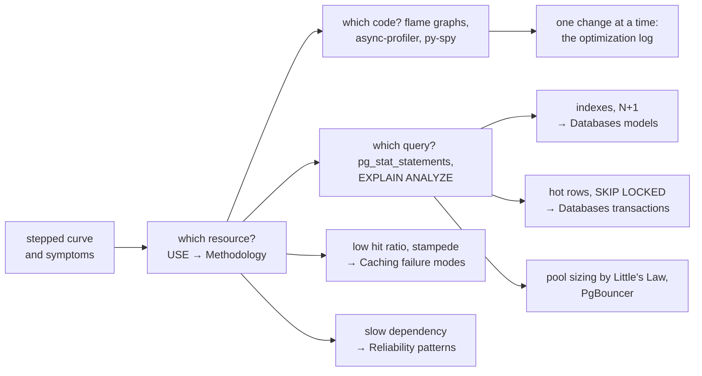

O teste breakpoint terminou: `POST /holds` mantém o p99 abaixo de 300 ms até cerca de 1 100 requisições por segundo, e a venda precisa de 4 500. E agora? Adicionar pods às cegas pode não mudar nada — ou piorar. Esta página trata do passo entre *medir* e *corrigir*: ler os resultados corretamente, localizar o recurso limitante, ver qual código ou consulta o consome e mudar uma coisa por vez até que o gargalo fique onde você quer.

---

## Lendo os resultados

### A curva em degraus

Um teste breakpoint que mantém cada taxa por alguns minutos produz um ponto por degrau: carga oferecida, vazão alcançada, p99 e erros. A tabela e o gráfico abaixo são típicos (dados sintéticos com ruído):

```python exec="1" html="1"
# Results of a stepped breakpoint test on POST /holds (synthetic but typical data):
# each step holds the offered rate for 2 minutes; we record the achieved rate and p99.
import matplotlib.pyplot as plt
import numpy as np
from io import StringIO

rng = np.random.default_rng(7)
SLO_MS, CAPACITY = 300, 1250              # p99 objective; true saturation rate (req/s)
offered = np.arange(100, 1701, 100)

def p99_at(rate):                          # queueing-like growth near capacity
    rho = min(rate / CAPACITY, 0.995)
    return 60 + 25 * rho / (1 - rho)

served = np.array([min(r, CAPACITY - 40 * max(0, r - CAPACITY) / 100) for r in offered])
achieved = served * (1 + rng.normal(0, 0.01, len(offered)))
p99 = np.array([p99_at(r) for r in offered]) * (1 + rng.normal(0, 0.05, len(offered)))
p99 = np.minimum(p99, 5000)                # the client times out at 5 s
errors = (offered - served) / offered * 100   # requests that timed out or were rejected

ok = offered[p99 < SLO_MS]
knee = ok.max()
sat = offered[np.argmax(achieved)]

print("<table><thead><tr><th>Offered (req/s)</th><th>Achieved (req/s)</th><th>p99 (ms)</th>"
      "<th>Errors</th><th>Verdict</th></tr></thead><tbody>")
for o, a, p, e in zip(offered, achieved, p99, errors):
    if o % 200 and o not in (knee, sat):
        continue
    verdict = "within SLO" if p < SLO_MS else ("SLO broken" if a >= o * 0.97 else "saturated")
    mark = " ← knee" if o == knee else (" ← max throughput" if o == sat else "")
    print(f"<tr><td>{o}</td><td>{a:.0f}</td><td>{p:.0f}</td><td>{e:.1f} %</td><td>{verdict}{mark}</td></tr>")
print("</tbody></table>")

fig, ax1 = plt.subplots(figsize=(10, 4.2))
ax1.plot(offered, offered, color="gray", linestyle=":", linewidth=1, label="offered = achieved (ideal)")
ax1.plot(offered, achieved, "o-", color="#4C9BE8", linewidth=2, label="achieved throughput")
ax1.set_xlabel("offered load (req/s)", color="gray")
ax1.set_ylabel("throughput (req/s)", color="#4C9BE8")
ax2 = ax1.twinx()
ax2.plot(offered, p99, "s-", color="#F28E2B", linewidth=2, label="p99 latency")
ax2.axhline(SLO_MS, color="#F28E2B", linestyle="--", linewidth=1)
ax2.text(110, SLO_MS * 1.15, f"SLO p99 < {SLO_MS} ms", color="#F28E2B", fontsize=8)
ax2.set_yscale("log")
ax2.set_ylabel("p99 (ms, log)", color="#F28E2B")
ax1.axvline(knee, color="#59A14F", linestyle="--", linewidth=1)
ax1.text(knee - 330, 1450, f"knee ≈ {knee} req/s", color="#59A14F", fontsize=9)
for ax in (ax1, ax2):
    ax.tick_params(colors="gray")
    ax.spines["top"].set_visible(False)
ax1.set_title("Stepped breakpoint test of POST /holds", fontweight="bold", color="gray")
h1, l1 = ax1.get_legend_handles_labels()
h2, l2 = ax2.get_legend_handles_labels()
ax1.legend(h1 + h2, l1 + l2, frameon=False, labelcolor="gray", loc="upper left", fontsize=8)
plt.tight_layout()
buf = StringIO()
plt.savefig(buf, format="svg", transparent=True)
print(buf.getvalue())
plt.close()
```

Três regiões são visíveis, e cada uma tem um nome que você deve usar nos relatórios:

- **Até o joelho (≈ 1 100 req/s)**: alcançado = oferecido, p99 dentro do SLO. Esta é a **capacidade utilizável** deste deployment.
- **Entre o joelho e o máximo**: alcançado ainda ≈ oferecido, mas o p99 quebra o SLO — o sistema está *funcionando*, só que *devagar demais*; filas estão se formando.
- **Depois do máximo (≈ 1 250 req/s)**: a vazão alcançada *cai* enquanto a oferecida continua crescendo, requisições expiram, aparecem erros. O sistema está **saturado** e, aqui, retrógrado: a sobrecarga o torna menos eficiente (timeouts, retries, comboios de locks).

A capacidade que você reporta é o joelho: "um deployment de `inventory` com 4 pods sustenta **1 100 reservas/s dentro do SLO**; satura em ~1 250 e degrada além disso".

### Sintomas e o que geralmente significam

| O que você vê | Causa provável | Confirme com |
|---|---|---|
| A latência sobe com a carga **e** a CPU está perto de 100 % | Caminho de código limitado por CPU | Flame graph de CPU |
| A latência sobe com a carga, **a CPU fica baixa** | Espera: um pool, um lock, I/O ou uma dependência lenta | USE nos pools e locks; perfil wall-clock; traces |
| A vazão estabiliza enquanto a carga oferecida cresce | Um recurso saturado (o gargalo) | USE: encontre o que está a 100 % ou com fila |
| A vazão **diminui** a partir de um ponto | Contenção / thrashing / retries (retrógrado, USL) | Esperas por lock, tempo de GC, contadores de retry |
| Histograma de latência **bimodal** (duas corcovas) | Dois caminhos de código: hit vs miss de cache, shard rápido vs lento, retries | Separe por tag (status do cache, shard) |
| Picos periódicos em intervalos fixos | Ciclos de GC, jobs de cron, checkpoints do banco, rotação de logs, renovação de tokens | Correlacione os horários com logs de GC, agendas de cron, logs do banco |
| A latência cresce devagar com carga **constante** | Vazamento ou crescimento sem limite (memória, conexões, inchaço de tabelas) | Tendências do teste soak; heap depois do GC |
| Erros só nos primeiros minutos | Partida a frio: JIT, pools e caches vazios, atraso do autoscaling | Compare com uma execução aquecida |
| p99 do cliente ≫ p99 do lado do servidor | Fila *antes* do serviço (load balancer, fila de accept, throttling de CPU) — ou omissão coordenada nas métricas do servidor | Compare os histogramas do gateway e do serviço; contadores de throttling |

---

## Um catálogo de gargalos comuns

| Gargalo | Sinal típico | Correção típica |
|---|---|---|
| **Índice ausente ou errado** | Uma consulta domina o `pg_stat_statements`; `Seq Scan` com muitas linhas removidas | Índice que corresponda ao filtro e à ordenação; índice parcial |
| **Consultas N+1** | Um trace com um span pai e dezenas de spans de banco idênticos | Join ou busca em lote (`IN (...)`), entity graph, projeção em DTO |
| **Esgotamento do pool de conexões** | `pending` do Hikari > 0; latência ≈ espera no pool | Primeiro, transações mais curtas; depois, dimensionar o pool; PgBouncer |
| **Contenção de locks / linhas quentes** | CPU do banco baixa, sessões esperando em `Lock: tuple` ou `transactionid` | Transações mais curtas, `SKIP LOCKED`, linhas de granularidade mais fina, enfileirar as escritas |
| **Esgotamento do pool de threads** | Todas as threads de requisição ocupadas, CPU baixa | Descubra o que elas esperam (geralmente um dos itens acima ou uma dependência); timeouts; virtual threads para código limitado por I/O |
| **Dependência lenta** | Frames largos de `HttpClient`/leitura de socket em perfis wall-clock; spans de cliente longos | Timeouts, circuit breaker, bulkhead, cache, assincronia |
| **Pressão de GC** | Tempo de GC > 5–10 %, flame graph cheio de alocações | Reduzir alocações (JSON grande, logs), dimensionar o heap, um coletor de pausas curtas |
| **Throttling de CPU** | Picos no p99 com CPU média moderada; `nr_throttled` crescendo | Aumentar/remover o limite de CPU, menos threads, mais pods |
| **Serialização** | Frames de `ObjectMapper`/JSON largos em perfis de CPU | Payloads menores, paginação, evitar serializar duas vezes |
| **Logs síncronos** | Frames do logger no caminho quente; I/O de disco no nó | Appenders assíncronos, nível de log menor, amostragem |
| **Problemas de cache** | Taxa de acerto baixa; estouro (*stampede*) após a expiração; uma chave quente | Veja [Cache — modos de falha](../../caching/failure-modes/index.md) |
| **Limites de rede** | Resets de conexão, esgotamento de portas efêmeras ou do conntrack com RPS alto | Keep-alive e reuso de conexões, HTTP/2, ajustar limites |

---

## Profiling: de "qual recurso" para "qual código"

As métricas dizem que o `inventory` passa o tempo esperando ou queimando CPU; um **profiler** diz *qual código* faz isso. Profilers modernos são **por amostragem**: muitas vezes por segundo eles registram a pilha de chamadas de cada thread, e o código que aparece em muitas amostras é para onde vai o tempo. O overhead é baixo o suficiente (tipicamente alguns por cento) para fazer profiling sob carga, até em produção.

Dois tipos de perfil respondem a perguntas diferentes:

- Perfis **on-CPU** amostram só threads que estão *executando*. Eles encontram código pesado em CPU — serialização, regexes, hashing, TLS.
- Perfis **off-CPU / wall-clock** amostram as threads seja lá o que estiverem fazendo, *inclusive esperando* por locks, sockets e pools. Quando a CPU está baixa mas a latência está alta — o caso comum —, **só um perfil wall-clock mostra para onde vai o tempo.**

### Lendo um flame graph

Um **flame graph** desenha as pilhas amostradas como caixas aninhadas[^1]:

- cada caixa é uma função (um frame da pilha); a caixa abaixo dela é quem a chamou;
- a **largura** é a fração de amostras em que a função estava na pilha — mais larga significa mais tempo;
- o **eixo x não é o tempo**: os frames são ordenados alfabeticamente para fundir pilhas idênticas;
- procure **caixas largas perto do topo** (onde o tempo é de fato gasto) e subárvores inesperadamente largas.

```python exec="1" html="1"
# A (simplified) wall-clock flame graph of inventory's POST /holds, drawn from
# sample counts. Width = share of samples; y = stack depth; x order is alphabetical, NOT time.
import matplotlib.pyplot as plt
from matplotlib.patches import Rectangle
from io import StringIO

# frame -> (samples spent in this frame itself, {children})
TREE = ("HoldController.hold", 0, [
    ("HoldService.hold", 0, [
        ("Logger.info", 3, []),
        ("ObjectMapper.writeValue", 5, []),
        ("TransactionTemplate.execute", 0, [
            ("HikariPool.getConnection", 22, []),
            ("HoldRepository.save", 6, []),
            ("PricingClient.quote", 0, [("HttpClient.send", 0, [("SocketInputStream.read", 26, [])])]),
            ("SeatRepository.lockSeats", 0, [("PgStatement.execute", 0, [("SocketInputStream.read", 30, [])])]),
        ]),
    ]),
])

def total(node):
    return node[1] + sum(total(c) for c in node[2])

COLORS = ["#F28E2B", "#E15759", "#EDC948", "#FF9D9A", "#F1A340", "#D37295"]
fig, ax = plt.subplots(figsize=(11, 3.8))
ALL = total(TREE)

def draw(node, x, depth):
    w = total(node) / ALL
    ax.add_patch(Rectangle((x, depth), w, 0.92, facecolor=COLORS[(depth + len(node[0])) % len(COLORS)],
                           edgecolor="white", linewidth=1))
    label = node[0] if w > 0.11 else (node[0][:9] + "…" if w > 0.07 else "")
    ax.text(x + 0.004, depth + 0.46, f"{label} {w:.0%}" if w > 0.11 else label,
            va="center", fontsize=7.5, color="black", clip_on=True)
    cx = x
    for child in sorted(node[2], key=lambda c: c[0]):          # alphabetical, like flame graphs
        draw(child, cx, depth + 1)
        cx += total(child) / ALL

draw(TREE, 0, 0)
ax.set_xlim(0, 1)
ax.set_ylim(0, 6)
ax.set_yticks([])
ax.set_xticks([0, 0.25, 0.5, 0.75, 1.0])
ax.set_xticklabels(["0 %", "25 %", "50 %", "75 %", "100 % of samples"], color="gray")
ax.set_title("Wall-clock flame graph of POST /holds (simplified)", fontweight="bold", color="gray")
for side in ("top", "right", "left"):
    ax.spines[side].set_visible(False)
plt.tight_layout()
buf = StringIO()
plt.savefig(buf, format="svg", transparent=True)
print(buf.getvalue())
plt.close()
```

Lendo este perfil wall-clock de `POST /holds` de cima para baixo: quase todo o tempo está dentro de `TransactionTemplate.execute` — e, dentro dele, um terço das amostras espera em uma leitura de socket dentro de `SeatRepository.lockSeats` (o banco está nos fazendo esperar por **locks de linha**), mais de um quarto espera em uma leitura de socket dentro de `PricingClient.quote` (uma chamada HTTP **dentro da transação**, segurando a conexão e os locks), e quase um quarto espera em `HikariPool.getConnection` (**esgotamento do pool**, causado pelos dois itens anteriores). JSON e logs, os suspeitos de sempre, são fatias finas. Um flame graph de CPU do mesmo serviço teria mostrado principalmente JSON e logs, e apontado para a correção errada.

### async-profiler para a JVM

O **async-profiler** é um profiler por amostragem de baixo overhead para Java que evita o *viés de safepoint* dos profilers de JVM mais antigos e produz flame graphs diretamente[^2]. Ele se acopla a uma JVM em execução:

```bash
# distroless images have no shell: attach an ephemeral debug container that shares
# the pod's process namespace, built from an image that contains async-profiler
kubectl debug -it inventory-7f9c-x2k8p --image=<your-debug-image-with-async-profiler> --target=inventory

asprof -d 30 -e cpu   -f /tmp/cpu.html   1    # on-CPU samples, 30 s, JVM is PID 1
asprof -d 30 -e wall  -t -f /tmp/wall.html 1  # wall-clock, split by thread: includes waiting
asprof -d 30 -e lock  -f /tmp/lock.html  1    # contended Java monitors and locks
asprof -d 30 -e alloc -f /tmp/alloc.html 1    # allocation hot spots (GC pressure)
```

Rode o profiler **enquanto o teste de carga está no platô** — o perfil de um serviço ocioso só mostra código ocioso. Se `perf_events` não for permitido no container, `-e itimer` (ou `ctimer`) é uma alternativa de amostragem de CPU. O **Java Flight Recorder**, embutido no JDK, é a alternativa sem ferramenta extra (`jcmd 1 JFR.start duration=60s filename=/tmp/inventory.jfr settings=profile`); abra a gravação no JDK Mission Control ou converta-a em flame graph com o conversor do async-profiler.

### py-spy para Python

O serviço `assistant` é Python (FastAPI). O **py-spy** é um profiler por amostragem que lê a memória do interpretador de fora do processo — sem mudar código, sem reiniciar[^3]:

```bash
py-spy top    --pid 1                                   # live "top" of Python functions
py-spy record --pid 1 --duration 30 -o cpu.svg          # flame graph (SVG) of running code
py-spy record --pid 1 --duration 30 --idle -o wall.svg  # include idle/waiting threads
py-spy dump   --pid 1                                   # current stack of every thread, once
```

Em um container o py-spy precisa da capability `SYS_PTRACE` (adicione-a ao container de debug, não à aplicação). Para código `asyncio`, lembre-se de que corrotinas esperando não são threads: uma visão wall-clock do event loop mostra *onde o loop está bloqueado* — o bug clássico sendo uma chamada síncrona (um cliente HTTP bloqueante, parsing pesado em CPU) dentro de um handler `async def`.

### Profiling contínuo

Fazer profiling só durante incidentes significa que você não tem um "antes" para comparar. O **profiling contínuo** amostra todas as instâncias o tempo todo com baixa frequência e guarda os perfis como métricas (Grafana Pyroscope, profilers das nuvens; o OpenTelemetry está adicionando perfis como um quarto sinal). Ele permite **flame graphs diferenciais** — esta versão vs a anterior —, que tornam óbvias as regressões de desempenho em um canary.

---

## Gargalos de banco de dados

O banco de dados é o gargalo mais comum de um sistema como o BoxOffice, porque é o único componente difícil de escalar horizontalmente e que toda escrita precisa alcançar.

### Quais consultas?

Comece pelo agregado, não por um palpite. A extensão `pg_stat_statements` registra estatísticas de cada consulta normalizada:

```sql
SELECT left(query, 70)                         AS query,
       calls,
       round(total_exec_time)                  AS total_ms,
       round(mean_exec_time::numeric, 2)       AS mean_ms,
       round(100 * total_exec_time / sum(total_exec_time) OVER (), 1) AS pct
FROM pg_stat_statements
ORDER BY total_exec_time DESC
LIMIT 10;
```

Ordene pelo tempo **total**, não pela média: uma consulta de 2 ms chamada 3 000 vezes por segundo custa mais que um relatório de 2 s rodado uma vez por hora.

### Por que está lenta? `EXPLAIN ANALYZE`

O `EXPLAIN` mostra o plano escolhido pelo otimizador; o `EXPLAIN (ANALYZE, BUFFERS)` *executa* a consulta e reporta tempos reais, contagens reais de linhas e páginas lidas[^4]. A consulta do mapa de assentos da venda:

```sql
EXPLAIN (ANALYZE, BUFFERS)
SELECT id, section, row_label, seat_number, price_cents
FROM seats
WHERE event_id = 4242 AND status = 'AVAILABLE'
ORDER BY section, row_label, seat_number
LIMIT 8;
```

```text title="Before: no suitable index (illustrative output, simplified)"
Limit  (cost=187432.10..187432.12 rows=8 width=40) (actual time=412.551..412.555 rows=8 loops=1)
  Buffers: shared hit=2112 read=59861
  ->  Sort  (cost=187432.10..187507.10 rows=30000 width=40) (actual time=412.549..412.551 rows=8 loops=1)
        Sort Key: section, row_label, seat_number
        Sort Method: top-N heapsort  Memory: 26kB
        ->  Seq Scan on seats  (cost=0.00..186832.00 rows=30000 width=40) (actual time=0.031..405.127 rows=31480 loops=1)
              Filter: ((event_id = 4242) AND (status = 'AVAILABLE'::text))
              Rows Removed by Filter: 5968520
Planning Time: 0.142 ms
Execution Time: 412.601 ms
```

Como ler, de baixo para cima (o nó mais interno executa primeiro):

- **`Seq Scan` com `Rows Removed by Filter: 5968520`** — o PostgreSQL leu todos os 6 milhões de assentos de todos os eventos para ficar com 31 480. Esse é o problema.
- **`Buffers: … read=59861`** — cerca de 60 000 páginas (8 KB cada, ≈ 470 MB) vieram do disco ou do cache do SO, e não do cache de buffers do PostgreSQL. Sob carga, isso é saturação de I/O.
- **`Sort … top-N heapsort`** — ordenar 31 480 linhas para ficar com 8; barato aqui, mas evitável.
- Compare as linhas **estimadas** `rows=30000` com as **reais** `rows=31480`: próximas, então as estatísticas estão boas. Uma diferença grande (100× fora) apontaria estatísticas desatualizadas (`ANALYZE`) ou colunas correlacionadas.

Um índice parcial que corresponda ao filtro e à ordenação permite ao PostgreSQL ler os 8 primeiros assentos disponíveis diretamente, em ordem:

```sql
CREATE INDEX CONCURRENTLY seats_available_idx
    ON seats (event_id, section, row_label, seat_number)
    WHERE status = 'AVAILABLE';
```

```text title="After: index scan (illustrative output, simplified)"
Limit  (cost=0.43..9.87 rows=8 width=40) (actual time=0.041..0.058 rows=8 loops=1)
  Buffers: shared hit=5
  ->  Index Scan using seats_available_idx on seats  (cost=0.43..35392.11 rows=30000 width=40) (actual time=0.040..0.055 rows=8 loops=1)
        Index Cond: (event_id = 4242)
Planning Time: 0.210 ms
Execution Time: 0.079 ms
```

De 412 ms para 0,08 ms e de ~62 000 páginas para 5. O `CONCURRENTLY` constrói o índice sem bloquear escritas — essencial em uma tabela em uso. (Índices não são de graça: cada um desacelera as escritas e usa memória; indexe o que o modelo de carga diz que é quente.)

### Contenção de locks e linhas quentes

Quando todos querem os mesmos assentos, as transações fazem fila por **locks de linha**. Descubra quem espera por quem:

```sql
SELECT pid,
       pg_blocking_pids(pid)        AS blocked_by,
       wait_event_type, wait_event,
       now() - query_start          AS waiting_for,
       left(query, 60)              AS query
FROM pg_stat_activity
WHERE cardinality(pg_blocking_pids(pid)) > 0;
```

Três mudanças reduzem a contenção, em ordem de esforço:

1. **Mantenha as transações curtas.** Nunca chame outro serviço (preços, pagamento) segurando uma transação: calcule o preço antes do `BEGIN`, chame o provedor de pagamento depois do `COMMIT` (com um outbox ou uma saga — veja [Mensageria — padrões](../../messaging/patterns/index.md)).
2. **Não brigue pela mesma linha.** Quando o fã pede "2 assentos no setor A", quaisquer dois assentos livres servem. O `SKIP LOCKED` permite que transações concorrentes peguem linhas livres *diferentes* em vez de fazer fila na primeira:

    ```sql
    BEGIN;
    SELECT id FROM seats
    WHERE event_id = 4242 AND section = 'A' AND status = 'AVAILABLE'
    ORDER BY row_label, seat_number
    LIMIT 2
    FOR UPDATE SKIP LOCKED;
    UPDATE seats
       SET status = 'HELD', held_by = $1, hold_expires_at = now() + interval '10 minutes'
     WHERE id = ANY($2);
    COMMIT;
    ```

3. **Controle a admissão.** Se 50 000 fãs tentam reservar assentos no mesmo segundo, nenhuma estratégia de lock deixa o PostgreSQL feliz. Uma sala de espera admite fãs na taxa que o inventário consegue absorver — transformando contenção em uma fila ordenada ([Mensageria — filas](../../messaging/queues-pubsub/index.md)).

### Dimensionando o pool de conexões

Um pool de conexões pode ser gargalo nos dois sentidos: pequeno demais e as requisições esperam uma conexão; grande demais e o banco passa o tempo alternando entre centenas de sessões, brigando por locks e memória. Dimensione-o com a Lei de Little — **conexões necessárias = vazão × tempo em que cada requisição segura uma conexão**:

| Design de `POST /holds` | Conexão segurada por | A 1 500 reservas/s | Por pod (10 pods) |
|---|---|---|---|
| Chamada de preços **dentro** da transação | 6 ms de SQL + 40 ms de HTTP = 46 ms | 1 500 × 0,046 ≈ **69** conexões ocupadas | ~7, mais para rajadas |
| Chamada de preços **antes** da transação | 6 ms | 1 500 × 0,006 ≈ **9** conexões ocupadas | ~1, mantenha um pool pequeno |

A primeira correção não é um pool maior — é segurar a conexão por menos tempo. Depois, dimensione pela capacidade **do banco**: o PostgreSQL funciona melhor com um número de conexões *ativas* da ordem de algumas vezes seus núcleos de CPU (o ponto de partida muito citado do HikariCP é `conexões ≈ núcleos × 2 + discos efetivos`)[^5]. Vinte pods × um pool de 20 = 400 conexões está muito além disso; coloque o **PgBouncer** em modo transaction pooling entre os pods e o banco, para que centenas de conexões de clientes compartilhem algumas dezenas de conexões de servidor. E falhe rápido:

```yaml title="inventory/src/main/resources/application.yaml"
spring:
  datasource:
    hikari:
      maximum-pool-size: 10
      minimum-idle: 10            # a fixed-size pool: no ramp-up during the spike
      connection-timeout: 2000    # wait at most 2 s for a connection (the default is 30 s)
```

---

## Uma mudança por vez: um diário de otimização

Mantenha um diário de cada execução: o que mudou, o novo joelho e o que saturou em seguida. Um gargalo removido revela o próximo; o objetivo não é "nenhum gargalo" (sempre há um), mas o gargalo **no lugar certo** com capacidade suficiente. O diário abaixo ilustra uma campanha típica em `POST /holds`:

| Execução | Mudança (uma por execução) | Joelho (reservas/s dentro do SLO) | O que saturou em seguida |
|---|---|---|---|
| 1 | Base: 4 pods, pool 10 | 400 | I/O do PostgreSQL (`Seq Scan` do mapa de assentos) |
| 2 | Índice parcial nos assentos disponíveis | 700 | Pool Hikari: 10/10 ativas, 150 pendentes |
| 3 | Chamada de preços movida para fora da transação | 1 100 | Esperas por locks de linha em setores quentes |
| 4 | `FOR UPDATE SKIP LOCKED` na seleção de assentos | 1 800 | CPU do `inventory` a 85 % (JSON, TLS) |
| 5 | 4 → 10 pods (mínimo do HPA), PgBouncer | 3 400 | CPU do primário do PostgreSQL a 80 % |
| 6 | Sala de espera admitindo 3 000 reservas/s | 3 000 admitidas, p99 140 ms | — por design: a admissão é o limite |

Depois da execução 6, o gargalo é deliberado: a taxa de admissão da sala de espera, definida abaixo do joelho do banco. Escalar além disso exigiria particionar o inventário por evento ou local ([Bancos de dados — particionamento](../../databases/partitioning/index.md)) — uma mudança muito maior, agora justificada por números.

!!! tip "Na entrevista"

    Na etapa de "gargalos e trade-offs", percorra o caminho da requisição e diga qual é o **primeiro recurso a saturar**, com um número: "A 4 500 reservas/s, o banco primário é o gargalo — toda reserva é uma escrita com lock. Eu manteria as transações curtas, usaria `SKIP LOCKED` para que os fãs não façam fila na mesma linha, dimensionaria os pools com a Lei de Little atrás do PgBouncer e colocaria uma sala de espera na frente, para que a admissão nunca passe do que o banco aguenta." Mencionar **profiling wall-clock vs de CPU** e **`EXPLAIN ANALYZE`** mostra que você já encontrou gargalos de verdade, não só desenhou caixas.

!!! warning "Armadilhas"

    - **Fazer profiling de um sistema ocioso**: faça no platô do teste de carga.
    - **Flame graphs de CPU para um problema de espera**: use perfis wall-clock (off-CPU) quando a CPU está baixa.
    - **Otimizar pelo tempo médio de consulta**: ordene pelo tempo total; consultas baratas e frequentes dominam.
    - **`EXPLAIN` sem `ANALYZE`** em uma consulta lenta: estimativas não são medições.
    - **Aumentar o pool para resolver esperas no pool**: primeiro encurte o que segura a conexão; pools maiores só movem a fila para dentro do banco.
    - **Mudar três coisas ao mesmo tempo**: você não vai saber qual ajudou — nem qual atrapalhou.

---

## Como se conecta { #how-it-connects }



**Componentes da paleta:** [`app`](../../../reference/components/compute/index.md#app) (CPU, GC, pools de threads, serialização) · [`sql`](../../../reference/components/storage/index.md#sql) (índices, locks, pools de conexões) · [`cache`](../../../reference/components/storage/index.md#cache) (taxa de acerto, chaves quentes, stampedes) · [`queue`](../../../reference/components/messaging/index.md#queue) (tirar escritas disputadas do caminho da requisição) · [`thirdparty`](../../../reference/components/external/index.md#thirdparty) (dependências lentas) · [`tracing`](../../../reference/components/observability/index.md#tracing) (consultas N+1 aparecem como dezenas de spans idênticos) e [`metrics`](../../../reference/components/observability/index.md#metrics) (contadores de pool e de throttling). **Cenários:** `monolith` (perfil breakpoint: encontrar o primeiro recurso a saturar), `read-heavy-cache`, `flash-sale` (linhas quentes de assentos). **Continua em:** [Bancos de dados — transações](../../databases/transactions/index.md), [Bancos de dados — particionamento](../../databases/partitioning/index.md), [Cache — modos de falha](../../caching/failure-modes/index.md), [Mensageria — filas e pub/sub](../../messaging/queues-pubsub/index.md), [Confiabilidade — padrões](../../reliability/patterns/index.md), [Planejamento de capacidade](../capacity-planning/index.md).

---

[^1]: GREGG, B. [The Flame Graph](https://queue.acm.org/detail.cfm?id=2927301){target="_blank"}. *ACM Queue*, v. 14, n. 2, 2016.
[^2]: PANGIN, A. et al. [async-profiler](https://github.com/async-profiler/async-profiler){target="_blank"}.
[^3]: FREDERICKSON, B. [py-spy: Sampling profiler for Python programs](https://github.com/benfred/py-spy){target="_blank"}.
[^4]: Documentação do PostgreSQL. [Using EXPLAIN](https://www.postgresql.org/docs/current/using-explain.html){target="_blank"}; [pg_stat_statements](https://www.postgresql.org/docs/current/pgstatstatements.html){target="_blank"}.
[^5]: HikariCP wiki. [About Pool Sizing](https://github.com/brettwooldridge/HikariCP/wiki/About-Pool-Sizing){target="_blank"}.
