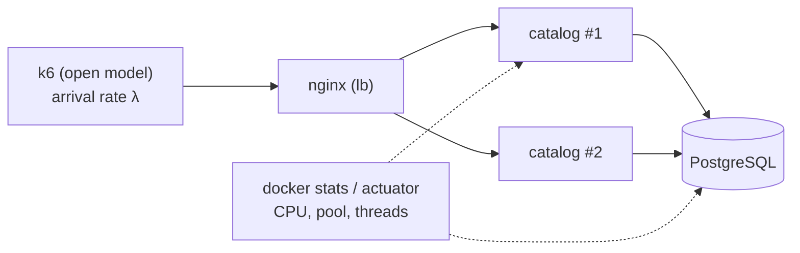

"How many requests per second does the BoxOffice `catalog` handle?" is a question with no answer until you add **"…with a p99 below 200 ms and less than 1% errors, on this machine"**. In this exercise you run a small but rigorous **k6 campaign** against your own service, find the point where latency explodes (the *knee*), name the resource that causes it, change one thing and **prove** the change with a new measurement.

!!! abstract "Learning objectives"

    After this exercise you will be able to:

    - **Design** smoke, load, stress and spike tests with an *open* workload model and SLO thresholds.
    - **Run** them reproducibly (fixed resources, repetitions, raw results committed).
    - **Read** percentiles and throughput-vs-latency curves and locate the knee.
    - **Diagnose** the bottleneck with resource metrics, the USE method and Little's Law.
    - **Verify** a hypothesis with a single change and a re-test.

## Context

[Lab 2](../../hands-on/2/index.md) introduced k6 and percentiles on the `catalog` service; [Lab 3](../../hands-on/3/index.md) put it behind Nginx with replicas. [Class 2](../../classes/estimation/index.md) gave you the theory: utilization, queueing, the knee, tail latency and Little's Law. [Class 15](../../classes/performance/index.md) goes deeper later in the semester, and the project's [load-test campaign](../project/load-test-campaign/index.md) reuses everything you build here.

Two ideas make the difference between a load test and a number:

- **Open vs closed model.** A *closed* model (N virtual users in a loop) slows down when the server slows down — it politely stops sending, and hides the problem (**coordinated omission**). Real users arrive whether or not the server is slow. Use k6's **arrival-rate** executors (`constant-arrival-rate`, `ramping-arrival-rate`): they start iterations at a fixed rate, independent of response times[^1].
- **Thresholds are SLOs.** `p(99)<500` and `rate<0.01` turn "it seemed fine" into pass/fail.



## Task

Run a load-test campaign against **one HTTP endpoint (or a small mix)** of your own service — the BoxOffice `catalog` from the labs (recommended) or another service of yours — and write a report that answers:

1. What is the **maximum sustainable throughput** of your setup with p99 below your SLO and errors below 1%?
2. Where is the **knee**, and **which resource** causes it?
3. What **one change** moves the knee, and by how much?

## Requirements

- [ ] **(mandatory)** The service runs with **fixed resources** (`cpus`/`mem_limit` in `compose.yaml`) and the environment is described (CPU, RAM, OS, versions, where k6 runs).
- [ ] **(mandatory)** **Raw results** committed: one k6 summary JSON per run (and CSV if you plot time series).
- [ ] k6 scripts use **arrival-rate executors** and **thresholds** for p95/p99 latency and error rate.
- [ ] **Smoke** test: passes with 0 errors.
- [ ] **Load** test: at least **10 minutes** at a constant rate that meets the SLO, repeated **3 times**; report mean and spread (min–max) of p99.
- [ ] **Stress** test: steps up to at least **2× the load rate** (or until failure); a **throughput vs p99** chart with the knee marked.
- [ ] **Spike** test: a sudden jump to ≥ 3× the base rate; report errors during the spike and the **recovery time** to normal p99.
- [ ] **Little's Law check** at the load rate: in-flight requests `L = λ × W` compared with the server threads and the database connection pool.
- [ ] **Bottleneck analysis** with resource evidence (CPU, memory, threads, pool waits, GC, DB) — not a guess.
- [ ] **One change + re-test** (e.g. pool size, replicas, an index, virtual threads, a cache) with before/after numbers under the same script and data.
- [ ] A one-sentence **capacity statement**: "one instance with 2 vCPU sustains X req/s at p99 < Y ms".
- [ ] *AI usage* section (see the [policy](../index.md#use-of-ai-tools)).

## Deliverables

In your repository (tag `ex2`): the k6 scripts in `load/`, the raw results in `load/results/`, the `compose.yaml` used, any plotting script; on your documentation site a page `load-test-report` following the [template](#templates).

## Step by step

### 1. Pin the environment

Results are only comparable if the resources do not change. Limit the service and the database in `compose.yaml`, and seed the database with enough data (e.g. 1,000 events) so that queries are realistic.

```yaml title="compose.yaml (excerpt)"
services:
  catalog:
    image: boxoffice/catalog:latest
    environment:
      SPRING_DATASOURCE_URL: jdbc:postgresql://db:5432/catalog
      SPRING_DATASOURCE_HIKARI_MAXIMUM_POOL_SIZE: "10"
      MANAGEMENT_ENDPOINTS_WEB_EXPOSURE_INCLUDE: health,metrics,prometheus
    cpus: "2"
    mem_limit: 1g
    ports:
      - "8080:8080"
    depends_on:
      - db
  db:
    image: postgres:16
    environment:
      POSTGRES_DB: catalog
      POSTGRES_USER: catalog
      POSTGRES_PASSWORD: catalog
    cpus: "2"
    mem_limit: 1g
```

!!! warning "k6 also uses CPU"

    If k6 runs on the same laptop, it competes with the service. Keep the service limited (as above), watch k6's own CPU, and say in the report where k6 ran. If k6 warns about `dropped_iterations` or `insufficient VUs`, the load generator — not your service — is the bottleneck.

### 2. Write one script, several test types

One script with the test type chosen by an environment variable keeps the request mix identical across tests.

```javascript title="load/catalog.js"
import http from 'k6/http';
import { check } from 'k6';

const BASE = __ENV.BASE_URL || 'http://localhost:8080';
const TYPE = __ENV.TEST_TYPE || 'smoke';
const RATE = Number(__ENV.RATE || 200);      // load-test rate (req/s)
const EVENTS = Number(__ENV.EVENTS || 1000); // ids seeded in the database

function stressStages() {
  const stages = [];
  for (const f of [0.5, 1, 1.5, 2, 2.5, 3]) {
    stages.push({ target: Math.round(RATE * f), duration: '30s' }); // ramp to the step
    stages.push({ target: Math.round(RATE * f), duration: '90s' }); // hold the step
  }
  return stages;
}

const profiles = {
  smoke: {
    executor: 'constant-arrival-rate', rate: 5, timeUnit: '1s',
    duration: '30s', preAllocatedVUs: 5,
  },
  load: {
    executor: 'ramping-arrival-rate', startRate: 0, timeUnit: '1s',
    preAllocatedVUs: 50, maxVUs: 500,
    stages: [
      { target: RATE, duration: '2m' },  // warm-up ramp
      { target: RATE, duration: '10m' }, // steady state: this is what you report
      { target: 0, duration: '30s' },
    ],
  },
  stress: {
    executor: 'ramping-arrival-rate', startRate: 0, timeUnit: '1s',
    preAllocatedVUs: 100, maxVUs: 2000, stages: stressStages(),
  },
  spike: {
    executor: 'ramping-arrival-rate', startRate: Math.round(RATE * 0.3), timeUnit: '1s',
    preAllocatedVUs: 100, maxVUs: 2000,
    stages: [
      { target: Math.round(RATE * 0.3), duration: '1m' },
      { target: RATE * 3, duration: '10s' },               // the spike
      { target: RATE * 3, duration: '1m' },
      { target: Math.round(RATE * 0.3), duration: '10s' },
      { target: Math.round(RATE * 0.3), duration: '2m' },  // recovery
    ],
  },
};

export const options = {
  scenarios: { [TYPE]: profiles[TYPE] },
  thresholds: {
    http_req_failed: ['rate<0.01'],
    http_req_duration: ['p(95)<200', 'p(99)<500'],
  },
  summaryTrendStats: ['avg', 'min', 'med', 'p(90)', 'p(95)', 'p(99)', 'max'],
};

export default function () {
  const id = 1 + Math.floor(Math.random() * EVENTS);
  const res = http.get(`${BASE}/events/${id}`, { tags: { name: 'GET /events/{id}' } });
  check(res, { 'status is 200': (r) => r.status === 200 });
}
```

Adjust the thresholds to **your** SLO and the URL to your endpoint. Stress and spike tests are *expected* to cross the thresholds: what you report is *where* and *how* they fail.

### 3. Run and keep everything

```bash title="load/run.sh"
#!/usr/bin/env bash
# usage: ./load/run.sh <type> <rate> <run-number>
set -euo pipefail
TYPE=${1:-smoke}; RATE=${2:-200}; RUN=${3:-1}
mkdir -p load/results
# resource usage of every container, every 2 s, in the background
( while true; do
    docker stats --no-stream --format '{{.Name}},{{.CPUPerc}},{{.MemUsage}}' \
      | sed "s/^/$(date +%s),/" >> "load/results/${TYPE}-r${RATE}-run${RUN}-docker.csv"
    sleep 2
  done ) &
STATS=$!
trap 'kill $STATS' EXIT
k6 run -e TEST_TYPE="$TYPE" -e RATE="$RATE" \
  --summary-export "load/results/${TYPE}-r${RATE}-run${RUN}.json" \
  --out csv="load/results/${TYPE}-r${RATE}-run${RUN}.csv" \
  load/catalog.js
```

Suggested order: smoke → stress (to find the knee) → choose the load rate at about **70% of the knee** → load ×3 → spike. Restart the service between runs (or always warm it up) so that runs start from the same state.

### 4. Find the knee

Each step of the stress test gives one point (achieved throughput, p99). Plot p99 against throughput: it is flat while utilization is low, then bends sharply as utilization approaches 1 — the **knee**. The chart below is **illustrative** (an M/M/1 queue with a 1 ms service time), not a measurement; yours will come from your runs.

```python exec="1" html="1"
import matplotlib.pyplot as plt
from io import StringIO

# Illustrative only: M/M/1 queue, service time 1 ms (capacity 1,000 req/s).
# Response time is exponential with mean S / (1 - rho); p99 = ln(100) * mean.
S = 0.001
rates = [r for r in range(50, 1000, 10)]
p99 = [1000 * 4.605 * S / (1 - r * S) for r in rates]
plt.rcParams.update({  # gray reads well in light and dark mode
    "text.color": "gray", "axes.labelcolor": "gray", "axes.edgecolor": "gray",
    "xtick.color": "gray", "ytick.color": "gray",
})

fig, ax = plt.subplots(figsize=(7, 3.5))
ax.plot(rates, p99, color="tab:blue", linewidth=2)
ax.axhline(50, color="tab:red", linestyle="--", linewidth=1)
ax.text(60, 55, "SLO: p99 < 50 ms", color="tab:red", fontsize=9)
ax.axvspan(820, 920, color="tab:orange", alpha=0.2)
ax.text(825, 140, "knee", color="tab:orange", fontsize=9)
ax.set_xlabel("throughput (req/s)")
ax.set_ylabel("p99 latency (ms)")
ax.set_ylim(0, 200)
ax.set_title("Illustrative throughput vs p99 (M/M/1, not measured)", fontsize=10)
for side in ("top", "right"):
    ax.spines[side].set_visible(False)
plt.tight_layout()

buffer = StringIO()
plt.savefig(buffer, format="svg", transparent=True)
print(buffer.getvalue())
plt.close()
```

A small script turns your summary files into the same chart:

```python title="load/plot_knee.py"
import glob
import json
import sys

import matplotlib.pyplot as plt

# usage: python load/plot_knee.py "load/results/stress-step-*.json"
points = []
for path in sorted(glob.glob(sys.argv[1])):
    m = json.load(open(path))["metrics"]
    points.append((m["http_reqs"]["rate"], m["http_req_duration"]["p(99)"]))
points.sort()
plt.plot([p[0] for p in points], [p[1] for p in points], marker="o")
plt.xlabel("achieved throughput (req/s)")
plt.ylabel("p99 (ms)")
plt.savefig("load/results/knee.png", dpi=150)
```

!!! tip "One point per step"

    A single stress run mixes all steps in one summary. Either run one short **constant-arrival-rate** test per step (e.g. 100, 200, 300… req/s for 2 minutes each, one JSON per step), or compute p99 per step from the CSV output by filtering on the timestamps of each step.

### 5. Find the bottleneck

Use the **USE method** for each resource — **U**tilization, **S**aturation, **E**rrors[^2]:

| Resource | Where to look | Saturation sign |
|-|-|-|
| App CPU | `docker stats`, `process.cpu.usage` | CPU near the `cpus` limit, throttling |
| Server threads | `tomcat.threads.busy` / `executor.active` (actuator) | busy = max |
| DB connection pool | `hikaricp.connections.pending`, `.usage` | pending > 0 |
| JVM memory / GC | `jvm.gc.pause`, `jvm.memory.used` | long or frequent pauses |
| Database | `docker stats` of `db`, `pg_stat_activity`, `EXPLAIN ANALYZE` | CPU at limit, sequential scans, lock waits |

```bash
curl -s localhost:8080/actuator/metrics/hikaricp.connections.pending | jq '.measurements'
curl -s localhost:8080/actuator/metrics/tomcat.threads.busy | jq '.measurements'
docker compose exec db psql -U catalog -c "select state, count(*) from pg_stat_activity group by state;"
```

Then check with **Little's Law**. If the load test achieves λ = 400 req/s with a mean latency W = 25 ms, there are `L = 400 × 0.025 = 10` requests in flight. If each request holds a database connection for most of its time and the pool has 10 connections, the pool is full: the next request waits — that is the knee. Hikari's default `maximum-pool-size` is 10, which is why this is the classic first bottleneck of a Spring Boot service.

### 6. Change one thing and re-test

Form a hypothesis ("the pool is the bottleneck; with 30 connections the knee moves from ~400 to ~1,000 req/s, until the DB CPU saturates"), change **only that**, and rerun the same stress and load tests. Report before/after side by side. A refuted hypothesis is a valid result if the evidence is clear — say what you learned.

## Templates

=== "English"

    ~~~markdown
    # Load-test report — <service>

    ## 1. System under test
    - Endpoint(s) and request mix: ...
    - Architecture (diagram) and resources: catalog 2 vCPU / 1 GB, db 2 vCPU / 1 GB, ...
    - Data: ... rows seeded; key distribution: ...
    - Environment: CPU, RAM, OS, Docker, JDK, k6 versions; k6 runs on ...

    ## 2. SLO and thresholds
    | SLI | Threshold |
    |-|-|
    | p99 latency | < ... ms |
    | error rate | < 1% |

    ## 3. Test plan
    | Test | Executor | Rate / stages | Duration | Purpose |
    |-|-|-|-|-|
    | smoke | constant-arrival-rate | 5 req/s | 30 s | script and service work |
    | stress | ramping-arrival-rate | 0.5× → 3× | 12 min | find the knee |
    | load ×3 | ramping-arrival-rate | ... req/s | 10 min steady | SLO at the chosen rate |
    | spike | ramping-arrival-rate | 0.3× → 3× → 0.3× | 4.5 min | errors and recovery |

    ## 4. Results
    | Run | Rate (req/s) | Achieved (req/s) | p50 | p95 | p99 | Errors | Thresholds |
    |-|-|-|-|-|-|-|-|
    | load-1 | | | | | | | pass/fail |
    | load-2 | | | | | | | |
    | load-3 | | | | | | | |
    Mean p99: ... (min ... – max ...)

    Throughput vs p99 chart (knee marked): ...
    Spike: errors during the spike ...; p99 back to normal after ... s.

    ## 5. Bottleneck analysis
    - USE table for each resource at the knee: ...
    - Little's Law: L = λ × W = ... vs threads ... and pool ...
    - Conclusion: the bottleneck is ... because ...

    ## 6. Change and re-test
    | Metric | Before | After |
    |-|-|-|
    | Knee (req/s) | | |
    | p99 at ... req/s | | |
    Hypothesis confirmed / refuted because ...

    ## 7. Capacity statement
    One instance with ... vCPU sustains ... req/s at p99 < ... ms and < 1% errors.

    ## 8. AI usage
    ~~~

=== "Português"

    ~~~markdown
    # Relatório de teste de carga — <serviço>

    ## 1. Sistema sob teste
    - Endpoint(s) e mistura de requisições: ...
    - Arquitetura (diagrama) e recursos: catalog 2 vCPU / 1 GB, db 2 vCPU / 1 GB, ...
    - Dados: ... linhas carregadas; distribuição das chaves: ...
    - Ambiente: CPU, RAM, SO, versões de Docker, JDK, k6; o k6 roda em ...

    ## 2. SLO e thresholds
    | SLI | Limite |
    |-|-|
    | latência p99 | < ... ms |
    | taxa de erro | < 1% |

    ## 3. Plano de testes
    | Teste | Executor | Taxa / estágios | Duração | Objetivo |
    |-|-|-|-|-|
    | smoke | constant-arrival-rate | 5 req/s | 30 s | script e serviço funcionam |
    | stress | ramping-arrival-rate | 0,5× → 3× | 12 min | achar o joelho |
    | load ×3 | ramping-arrival-rate | ... req/s | 10 min estáveis | SLO na taxa escolhida |
    | spike | ramping-arrival-rate | 0,3× → 3× → 0,3× | 4,5 min | erros e recuperação |

    ## 4. Resultados
    | Execução | Taxa (req/s) | Atingido (req/s) | p50 | p95 | p99 | Erros | Thresholds |
    |-|-|-|-|-|-|-|-|
    | load-1 | | | | | | | passou/falhou |
    | load-2 | | | | | | | |
    | load-3 | | | | | | | |
    p99 médio: ... (mín ... – máx ...)

    Gráfico vazão vs p99 (joelho marcado): ...
    Spike: erros durante o pico ...; p99 volta ao normal depois de ... s.

    ## 5. Análise do gargalo
    - Tabela USE de cada recurso no joelho: ...
    - Lei de Little: L = λ × W = ... vs threads ... e pool ...
    - Conclusão: o gargalo é ... porque ...

    ## 6. Mudança e novo teste
    | Métrica | Antes | Depois |
    |-|-|-|
    | Joelho (req/s) | | |
    | p99 a ... req/s | | |
    Hipótese confirmada / refutada porque ...

    ## 7. Declaração de capacidade
    Uma instância com ... vCPU sustenta ... req/s com p99 < ... ms e < 1% de erros.

    ## 8. Uso de IA
    ~~~

## Rubric

Levels as defined in [How the exercises are graded](../index.md#how-the-exercises-are-graded).

| Criterion | I | D | C | B | A |
|-|-|-|-|-|-|
| Reproducibility **(mandatory)** | Numbers without raw data | Environment or resources not fixed/described | Fixed resources, environment described, raw JSON for every run | One command reruns any test | A classmate reruns it and gets similar numbers (documented) |
| Test design | Closed model only, no thresholds | Some test types missing | Smoke, load, stress, spike with arrival-rate executors and thresholds | Load rate chosen from the knee; warm-up excluded | Adds soak or breakpoint and explains what it reveals |
| Rigor | Single run | Load not repeated | 3 load runs with spread reported | Discusses variance and outliers | Explains a source of noise and controls it |
| Results | — | Tables only, no curve | Throughput vs p99 chart with the knee | Percentiles interpreted (tail vs median) | Spike recovery analysed over time |
| Bottleneck analysis | Guess | Resource named without evidence | USE evidence for the bottleneck | Little's Law check consistent with the evidence | Predicts the *next* bottleneck and checks it |
| Change and re-test | — | Change without re-test | Before/after with the same script | Hypothesis stated first, quantified prediction | Two iterations, or a refuted hypothesis well explained |

## FAQ

??? question "Why not just use `vus: 100` and a loop?"

    That is a *closed* model: when the service slows down, the virtual users wait and send fewer requests, so the latency you measure is too optimistic (coordinated omission). With arrival-rate executors the request rate is what you ask for, as with real users.

??? question "What rate should I use for the load test?"

    One that your setup sustains within the SLO — about 70% of the knee found in the stress test is a good choice. The load test confirms that this rate is stable for 10 minutes; it is not the place to look for the limit.

??? question "My results change a lot between runs."

    Check that resources are fixed, that nothing else heavy runs on the machine, that you warm the JVM up (the first minute of a Java service is slower) and that the database starts with the same data. Report the spread; it is part of the result.

??? question "k6 says `insufficient VUs` / `dropped_iterations`."

    The executor could not start iterations at the requested rate because all pre-allocated VUs were busy waiting for responses. Raise `maxVUs`; if it still happens, the service is saturated (that *is* a result) or k6 itself is out of CPU.

??? question "Can I test through Nginx with several replicas?"

    Yes — that is Lab 3's setup and makes the bottleneck analysis more interesting (is it the replicas, Nginx, or the shared database?). Describe the topology and give every container fixed resources.

??? question "Do I need Grafana?"

    Not for this exercise: `docker stats`, actuator metrics and the k6 summaries are enough. If you already have the observability stack of [Lab 8](../../hands-on/8/index.md), dashboards screenshots are welcome evidence.

[^1]: Grafana k6 documentation, "Open and closed models" and "Arrival-rate executors", [grafana.com/docs/k6](https://grafana.com/docs/k6/latest/using-k6/scenarios/concepts/open-vs-closed/){target="_blank"}.
[^2]: Brendan Gregg, "The USE Method", [brendangregg.com/usemethod.html](https://www.brendangregg.com/usemethod.html){target="_blank"}.
