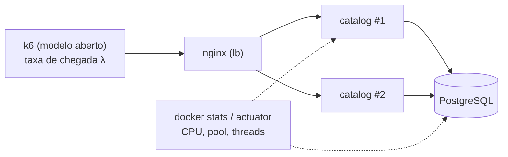

"Quantas requisições por segundo o `catalog` da BoxOffice aguenta?" é uma pergunta sem resposta até você acrescentar **"…com p99 abaixo de 200 ms e menos de 1% de erros, nesta máquina"**. Neste exercício você executa uma **campanha de k6** pequena, mas rigorosa, contra o seu próprio serviço, encontra o ponto em que a latência explode (o *joelho*), nomeia o recurso que o causa, muda uma coisa e **prova** a mudança com uma nova medição.

!!! abstract "Objetivos de aprendizagem"

    Ao final deste exercício você será capaz de:

    - **Projetar** testes de smoke, load, stress e spike com um modelo de carga *aberto* e thresholds de SLO.
    - **Executá-los** de forma reprodutível (recursos fixos, repetições, resultados brutos versionados).
    - **Ler** percentis e curvas de vazão vs latência e localizar o joelho.
    - **Diagnosticar** o gargalo com métricas de recursos, o método USE e a Lei de Little.
    - **Verificar** uma hipótese com uma única mudança e um novo teste.

## Contexto

O [Lab 2](../../hands-on/2/index.md) apresentou o k6 e os percentis no serviço `catalog`; o [Lab 3](../../hands-on/3/index.md) o colocou atrás do Nginx com réplicas. A [Aula 2](../../classes/estimation/index.md) deu a teoria: utilização, filas, o joelho, latência de cauda e Lei de Little. A [Aula 15](../../classes/performance/index.md) aprofunda o tema mais adiante no semestre, e a [campanha de testes de carga](../project/load-test-campaign/index.md) do projeto reaproveita tudo o que você construir aqui.

Duas ideias separam um teste de carga de um número qualquer:

- **Modelo aberto vs fechado.** Um modelo *fechado* (N usuários virtuais em loop) desacelera quando o servidor desacelera — ele educadamente para de enviar e esconde o problema (**coordinated omission**). Usuários reais chegam estando o servidor lento ou não. Use os executores de **taxa de chegada** do k6 (`constant-arrival-rate`, `ramping-arrival-rate`): eles iniciam iterações a uma taxa fixa, independentemente dos tempos de resposta[^1].
- **Thresholds são SLOs.** `p(99)<500` e `rate<0.01` transformam "parecia bom" em passou/falhou.



## Tarefa

Execute uma campanha de testes de carga contra **um endpoint HTTP (ou uma pequena mistura)** do seu próprio serviço — o `catalog` da BoxOffice dos labs (recomendado) ou outro serviço seu — e escreva um relatório que responda:

1. Qual é a **vazão máxima sustentável** do seu ambiente com p99 abaixo do seu SLO e erros abaixo de 1%?
2. Onde está o **joelho**, e **qual recurso** o causa?
3. Que **única mudança** desloca o joelho, e quanto?

## Requisitos

- [ ] **(obrigatório)** O serviço roda com **recursos fixos** (`cpus`/`mem_limit` no `compose.yaml`) e o ambiente está descrito (CPU, RAM, SO, versões, onde o k6 roda).
- [ ] **(obrigatório)** **Resultados brutos** versionados: um resumo JSON do k6 por execução (e CSV se você plotar séries temporais).
- [ ] Os scripts k6 usam **executores de taxa de chegada** e **thresholds** de latência p95/p99 e de taxa de erro.
- [ ] Teste **smoke**: passa com 0 erros.
- [ ] Teste **load**: pelo menos **10 minutos** a uma taxa constante que cumpre o SLO, repetido **3 vezes**; informe a média e a dispersão (mín–máx) do p99.
- [ ] Teste **stress**: degraus até pelo menos **2× a taxa do load** (ou até falhar); um gráfico de **vazão vs p99** com o joelho marcado.
- [ ] Teste **spike**: um salto repentino para ≥ 3× a taxa base; informe os erros durante o pico e o **tempo de recuperação** até o p99 normal.
- [ ] **Verificação da Lei de Little** na taxa do load: requisições em andamento `L = λ × W` comparadas com as threads do servidor e o pool de conexões do banco.
- [ ] **Análise do gargalo** com evidências de recursos (CPU, memória, threads, espera no pool, GC, banco) — não um chute.
- [ ] **Uma mudança + novo teste** (por exemplo, tamanho do pool, réplicas, um índice, virtual threads, um cache) com números de antes/depois com o mesmo script e os mesmos dados.
- [ ] Uma **declaração de capacidade** de uma frase: "uma instância com 2 vCPU sustenta X req/s com p99 < Y ms".
- [ ] Seção *Uso de IA* (veja a [política](../index.md#use-of-ai-tools)).

## Entregáveis

No seu repositório (tag `ex2`): os scripts k6 em `load/`, os resultados brutos em `load/results/`, o `compose.yaml` usado e eventuais scripts de gráficos; no site da sua documentação, uma página `load-test-report` seguindo o [template](#templates).

## Passo a passo

### 1. Fixe o ambiente

Os resultados só são comparáveis se os recursos não mudarem. Limite o serviço e o banco no `compose.yaml` e carregue o banco com dados suficientes (por exemplo, 1.000 eventos) para que as consultas sejam realistas.

```yaml title="compose.yaml (excerpt)"
services:
  catalog:
    image: boxoffice/catalog:latest
    environment:
      SPRING_DATASOURCE_URL: jdbc:postgresql://db:5432/catalog
      SPRING_DATASOURCE_HIKARI_MAXIMUM_POOL_SIZE: "10"
      MANAGEMENT_ENDPOINTS_WEB_EXPOSURE_INCLUDE: health,metrics,prometheus
    cpus: "2"
    mem_limit: 1g
    ports:
      - "8080:8080"
    depends_on:
      - db
  db:
    image: postgres:16
    environment:
      POSTGRES_DB: catalog
      POSTGRES_USER: catalog
      POSTGRES_PASSWORD: catalog
    cpus: "2"
    mem_limit: 1g
```

!!! warning "O k6 também usa CPU"

    Se o k6 roda no mesmo notebook, ele compete com o serviço. Mantenha o serviço limitado (como acima), acompanhe a CPU do próprio k6 e diga no relatório onde o k6 rodou. Se o k6 avisar `dropped_iterations` ou `insufficient VUs`, o gerador de carga — e não o seu serviço — é o gargalo.

### 2. Escreva um script, vários tipos de teste

Um único script, com o tipo de teste escolhido por uma variável de ambiente, mantém a mistura de requisições idêntica entre os testes.

```javascript title="load/catalog.js"
import http from 'k6/http';
import { check } from 'k6';

const BASE = __ENV.BASE_URL || 'http://localhost:8080';
const TYPE = __ENV.TEST_TYPE || 'smoke';
const RATE = Number(__ENV.RATE || 200);      // load-test rate (req/s)
const EVENTS = Number(__ENV.EVENTS || 1000); // ids seeded in the database

function stressStages() {
  const stages = [];
  for (const f of [0.5, 1, 1.5, 2, 2.5, 3]) {
    stages.push({ target: Math.round(RATE * f), duration: '30s' }); // ramp to the step
    stages.push({ target: Math.round(RATE * f), duration: '90s' }); // hold the step
  }
  return stages;
}

const profiles = {
  smoke: {
    executor: 'constant-arrival-rate', rate: 5, timeUnit: '1s',
    duration: '30s', preAllocatedVUs: 5,
  },
  load: {
    executor: 'ramping-arrival-rate', startRate: 0, timeUnit: '1s',
    preAllocatedVUs: 50, maxVUs: 500,
    stages: [
      { target: RATE, duration: '2m' },  // warm-up ramp
      { target: RATE, duration: '10m' }, // steady state: this is what you report
      { target: 0, duration: '30s' },
    ],
  },
  stress: {
    executor: 'ramping-arrival-rate', startRate: 0, timeUnit: '1s',
    preAllocatedVUs: 100, maxVUs: 2000, stages: stressStages(),
  },
  spike: {
    executor: 'ramping-arrival-rate', startRate: Math.round(RATE * 0.3), timeUnit: '1s',
    preAllocatedVUs: 100, maxVUs: 2000,
    stages: [
      { target: Math.round(RATE * 0.3), duration: '1m' },
      { target: RATE * 3, duration: '10s' },               // the spike
      { target: RATE * 3, duration: '1m' },
      { target: Math.round(RATE * 0.3), duration: '10s' },
      { target: Math.round(RATE * 0.3), duration: '2m' },  // recovery
    ],
  },
};

export const options = {
  scenarios: { [TYPE]: profiles[TYPE] },
  thresholds: {
    http_req_failed: ['rate<0.01'],
    http_req_duration: ['p(95)<200', 'p(99)<500'],
  },
  summaryTrendStats: ['avg', 'min', 'med', 'p(90)', 'p(95)', 'p(99)', 'max'],
};

export default function () {
  const id = 1 + Math.floor(Math.random() * EVENTS);
  const res = http.get(`${BASE}/events/${id}`, { tags: { name: 'GET /events/{id}' } });
  check(res, { 'status is 200': (r) => r.status === 200 });
}
```

Ajuste os thresholds ao **seu** SLO e a URL ao seu endpoint. Espera-se que os testes de stress e spike *ultrapassem* os thresholds: o que você relata é *onde* e *como* eles falham.

### 3. Execute e guarde tudo

```bash title="load/run.sh"
#!/usr/bin/env bash
# usage: ./load/run.sh <type> <rate> <run-number>
set -euo pipefail
TYPE=${1:-smoke}; RATE=${2:-200}; RUN=${3:-1}
mkdir -p load/results
# resource usage of every container, every 2 s, in the background
( while true; do
    docker stats --no-stream --format '{{.Name}},{{.CPUPerc}},{{.MemUsage}}' \
      | sed "s/^/$(date +%s),/" >> "load/results/${TYPE}-r${RATE}-run${RUN}-docker.csv"
    sleep 2
  done ) &
STATS=$!
trap 'kill $STATS' EXIT
k6 run -e TEST_TYPE="$TYPE" -e RATE="$RATE" \
  --summary-export "load/results/${TYPE}-r${RATE}-run${RUN}.json" \
  --out csv="load/results/${TYPE}-r${RATE}-run${RUN}.csv" \
  load/catalog.js
```

Ordem sugerida: smoke → stress (para achar o joelho) → escolher a taxa do load em cerca de **70% do joelho** → load ×3 → spike. Reinicie o serviço entre as execuções (ou sempre faça o aquecimento) para que todas comecem do mesmo estado.

### 4. Encontre o joelho

Cada degrau do teste de stress dá um ponto (vazão atingida, p99). Plote o p99 contra a vazão: a curva é plana enquanto a utilização é baixa e depois se dobra bruscamente quando a utilização se aproxima de 1 — o **joelho**. O gráfico abaixo é **ilustrativo** (uma fila M/M/1 com tempo de serviço de 1 ms), não uma medição; o seu virá das suas execuções.

```python exec="1" html="1"
import matplotlib.pyplot as plt
from io import StringIO

# Illustrative only: M/M/1 queue, service time 1 ms (capacity 1,000 req/s).
# Response time is exponential with mean S / (1 - rho); p99 = ln(100) * mean.
S = 0.001
rates = [r for r in range(50, 1000, 10)]
p99 = [1000 * 4.605 * S / (1 - r * S) for r in rates]
plt.rcParams.update({  # gray reads well in light and dark mode
    "text.color": "gray", "axes.labelcolor": "gray", "axes.edgecolor": "gray",
    "xtick.color": "gray", "ytick.color": "gray",
})

fig, ax = plt.subplots(figsize=(7, 3.5))
ax.plot(rates, p99, color="tab:blue", linewidth=2)
ax.axhline(50, color="tab:red", linestyle="--", linewidth=1)
ax.text(60, 55, "SLO: p99 < 50 ms", color="tab:red", fontsize=9)
ax.axvspan(820, 920, color="tab:orange", alpha=0.2)
ax.text(825, 140, "knee", color="tab:orange", fontsize=9)
ax.set_xlabel("throughput (req/s)")
ax.set_ylabel("p99 latency (ms)")
ax.set_ylim(0, 200)
ax.set_title("Illustrative throughput vs p99 (M/M/1, not measured)", fontsize=10)
for side in ("top", "right"):
    ax.spines[side].set_visible(False)
plt.tight_layout()

buffer = StringIO()
plt.savefig(buffer, format="svg", transparent=True)
print(buffer.getvalue())
plt.close()
```

Um pequeno script transforma os seus arquivos de resumo no mesmo gráfico:

```python title="load/plot_knee.py"
import glob
import json
import sys

import matplotlib.pyplot as plt

# usage: python load/plot_knee.py "load/results/stress-step-*.json"
points = []
for path in sorted(glob.glob(sys.argv[1])):
    m = json.load(open(path))["metrics"]
    points.append((m["http_reqs"]["rate"], m["http_req_duration"]["p(99)"]))
points.sort()
plt.plot([p[0] for p in points], [p[1] for p in points], marker="o")
plt.xlabel("achieved throughput (req/s)")
plt.ylabel("p99 (ms)")
plt.savefig("load/results/knee.png", dpi=150)
```

!!! tip "Um ponto por degrau"

    Uma única execução de stress mistura todos os degraus em um só resumo. Ou execute um teste curto de **constant-arrival-rate** por degrau (por exemplo, 100, 200, 300… req/s por 2 minutos cada, um JSON por degrau), ou calcule o p99 de cada degrau a partir da saída CSV, filtrando pelos instantes de cada degrau.

### 5. Encontre o gargalo

Use o **método USE** para cada recurso — **U**tilização, **S**aturação, **E**rros[^2]:

| Recurso | Onde olhar | Sinal de saturação |
|-|-|-|
| CPU da aplicação | `docker stats`, `process.cpu.usage` | CPU perto do limite de `cpus`, throttling |
| Threads do servidor | `tomcat.threads.busy` / `executor.active` (actuator) | ocupadas = máximo |
| Pool de conexões do BD | `hikaricp.connections.pending`, `.usage` | pending > 0 |
| Memória da JVM / GC | `jvm.gc.pause`, `jvm.memory.used` | pausas longas ou frequentes |
| Banco de dados | `docker stats` do `db`, `pg_stat_activity`, `EXPLAIN ANALYZE` | CPU no limite, varreduras sequenciais, espera por locks |

```bash
curl -s localhost:8080/actuator/metrics/hikaricp.connections.pending | jq '.measurements'
curl -s localhost:8080/actuator/metrics/tomcat.threads.busy | jq '.measurements'
docker compose exec db psql -U catalog -c "select state, count(*) from pg_stat_activity group by state;"
```

Depois confira com a **Lei de Little**. Se o teste de load atinge λ = 400 req/s com latência média W = 25 ms, há `L = 400 × 0,025 = 10` requisições em andamento. Se cada requisição segura uma conexão com o banco durante a maior parte do tempo e o pool tem 10 conexões, o pool está cheio: a próxima requisição espera — esse é o joelho. O `maximum-pool-size` padrão do Hikari é 10, e é por isso que esse é o gargalo clássico de um serviço Spring Boot.

### 6. Mude uma coisa e teste de novo

Formule uma hipótese ("o pool é o gargalo; com 30 conexões o joelho vai de ~400 para ~1.000 req/s, até a CPU do banco saturar"), mude **só isso** e repita os mesmos testes de stress e load. Apresente antes/depois lado a lado. Uma hipótese refutada é um resultado válido se a evidência for clara — diga o que você aprendeu.

## Templates

=== "English"

    ~~~markdown
    # Load-test report — <service>

    ## 1. System under test
    - Endpoint(s) and request mix: ...
    - Architecture (diagram) and resources: catalog 2 vCPU / 1 GB, db 2 vCPU / 1 GB, ...
    - Data: ... rows seeded; key distribution: ...
    - Environment: CPU, RAM, OS, Docker, JDK, k6 versions; k6 runs on ...

    ## 2. SLO and thresholds
    | SLI | Threshold |
    |-|-|
    | p99 latency | < ... ms |
    | error rate | < 1% |

    ## 3. Test plan
    | Test | Executor | Rate / stages | Duration | Purpose |
    |-|-|-|-|-|
    | smoke | constant-arrival-rate | 5 req/s | 30 s | script and service work |
    | stress | ramping-arrival-rate | 0.5× → 3× | 12 min | find the knee |
    | load ×3 | ramping-arrival-rate | ... req/s | 10 min steady | SLO at the chosen rate |
    | spike | ramping-arrival-rate | 0.3× → 3× → 0.3× | 4.5 min | errors and recovery |

    ## 4. Results
    | Run | Rate (req/s) | Achieved (req/s) | p50 | p95 | p99 | Errors | Thresholds |
    |-|-|-|-|-|-|-|-|
    | load-1 | | | | | | | pass/fail |
    | load-2 | | | | | | | |
    | load-3 | | | | | | | |
    Mean p99: ... (min ... – max ...)

    Throughput vs p99 chart (knee marked): ...
    Spike: errors during the spike ...; p99 back to normal after ... s.

    ## 5. Bottleneck analysis
    - USE table for each resource at the knee: ...
    - Little's Law: L = λ × W = ... vs threads ... and pool ...
    - Conclusion: the bottleneck is ... because ...

    ## 6. Change and re-test
    | Metric | Before | After |
    |-|-|-|
    | Knee (req/s) | | |
    | p99 at ... req/s | | |
    Hypothesis confirmed / refuted because ...

    ## 7. Capacity statement
    One instance with ... vCPU sustains ... req/s at p99 < ... ms and < 1% errors.

    ## 8. AI usage
    ~~~

=== "Português"

    ~~~markdown
    # Relatório de teste de carga — <serviço>

    ## 1. Sistema sob teste
    - Endpoint(s) e mistura de requisições: ...
    - Arquitetura (diagrama) e recursos: catalog 2 vCPU / 1 GB, db 2 vCPU / 1 GB, ...
    - Dados: ... linhas carregadas; distribuição das chaves: ...
    - Ambiente: CPU, RAM, SO, versões de Docker, JDK, k6; o k6 roda em ...

    ## 2. SLO e thresholds
    | SLI | Limite |
    |-|-|
    | latência p99 | < ... ms |
    | taxa de erro | < 1% |

    ## 3. Plano de testes
    | Teste | Executor | Taxa / estágios | Duração | Objetivo |
    |-|-|-|-|-|
    | smoke | constant-arrival-rate | 5 req/s | 30 s | script e serviço funcionam |
    | stress | ramping-arrival-rate | 0,5× → 3× | 12 min | achar o joelho |
    | load ×3 | ramping-arrival-rate | ... req/s | 10 min estáveis | SLO na taxa escolhida |
    | spike | ramping-arrival-rate | 0,3× → 3× → 0,3× | 4,5 min | erros e recuperação |

    ## 4. Resultados
    | Execução | Taxa (req/s) | Atingido (req/s) | p50 | p95 | p99 | Erros | Thresholds |
    |-|-|-|-|-|-|-|-|
    | load-1 | | | | | | | passou/falhou |
    | load-2 | | | | | | | |
    | load-3 | | | | | | | |
    p99 médio: ... (mín ... – máx ...)

    Gráfico vazão vs p99 (joelho marcado): ...
    Spike: erros durante o pico ...; p99 volta ao normal depois de ... s.

    ## 5. Análise do gargalo
    - Tabela USE de cada recurso no joelho: ...
    - Lei de Little: L = λ × W = ... vs threads ... e pool ...
    - Conclusão: o gargalo é ... porque ...

    ## 6. Mudança e novo teste
    | Métrica | Antes | Depois |
    |-|-|-|
    | Joelho (req/s) | | |
    | p99 a ... req/s | | |
    Hipótese confirmada / refutada porque ...

    ## 7. Declaração de capacidade
    Uma instância com ... vCPU sustenta ... req/s com p99 < ... ms e < 1% de erros.

    ## 8. Uso de IA
    ~~~

## Rubrica

Níveis conforme definidos em [Como os exercícios são avaliados](../index.md#how-the-exercises-are-graded).

| Critério | I | D | C | B | A |
|-|-|-|-|-|-|
| Reprodutibilidade **(obrigatório)** | Números sem dados brutos | Ambiente ou recursos não fixados/descritos | Recursos fixos, ambiente descrito, JSON bruto de cada execução | Um comando reexecuta qualquer teste | Um colega reexecuta e obtém números parecidos (documentado) |
| Desenho dos testes | Só modelo fechado, sem thresholds | Faltam tipos de teste | Smoke, load, stress, spike com executores de taxa de chegada e thresholds | Taxa do load escolhida a partir do joelho; aquecimento excluído | Acrescenta soak ou breakpoint e explica o que revela |
| Rigor | Uma única execução | Load não repetido | 3 execuções de load com dispersão informada | Discute variância e outliers | Explica uma fonte de ruído e a controla |
| Resultados | — | Só tabelas, sem curva | Gráfico vazão vs p99 com o joelho | Percentis interpretados (cauda vs mediana) | Recuperação do spike analisada ao longo do tempo |
| Análise do gargalo | Chute | Recurso apontado sem evidência | Evidência USE para o gargalo | Verificação da Lei de Little consistente com a evidência | Prevê o *próximo* gargalo e o confere |
| Mudança e novo teste | — | Mudança sem novo teste | Antes/depois com o mesmo script | Hipótese enunciada antes, previsão quantificada | Duas iterações, ou uma hipótese refutada bem explicada |

## FAQ

??? question "Por que não usar simplesmente `vus: 100` e um loop?"

    Isso é um modelo *fechado*: quando o serviço fica lento, os usuários virtuais esperam e mandam menos requisições, então a latência medida fica otimista demais (coordinated omission). Com executores de taxa de chegada, a taxa de requisições é a que você pediu, como acontece com usuários reais.

??? question "Que taxa devo usar no teste de load?"

    Uma que o seu ambiente sustente dentro do SLO — cerca de 70% do joelho encontrado no teste de stress é uma boa escolha. O teste de load confirma que essa taxa é estável por 10 minutos; não é o lugar para procurar o limite.

??? question "Meus resultados mudam muito entre execuções."

    Confira se os recursos estão fixos, se nada pesado roda junto na máquina, se você aquece a JVM (o primeiro minuto de um serviço Java é mais lento) e se o banco começa com os mesmos dados. Informe a dispersão; ela faz parte do resultado.

??? question "O k6 diz `insufficient VUs` / `dropped_iterations`."

    O executor não conseguiu iniciar iterações na taxa pedida porque todos os VUs pré-alocados estavam ocupados esperando respostas. Aumente `maxVUs`; se continuar, o serviço está saturado (isso *é* um resultado) ou o próprio k6 ficou sem CPU.

??? question "Posso testar através do Nginx com várias réplicas?"

    Sim — esse é o ambiente do Lab 3 e deixa a análise do gargalo mais interessante (são as réplicas, o Nginx ou o banco compartilhado?). Descreva a topologia e dê recursos fixos a todos os contêineres.

??? question "Preciso do Grafana?"

    Não para este exercício: `docker stats`, as métricas do actuator e os resumos do k6 bastam. Se você já tem a stack de observabilidade do [Lab 8](../../hands-on/8/index.md), capturas de tela dos dashboards são evidências bem-vindas.

[^1]: Documentação do Grafana k6, "Open and closed models" e "Arrival-rate executors", [grafana.com/docs/k6](https://grafana.com/docs/k6/latest/using-k6/scenarios/concepts/open-vs-closed/){target="_blank"}.
[^2]: Brendan Gregg, "The USE Method", [brendangregg.com/usemethod.html](https://www.brendangregg.com/usemethod.html){target="_blank"}.
