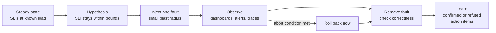

Your system passed its load tests on a sunny day. Production is not sunny: the payment provider slows down in the middle of an on-sale, a node dies, the broker restarts, someone ships a bad build. A **game day** is a planned, supervised exercise in which you **break your own system on purpose**, under load, to learn whether it degrades the way you designed it to — and whether your team can **detect, diagnose and mitigate** a failure using only its dashboards and alerts.

!!! abstract "Goals"

    With this milestone your team will:

    - **Formulate** chaos experiments as hypotheses about steady state, with a bounded blast radius and abort conditions.
    - **Inject** realistic faults (dependency latency and outage, pod and node loss, broker or database failure, bad deploy) under load.
    - **Observe** the effect on SLIs with the observability stack, and **verify** correctness afterwards.
    - **Respond** to a surprise fault injected by the instructor, measuring time to detect and time to mitigate.
    - **Learn** from it: a blameless report with action items, owners and follow-up.

This milestone builds on [Class 9 — Reliability](../../../classes/reliability/index.md), [Class 10 — Observability](../../../classes/observability/index.md) and [Lab 9](../../../hands-on/9/index.md) (Resilience4j, Toxiproxy, game day). The game day **runs in class in week 17**; weight **10%** of the project.

## What to deliver

- An **experiment plan** for at least three experiments, committed **before** the game day, following the [template](#templates).
- The **run sheet** filled during the game day (timeline with timestamps).
- A **game day report**: per experiment, hypothesis vs observation, SLO impact, correctness check, time to detect and to mitigate; the surprise fault; action items with owners.
- Dashboard screenshots and k6 summaries of the runs; the scripts used to inject faults (`chaos/`).
- The tag `m7`.

## Acceptance criteria

- [ ] **(mandatory)** Plan committed before the game day with **≥ 3 experiments**, each with hypothesis, steady state, blast radius, abort conditions and rollback.
- [ ] **(mandatory)** Experiments executed **under load** (k6 at 50–70% of the test target) with a live dashboard; the run sheet records every action with a timestamp.
- [ ] The three experiments cover different failure classes: **a slow or failing dependency**, **loss of compute** (pod/node), and **loss of a stateful component** (broker or database).
- [ ] For each experiment: SLIs during the fault vs steady state, hypothesis **confirmed or refuted**, correctness check after recovery.
- [ ] The **surprise fault** is detected through an **alert** (not by someone staring at a graph by chance); time to detect (TTD) and time to mitigate (TTM) reported.
- [ ] A **blameless** report with at least **three action items**, each with an owner and a due milestone.
- [ ] *AI usage* section (see the [policy](../../index.md#use-of-ai-tools)).

## Step by step

### 1. Principles

Chaos engineering is an experiment, not vandalism[^1]:

1. **Define steady state** with SLIs you already measure (e.g. hold p99, error rate, consumer lag) at a known load.
2. **Hypothesize** that steady state continues (or degrades in a bounded, designed way) during the fault: *"When the payment provider adds 3 s of latency, hold p99 stays below 500 ms and order errors stay below 1%, because the payment call has a 1 s timeout and a circuit breaker opens within 10 s."*
3. **Inject** one fault at a time, with the **smallest blast radius** that tests the hypothesis.
4. **Observe** and compare with steady state; **abort** if an abort condition is met.
5. **Recover**, check correctness, and **learn**: confirmed hypotheses build confidence, refuted ones are the valuable ones.



### 2. Roles

| Role | Responsibility |
|-|-|
| **Game master** | Owns the plan and the clock, announces each step, calls the abort |
| **Operator** | Runs the injection and rollback commands — and nothing else |
| **Scribe** | Writes the run sheet: every action and observation with a timestamp |
| **Responders** | Watch dashboards and alerts, diagnose, propose mitigations |

With 2–3 people, combine roles (game master + scribe), but never let the operator also be the only responder. For the **surprise fault**, the instructor acts as game master and operator; the whole team responds.

### 3. Prepare the tools

**Toxiproxy** sits between a service and a dependency and injects latency, timeouts or outages on demand[^2]. Put it between the `payment` adapter and the payment provider stub (or between the `assistant` and the LLM):

```yaml title="compose.yaml (excerpt)"
services:
  toxiproxy:
    image: ghcr.io/shopify/toxiproxy:2.9.0
    ports:
      - "8474:8474"   # control API
```

```bash title="chaos/payment.sh"
#!/usr/bin/env bash
# usage: ./chaos/payment.sh setup|slow|down|heal
# The payment adapter calls http://toxiproxy:9090 instead of the provider.
API=${TOXIPROXY_API:-http://localhost:8474}
case "$1" in
  setup)
    curl -s -X POST "$API/proxies" \
      -d '{"name":"payment","listen":"0.0.0.0:9090","upstream":"payment-provider:8080","enabled":true}' ;;
  slow)   # 3 s +/- 0.5 s on every response
    curl -s -X POST "$API/proxies/payment/toxics" \
      -d '{"name":"slow","type":"latency","stream":"downstream","toxicity":1.0,"attributes":{"latency":3000,"jitter":500}}' ;;
  down)   # connections refused
    curl -s -X POST "$API/proxies/payment" -d '{"enabled":false}' ;;
  heal)
    curl -s -X DELETE "$API/proxies/payment/toxics/slow"
    curl -s -X POST "$API/proxies/payment" -d '{"enabled":true}' ;;
esac
```

On Kubernetes, run Toxiproxy as a Deployment with a Service and reach its control API with `kubectl port-forward svc/toxiproxy 8474` (fine for control commands, not for load).

### 4. Fault library

```bash title="chaos/k8s-faults.sh"
#!/usr/bin/env bash
# usage: ./chaos/k8s-faults.sh <fault>
case "$1" in
  kill-one-pod)      # loss of one replica of a stateless service
    kubectl delete "$(kubectl get pod -l app=inventory -o name | head -n 1)" --wait=false ;;
  kill-all-pods)     # loss of the whole service (until the Deployment recreates the pods)
    kubectl delete pod -l app=inventory --wait=false ;;
  stop-kafka)        # broker outage
    kubectl scale statefulset kafka --replicas=0 ;;
  start-kafka)
    kubectl scale statefulset kafka --replicas=1 ;;
  kill-postgres)     # database restart
    kubectl delete pod -l app=postgres --wait=false ;;
  isolate-kafka)     # network partition: nothing can reach the broker
    kubectl apply -f chaos/isolate-kafka.yaml ;;
  heal-kafka)
    kubectl delete -f chaos/isolate-kafka.yaml ;;
  bad-deploy)        # ship an image that fails
    kubectl set image deployment/order order=boxoffice/order:broken ;;
  rollback)
    kubectl rollout undo deployment/order ;;
esac
```

```yaml title="chaos/isolate-kafka.yaml"
apiVersion: networking.k8s.io/v1
kind: NetworkPolicy
metadata:
  name: chaos-isolate-kafka
spec:
  podSelector:
    matchLabels:
      app: kafka
  policyTypes:
    - Ingress
  ingress: []   # deny all incoming traffic to the broker
```

!!! warning "NetworkPolicy needs a CNI that enforces it"

    Recent kind versions enforce NetworkPolicies with their default network plugin; minikube needs a CNI such as Calico (`minikube start --cni=calico`). Test the policy **before** the game day: an experiment that silently does nothing teaches nothing. Chaos Mesh or LitmusChaos are optional alternatives with richer faults (CPU stress, clock skew, DNS errors).

### 5. Example experiments

| # | Fault | Hypothesis (example) | Abort if |
|-|-|-|-|
| 1 | Payment provider +3 s latency for 3 min (`payment.sh slow`) | Hold p99 < 500 ms; order error rate < 1%; circuit breaker opens in < 10 s; orders queue for retry | Error rate on browse > 5% for 1 min |
| 2 | Kill one `inventory` pod under load (`kill-one-pod`) | No failed holds beyond retries; replacement ready in < 60 s; 0 double bookings | Availability of holds < 95% for 1 min |
| 3 | Stop Kafka for 2 min (`stop-kafka`) | Orders still accepted (outbox grows); lag drains in < 2 min after restart; 0 lost e-mails | Outbox write errors appear |
| 4 *(optional)* | Bad deploy of `order` + rollback | Readiness keeps the broken pods out of rotation; rollback in < 2 min | Error rate > 10% |

Adapt the table to your system option (e.g. LLM gateway outage with model fallback for the AI assistant, Redis loss for the feed timeline cache, WebSocket node loss for chat).

### 6. Run the game day

1. **T−15 min:** environment healthy, data seeded, dashboards open, alerts armed, k6 started at 50–70% of the test target, steady state recorded for 5 minutes.
2. **Per experiment:** game master announces; operator injects; scribe logs; responders observe and talk aloud; at the planned end (or abort), operator heals; wait for recovery; run the correctness check; scribe records the end of recovery.
3. **Surprise fault:** the instructor injects one fault the team does not know about (chosen from a safe list announced in advance: a Toxiproxy toxic, a deployment scaled to zero, a CPU-hogging pod, a wrong configuration value). The clock starts at injection. Record **when the first alert fires (TTD)** and **when SLIs are back within SLO (TTM)**, and what the team did in between.
4. **Hot wash (10 min):** what surprised you, what worked, what to change.

### 7. Write the report

Write it **blameless**: describe what the system and the people did and why it made sense at the time, not who made a mistake[^3]. Every finding becomes an **action item** with an owner and a milestone (e.g. "add an alert on outbox backlog — Ana — M8").

## Templates

=== "English"

    ~~~markdown
    # Game day — <team / system>

    ## Experiment plan (one block per experiment, committed before the game day)
    ### Experiment <n>: <title>
    - Steady state: SLIs and their baseline values at ... req/s
    - Hypothesis: When <fault>, <SLI> stays <bound> because <mechanism>; recovery within <time>.
    - Fault and method: <tool, command>, duration ...
    - Blast radius: <which services/users are affected; how it is limited>
    - Abort conditions: <SLI threshold and duration>, data inconsistency detected
    - Rollback: <command>
    - Correctness check after recovery: <query/script>
    - Roles: game master ..., operator ..., scribe ..., responders ...

    ## Run sheet
    | Time | Who | Action / observation |
    |-|-|-|
    | T+0:00 | operator | `./chaos/payment.sh slow` |
    | T+0:08 | responder | alert "payment latency" fired |

    ## Results
    | # | Hypothesis | Observed (SLIs during the fault) | Confirmed? | Recovery time | Correctness |
    |-|-|-|-|-|-|

    ## Surprise fault
    Injected at ...; first alert at ... (TTD = ...); diagnosis steps; mitigation; SLIs back at ... (TTM = ...).

    ## What went well / what did not
    ...

    ## Action items
    | # | Action | Owner | Due | Status |
    |-|-|-|-|-|

    ## AI usage
    ~~~

=== "Português"

    ~~~markdown
    # Game day — <time / sistema>

    ## Plano dos experimentos (um bloco por experimento, versionado antes do game day)
    ### Experimento <n>: <título>
    - Estado estável: SLIs e seus valores de referência a ... req/s
    - Hipótese: Quando <falha>, <SLI> fica <limite> porque <mecanismo>; recuperação em até <tempo>.
    - Falha e método: <ferramenta, comando>, duração ...
    - Raio de impacto: <quais serviços/usuários são afetados; como é limitado>
    - Condições de aborto: <limite de SLI e duração>, inconsistência de dados detectada
    - Reversão: <comando>
    - Verificação de correção após a recuperação: <consulta/script>
    - Papéis: game master ..., operador ..., escriba ..., respondedores ...

    ## Folha de execução
    | Hora | Quem | Ação / observação |
    |-|-|-|
    | T+0:00 | operador | `./chaos/payment.sh slow` |
    | T+0:08 | respondedor | alerta "payment latency" disparou |

    ## Resultados
    | # | Hipótese | Observado (SLIs durante a falha) | Confirmada? | Tempo de recuperação | Correção |
    |-|-|-|-|-|-|

    ## Falha surpresa
    Injetada às ...; primeiro alerta às ... (TTD = ...); passos do diagnóstico; mitigação; SLIs de volta às ... (TTM = ...).

    ## O que funcionou / o que não funcionou
    ...

    ## Itens de ação
    | # | Ação | Responsável | Prazo | Situação |
    |-|-|-|-|-|

    ## Uso de IA
    ~~~

## Rubric

Levels as defined in [How the exercises are graded](../../index.md#how-the-exercises-are-graded).

| Criterion | I | D | C | B | A |
|-|-|-|-|-|-|
| Plan **(mandatory)** | None | Written after the game day, or < 3 experiments | 3 experiments with hypothesis, steady state, blast radius, abort, rollback | Hypotheses quantified and tied to designed mechanisms (timeouts, breakers, outbox) | Experiments ordered by risk; dry-run of tools documented |
| Execution **(mandatory)** | Not run | Not under load, or no run sheet | Under load, run sheet with timestamps, correctness checks | Abort conditions respected; one variable at a time | An extra experiment born from a finding during the day |
| Observation and analysis | — | Screenshots without interpretation | Hypothesis confirmed/refuted per experiment with SLIs | Root cause of every refuted hypothesis explained with traces/logs | Refuted hypothesis fixed and the experiment rerun before M9 |
| Surprise fault | — | Not detected, or detected by chance | Detected by an alert; TTD and TTM reported | Diagnosis path documented (alert → dashboard → trace → cause) | TTD and TTM within the team's own targets, with runbook used |
| Learning | — | No action items | ≥ 3 action items with owners | Blameless narrative; items prioritized | At least one item implemented and verified |

## FAQ

??? question "Will the instructor break something permanently?"

    No. The surprise fault is chosen from a list announced in advance, is reversible, and the instructor heals it if the team cannot within the time box. The goal is to exercise detection and response, not to destroy your data.

??? question "Our hypothesis was refuted. Is that bad for the grade?"

    No — it is the most valuable outcome of a game day, as long as you explain why it failed and what you will change. A team that confirms everything with trivial experiments learns less (and scores less) than one that finds a real weakness.

??? question "Can we run the game day on Docker Compose?"

    Experiments 1 and 3 work on Compose (Toxiproxy, `docker compose stop kafka`). Loss of compute is more interesting on Kubernetes, where the Deployment and the readiness probes are part of the answer. Prefer the environment you will present.

??? question "What if an experiment corrupts data?"

    That is what the abort conditions and the correctness check are for. Stop, record, restore from the seed (you have a seed script from M6), and treat it as the top action item.

??? question "We have no alerts yet."

    Alerts are an M4 requirement (one SLO burn-rate alert at least). Without them the surprise fault will be detected late or by luck — which is exactly what the report should then say.

[^1]: Principles of Chaos Engineering, [principlesofchaos.org](https://principlesofchaos.org/){target="_blank"}.
[^2]: Toxiproxy, [github.com/Shopify/toxiproxy](https://github.com/Shopify/toxiproxy){target="_blank"}.
[^3]: Betsy Beyer et al. (eds.), *Site Reliability Engineering*, O'Reilly, 2016 — chapter 15, "Postmortem Culture: Learning from Failure".
