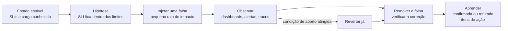

O seu sistema passou nos testes de carga num dia de sol. Produção não é ensolarada: o provedor de pagamento fica lento no meio de uma venda, um nó morre, o broker reinicia, alguém publica um build quebrado. Um **game day** é um exercício planejado e supervisionado em que vocês **quebram o próprio sistema de propósito**, sob carga, para descobrir se ele se degrada do jeito que foi projetado — e se o time consegue **detectar, diagnosticar e mitigar** uma falha usando apenas seus dashboards e alertas.

!!! abstract "Metas"

    Com este marco o seu time vai:

    - **Formular** experimentos de caos como hipóteses sobre o estado estável, com raio de impacto limitado e condições de aborto.
    - **Injetar** falhas realistas (latência e queda de dependência, perda de pod e de nó, falha do broker ou do banco, deploy ruim) sob carga.
    - **Observar** o efeito nos SLIs com a stack de observabilidade, e **verificar** a correção depois.
    - **Responder** a uma falha surpresa injetada pelo professor, medindo o tempo para detectar e o tempo para mitigar.
    - **Aprender** com isso: um relatório sem culpados, com itens de ação, responsáveis e acompanhamento.

Este marco se apoia na [Aula 9 — Confiabilidade](../../../classes/reliability/index.md), na [Aula 10 — Observabilidade](../../../classes/observability/index.md) e no [Lab 9](../../../hands-on/9/index.md) (Resilience4j, Toxiproxy, game day). O game day **acontece em aula na semana 17**; peso de **10%** do projeto.

## O que entregar

- Um **plano de experimentos** com pelo menos três experimentos, versionado **antes** do game day, seguindo o [template](#templates).
- A **folha de execução** preenchida durante o game day (linha do tempo com horários).
- Um **relatório do game day**: por experimento, hipótese vs observação, impacto no SLO, verificação de correção, tempo para detectar e para mitigar; a falha surpresa; itens de ação com responsáveis.
- Capturas dos dashboards e resumos do k6 das execuções; os scripts usados para injetar falhas (`chaos/`).
- A tag `m7`.

## Critérios de aceitação

- [ ] **(obrigatório)** Plano versionado antes do game day com **≥ 3 experimentos**, cada um com hipótese, estado estável, raio de impacto, condições de aborto e reversão.
- [ ] **(obrigatório)** Experimentos executados **sob carga** (k6 a 50–70% da meta de teste) com dashboard ao vivo; a folha de execução registra cada ação com horário.
- [ ] Os três experimentos cobrem classes de falha diferentes: **uma dependência lenta ou falhando**, **perda de computação** (pod/nó) e **perda de um componente com estado** (broker ou banco).
- [ ] Para cada experimento: SLIs durante a falha vs estado estável, hipótese **confirmada ou refutada**, verificação de correção após a recuperação.
- [ ] A **falha surpresa** é detectada por um **alerta** (e não por alguém olhando um gráfico por acaso); tempo para detectar (TTD) e tempo para mitigar (TTM) informados.
- [ ] Um relatório **sem culpados** com pelo menos **três itens de ação**, cada um com responsável e marco de entrega.
- [ ] Seção *Uso de IA* (veja a [política](../../index.md#use-of-ai-tools)).

## Passo a passo

### 1. Princípios

Engenharia do caos é um experimento, não vandalismo[^1]:

1. **Defina o estado estável** com SLIs que vocês já medem (por exemplo, p99 da reserva, taxa de erro, atraso do consumidor) a uma carga conhecida.
2. **Formule a hipótese** de que o estado estável continua (ou se degrada de forma limitada e projetada) durante a falha: *"Quando o provedor de pagamento acrescenta 3 s de latência, o p99 da reserva fica abaixo de 500 ms e os erros de pedido abaixo de 1%, porque a chamada de pagamento tem timeout de 1 s e um circuit breaker abre em menos de 10 s."*
3. **Injete** uma falha por vez, com o **menor raio de impacto** que testa a hipótese.
4. **Observe** e compare com o estado estável; **aborte** se uma condição de aborto for atingida.
5. **Recupere**, verifique a correção e **aprenda**: hipóteses confirmadas dão confiança, as refutadas são as valiosas.



### 2. Papéis

| Papel | Responsabilidade |
|-|-|
| **Game master** | Dono do plano e do relógio, anuncia cada passo, decide o aborto |
| **Operador** | Executa os comandos de injeção e de reversão — e nada mais |
| **Escriba** | Escreve a folha de execução: cada ação e observação com horário |
| **Respondedores** | Acompanham dashboards e alertas, diagnosticam, propõem mitigações |

Com 2–3 pessoas, acumule papéis (game master + escriba), mas nunca deixe o operador ser também o único respondedor. Na **falha surpresa**, o professor faz o papel de game master e operador; o time inteiro responde.

### 3. Prepare as ferramentas

O **Toxiproxy** fica entre um serviço e uma dependência e injeta latência, timeouts ou quedas sob demanda[^2]. Coloque-o entre o adaptador `payment` e o simulador do provedor de pagamento (ou entre o `assistant` e o LLM):

```yaml title="compose.yaml (excerpt)"
services:
  toxiproxy:
    image: ghcr.io/shopify/toxiproxy:2.9.0
    ports:
      - "8474:8474"   # control API
```

```bash title="chaos/payment.sh"
#!/usr/bin/env bash
# usage: ./chaos/payment.sh setup|slow|down|heal
# The payment adapter calls http://toxiproxy:9090 instead of the provider.
API=${TOXIPROXY_API:-http://localhost:8474}
case "$1" in
  setup)
    curl -s -X POST "$API/proxies" \
      -d '{"name":"payment","listen":"0.0.0.0:9090","upstream":"payment-provider:8080","enabled":true}' ;;
  slow)   # 3 s +/- 0.5 s on every response
    curl -s -X POST "$API/proxies/payment/toxics" \
      -d '{"name":"slow","type":"latency","stream":"downstream","toxicity":1.0,"attributes":{"latency":3000,"jitter":500}}' ;;
  down)   # connections refused
    curl -s -X POST "$API/proxies/payment" -d '{"enabled":false}' ;;
  heal)
    curl -s -X DELETE "$API/proxies/payment/toxics/slow"
    curl -s -X POST "$API/proxies/payment" -d '{"enabled":true}' ;;
esac
```

No Kubernetes, rode o Toxiproxy como um Deployment com um Service e acesse a API de controle com `kubectl port-forward svc/toxiproxy 8474` (serve para comandos de controle, não para carga).

### 4. Biblioteca de falhas

```bash title="chaos/k8s-faults.sh"
#!/usr/bin/env bash
# usage: ./chaos/k8s-faults.sh <fault>
case "$1" in
  kill-one-pod)      # loss of one replica of a stateless service
    kubectl delete "$(kubectl get pod -l app=inventory -o name | head -n 1)" --wait=false ;;
  kill-all-pods)     # loss of the whole service (until the Deployment recreates the pods)
    kubectl delete pod -l app=inventory --wait=false ;;
  stop-kafka)        # broker outage
    kubectl scale statefulset kafka --replicas=0 ;;
  start-kafka)
    kubectl scale statefulset kafka --replicas=1 ;;
  kill-postgres)     # database restart
    kubectl delete pod -l app=postgres --wait=false ;;
  isolate-kafka)     # network partition: nothing can reach the broker
    kubectl apply -f chaos/isolate-kafka.yaml ;;
  heal-kafka)
    kubectl delete -f chaos/isolate-kafka.yaml ;;
  bad-deploy)        # ship an image that fails
    kubectl set image deployment/order order=boxoffice/order:broken ;;
  rollback)
    kubectl rollout undo deployment/order ;;
esac
```

```yaml title="chaos/isolate-kafka.yaml"
apiVersion: networking.k8s.io/v1
kind: NetworkPolicy
metadata:
  name: chaos-isolate-kafka
spec:
  podSelector:
    matchLabels:
      app: kafka
  policyTypes:
    - Ingress
  ingress: []   # deny all incoming traffic to the broker
```

!!! warning "NetworkPolicy precisa de um CNI que a aplique"

    Versões recentes do kind aplicam NetworkPolicies com o plugin de rede padrão; o minikube precisa de um CNI como o Calico (`minikube start --cni=calico`). Teste a policy **antes** do game day: um experimento que silenciosamente não faz nada não ensina nada. Chaos Mesh ou LitmusChaos são alternativas opcionais com falhas mais ricas (estresse de CPU, desvio de relógio, erros de DNS).

### 5. Exemplos de experimentos

| # | Falha | Hipótese (exemplo) | Abortar se |
|-|-|-|-|
| 1 | Provedor de pagamento +3 s de latência por 3 min (`payment.sh slow`) | p99 da reserva < 500 ms; taxa de erro de pedidos < 1%; circuit breaker abre em < 10 s; pedidos ficam na fila para nova tentativa | Taxa de erro da navegação > 5% por 1 min |
| 2 | Derrubar um pod do `inventory` sob carga (`kill-one-pod`) | Nenhuma reserva falha além das retentativas; substituto pronto em < 60 s; 0 vendas duplicadas | Disponibilidade das reservas < 95% por 1 min |
| 3 | Parar o Kafka por 2 min (`stop-kafka`) | Pedidos continuam aceitos (o outbox cresce); o atraso esvazia em < 2 min após o reinício; 0 e-mails perdidos | Aparecem erros de escrita no outbox |
| 4 *(opcional)* | Deploy ruim do `order` + reversão | A readiness mantém os pods quebrados fora da rotação; reversão em < 2 min | Taxa de erro > 10% |

Adapte a tabela à sua opção de sistema (por exemplo, queda do gateway de LLM com fallback de modelo no assistente de IA, perda do Redis no cache de timeline do feed, perda de um nó de WebSocket no chat).

### 6. Execute o game day

1. **T−15 min:** ambiente saudável, dados carregados, dashboards abertos, alertas armados, k6 rodando a 50–70% da meta de teste, estado estável registrado por 5 minutos.
2. **Por experimento:** o game master anuncia; o operador injeta; o escriba registra; os respondedores observam e falam em voz alta; no fim planejado (ou no aborto), o operador reverte; aguarde a recuperação; rode a verificação de correção; o escriba registra o fim da recuperação.
3. **Falha surpresa:** o professor injeta uma falha que o time não conhece (escolhida de uma lista segura anunciada antes: uma toxic do Toxiproxy, um deployment escalado para zero, um pod consumindo CPU, um valor de configuração errado). O relógio começa na injeção. Registre **quando o primeiro alerta dispara (TTD)** e **quando os SLIs voltam ao SLO (TTM)**, e o que o time fez nesse intervalo.
4. **Conversa a quente (10 min):** o que surpreendeu, o que funcionou, o que mudar.

### 7. Escreva o relatório

Escreva **sem culpados**: descreva o que o sistema e as pessoas fizeram e por que aquilo fazia sentido no momento, e não quem errou[^3]. Toda descoberta vira um **item de ação** com responsável e marco (por exemplo, "acrescentar um alerta de backlog do outbox — Ana — M8").

## Templates

=== "English"

    ~~~markdown
    # Game day — <team / system>

    ## Experiment plan (one block per experiment, committed before the game day)
    ### Experiment <n>: <title>
    - Steady state: SLIs and their baseline values at ... req/s
    - Hypothesis: When <fault>, <SLI> stays <bound> because <mechanism>; recovery within <time>.
    - Fault and method: <tool, command>, duration ...
    - Blast radius: <which services/users are affected; how it is limited>
    - Abort conditions: <SLI threshold and duration>, data inconsistency detected
    - Rollback: <command>
    - Correctness check after recovery: <query/script>
    - Roles: game master ..., operator ..., scribe ..., responders ...

    ## Run sheet
    | Time | Who | Action / observation |
    |-|-|-|
    | T+0:00 | operator | `./chaos/payment.sh slow` |
    | T+0:08 | responder | alert "payment latency" fired |

    ## Results
    | # | Hypothesis | Observed (SLIs during the fault) | Confirmed? | Recovery time | Correctness |
    |-|-|-|-|-|-|

    ## Surprise fault
    Injected at ...; first alert at ... (TTD = ...); diagnosis steps; mitigation; SLIs back at ... (TTM = ...).

    ## What went well / what did not
    ...

    ## Action items
    | # | Action | Owner | Due | Status |
    |-|-|-|-|-|

    ## AI usage
    ~~~

=== "Português"

    ~~~markdown
    # Game day — <time / sistema>

    ## Plano dos experimentos (um bloco por experimento, versionado antes do game day)
    ### Experimento <n>: <título>
    - Estado estável: SLIs e seus valores de referência a ... req/s
    - Hipótese: Quando <falha>, <SLI> fica <limite> porque <mecanismo>; recuperação em até <tempo>.
    - Falha e método: <ferramenta, comando>, duração ...
    - Raio de impacto: <quais serviços/usuários são afetados; como é limitado>
    - Condições de aborto: <limite de SLI e duração>, inconsistência de dados detectada
    - Reversão: <comando>
    - Verificação de correção após a recuperação: <consulta/script>
    - Papéis: game master ..., operador ..., escriba ..., respondedores ...

    ## Folha de execução
    | Hora | Quem | Ação / observação |
    |-|-|-|
    | T+0:00 | operador | `./chaos/payment.sh slow` |
    | T+0:08 | respondedor | alerta "payment latency" disparou |

    ## Resultados
    | # | Hipótese | Observado (SLIs durante a falha) | Confirmada? | Tempo de recuperação | Correção |
    |-|-|-|-|-|-|

    ## Falha surpresa
    Injetada às ...; primeiro alerta às ... (TTD = ...); passos do diagnóstico; mitigação; SLIs de volta às ... (TTM = ...).

    ## O que funcionou / o que não funcionou
    ...

    ## Itens de ação
    | # | Ação | Responsável | Prazo | Situação |
    |-|-|-|-|-|

    ## Uso de IA
    ~~~

## Rubrica

Níveis conforme definidos em [Como os exercícios são avaliados](../../index.md#how-the-exercises-are-graded).

| Critério | I | D | C | B | A |
|-|-|-|-|-|-|
| Plano **(obrigatório)** | Nenhum | Escrito depois do game day, ou < 3 experimentos | 3 experimentos com hipótese, estado estável, raio de impacto, aborto, reversão | Hipóteses quantificadas e ligadas a mecanismos projetados (timeouts, breakers, outbox) | Experimentos ordenados por risco; ensaio das ferramentas documentado |
| Execução **(obrigatório)** | Não executado | Sem carga, ou sem folha de execução | Sob carga, folha de execução com horários, verificações de correção | Condições de aborto respeitadas; uma variável por vez | Um experimento extra nascido de uma descoberta durante o dia |
| Observação e análise | — | Capturas sem interpretação | Hipótese confirmada/refutada por experimento, com SLIs | Causa raiz de cada hipótese refutada explicada com traces/logs | Hipótese refutada corrigida e experimento repetido antes do M9 |
| Falha surpresa | — | Não detectada, ou detectada por acaso | Detectada por um alerta; TTD e TTM informados | Caminho do diagnóstico documentado (alerta → dashboard → trace → causa) | TTD e TTM dentro das metas do próprio time, com runbook usado |
| Aprendizado | — | Sem itens de ação | ≥ 3 itens de ação com responsáveis | Narrativa sem culpados; itens priorizados | Pelo menos um item implementado e verificado |

## FAQ

??? question "O professor vai quebrar algo de forma permanente?"

    Não. A falha surpresa é escolhida de uma lista anunciada antes, é reversível, e o professor a desfaz se o time não conseguir dentro do tempo. O objetivo é exercitar detecção e resposta, não destruir os seus dados.

??? question "Nossa hipótese foi refutada. Isso é ruim para a nota?"

    Não — é o resultado mais valioso de um game day, desde que vocês expliquem por que falhou e o que vão mudar. Um time que confirma tudo com experimentos triviais aprende menos (e tira menos) do que um que encontra uma fraqueza real.

??? question "Podemos fazer o game day no Docker Compose?"

    Os experimentos 1 e 3 funcionam no Compose (Toxiproxy, `docker compose stop kafka`). A perda de computação é mais interessante no Kubernetes, onde o Deployment e as probes de readiness fazem parte da resposta. Prefira o ambiente que vocês vão apresentar.

??? question "E se um experimento corromper dados?"

    É para isso que existem as condições de aborto e a verificação de correção. Parem, registrem, restaurem a partir da carga inicial (vocês têm um script de carga desde o M6) e tratem isso como o item de ação mais importante.

??? question "Ainda não temos alertas."

    Alertas são um requisito do M4 (pelo menos um alerta de burn rate de SLO). Sem eles, a falha surpresa será detectada tarde ou por sorte — que é exatamente o que o relatório deve dizer nesse caso.

[^1]: Principles of Chaos Engineering, [principlesofchaos.org](https://principlesofchaos.org/){target="_blank"}.
[^2]: Toxiproxy, [github.com/Shopify/toxiproxy](https://github.com/Shopify/toxiproxy){target="_blank"}.
[^3]: Betsy Beyer et al. (orgs.), *Site Reliability Engineering*, O'Reilly, 2016 — capítulo 15, "Postmortem Culture: Learning from Failure".
