In the team project you **design, build, measure, break and defend** one system, from the first estimate to a load-tested deployment on Kubernetes. It is the course in miniature: every class adds a piece, every lab gives you a working example to adapt, and every milestone asks for **evidence** — a diagram, a passing check, a k6 report, a dashboard — not promises.

!!! abstract "Goals"

    By the end of the project your team will have:

    - **Designed** a system from requirements to a reviewed design doc with estimates, SLOs and ADRs.
    - **Built** its core path as services that run with one command (Docker Compose) and on Kubernetes.
    - **Scaled** it with caching, replication and asynchronous processing, and **protected** it with resilience patterns.
    - **Delivered** it continuously (CI/CD with tests, image scan and a performance gate).
    - **Proved** it meets a target SLO with a load-test campaign, and that it degrades gracefully in a chaos **game day**.
    - **Priced** it (cost report with unit economics) and **defended** it in a final presentation.

## Team rules

- [ ] **2 to 3 students** per team. Teams are registered by **week 3** (form on Blackboard) with the chosen system option; changing option after week 5 needs the instructor's approval.
- [ ] **One GitHub repository per team** (monorepo recommended: `services/`, `deploy/`, `load/`, `chaos/`, `docs/`), with every member as a collaborator and the instructor and teaching assistant added.
- [ ] **Documentation on GitHub Pages** (MkDocs Material or Zensical), one section per milestone; the [documentation template](https://hsandmann.github.io/documentation.template/){target="_blank"} is a good start.
- [ ] **Ownership table** on the home page: each member owns **at least one service** and **at least one cross-cutting area** (e.g. observability, CI/CD, load testing, chaos, cost). Owners lead; everybody must understand everything.
- [ ] **Every member commits** with their own GitHub identity (`git config user.name/user.email`). Work done in pairs is marked with `Co-authored-by:` trailers.
- [ ] **Milestones are tags**: `m1` … `m9` on the commit to be graded, plus a short entry in the docs ("what we delivered, evidence, what is missing").

!!! warning "Individual grades inside a team"

    The team grade is, by default, the same for all members. The instructor may **adjust an individual grade** when the evidence (commit history, ownership table, milestone check-ins, the final oral questions, and a short confidential peer evaluation at the end) shows that a member did not contribute or cannot explain the system. The [oral check rule](../index.md#use-of-ai-tools) applies to every member.

## System options

Pick **one** option. Each one exercises the whole palette, but stresses a different part of it. Every option has two scales:

- **Design target** — the real-world scale, used in the design doc, the estimates and the cost report (you will not run it).
- **Test target** — a scaled-down load that your deployment (laptop with Docker Compose or kind/minikube, or a small cloud account) must sustain **within the SLOs** in the [load-test campaign](load-test-campaign/index.md). If your environment cannot reach it, show the bottleneck with numbers and agree a new target with the instructor **before week 14**.

=== "1. BoxOffice flash sale"

    The course's running example. A stadium show goes on sale at 10:00; 2 M fans arrive for 60 k seats. Fans browse the catalog, enter a **waiting room**, **hold** seats for a few minutes, pay through an external provider and receive their tickets by e-mail.

    **Core requirements:** event catalog and search; waiting room with fair admission; seat hold with expiry; order + payment (provider stub with latency and failures); ticket e-mail; no double booking — ever.

    | SLO / constraint | Design target | Test target |
    |-|-|-|
    | Catalog read latency | p99 < 200 ms at 200 k req/s | p99 < 200 ms at 1,000 req/s |
    | Seat hold latency | p99 < 500 ms | p99 < 500 ms at 100 holds/s |
    | Double bookings | 0 | 0 (checked by a consistency query after every test) |
    | Availability during the on-sale | 99.9% | error rate < 0.1% (excluding 429 from the waiting room) |
    | Ticket e-mail | p95 < 60 s after payment | p95 < 30 s, consumer lag < 10 s |

    Playground: [`flash-sale`](../../../playground/scenarios/index.md) · Case study: [ticketing](../../classes/case-studies/ticketing/index.md)

=== "2. Real-time chat"

    One-to-one and small-group chat (up to 100 members) with online presence and message history, used on mobile and web.

    **Core requirements:** WebSocket (or SSE) connections behind a load balancer; message fan-out through pub/sub across instances; per-conversation ordering; at-least-once delivery with client-side de-duplication; history pagination; push notification for offline users.

    | SLO / constraint | Design target | Test target |
    |-|-|-|
    | End-to-end delivery (sender → online receiver) | p99 < 300 ms | p99 < 500 ms |
    | Concurrent connections | 10 M | 5,000 |
    | Messages | 1 M msg/s peak | 500 msg/s |
    | Message loss | 0 acknowledged messages lost | 0 (checked by sequence numbers) |
    | History read | p99 < 200 ms | p99 < 200 ms at 200 req/s |

    Playground: [`chat`](../../../playground/scenarios/index.md) · Case study: [chat](../../classes/case-studies/chat/index.md)

=== "3. Ride-sharing dispatch"

    Drivers send their location every few seconds; riders request a ride and get matched with a nearby available driver.

    **Core requirements:** location ingestion (write-heavy); geo index (geohash, H3 or PostGIS) of available drivers; matching with a driver lock (one driver, one ride); trip state machine; pricing stub; notifications to both sides.

    | SLO / constraint | Design target | Test target |
    |-|-|-|
    | Location update ingestion | p99 < 100 ms at 1 M updates/s | p99 < 200 ms at 1,250 updates/s (5,000 drivers every 4 s) |
    | Nearby-drivers query | p99 < 150 ms | p99 < 200 ms at 100 req/s |
    | Match (request → driver assigned) | p95 < 3 s | p95 < 3 s at 20 rides/s |
    | Double assignment of a driver | 0 | 0 (checked after every test) |
    | Location freshness | < 10 s | < 10 s |

    Playground: [`ride-sharing`](../../../playground/scenarios/index.md) · Case study: [ride-sharing](../../classes/case-studies/ride-sharing/index.md)

=== "4. Social feed"

    Users post short texts with images and follow other users; the home timeline shows recent posts of the people they follow — including a few celebrities with millions of followers.

    **Core requirements:** posts with media in object storage; follow graph; home timeline with a **hybrid fan-out** (push for normal users, pull for celebrities); timeline cache; likes counter; notifications.

    | SLO / constraint | Design target | Test target |
    |-|-|-|
    | Home timeline read | p99 < 200 ms at 300 k req/s | p99 < 200 ms at 1,000 req/s |
    | Post visible to followers | p95 < 5 s | p95 < 5 s, including one account with 100 k followers |
    | Post write | p99 < 300 ms | p99 < 300 ms at 50 posts/s |
    | Availability (reads) | 99.95% | error rate < 0.1% |

    Playground: [`news-feed`](../../../playground/scenarios/index.md) · Case study: [news feed](../../classes/case-studies/news-feed/index.md)

=== "5. Video platform"

    Creators upload videos; the platform transcodes them into several resolutions; viewers watch them with adaptive streaming (HLS) served from a CDN-like edge.

    **Core requirements:** resumable/multipart upload to object storage (MinIO locally) with pre-signed URLs; transcoding jobs on a queue with workers (FFmpeg); HLS manifests and segments served through a cache (Nginx as the "CDN"); video metadata and search; view counter.

    | SLO / constraint | Design target | Test target |
    |-|-|-|
    | Upload acknowledged (after the transfer) | p99 < 1 s | p99 < 1 s |
    | Transcoding done | p95 < 2× video duration | p95 < 2× duration for 20 parallel uploads of 30 s clips |
    | Playback start (manifest + first segment) | p99 < 300 ms | p99 < 300 ms at 500 req/s |
    | Edge (cache) hit ratio for segments | > 95% | > 90% |

    Playground: [`video-streaming`](../../../playground/scenarios/index.md) · Case study: [video streaming](../../classes/case-studies/video-streaming/index.md)

=== "6. AI support assistant"

    A support assistant for BoxOffice (or another domain agreed with the instructor): it answers questions with **RAG** over the help center and the event catalog, and uses **tools** to look up or cancel orders — safely.

    **Core requirements:** LLM gateway (LiteLLM) with model routing, fallback and per-user quotas; ingestion pipeline (chunking, embeddings, pgvector); orchestrator with a bounded agent loop and tool calls to existing services; guardrails (prompt injection, PII, output validation); semantic cache; token and cost metrics; an evaluation set.

    | SLO / constraint | Design target | Test target |
    |-|-|-|
    | Time to first token (TTFT) | p95 < 1.5 s | p95 < 2 s with a **stub LLM** (fixed latency distribution) at 20 concurrent chats; measured separately with the real model at 1 req/s |
    | Answer quality | ≥ 90% on the evaluation set | ≥ 80% on a 30-question evaluation set |
    | Unsafe tool actions | 0 | 0 on a 20-prompt injection test set |
    | Cost per conversation | < US$ 0.01 | measured and reported (tokens × price) |

    Playground: [`ai-assistant`](../../../playground/scenarios/index.md) · Case study: [AI assistant](../../classes/case-studies/ai-assistant/index.md)

!!! tip "Other systems"

    A different system (e.g. food delivery, collaborative editor, payments ledger) is welcome if it has the same breadth. Send a one-page proposal with requirements and target SLOs **by week 3**; it needs the instructor's approval.

## Mandatory components

Whatever the option, the system must have the components below (palette ids in parentheses — see the [component catalog](../../reference/components/index.md)). The milestone where each one is first required is in the last column.

| Area | Requirement | Milestone |
|-|-|:-:|
| Edge | An entry point: API gateway (`apigw`) or Ingress (`ingress`) with rate limiting on at least one route | M2 |
| Identity | Authentication (`auth`) with JWT or OIDC; at least one protected route | M2 |
| Services | **At least three** services of your own (`app`/`worker`), each with its own data | M2 |
| Data | A SQL database (`sql`) with migrations; a justified second store if needed (`nosql`, `objstore`, `vectordb`) | M2 |
| Caching | A cache (`cache`) on a hot read path, with a measured hit ratio | M3 |
| Replication | A read replica or a connection pool in front of the database, justified by a measurement | M3 |
| Messaging | A broker (`kafka`, `queue` or `pubsub`) with a **transactional outbox** or an **idempotent consumer**, and a DLQ | M4 |
| Resilience | Timeout + retry with backoff and jitter + circuit breaker on at least one slow/external dependency (`payment`, `thirdparty`, `email` or `llmgw`) | M4 |
| Observability | OpenTelemetry → metrics, logs and traces (`grafana/otel-lgtm` is enough); a RED dashboard; one SLO burn-rate alert | M4 |
| Platform | Kubernetes (kind/minikube or cloud) with probes, requests/limits and an HPA on at least one service | M5 |
| Delivery | GitHub Actions: build, tests, image build, image scan, SBOM, and a k6 performance gate | M5 |
| Proof | k6 load-test campaign against the test target; chaos game day with at least three experiments | M6–M7 |
| Cost | Cost report for the design target and for the environment you actually used | M8 |

The hands-on labs give you a working version of almost every row: reuse them (and say so).

## Deliverables

All deliverables live in the team repository and its GitHub Pages site:

1. **Design doc + ADRs** — [design doc](design-doc/index.md) (M1, kept up to date until the end).
2. **Running system** — code, `compose.yaml`, Kubernetes manifests (or Helm/Kustomize), CI/CD workflows ([milestones](milestones/index.md) M2–M5).
3. **Load-test campaign report** — plan, k6 scripts, raw results, analysis ([load-test campaign](load-test-campaign/index.md), M6).
4. **Game day report** — experiment plans, run sheet, findings and action items ([game day](game-day/index.md), M7).
5. **Cost report** — design-target and actual costs, unit economics ([cost report](cost-report/index.md), M8).
6. **Final presentation** — slides, live demo, 3-minute video ([presentation](presentation/index.md), M9).

## Grading

```python exec="1" html="1"
--8<-- "docs/2027.1/exercises/project/grade.py"
```

| Phase | Deliverable | Page | Weight |
|-|-|-|:-:|
| Design | M1 — Design doc & estimates | [design doc](design-doc/index.md) | 10% |
| Build | M2 — Core path running | [milestones](milestones/index.md#m2-core-path-running) | 10% |
| | M3 — Scale & cache | [milestones](milestones/index.md#m3-scale-cache) | 10% |
| | M4 — Async & resilience | [milestones](milestones/index.md#m4-async-resilience) | 10% |
| | M5 — Kubernetes + CI/CD | [milestones](milestones/index.md#m5-kubernetes-cicd) | 10% |
| Prove | M6 — Load-test campaign | [load-test campaign](load-test-campaign/index.md) | 15% |
| | M7 — Chaos game day | [game day](game-day/index.md) | 10% |
| Communicate | M8 — Cost report | [cost report](cost-report/index.md) | 10% |
| | M9 — Final presentation | [presentation](presentation/index.md) | 10% |
| | Documentation quality (whole site) | this page | 5% |

Each deliverable receives a concept grade (I, D, C, B, A, with +) using the rubric on its page and the [common level definitions](../index.md#how-the-exercises-are-graded); the project grade is the weighted average of the numeric equivalents. How the project grade enters the final grade is on the [course page](../../index.md).

### Documentation quality rubric

| Criterion | I | D | C | B | A |
|-|-|-|-|-|-|
| Structure | No site | Pages missing or broken | One section per milestone, navigable | Clear home page with architecture, ownership and links to every deliverable | A reviewer finds any evidence in two clicks |
| Reproducibility | Cannot run | Instructions incomplete | `README` runs the system locally | One command per environment (Compose, K8s) + seeded test data | A new person reproduces a load test from scratch in 30 min |
| Accuracy | Contradicts the code | Outdated in several places | Matches the code at the final tag | Diagrams and numbers updated after every milestone | Changelog of design changes linked to ADRs |
| AI usage | Not declared | Vague | Declared per deliverable | Declared with what was verified | Includes lessons on where AI helped or misled |

## Timeline

Weeks are relative to the start of the semester; the dates are on the [planning page](../../planning.md). Each milestone has a **10-minute check-in** in class during its week (demo + questions to any member) and is graded on the tag pushed by the deadline.

| Week | Milestone | What is due |
|:-:|-|-|
| 3 | Team registration | Team, system option, repository link |
| 5 | **M1** Design doc & estimates | Design doc v1, estimates, SLOs, 3+ ADRs, test target agreed |
| 7 | **M2** Core path running | The main use case end to end with Docker Compose; gateway + auth; smoke test |
| 9 | **M3** Scale & cache | Cache + replica/pool, before/after k6 numbers |
| 12 | **M4** Async & resilience | Broker + outbox/idempotency + DLQ; resilience patterns; observability stack |
| 14 | **M5** Kubernetes + CI/CD | Deployment on K8s with probes + HPA; CI/CD with scan, SBOM and performance gate |
| 16 | **M6** Load-test campaign | Campaign report against the test target |
| 17 | **M7** Chaos game day | Game day run in class; report with action items |
| 18 | **M8** Cost report | Cost report and final design doc update |
| 19–20 | **M9** Final presentation | Presentation, live demo, video; final tag `final` |

```mermaid
gantt
    title Project timeline (relative weeks)
    dateFormat  X
    axisFormat  W%s
    section Design
    M1 Design doc          :m1, 3, 5
    section Build
    M2 Core path           :m2, 5, 7
    M3 Scale & cache       :m3, 7, 9
    M4 Async & resilience  :m4, 9, 12
    M5 K8s + CI/CD         :m5, 12, 14
    section Prove
    M6 Load-test campaign  :m6, 14, 16
    M7 Game day            :m7, 16, 17
    section Communicate
    M8 Cost report         :m8, 17, 18
    M9 Presentation        :m9, 18, 20
```



!!! danger "Use of AI"

    The [AI policy of the exercises](../index.md#use-of-ai-tools) applies: AI tools are allowed, their use is declared per deliverable, measurements must come from your own runs, and **every member must be able to explain and change any part of the system** — including the parts written with AI. The final presentation includes individual questions.
