No projeto em equipe vocês **projetam, constroem, medem, quebram e defendem** um sistema, da primeira estimativa a uma implantação testada sob carga no Kubernetes. É o curso em miniatura: cada aula acrescenta uma peça, cada lab dá um exemplo funcionando para adaptar, e cada marco pede **evidências** — um diagrama, uma verificação que passa, um relatório do k6, um dashboard — e não promessas.

!!! abstract "Objetivos"

    Ao final do projeto a sua equipe terá:

    - **Projetado** um sistema, dos requisitos a um design doc revisado com estimativas, SLOs e ADRs.
    - **Construído** o caminho principal como serviços que sobem com um comando (Docker Compose) e no Kubernetes.
    - **Escalado** o sistema com cache, replicação e processamento assíncrono, e o **protegido** com padrões de resiliência.
    - **Entregado** o sistema continuamente (CI/CD com testes, varredura de imagens e um portão de desempenho).
    - **Provado** que ele atende a um SLO-alvo com uma campanha de testes de carga, e que degrada com elegância em um **game day** de caos.
    - **Precificado** o sistema (relatório de custos com economia unitária) e o **defendido** em uma apresentação final.

## Regras das equipes { #team-rules }

- [ ] **2 a 3 alunos** por equipe. As equipes são registradas até a **semana 3** (formulário no Blackboard) com a opção de sistema escolhida; trocar de opção depois da semana 5 exige aprovação do professor.
- [ ] **Um repositório GitHub por equipe** (monorepo recomendado: `services/`, `deploy/`, `load/`, `chaos/`, `docs/`), com todos os membros como colaboradores e o professor e o assistente adicionados.
- [ ] **Documentação no GitHub Pages** (MkDocs Material ou Zensical), uma seção por marco; o [template de documentação](https://hsandmann.github.io/documentation.template/){target="_blank"} é um bom começo.
- [ ] **Tabela de responsabilidades** na página inicial: cada membro é dono de **pelo menos um serviço** e de **pelo menos uma área transversal** (por exemplo, observabilidade, CI/CD, testes de carga, caos, custos). Os donos lideram; todos precisam entender tudo.
- [ ] **Todo membro faz commits** com a sua própria identidade do GitHub (`git config user.name/user.email`). Trabalho feito em dupla é marcado com trailers `Co-authored-by:`.
- [ ] **Os marcos são tags**: `m1` … `m9` no commit a ser avaliado, mais uma entrada curta na documentação ("o que entregamos, evidências, o que falta").

!!! warning "Notas individuais dentro de uma equipe"

    A nota da equipe é, por padrão, a mesma para todos os membros. O professor pode **ajustar uma nota individual** quando as evidências (histórico de commits, tabela de responsabilidades, check-ins dos marcos, as perguntas orais finais e uma breve avaliação confidencial entre pares no fim) mostrarem que um membro não contribuiu ou não consegue explicar o sistema. A [regra da verificação oral](../index.md#use-of-ai-tools) vale para todos os membros.

## Opções de sistema { #system-options }

Escolha **uma** opção. Todas exercitam a paleta inteira, mas cada uma força uma parte diferente dela. Toda opção tem duas escalas:

- **Escala de projeto** — a escala do mundo real, usada no design doc, nas estimativas e no relatório de custos (vocês não vão executá-la).
- **Escala de teste** — uma carga reduzida que a sua implantação (notebook com Docker Compose ou kind/minikube, ou uma conta pequena na nuvem) precisa sustentar **dentro dos SLOs** na [campanha de testes de carga](load-test-campaign/index.md). Se o seu ambiente não conseguir alcançá-la, mostre o gargalo com números e combine uma nova meta com o professor **antes da semana 14**.

=== "1. Venda relâmpago BoxOffice"

    O exemplo que acompanha o curso. Um show em estádio começa a ser vendido às 10:00; 2 M de fãs chegam para 60 mil lugares. Os fãs navegam pelo catálogo, entram em uma **sala de espera**, **reservam** assentos por alguns minutos, pagam por um provedor externo e recebem os ingressos por e-mail.

    **Requisitos centrais:** catálogo de eventos e busca; sala de espera com admissão justa; reserva de assento com expiração; pedido + pagamento (stub do provedor com latência e falhas); e-mail do ingresso; nenhuma venda duplicada — nunca.

    | SLO / restrição | Escala de projeto | Escala de teste |
    |-|-|-|
    | Latência de leitura do catálogo | p99 < 200 ms a 200 mil req/s | p99 < 200 ms a 1.000 req/s |
    | Latência da reserva de assento | p99 < 500 ms | p99 < 500 ms a 100 reservas/s |
    | Vendas duplicadas | 0 | 0 (conferido por uma consulta de consistência depois de cada teste) |
    | Disponibilidade durante a venda | 99,9% | taxa de erro < 0,1% (sem contar os 429 da sala de espera) |
    | E-mail do ingresso | p95 < 60 s depois do pagamento | p95 < 30 s, atraso do consumidor < 10 s |

    Playground: [`flash-sale`](../../../playground/scenarios/index.md) · Estudo de caso: [ticketing](../../classes/case-studies/ticketing/index.md)

=== "2. Chat em tempo real"

    Chat individual e em pequenos grupos (até 100 membros) com presença online e histórico de mensagens, usado no celular e na web.

    **Requisitos centrais:** conexões WebSocket (ou SSE) atrás de um balanceador de carga; distribuição das mensagens por pub/sub entre as instâncias; ordem por conversa; entrega at-least-once com deduplicação no cliente; paginação do histórico; notificação push para usuários offline.

    | SLO / restrição | Escala de projeto | Escala de teste |
    |-|-|-|
    | Entrega fim a fim (remetente → destinatário online) | p99 < 300 ms | p99 < 500 ms |
    | Conexões simultâneas | 10 M | 5.000 |
    | Mensagens | 1 M msg/s no pico | 500 msg/s |
    | Perda de mensagens | 0 mensagens confirmadas perdidas | 0 (conferido por números de sequência) |
    | Leitura do histórico | p99 < 200 ms | p99 < 200 ms a 200 req/s |

    Playground: [`chat`](../../../playground/scenarios/index.md) · Estudo de caso: [chat](../../classes/case-studies/chat/index.md)

=== "3. Despacho de corridas"

    Motoristas enviam a localização a cada poucos segundos; passageiros pedem uma corrida e são casados com um motorista disponível próximo.

    **Requisitos centrais:** ingestão de localização (muita escrita); índice geográfico (geohash, H3 ou PostGIS) dos motoristas disponíveis; casamento com bloqueio do motorista (um motorista, uma corrida); máquina de estados da viagem; stub de preço; notificações para os dois lados.

    | SLO / restrição | Escala de projeto | Escala de teste |
    |-|-|-|
    | Ingestão de atualização de localização | p99 < 100 ms a 1 M atualizações/s | p99 < 200 ms a 1.250 atualizações/s (5.000 motoristas a cada 4 s) |
    | Consulta de motoristas próximos | p99 < 150 ms | p99 < 200 ms a 100 req/s |
    | Casamento (pedido → motorista atribuído) | p95 < 3 s | p95 < 3 s a 20 corridas/s |
    | Atribuição dupla de um motorista | 0 | 0 (conferido depois de cada teste) |
    | Atualidade da localização | < 10 s | < 10 s |

    Playground: [`ride-sharing`](../../../playground/scenarios/index.md) · Estudo de caso: [ride-sharing](../../classes/case-studies/ride-sharing/index.md)

=== "4. Feed social"

    Usuários publicam textos curtos com imagens e seguem outros usuários; a timeline mostra os posts recentes das pessoas seguidas — incluindo algumas celebridades com milhões de seguidores.

    **Requisitos centrais:** posts com mídia em object storage; grafo de seguidores; timeline com **fan-out híbrido** (push para usuários comuns, pull para celebridades); cache da timeline; contador de curtidas; notificações.

    | SLO / restrição | Escala de projeto | Escala de teste |
    |-|-|-|
    | Leitura da timeline | p99 < 200 ms a 300 mil req/s | p99 < 200 ms a 1.000 req/s |
    | Post visível para os seguidores | p95 < 5 s | p95 < 5 s, incluindo uma conta com 100 mil seguidores |
    | Escrita de post | p99 < 300 ms | p99 < 300 ms a 50 posts/s |
    | Disponibilidade (leituras) | 99,95% | taxa de erro < 0,1% |

    Playground: [`news-feed`](../../../playground/scenarios/index.md) · Estudo de caso: [news feed](../../classes/case-studies/news-feed/index.md)

=== "5. Plataforma de vídeo"

    Criadores enviam vídeos; a plataforma os converte em várias resoluções; espectadores assistem com streaming adaptativo (HLS) servido por uma borda no estilo CDN.

    **Requisitos centrais:** upload retomável/multipart para object storage (MinIO localmente) com URLs pré-assinadas; tarefas de transcodificação em uma fila com workers (FFmpeg); manifestos e segmentos HLS servidos através de um cache (Nginx como "CDN"); metadados e busca de vídeos; contador de visualizações.

    | SLO / restrição | Escala de projeto | Escala de teste |
    |-|-|-|
    | Upload confirmado (depois da transferência) | p99 < 1 s | p99 < 1 s |
    | Transcodificação concluída | p95 < 2× a duração do vídeo | p95 < 2× a duração para 20 uploads paralelos de clipes de 30 s |
    | Início da reprodução (manifesto + primeiro segmento) | p99 < 300 ms | p99 < 300 ms a 500 req/s |
    | Taxa de acerto da borda (cache) para segmentos | > 95% | > 90% |

    Playground: [`video-streaming`](../../../playground/scenarios/index.md) · Estudo de caso: [video streaming](../../classes/case-studies/video-streaming/index.md)

=== "6. Assistente de suporte com IA"

    Um assistente de suporte para a BoxOffice (ou outro domínio combinado com o professor): ele responde perguntas com **RAG** sobre a central de ajuda e o catálogo de eventos, e usa **ferramentas** para consultar ou cancelar pedidos — com segurança.

    **Requisitos centrais:** gateway de LLM (LiteLLM) com roteamento de modelos, fallback e cotas por usuário; pipeline de ingestão (chunking, embeddings, pgvector); orquestrador com um loop de agente limitado e chamadas de ferramentas aos serviços existentes; guardrails (prompt injection, dados pessoais, validação da saída); cache semântico; métricas de tokens e de custo; um conjunto de avaliação.

    | SLO / restrição | Escala de projeto | Escala de teste |
    |-|-|-|
    | Tempo até o primeiro token (TTFT) | p95 < 1,5 s | p95 < 2 s com um **LLM stub** (distribuição de latência fixa) a 20 conversas simultâneas; medido à parte com o modelo real a 1 req/s |
    | Qualidade das respostas | ≥ 90% no conjunto de avaliação | ≥ 80% em um conjunto de avaliação de 30 perguntas |
    | Ações inseguras de ferramentas | 0 | 0 em um conjunto de teste de 20 prompts de injeção |
    | Custo por conversa | < US$ 0,01 | medido e informado (tokens × preço) |

    Playground: [`ai-assistant`](../../../playground/scenarios/index.md) · Estudo de caso: [AI assistant](../../classes/case-studies/ai-assistant/index.md)

!!! tip "Outros sistemas"

    Um sistema diferente (por exemplo, entrega de comida, editor colaborativo, livro-razão de pagamentos) é bem-vindo se tiver a mesma abrangência. Envie uma proposta de uma página com requisitos e SLOs-alvo **até a semana 3**; ela precisa da aprovação do professor.

## Componentes obrigatórios { #mandatory-components }

Seja qual for a opção, o sistema precisa ter os componentes abaixo (ids da paleta entre parênteses — veja o [catálogo de componentes](../../reference/components/index.md)). O marco em que cada um é exigido pela primeira vez está na última coluna.

| Área | Requisito | Marco |
|-|-|:-:|
| Borda | Um ponto de entrada: API gateway (`apigw`) ou Ingress (`ingress`) com rate limiting em pelo menos uma rota | M2 |
| Identidade | Autenticação (`auth`) com JWT ou OIDC; pelo menos uma rota protegida | M2 |
| Serviços | **Pelo menos três** serviços próprios (`app`/`worker`), cada um com os seus dados | M2 |
| Dados | Um banco SQL (`sql`) com migrações; um segundo armazenamento justificado, se necessário (`nosql`, `objstore`, `vectordb`) | M2 |
| Cache | Um cache (`cache`) em um caminho de leitura quente, com taxa de acerto medida | M3 |
| Replicação | Uma réplica de leitura ou um pool de conexões na frente do banco, justificado por uma medição | M3 |
| Mensageria | Um broker (`kafka`, `queue` ou `pubsub`) com **outbox transacional** ou **consumidor idempotente**, e uma DLQ | M4 |
| Resiliência | Timeout + retentativa com backoff e jitter + circuit breaker em pelo menos uma dependência lenta/externa (`payment`, `thirdparty`, `email` ou `llmgw`) | M4 |
| Observabilidade | OpenTelemetry → métricas, logs e traces (`grafana/otel-lgtm` basta); um dashboard RED; um alerta de burn rate de SLO | M4 |
| Plataforma | Kubernetes (kind/minikube ou nuvem) com probes, requests/limits e um HPA em pelo menos um serviço | M5 |
| Entrega | GitHub Actions: build, testes, build da imagem, varredura da imagem, SBOM e um portão de desempenho com k6 | M5 |
| Prova | Campanha de testes de carga k6 contra a escala de teste; game day de caos com pelo menos três experimentos | M6–M7 |
| Custo | Relatório de custos para a escala de projeto e para o ambiente realmente usado | M8 |

Os labs dão uma versão funcionando de quase todas as linhas: reaproveitem-nos (e digam isso).

## Entregáveis

Todas as entregas ficam no repositório da equipe e no seu site do GitHub Pages:

1. **Design doc + ADRs** — [design doc](design-doc/index.md) (M1, mantido atualizado até o fim).
2. **Sistema rodando** — código, `compose.yaml`, manifestos do Kubernetes (ou Helm/Kustomize), workflows de CI/CD ([marcos](milestones/index.md) M2–M5).
3. **Relatório da campanha de testes de carga** — plano, scripts k6, resultados brutos, análise ([campanha de testes de carga](load-test-campaign/index.md), M6).
4. **Relatório do game day** — planos dos experimentos, roteiro de execução, constatações e ações ([game day](game-day/index.md), M7).
5. **Relatório de custos** — custos da escala de projeto e reais, economia unitária ([relatório de custos](cost-report/index.md), M8).
6. **Apresentação final** — slides, demonstração ao vivo, vídeo de 3 minutos ([apresentação](presentation/index.md), M9).

## Avaliação

```python exec="1" html="1"
--8<-- "docs/2027.1/exercises/project/grade.py"
```

| Fase | Entrega | Página | Peso |
|-|-|-|:-:|
| Projetar | M1 — Design doc e estimativas | [design doc](design-doc/index.md) | 10% |
| Construir | M2 — Caminho principal rodando | [marcos](milestones/index.md#m2-core-path-running) | 10% |
| | M3 — Escala e cache | [marcos](milestones/index.md#m3-scale-cache) | 10% |
| | M4 — Assíncrono e resiliência | [marcos](milestones/index.md#m4-async-resilience) | 10% |
| | M5 — Kubernetes + CI/CD | [marcos](milestones/index.md#m5-kubernetes-cicd) | 10% |
| Provar | M6 — Campanha de testes de carga | [campanha de testes de carga](load-test-campaign/index.md) | 15% |
| | M7 — Game day de caos | [game day](game-day/index.md) | 10% |
| Comunicar | M8 — Relatório de custos | [relatório de custos](cost-report/index.md) | 10% |
| | M9 — Apresentação final | [apresentação](presentation/index.md) | 10% |
| | Qualidade da documentação (site inteiro) | esta página | 5% |

Cada entrega recebe um conceito (I, D, C, B, A, com +) usando a rubrica da sua página e as [definições comuns de níveis](../index.md#how-the-exercises-are-graded); a nota do projeto é a média ponderada dos equivalentes numéricos. Como a nota do projeto entra na nota final está na [página do curso](../../index.md).

### Rubrica da qualidade da documentação { #documentation-quality-rubric }

| Critério | I | D | C | B | A |
|-|-|-|-|-|-|
| Estrutura | Sem site | Páginas faltando ou quebradas | Uma seção por marco, navegável | Página inicial clara com arquitetura, responsabilidades e links para todas as entregas | Um revisor encontra qualquer evidência em dois cliques |
| Reprodutibilidade | Não roda | Instruções incompletas | O `README` sobe o sistema localmente | Um comando por ambiente (Compose, K8s) + dados de teste carregados | Uma pessoa nova reproduz um teste de carga do zero em 30 min |
| Exatidão | Contradiz o código | Desatualizada em vários pontos | Bate com o código na tag final | Diagramas e números atualizados depois de cada marco | Changelog das mudanças de design ligado às ADRs |
| Uso de IA | Não declarado | Vago | Declarado por entrega | Declarado com o que foi verificado | Inclui lições sobre onde a IA ajudou ou enganou |

## Cronograma

As semanas são relativas ao início do semestre; as datas estão na [página de planejamento](../../planning.md). Cada marco tem um **check-in de 10 minutos** em aula na sua semana (demonstração + perguntas a qualquer membro) e é avaliado pela tag enviada até o prazo.

| Semana | Marco | O que é entregue |
|:-:|-|-|
| 3 | Registro da equipe | Equipe, opção de sistema, link do repositório |
| 5 | **M1** Design doc e estimativas | Design doc v1, estimativas, SLOs, 3+ ADRs, escala de teste combinada |
| 7 | **M2** Caminho principal rodando | O caso de uso principal de ponta a ponta com Docker Compose; gateway + auth; smoke test |
| 9 | **M3** Escala e cache | Cache + réplica/pool, números do k6 de antes/depois |
| 12 | **M4** Assíncrono e resiliência | Broker + outbox/idempotência + DLQ; padrões de resiliência; stack de observabilidade |
| 14 | **M5** Kubernetes + CI/CD | Implantação no K8s com probes + HPA; CI/CD com varredura, SBOM e portão de desempenho |
| 16 | **M6** Campanha de testes de carga | Relatório da campanha contra a escala de teste |
| 17 | **M7** Game day de caos | Game day executado em aula; relatório com ações |
| 18 | **M8** Relatório de custos | Relatório de custos e atualização final do design doc |
| 19–20 | **M9** Apresentação final | Apresentação, demonstração ao vivo, vídeo; tag final `final` |

```mermaid
gantt
    title Cronograma do projeto (semanas relativas)
    dateFormat  X
    axisFormat  S%s
    section Projetar
    M1 Design doc          :m1, 3, 5
    section Construir
    M2 Caminho principal   :m2, 5, 7
    M3 Escala e cache      :m3, 7, 9
    M4 Assíncrono e resiliência :m4, 9, 12
    M5 K8s + CI/CD         :m5, 12, 14
    section Provar
    M6 Campanha de carga   :m6, 14, 16
    M7 Game day            :m7, 16, 17
    section Comunicar
    M8 Relatório de custos :m8, 17, 18
    M9 Apresentação        :m9, 18, 20
```



!!! danger "Uso de IA"

    A [política de IA dos exercícios](../index.md#use-of-ai-tools) vale aqui: ferramentas de IA são permitidas, o uso é declarado por entrega, as medições precisam vir das suas próprias execuções e **todo membro precisa conseguir explicar e alterar qualquer parte do sistema** — inclusive as partes escritas com IA. A apresentação final inclui perguntas individuais.
