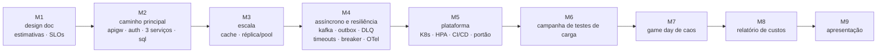

O projeto é entregue em **nove marcos**. Cada um acrescenta uma camada ao mesmo sistema, na ordem em que as aulas a ensinam, para que vocês nunca construam algo que ainda não viram em aula — e nunca deixem tudo para as duas últimas semanas. Cada marco tem **critérios de aceitação que vocês mesmos podem conferir** antes do prazo, e um **check-in** curto em aula.

Cada marco é avaliado pela tag `m<n>` enviada até o prazo (semana indicada em cada seção; datas na [página de planejamento](../../../planning.md)) e pelo check-in. O M1 e os M6–M9 têm páginas próprias com detalhes e rubricas; os M2–M5 compartilham a [rubrica no fim desta página](#rubric-for-m2m5).

## M1 — Design doc e estimativas { #m1-design-doc-estimates }

**Semana 5 · 10% · tag `m1`.** Combinem o que estão construindo, de que tamanho é e como vão provar que funciona.

- [ ] Design doc com todas as seções, complementos do projeto, tabela de SLOs e modelo de capacidade.
- [ ] Pelo menos três ADRs, registro de riscos, tabela de responsabilidades.
- [ ] Escala de teste combinada com o professor.

Detalhes, template e rubrica: [design doc](../design-doc/index.md). Relacionados: exercícios de [estimativas](../../estimation/index.md) e de [design doc](../../design-doc/index.md).

**Perguntas do check-in:** Qual SLO é o mais difícil de cumprir, e por quê? Qual número das estimativas guia a maior decisão? Quem é responsável pelo quê?

## M2 — Caminho principal rodando { #m2-core-path-running }

**Semana 7 · 10% · tag `m2`.** O caso de uso principal funciona de ponta a ponta, localmente, com um comando.

**Critérios de aceitação**

- [ ] `docker compose up` a partir de um clone limpo deixa todos os contêineres **saudáveis** em **menos de 3 minutos** (health checks no `compose.yaml`).
- [ ] O **caso de uso principal** funciona de ponta a ponta pelo ponto de entrada (por exemplo, BoxOffice: listar eventos → reservar assentos → confirmar pedido), mostrado por um script ou por um smoke test k6.
- [ ] O **gateway** (`apigw`) roteia para pelo menos **três serviços próprios**, cada um com o **seu próprio schema/banco** e migrações (Flyway ou equivalente).
- [ ] **Autenticação**: o login emite um JWT (ou token OIDC); pelo menos uma rota é protegida e devolve **401** sem token; pelo menos uma rota é aberta.
- [ ] **Rate limiting** em pelo menos uma rota no gateway, mostrado por uma rajada que recebe **429**.
- [ ] **Smoke test k6** (≥ 30 s, taxa baixa) no caso de uso principal passa com **0 erros**, versionado com o seu resumo.
- [ ] OpenAPI disponível para todos os serviços.

**Evidências na documentação:** diagrama da arquitetura como construída, como executar, resumo do smoke test, uma gravação de tela curta ou log de terminal do caso de uso principal.

**Relacionados:** [Lab 1](../../../hands-on/1/index.md) (primeiro serviço), [Lab 2](../../../hands-on/2/index.md) (k6), [Lab 3](../../../hands-on/3/index.md) (borda), [Lab 4](../../../hands-on/4/index.md) (gateway e identidade).

**Perguntas do check-in:** O que acontece se o serviço de autenticação cair — quais rotas continuam funcionando? Onde o rate limit é aplicado e com qual algoritmo? Mostre os dados de um serviço: outro serviço conseguiria escrevê-los?

## M3 — Escala e cache { #m3-scale-cache }

**Semana 9 · 10% · tag `m3`.** Tornem barato o caminho de leitura quente e provem isso com números.

**Critérios de aceitação**

- [ ] Um **cache** (`cache`, Redis) no caminho de leitura mais quente, com TTL e **invalidação na escrita**; métricas de hit/miss expostas.
- [ ] Uma **réplica de leitura** com roteamento leitura/escrita **ou** um pooler de conexões (PgBouncer) — escolhido e justificado por uma medição.
- [ ] Pelo menos **duas réplicas** do serviço mais quente atrás de um balanceador de carga (Nginx ou o gateway), com health checks.
- [ ] **Teste k6 de antes/depois** com o mesmo script, os mesmos dados e os mesmos recursos: taxa de acerto **≥ 80%** em regime (ou um valor menor justificado para a sua carga), p99 e joelho antes vs depois.
- [ ] A escrita crítica (por exemplo, reserva de assento) é **consistente sob concorrência**: um teste k6 com tentativas simultâneas sobre o mesmo item mostra **nenhuma venda/atribuição duplicada** (consulta de verificação versionada).
- [ ] Modelo de capacidade do design doc atualizado com a capacidade medida por instância.

**Evidências na documentação:** tabela de antes/depois, taxa de acerto, gráfico do joelho, saída da verificação de consistência, entrada no changelog do design doc.

**Relacionados:** [Lab 5](../../../hands-on/5/index.md) (cache), [Lab 6](../../../hands-on/6/index.md) (dados em escala), exercícios de [cache e banco de dados](../../cache-db/index.md) e de [relatório de teste de carga](../../load-test-report/index.md).

**Perguntas do check-in:** O que aconteceria com o banco se o Redis fosse esvaziado agora? Mostre a consulta que prova que não há venda duplicada. Qual é o seu novo gargalo?

## M4 — Assíncrono e resiliência { #m4-async-resilience }

**Semana 12 · 10% · tag `m4`.** Tirem o trabalho lento do caminho da requisição, sobrevivam a dependências lentas e enxerguem o que está acontecendo.

**Critérios de aceitação**

- [ ] Um **broker** (`kafka`, `queue` ou `pubsub`) transporta pelo menos um evento de negócio entre dois serviços.
- [ ] **Outbox transacional** no produtor **ou** **consumidor idempotente** (idealmente os dois) — verificado por uma consulta de reconciliação depois de uma execução em que o consumidor é derrubado: **0 perdidos, 0 duplicados**.
- [ ] Retentativas com backoff e uma **DLQ/DLT**; uma mensagem envenenada termina lá e o processamento continua.
- [ ] Na chamada à dependência lenta/externa (`payment`, `thirdparty`, `email` ou `llmgw`): **timeout + retentativa com backoff exponencial e jitter + circuit breaker** (Resilience4j ou equivalente), com fallback ou um erro claro.
- [ ] Demonstração com **Toxiproxy** (ou equivalente): com 2 s de latência injetada na dependência, o p99 do ponto de entrada fica limitado e as threads não se esgotam (números de antes/depois).
- [ ] **Observabilidade**: traces OpenTelemetry atravessando pelo menos três serviços (uma captura de um trace que passa pelo broker), um **dashboard RED** (taxa, erros, duração) por serviço e um **alerta de burn rate de SLO** que dispara em um teste.

**Evidências na documentação:** diagrama do fluxo de eventos, schema do envelope, saída da reconciliação, tabela do experimento com Toxiproxy, capturas do dashboard e do trace, definição do alerta.

**Relacionados:** [Lab 7](../../../hands-on/7/index.md) (assíncrono), [Lab 8](../../../hands-on/8/index.md) (observabilidade), [Lab 9](../../../hands-on/9/index.md) (resiliência e caos), exercício [orientado a eventos](../../event-driven/index.md); opção de IA: [Lab 12](../../../hands-on/12/index.md).

**Perguntas do check-in:** Derrubem o consumidor agora — o que acontece com os eventos, e como vocês sabem que nenhum se perde? Por que esse valor de timeout? Abram o dashboard: qual serviço é o mais lento e por quê?

## M5 — Kubernetes + CI/CD { #m5-kubernetes-cicd }

**Semana 14 · 10% · tag `m5`.** Rodem sobre uma plataforma e entreguem cada mudança de forma automática e segura.

**Critérios de aceitação**

- [ ] Todos os serviços rodam no **Kubernetes** (kind/minikube ou um cluster na nuvem) a partir de manifestos no repositório (YAML puro, Kustomize ou Helm), com **requests/limits**, **probes de startup/readiness/liveness**, desligamento gracioso e um **Ingress** (ou Gateway API).
- [ ] Um **HPA** em pelo menos um serviço **escala sob uma carga k6** e volta (gráfico de réplicas ao longo do tempo).
- [ ] **Zero requisições com falha** durante uma atualização gradual sob carga estável.
- [ ] **CI** (GitHub Actions) em todo pull request: build, testes unitários, imagem de contêiner, **varredura da imagem** (por exemplo, Trivy) falhando em vulnerabilidades críticas, **SBOM** gerado e guardado como artefato.
- [ ] **Portão de desempenho**: um teste k6 smoke/curto com thresholds de SLO roda na CI e **bloqueia o merge** quando um threshold falha (mostrem uma execução vermelha).
- [ ] **CD**: o merge na `main` implanta no cluster (GitOps com Argo CD, ou um job de deploy), com rollback documentado.
- [ ] Segredos não estão no repositório (Secrets do Kubernetes a partir de secrets da CI, ou Sealed Secrets/External Secrets).

**Extra opcional nível A:** acrescentem ao pipeline uma etapa de IA do [Lab 13 — IA na CI/CD](../../../hands-on/13/index.md) (por exemplo, um revisor de pull requests com IA ou análise de canary explicada por IA), com uma breve avaliação do que ela pegou e do que errou.

**Evidências na documentação:** diagrama do cluster, links dos manifestos, gráfico do HPA, resumo do k6 da atualização gradual, links para uma execução verde e uma vermelha da CI, artefato do SBOM, procedimento de implantação e de rollback.

**Relacionados:** [Lab 10](../../../hands-on/10/index.md) (Kubernetes), [Lab 11](../../../hands-on/11/index.md) (entrega), exercício de [autoscaling no Kubernetes](../../kubernetes-autoscaling/index.md).

**Perguntas do check-in:** Enviem uma mudança que quebra um threshold — o que acontece? Como vocês fazem rollback, e quanto tempo leva? O que limita o seu `maxReplicas`?

## M6 — Campanha de testes de carga { #m6-load-test-campaign }

**Semana 16 · 15% · tag `m6`.** Provem, com uma campanha k6 rigorosa, que o sistema cumpre os SLOs da escala de teste — e encontrem onde ele deixa de cumpri-los.

- [ ] Plano da campanha, scripts, resultados brutos e relatório.
- [ ] SLOs da escala de teste cumpridos por ≥ 10 minutos em 3 repetições; joelho e gargalo identificados; ≥ 2 iterações de melhoria.

Detalhes, template e rubrica: [campanha de testes de carga](../load-test-campaign/index.md). Relacionados: [Aula 15](../../../classes/performance/index.md), [Lab 2](../../../hands-on/2/index.md).

**Perguntas do check-in:** Com que carga o primeiro SLO quebra, e qual recurso causa isso? Qual iteração mais ajudou? Como vocês sabem que o gerador de carga não era o gargalo?

## M7 — Game day de caos { #m7-chaos-game-day }

**Semana 17 · 10% · tag `m7`.** Quebrem o sistema de propósito, sob carga, na frente da turma — e aprendam com isso.

- [ ] Pelo menos três experimentos planejados mais uma falha surpresa injetada pelo professor.
- [ ] Relatório com observações, impacto nos SLOs, tempo para detectar/mitigar e ações.

Detalhes, templates e rubrica: [game day](../game-day/index.md). Relacionados: [Aula 9](../../../classes/reliability/index.md), [Lab 9](../../../hands-on/9/index.md).

**Perguntas do check-in:** Qual experimento surpreendeu vocês? Como detectaram a falha surpresa — alerta, dashboard ou um usuário? Qual ação é a mais importante?

## M8 — Relatório de custos { #m8-cost-report }

**Semana 18 · 10% · tag `m8`.** Coloquem preço na escala de projeto e no que vocês realmente executaram, e liguem o custo às suas medições.

- [ ] Custo mensal da escala de projeto com lista de componentes, economia unitária e análise de sensibilidade.
- [ ] Atualização final do design doc (changelog completo).

Detalhes, template e rubrica: [relatório de custos](../cost-report/index.md). Relacionados: [Aula 12](../../../classes/cloud-native/index.md).

**Perguntas do check-in:** Qual é o custo de um ingresso vendido (ou mensagem, corrida, visualização, conversa)? O que domina a conta? O que vocês mudariam para cortá-la pela metade?

## M9 — Apresentação final { #m9-final-presentation }

**Semanas 19–20 · 10% · tag `final`.** Mostrem o sistema funcionando, as evidências de que ele cumpre as suas metas e o que aprenderam.

- [ ] Apresentação de 15 minutos + demonstração ao vivo + 10 minutos de perguntas; todos os membros apresentam.
- [ ] Vídeo de 3 minutos e documentação final.

Detalhes, template e rubrica: [apresentação](../presentation/index.md).

## Rubrica dos M2–M5 { #rubric-for-m2m5 }

Níveis conforme definidos em [Como os exercícios são avaliados](../../index.md#how-the-exercises-are-graded).

| Critério | I | D | C | B | A |
|-|-|-|-|-|-|
| Critérios de aceitação **(obrigatório)** | Tag ausente ou o sistema não roda | Pelo menos um critério não atendido | Todos os critérios atendidos | Todos atendidos com folga (por exemplo, números melhores que o exigido) | Todos atendidos mais um extra relevante (por exemplo, a etapa de IA do M5, relay por CDC, testes com várias instâncias) |
| Evidências e medições | Nenhuma | Afirmações sem evidência | Cada critério tem evidência na documentação | Números interpretados, antes/depois explicado | Evidências reproduzíveis pelo leitor com um comando |
| Qualidade do código e da configuração | Quebrado | Frágil, segredos ou valores fixos no código | Limpo, configuração externalizada, migrações | Testes nos caminhos críticos, convenções consistentes | Código que um membro novo conseguiria estender em um dia |
| Documentação | Ausente | Desatualizada ou incompleta | Seção do marco completa, changelog do design doc atualizado | Diagramas claros e ADRs para as mudanças | Lições aprendidas e limitações conhecidas declaradas com honestidade |
| Check-in | Ausente | Não consegue demonstrar nem responder | A demonstração funciona, os responsáveis respondem às perguntas | Qualquer membro responde a qualquer pergunta | A equipe antecipa as perguntas seguintes |

## Check-ins

Cada marco tem um **check-in de 10 minutos** em aula na sua semana:

1. **Demonstração a partir de um clone limpo da tag** (2–3 minutos): `git clone`, checkout da tag, um comando, o caso de uso funcionando. Nada de "funcionava na minha máquina".
2. **Percurso pelas evidências** (2–3 minutos): a seção do marco na documentação.
3. **Perguntas** (4–5 minutos): o professor escolhe **qualquer membro** para cada pergunta (há exemplos em cada marco). Os responsáveis podem complementar, mas todo membro precisa saber responder o básico.

Um check-in perdido sem justificativa limita o marco a D. Problemas descobertos em um check-in podem ser corrigidos até o prazo da mesma semana.
