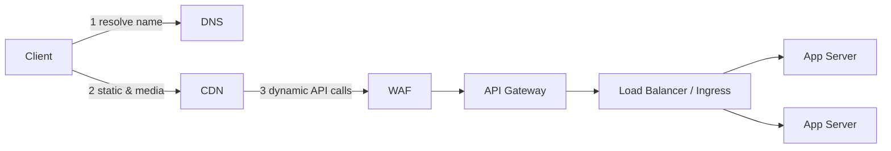

# Traffic & Edge

The **edge** is everything between the client and your application code: it finds your servers (DNS), serves what can be served from close to the user (CDN), spreads the traffic over many replicas (load balancer), blocks what should never reach you (WAF), and applies the cross-cutting rules of your API — authentication, rate limits, routing (API gateway, Ingress). A request that is answered or rejected at the edge is the cheapest request you will ever serve.

In BoxOffice, the edge is what keeps the 10:00 flash sale alive: the event page and images come from the CDN, bots are filtered by the WAF, the API gateway limits each user to a few purchase attempts per minute, and the load balancer spreads the survivors over the `inventory` and `order` replicas.

| Component | One-liner | Playground id |
|---|---|---|
| [DNS](#dns) | Translates names into IP addresses; can steer users by geography, weight or health | `dns` |
| [CDN](#cdn) | A worldwide cache of your content, close to the users | `cdn` |
| [Load Balancer](#lb) | Spreads requests over healthy replicas (L4 or L7) | `lb` |
| [WAF](#waf) | Filters malicious HTTP traffic: injection, bots, abusive patterns | `waf` |
| [API Gateway](#apigw) | Single front door of the API: auth, rate limiting, routing, BFF | `apigw` |
| [Ingress](#ingress) | The Kubernetes way to route external HTTP traffic to services | `ingress` |

---

## DNS { #dns }

**What it is.** The Domain Name System is the internet's phone book: it turns `api.boxoffice.example` into an IP address. Resolution goes from the client's stub resolver to a recursive resolver (your ISP, 8.8.8.8, 1.1.1.1), which asks the root, the top-level domain (`.example`) and finally your **authoritative** name servers. Answers are cached for the record's **TTL** (time to live). Managed DNS services add *traffic steering*: different answers by the user's location (GeoDNS), by weight (canary) or by health (failover).

**When to use.**

- Always — every public system has DNS. The design question is which **routing policy** to use.
- **Failover between regions**: health-checked records answer with the secondary region when the primary is down (scenario `multi-region`).
- **Latency/geo routing**: send Brazilian users to `sa-east-1` and European users to `eu-west-1`.
- **Weighted routing** for migrations and canaries at the coarsest level (10% of the users to the new stack).

**When not to (or watch out).**

- DNS is **not** a fast load balancer: clients and resolvers cache answers and some ignore the TTL, so changes take seconds to many minutes to propagate.
- Do not rely on DNS round robin for health: a dead IP may keep receiving traffic until caches expire. Put a load balancer behind DNS.
- Very low TTLs (a few seconds) increase query volume and latency for little gain.

**Key numbers.**

| Metric | Typical value | Note |
|---|---|---|
| Lookup answered from a nearby resolver's cache | ≈ 1–10 ms | Most lookups |
| Full recursive lookup (cache miss) | ≈ 20–120 ms | Several round trips: root → TLD → authoritative |
| Common TTLs | 60–300 s for failover records; hours for stable records | Trade-off: agility vs query volume |
| Failover time with health-checked DNS | ≈ health-check interval × threshold + TTL | e.g. 3 × 10 s + 60 s ≈ 1.5 min (≈ illustrative) |
| Anycast | one IP announced from many locations | Used by large DNS providers and CDNs to answer from the nearest site |

**Failure modes.**

- **DNS provider outage** — nobody can resolve your name even though the servers are fine → a second DNS provider, long TTLs on stable records.
- **Slow failover** — cached answers point to the dead region → shorter TTL on failover records, a load balancer with health checks behind each name.
- **Misconfiguration** — a wrong record or an expired domain takes the whole site down → infrastructure as code, review, monitoring of the resolution from outside.
- **DDoS on the name servers** → anycast DNS provider with DDoS protection.

**In the playground.** `dns` is a **split** node: it distributes requests among its targets. Its routing mode can be `failover` (primary/secondary: all traffic goes to the primary while it is healthy) or `weighted` (proportional split). Failure detection (≈ 30 s, ≈ 3 s with a health check) plus the answers cached by clients for `ttlS` (default 60 s) make failover take time — watch the error spike during a region outage. Scenarios: [`multi-region`](../../../../playground/scenarios/index.md#multi-region), [`cdn-static`](../../../../playground/scenarios/index.md#cdn-static).

**Real products.**

=== "AWS"

    - **Amazon Route 53** — authoritative DNS with health checks and routing policies (failover, latency, geolocation, weighted).

=== "GCP"

    - **Cloud DNS** — managed authoritative DNS with routing policies (geolocation, weighted round robin, failover).

=== "Azure"

    - **Azure DNS** — managed authoritative DNS.
    - **Azure Traffic Manager** — DNS-based traffic steering (priority, weighted, performance, geographic).

=== "Open source"

    - **CoreDNS** — DNS server used inside Kubernetes for service discovery.
    - **BIND** — the classic authoritative and recursive DNS server.
    - **PowerDNS** — authoritative server and recursor with database back ends.

!!! tip "In the interview"
    "DNS gets users to the right region — GeoDNS for latency, health-checked failover between regions — but its answers are cached, so I never rely on it for fast failover inside a region; that is the load balancer's job."

**Learn more:** [Edge › DNS & CDN](../../../classes/edge/dns-cdn/index.md) · [Reliability › Disaster recovery](../../../classes/reliability/disaster-recovery/index.md) · [Network & security › Cloud network](../../../classes/network-security/cloud-network/index.md)

---

## CDN { #cdn }

**What it is.** A Content Delivery Network is a fleet of caching servers (*edges*, *points of presence*) spread around the world. A user fetches `event-hero.jpg` from an edge a few milliseconds away; only on a **miss** does the edge go to your **origin** (object store or app). Modern CDNs also terminate TLS, absorb DDoS attacks, run small functions at the edge (*edge compute*) and cache API responses when told to.

**When to use.**

- Static assets (JavaScript, CSS, fonts) and media (images, video segments): almost always.
- Read-heavy public content that is the same for everybody: BoxOffice event pages during the flash sale can be cached for a few seconds — 2 M fans reading the same page become a handful of origin requests.
- Video streaming: segments of popular titles are served almost entirely from the edges (scenario `video-streaming`).
- As a shield: the CDN absorbs traffic spikes and attacks before they reach the origin.

**When not to (or watch out).**

- Personalized or sensitive responses (cart, order history) must not be cached in a shared cache: use `Cache-Control: private` or `no-store`.
- Strongly consistent data (seat availability at the moment of purchase) cannot come from a cache that may be seconds old.
- The **cache key** matters: query strings, cookies or headers in the key can explode the number of variants and kill the hit ratio.
- Invalidation is slow and sometimes paid: prefer versioned file names (`app.3f9a1c.js`) over purges.

**Key numbers.**

| Metric | Typical value | Note |
|---|---|---|
| Edge hit latency for a nearby user | ≈ 5–30 ms | vs ≈ 100+ ms to a distant origin |
| Hit ratio for static assets | often > 90% | Lower for long-tail content |
| Origin load with hit ratio *h* | (1 − *h*) × requests | 95% hit ⇒ origin sees 1/20 of the traffic |
| Invalidation propagation | seconds to minutes | Depends on the provider |
| Egress price | ≈ USD 0.02–0.09 per GB | ≈ approximate list prices (2026); falls with volume |

**Failure modes.**

- **Cold cache / purge storm** — after a deploy or a full purge, every request goes to the origin → stagger purges, use versioned URLs, *origin shield* (a mid-tier cache).
- **Cache stampede on a popular object expiring** → request coalescing at the edge, `stale-while-revalidate`.
- **Caching private data** — one user sees another user's page → correct `Cache-Control`, never cache responses that set cookies.
- **Stale content** — a cancelled event still shows "on sale" → short TTL for dynamic pages, purge on change.
- **CDN provider outage** → multi-CDN with DNS steering for the most critical properties.

**In the playground.** `cdn` is a **cache** node: reads hit with probability `hitRatio` and return from the edge with a short latency (≈ 15 ms median); misses and writes are forwarded to the origin. Events such as a cache flush drop the hit ratio to 0 and it warms up over `cacheWarmS` (default 60 s) — watch the origin load jump. Cost includes egress per GB (`respKB`, default 50 KB per response, at ≈ 0.03 USD/GB). Scenarios: [`cdn-static`](../../../../playground/scenarios/index.md#cdn-static), [`video-streaming`](../../../../playground/scenarios/index.md#video-streaming), [`flash-sale`](../../../../playground/scenarios/index.md#flash-sale).

**Real products.**

=== "AWS"

    - **Amazon CloudFront** — global CDN with Lambda@Edge and CloudFront Functions for edge compute.

=== "GCP"

    - **Cloud CDN** — CDN integrated with the Google Cloud external load balancer.
    - **Media CDN** — CDN for large-scale video and media delivery.

=== "Azure"

    - **Azure Front Door** — global CDN + layer-7 load balancer with WAF.

=== "Open source"

    - **Varnish Cache** — HTTP reverse-proxy cache, programmable with VCL.
    - **Nginx** — `proxy_cache` turns it into a caching reverse proxy.
    - **Apache Traffic Server** — caching proxy used by large CDNs.
    - Commercial CDNs often compared: Cloudflare, Akamai, Fastly.

!!! tip "In the interview"
    "Everything that is the same for every user goes through the CDN: static assets with versioned URLs and long TTLs, and even the event page with a few seconds of TTL during the on-sale. With a 95% hit ratio the origin sees one request in twenty; anything personal or strongly consistent bypasses the CDN."

**Learn more:** [Edge › DNS & CDN](../../../classes/edge/dns-cdn/index.md) · [Caching › Patterns](../../../classes/caching/patterns/index.md) · [Case study: video streaming](../../../classes/case-studies/video-streaming/index.md) · [Case study: ticketing](../../../classes/case-studies/ticketing/index.md)

---

## Load Balancer { #lb }

**What it is.** A load balancer receives connections on one address and spreads them across a pool of **healthy** backends. A **layer-4** (L4) balancer works with TCP/UDP connections and does not look inside them — very fast, protocol agnostic. A **layer-7** (L7) balancer understands HTTP: it can route by path or header, terminate TLS, retry, and spread individual requests of a long-lived connection. Health checks remove broken replicas from the pool.

**When to use.**

- As soon as there is more than one replica of anything: it is what makes **horizontal scaling** and zero-downtime deploys possible.
- To hide failures: a crashed replica is removed after a few failed health checks.
- L7 when you need path-based routing (`/api/catalog` → catalog, `/api/orders` → order), TLS termination, HTTP/2 or gRPC balancing.
- L4 for raw TCP (databases, MQTT), extreme throughput or when TLS must reach the backend untouched.

**When not to (or watch out).**

- The load balancer itself must be redundant (managed LBs are; a single Nginx VM is a single point of failure).
- **Sticky sessions** pin users to replicas and break even distribution and failover; prefer stateless app servers with session data in a cache.
- Round robin ignores load: for requests with very different costs, use least-connections or least-outstanding-requests.
- L4 balancing of long-lived connections (gRPC, WebSockets) can leave new replicas idle — balance per request (L7) or reconnect periodically.

**Key numbers.**

| Metric | Typical value | Note |
|---|---|---|
| Added latency | L4: ≪ 1 ms; L7: ≈ 1 ms or less | Plus TLS termination if done there |
| Health check | interval 5–30 s, 2–3 failures to remove | Detection time ≈ interval × threshold |
| Capacity of a managed LB | scales to millions of req/s | Some need "pre-warming" for sudden huge spikes |
| Software LB on one VM (Nginx/HAProxy) | tens of thousands of req/s per core | ≈ illustrative; depends on TLS and payload |

**Failure modes.**

- **Routing to a dead replica** until health checks notice → short intervals, passive health checks (outlier detection), retries of idempotent requests on another replica.
- **Uneven load** — one replica gets the slow requests → least-outstanding-requests, consistent hashing only when needed.
- **Health check that lies** — `/health` returns 200 while the database is unreachable (or returns 500 because a non-critical dependency is down, emptying the pool) → separate liveness and readiness, check only what the instance needs to serve.
- **Connection draining missing** — deploys cut in-flight requests → deregistration delay, graceful shutdown.

**In the playground.** `lb` is a **split** node: requests are distributed among healthy targets, proportionally to capacity (round robin weighted by capacity). Without a [`healthcheck`](../observability/index.md#healthcheck) node, a crashed replica is detected after ≈ 30 s; with one, after ≈ 3 s — run a chaos profile and compare the error spikes. Scenarios: [`scale-out`](../../../../playground/scenarios/index.md#scale-out), [`monolith`](../../../../playground/scenarios/index.md#monolith), [`db-replicas`](../../../../playground/scenarios/index.md#db-replicas).

**Real products.**

=== "AWS"

    - **Application Load Balancer (ALB)** — layer 7, path/host routing, HTTP/2, gRPC, WebSockets.
    - **Network Load Balancer (NLB)** — layer 4, very high throughput, static IPs.

=== "GCP"

    - **Cloud Load Balancing** — global external Application Load Balancer (L7, anycast IP) and Network Load Balancers (L4).

=== "Azure"

    - **Azure Load Balancer** — layer 4.
    - **Azure Application Gateway** — layer 7 with optional WAF.

=== "Open source"

    - **HAProxy** — high-performance L4/L7 load balancer.
    - **Nginx** — web server and L7 reverse proxy / load balancer (used in Hands-on 3).
    - **Envoy** — L7 proxy with advanced load balancing, used by service meshes.
    - **Traefik** — reverse proxy with automatic service discovery.

!!! tip "In the interview"
    "Stateless app servers behind an L7 load balancer with health checks: I scale by adding replicas, a crashed one leaves the pool in seconds, and the balancer itself is a managed, redundant service — not a single box."

**Learn more:** [Edge › Load balancing](../../../classes/edge/load-balancing/index.md) · [Compute › Services](../../../classes/compute/services/index.md) · [Intro › Scaling journey](../../../classes/intro/scaling-journey/index.md) · [Hands-on 3](../../../hands-on/3/index.md)

---

## WAF { #waf }

**What it is.** A Web Application Firewall inspects HTTP requests and blocks the ones that match attack patterns: SQL injection, cross-site scripting (XSS), path traversal, known exploits, and abusive behavior (too many requests per IP, suspicious user agents, bots). It usually runs at the edge — attached to the CDN, the load balancer or the API gateway — with **managed rule sets** maintained by the vendor plus your own rules.

**When to use.**

- In front of every public HTTP endpoint, especially login, search and checkout.
- Against bots and scalpers in BoxOffice: rate rules per IP/fingerprint, CAPTCHA or JavaScript challenges on the purchase flow, geo rules.
- For a quick "virtual patch" when a vulnerability is disclosed and the code fix takes days.
- As part of DDoS protection at layer 7 (HTTP floods).

**When not to (or watch out).**

- It is a safety net, not a substitute for secure code: parameterized queries, output encoding and authorization checks still belong in the application.
- **False positives** block real customers (a band name with an apostrophe looks like SQL injection) → start rules in "count/log" mode, then enforce.
- Rate limits by IP punish users behind carrier-grade NAT (a whole stadium on a few IPs) → combine with user/session identity at the API gateway.

**Key numbers.**

| Metric | Typical value | Note |
|---|---|---|
| Added latency | ≈ < 1 ms to a few ms | Depends on the number and kind of rules |
| Rule evaluation | per request, at the edge | Blocked requests never reach your origin |
| Price model | per rule set + per million requests inspected | ≈ illustrative; check the provider |
| Share of bot traffic on public sites | often a large fraction during sales | ≈ illustrative; measure your own traffic |

**Failure modes.**

- **False positives** — legitimate purchases blocked → monitoring of blocked requests, exceptions per path, staged rollout of rules.
- **Fail-open vs fail-closed** — if the WAF fails, do you let everything through or block everything? Decide per endpoint.
- **Bypass** — attackers hit the origin directly → allow traffic to the origin only from the CDN/WAF IP ranges or through a private connection.
- **Rule update breaks traffic** → version rules as code, test before enabling.

**In the playground.** `waf` is a **call** node in the request path with a small latency (≈ 1 ms) and a capacity like any other node; it stops a share `blockRate` (default 0.95) of the clients' bot traffic (`botShare`) and costs money per request. Place it between the client/CDN and the gateway to see its effect on latency and cost. Chaos events such as viral spikes and flash crowds show why bot filtering at the edge protects the backend. Scenarios: [`flash-sale`](../../../../playground/scenarios/index.md#flash-sale), [`rate-limiter`](../../../../playground/scenarios/index.md#rate-limiter).

**Real products.**

=== "AWS"

    - **AWS WAF** — managed rules, rate-based rules, Bot Control; attaches to CloudFront, ALB and API Gateway.
    - **AWS Shield** — DDoS protection (Standard included; Advanced paid).

=== "GCP"

    - **Google Cloud Armor** — WAF and DDoS protection for the external Application Load Balancer, with preconfigured OWASP rules and rate limiting.

=== "Azure"

    - **Azure Web Application Firewall** — on Front Door and Application Gateway.
    - **Azure DDoS Protection** — network-level DDoS mitigation.

=== "Open source"

    - **ModSecurity** with the **OWASP Core Rule Set (CRS)** — the classic open-source WAF engine and rules.
    - **Coraza** — WAF engine in Go, compatible with ModSecurity rules and the CRS.

!!! tip "In the interview"
    "At the edge I put a WAF with managed OWASP rules and bot protection on the purchase flow; it stops injection attempts and scalper bots before they cost me a single database query. It is a safety net — the application still validates and authorizes everything."

**Learn more:** [Edge (overview)](../../../classes/edge/index.md) · [Network & security › Zero trust](../../../classes/network-security/zero-trust/index.md) · [Case study: ticketing](../../../classes/case-studies/ticketing/index.md)

---

## API Gateway { #apigw }

**What it is.** The single front door of your API. Clients call one host; the gateway **routes** each request to the right service and applies cross-cutting concerns in one place: authentication (validating JWTs), **rate limiting** and quotas, request/response transformation, caching, CORS, API keys, observability. A **BFF** (Backend for Frontend) is a gateway tailored to one client type, aggregating several service calls into one response for a mobile screen.

**When to use.**

- With several services behind one public API (BoxOffice: `catalog`, `inventory`, `order`, `search`, `assistant`).
- To protect the backend: per-user and per-endpoint rate limits (token bucket, sliding window) answering `429 Too Many Requests` with `Retry-After`.
- To centralize token validation so each service does not reimplement it.
- To publish APIs to partners (API keys, usage plans, developer portal).

**When not to (or watch out).**

- Do not put business logic in the gateway; it becomes a distributed monolith that every team must change.
- It is in the path of every request: it must be redundant, autoscaled and fast.
- Rate limiting across many gateway replicas needs shared state (Redis) or approximate local limits.
- For a single service, a load balancer may be enough.

**Key numbers.**

| Metric | Typical value | Note |
|---|---|---|
| Added latency | ≈ 1–10 ms | More with plugins (token introspection, transformations) |
| Rate-limit check in Redis | ≈ 0.5–1 ms | One round trip, atomic with a Lua script |
| HTTP status for throttling | `429` + `Retry-After` | `503` is for overload of the server itself |
| BoxOffice purchase limit | e.g. 5 attempts/min per user | ≈ illustrative policy |

**Failure modes.**

- **Gateway overload** — it becomes the bottleneck → autoscaling, keep plugins light, shed load early.
- **Rate-limiter store down** → choose fail-open (availability) or fail-closed (protection) per route; fall back to local in-memory limits.
- **Timeouts not set** — a slow service holds gateway connections and the gateway dies with it → per-route timeouts, circuit breakers.
- **Retries at every layer** (client, gateway, service) multiply the load → retry in one layer only, with backoff and budget.

**In the playground.** `apigw` is a **call** node (and a **split** node when it has two or more targets of the same type). Its `rateLimit` (default 0 = off) caps the accepted rate: the excess is rejected with errors (429) instead of overloading the backend. Edge parameters on its outgoing calls (`timeoutMs`, `retries`, `backoff`, `circuitBreaker`) model the resilience policies. Scenarios: [`rate-limiter`](../../../../playground/scenarios/index.md#rate-limiter), [`retry-storm`](../../../../playground/scenarios/index.md#retry-storm), [`flash-sale`](../../../../playground/scenarios/index.md#flash-sale).

**Real products.**

=== "AWS"

    - **Amazon API Gateway** — managed REST, HTTP and WebSocket APIs with throttling, usage plans and authorizers.

=== "GCP"

    - **Apigee** — full API management platform.
    - **API Gateway** — lightweight managed gateway for serverless back ends.

=== "Azure"

    - **Azure API Management** — gateway, policies, developer portal.

=== "Open source"

    - **Spring Cloud Gateway** — Java gateway used in the course (Hands-on 4).
    - **Kong Gateway** — Nginx/OpenResty-based gateway with plugins.
    - **Envoy Gateway**, **Apache APISIX**, **Tyk** — other open-source gateways.

!!! tip "In the interview"
    "One API gateway in front of the services validates the JWT once, routes by path and enforces a token-bucket rate limit per user backed by Redis, answering 429 with Retry-After. Business logic stays in the services; the gateway stays thin, redundant and fast."

**Learn more:** [Edge › API gateway](../../../classes/edge/api-gateway/index.md) · [Case study: rate limiter](../../../classes/case-studies/rate-limiter/index.md) · [Network & security › Identity](../../../classes/network-security/identity/index.md) · [Hands-on 4](../../../hands-on/4/index.md)

---

## Ingress { #ingress }

**What it is.** In Kubernetes, an **Ingress** is a resource that declares how external HTTP(S) traffic reaches the cluster's Services (`boxoffice.example/api/catalog` → Service `catalog`). The rules are executed by an **Ingress controller** (Nginx, Traefik, a cloud load balancer). The newer **Gateway API** (`Gateway`, `HTTPRoute`, …) is the successor: more expressive (header matching, traffic splitting for canaries) and with roles split between platform and application teams.

**When to use.**

- Whenever services run on Kubernetes and must be reachable from outside over HTTP(S).
- For path/host routing, TLS termination with automatically renewed certificates (cert-manager), and canary traffic splits (Gateway API).
- To keep routing **declarative** and versioned with the application manifests (GitOps).

**When not to (or watch out).**

- Ingress handles HTTP(S); raw TCP/UDP needs a `Service` of type `LoadBalancer` or Gateway API routes for TCP/UDP.
- The original Ingress API is limited; advanced behavior lives in controller-specific annotations that do not port between controllers. Prefer the Gateway API for new designs.
- The controller pods are in the path of every request: run several replicas and give them resources.

**Key numbers.**

| Metric | Typical value | Note |
|---|---|---|
| Added latency | ≈ 1 ms or less | One L7 proxy hop |
| Controller replicas | ≥ 2, spread over zones | Avoid a single point of failure |
| Config reload after a change | seconds | Some controllers reload without dropping connections |
| Certificate renewal (Let's Encrypt via cert-manager) | automatic, certificates valid 90 days | Renewed well before expiry |

**Failure modes.**

- **Controller not redundant or under-provisioned** → several replicas, autoscaling, pod disruption budgets.
- **Bad rule shadows another route** → review, tests of the routing table, Gateway API's clearer precedence.
- **Expired certificate** → cert-manager with alerts on expiry.
- **Readiness not configured** — traffic reaches pods that are still starting → readiness probes on the backends.

**In the playground.** `ingress` is a **split** node like the load balancer: it spreads requests among healthy targets in proportion to their capacity. Use it to model a Kubernetes cluster's entry point in front of app replicas with `autoscale` enabled. Scenarios: [`scale-out`](../../../../playground/scenarios/index.md#scale-out), [`observability-stack`](../../../../playground/scenarios/index.md#observability-stack).

**Real products.**

=== "AWS"

    - **AWS Load Balancer Controller** — implements Ingress (with ALB) and Services of type LoadBalancer (with NLB) on Amazon EKS.

=== "GCP"

    - **GKE Ingress** and **GKE Gateway controller** — implement Ingress and the Gateway API with Google Cloud load balancers.

=== "Azure"

    - **Application Gateway for Containers** — Azure's L7 load balancer for AKS, supports Ingress and the Gateway API.
    - **AKS application routing add-on** — managed Nginx-based ingress.

=== "Open source"

    - **ingress-nginx** — the community Nginx Ingress controller, very common in older clusters; the Kubernetes project announced its retirement (March 2026), so new clusters should pick a Gateway API implementation.
    - **Traefik**, **HAProxy Ingress**, **Contour**, **Envoy Gateway** — other controllers; Envoy Gateway and Contour implement the Gateway API.
    - **cert-manager** — automatic TLS certificates for Ingress and Gateway.

!!! tip "In the interview"
    "On Kubernetes, external traffic enters through an Ingress (or Gateway API) controller that routes by host and path to the Services, terminates TLS with automatic certificates, and can split traffic for a canary. It runs with several replicas because every request passes through it."

**Learn more:** [Edge › API gateway](../../../classes/edge/api-gateway/index.md) · [Cloud-native › Kubernetes](../../../classes/cloud-native/kubernetes/index.md) · [Cloud-native › Delivery](../../../classes/cloud-native/delivery/index.md) · [Hands-on 10](../../../hands-on/10/index.md)
