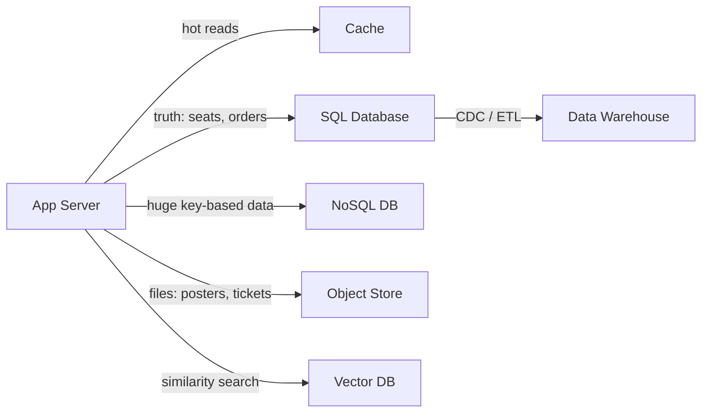

# Storage

**Storage** is where the state of the system lives — and state is what makes systems hard. Compute can be replaced, restarted and multiplied freely; data must survive crashes, be read back correctly and stay consistent when many requests touch it at once. Each storage component in the palette answers a different question: *where is the truth?* (SQL Database), *how does it survive a dead primary, and how much can it lose?* (DB Cluster), *how do I store huge volumes with simple access?* (NoSQL DB), *how do I avoid asking the database again?* (Cache), *where do big files go?* (Object Store), *how do I analyse history?* (Data Warehouse), *how do I find things by meaning?* (Vector DB).

In BoxOffice, the seat inventory and the orders live in PostgreSQL (the truth, with transactions — no double booking); the catalog of events is read millions of times and sits behind a Redis cache; posters, venue maps and PDF tickets go to an object store; sales history flows into a data warehouse for the "best-selling artists" dashboard; and the support assistant finds the right FAQ answer through a vector index.

| Component | One-liner | Playground id |
|---|---|---|
| [SQL Database](#sql) | Relational tables, SQL, transactions: the default system of record | `sql` |
| [DB Cluster](#dbcluster) | Replicated, optionally sharded database with automatic failover | `dbcluster` |
| [NoSQL DB](#nosql) | Key-value, document or wide-column stores that partition horizontally | `nosql` |
| [Cache](#cache) | In-memory copy of hot data: sub-millisecond reads, offloads the database | `cache` |
| [Object Store](#objstore) | Cheap, durable storage of files (blobs) by key, over HTTP | `objstore` |
| [Data Warehouse](#dwh) | Columnar analytical store for large scans and aggregations (OLAP) | `dwh` |
| [Vector DB](#vectordb) | Stores embeddings and finds the nearest ones (similarity search) | `vectordb` |

---

## SQL Database { #sql }

**What it is.** A relational database stores data in **tables** with a fixed schema, related by keys, queried with SQL, and protected by **ACID transactions** (atomicity, consistency, isolation, durability). It is the default **system of record**: the place where the truth lives. Indexes (usually B-trees) make lookups fast; the query planner chooses how to execute each query. To scale, you add **read replicas** (copies that serve reads, fed by the primary's log), connection pooling, and — much later — partitioning (sharding) or a distributed SQL engine.

**When to use.**

- Data with relations and invariants: BoxOffice seats, holds, orders and payments — "a seat is sold at most once" is enforced by a transaction or a unique constraint.
- When you need ad-hoc queries, joins, secondary indexes and reporting on current data.
- As the starting point of almost every system: a single well-indexed PostgreSQL goes much further than most people expect.
- Read-heavy workloads: add read replicas (scenario `db-replicas`) and a cache in front.

**When not to (or watch out).**

- Write volume beyond one primary (millions of writes per second, e.g. location updates of every driver): partition, or use a store designed for it (NoSQL, event log).
- Huge blobs (images, videos): store them in an object store and keep only the key in SQL.
- Replicas scale **reads**, not writes, and they **lag**: a read right after a write may not see it (read-your-writes problem).
- Long transactions and hot rows (every request updating the same counter) serialize the database.
- Each connection costs memory: hundreds of app replicas × a pool of 20 can exhaust the server → use a pooler (PgBouncer).

**Key numbers.**

| Metric | Typical value | Note |
|---|---|---|
| Indexed point query (primary key) | ≈ 0.1–1 ms on the server | Plus a network round trip in the same zone (≈ 0.5 ms) |
| Throughput of one primary | ≈ thousands to tens of thousands of simple queries/s | ≈ illustrative; depends on hardware, query mix, indexes |
| Max connections | hundreds per server (PostgreSQL default `max_connections` = 100) | Use a connection pooler |
| Replication lag (async, same region) | ≈ milliseconds, seconds under heavy write load | Grows with write volume |
| Failover to a standby (managed services) | ≈ 30 s to a few minutes | ≈ approximate; depends on the provider |
| Single-node data size that is comfortable | up to a few TB | Beyond that, partition or archive |

**Failure modes.**

- **Primary failure** → standby with automatic failover (multi-AZ); clients must reconnect and retry idempotently.
- **Connection exhaustion** — app replicas scale out and open too many connections → pooler, smaller pools, limit autoscaling.
- **Slow query / missing index** — one full scan saturates the CPU and every query slows → `EXPLAIN`, indexes, query timeouts.
- **Lock contention / hot row** — thousands of flash-sale requests updating the same rows → short transactions, `SELECT … FOR UPDATE SKIP LOCKED`, a waiting-room queue in front.
- **Replication lag** → users don't see their own writes → read from the primary after writes, or wait for the replica position.
- **Disk full / runaway table growth** → monitoring, retention policies, archiving to object storage.

**In the playground.** `sql` is a **storage** node with separate read and write capacities. `readReplicas` multiplies read capacity by (1 + replicas) while write capacity stays the same, and replication lag grows with the write load. Main parameters: `capacity` (default 3,000 reads/s; a write costs `writeCost` = 3 reads), `latencyMs` (median 4 ms), `threads` (200 connections), `queueLimit` (400), `standby` (multi-AZ failover); incoming edges can carry `timeoutMs`, `retries` and `circuitBreaker`. The client's read % decides how much the replicas help. Scenarios: [`monolith`](../../../../playground/scenarios/index.md#monolith), [`db-replicas`](../../../../playground/scenarios/index.md#db-replicas), [`read-heavy-cache`](../../../../playground/scenarios/index.md#read-heavy-cache), [`flash-sale`](../../../../playground/scenarios/index.md#flash-sale), [`payment-system`](../../../../playground/scenarios/index.md#payment-system).

**Real products.**

=== "AWS"

    - **Amazon RDS** — managed PostgreSQL, MySQL, MariaDB, SQL Server and Oracle, with multi-AZ standby and read replicas.
    - **Amazon Aurora** — PostgreSQL/MySQL-compatible engine with a distributed storage layer and up to 15 read replicas.

=== "GCP"

    - **Cloud SQL** — managed PostgreSQL, MySQL and SQL Server.
    - **AlloyDB for PostgreSQL** — PostgreSQL-compatible, tuned for higher throughput and analytics.
    - **Spanner** — globally distributed SQL database with external consistency (TrueTime).

=== "Azure"

    - **Azure Database for PostgreSQL (Flexible Server)** and **Azure Database for MySQL** — managed open-source engines.
    - **Azure SQL Database** — managed SQL Server engine.

=== "Open source"

    - **PostgreSQL** — the course default: rich SQL, strong transactions, extensions (pgvector, PostGIS).
    - **MySQL** / **MariaDB** — widely used relational databases.
    - **YugabyteDB** — distributed SQL, PostgreSQL-compatible.
    - **Vitess** — sharding layer for MySQL (born at YouTube).
    - **PgBouncer** — lightweight connection pooler for PostgreSQL.

!!! tip "In the interview"
    "The source of truth for seats and orders is a relational database, because I need transactions to guarantee no double booking. I scale reads with replicas and a cache, keep writes on one primary with a standby for failover, and only shard when write volume or data size forces me to."

**Learn more:** [Databases › Data models](../../../classes/databases/models/index.md) · [Databases › Transactions](../../../classes/databases/transactions/index.md) · [Databases › Replication](../../../classes/databases/replication/index.md) · [Case study: ticketing](../../../classes/case-studies/ticketing/index.md) · [Hands-on 1](../../../hands-on/1/index.md) · [Hands-on 6](../../../hands-on/6/index.md)

---

## DB Cluster { #dbcluster }

**What it is.** A database run as a **group of nodes** instead of one server: each **shard** (a slice of the keys) has one **primary** that accepts the writes and **followers** that receive a copy of its log, and a cluster manager (or a consensus protocol such as Raft or Paxos) **detects a dead primary and promotes a follower** automatically. It adds what a single [SQL Database](#sql) node cannot give: read capacity from followers, write capacity from more shards, and survival of a node or zone failure. The two knobs every design must choose are **how a write is acknowledged** — *async* (the primary alone, fast, may lose the last writes on failover), *sync* (the primary plus one follower) or *quorum* (a majority of the shard's nodes) — and **where reads go** (primary only: always fresh; followers too: more capacity, possibly stale).

**When to use.**

- Any system of record that must survive the loss of a machine or an availability zone without losing confirmed data: BoxOffice orders and payments.
- Read-heavy workloads that outgrow one node: reads from followers (when a slightly stale answer is acceptable, e.g. the event catalog).
- Write volume or data size beyond one primary: shard by a key with many distinct, evenly used values (`event_id`, `user_id`).
- When the RPO (data you may lose) and RTO (time you may be down) are explicit requirements: they decide the replication mode and the failover mechanism.

**When not to (or watch out).**

- **Async replication loses data on failover**: the writes still inside the replication lag when the primary dies are gone (RPO > 0). Use sync or quorum for money and seats.
- **Sync and quorum cost latency on every write** (a round trip to a follower, often in another AZ); a single synchronous follower that becomes slow slows all writes — quorum tolerates one slow follower.
- **Followers lag**: reading from them breaks read-your-writes → read your own writes from the primary, or wait for the follower's position.
- **Sharding is hard to undo**: cross-shard joins and transactions become expensive, and a **hot key** (one popular event) saturates its shard while the others idle.
- Failover is not instant: detection plus promotion plus clients reconnecting is typically tens of seconds — the RTO.
- Split brain: two nodes that both believe they are primary corrupt data → consensus-based leader election, fencing.

**Key numbers.**

| Metric | Typical value | Note |
|---|---|---|
| Replication round trip to a follower in another AZ | ≈ 1–2 ms | ≈ illustrative; added to every write with sync or quorum |
| Async replication lag (same region) | ≈ milliseconds; seconds under heavy write load | Lost on failover with async: RPO ≈ the lag at that moment |
| Automatic failover | ≈ 30 s (Aurora: typically under 30 s); ≈ 60–120 s (RDS Multi-AZ instance) | ≈ approximate; detection + promotion + DNS/client reconnection |
| Patroni (PostgreSQL HA) leader lock | `ttl` 30 s, `loop_wait` 10 s | Documented defaults: a dead primary is replaced after ≈ 30 s |
| Majority of a shard | ⌊N/2⌋ + 1 of N nodes | 3 nodes tolerate 1 failure, 5 tolerate 2 |
| Aurora storage | 6 copies in 3 AZs; write quorum 4/6, read quorum 3/6 | Survives the loss of an AZ plus one more copy |
| Theoretical availability of a 3-node shard | 1 − (1 − 0.999)³ ≈ 99.9999999% | Ideal: ignores correlated failures, failover time and bugs |

**Failure modes.**

- **Primary failure** — writes to its shard fail until a follower is promoted (RTO); with async replication the last writes are lost (RPO) → sync/quorum for critical data, idempotent client retries.
- **Slow synchronous follower** — every write waits for it → quorum instead of a single sync follower, alerts on replication latency.
- **Replication lag** → stale reads, users don't see their own writes → read-your-writes routing, lag-aware load balancing, monitoring the lag.
- **Hot shard** — skewed keys send most requests to one shard → better shard key, split hot keys, cache in front.
- **Split brain** — a network partition leaves two primaries → consensus (Raft/Paxos), fencing tokens, majority-only writes.
- **No followers** — a node failure means the shard is down until the node comes back → at least one follower per shard in another AZ.

**In the playground.** `dbcluster` is a **call** node that models a replicated, optionally sharded database. Parameters (defaults in parentheses): `shards` (1; 1–64), `replicasPerShard` (2 followers per shard; 0–5), `replication` (`async`, or `sync` / `quorum`), `readsFrom` (`followers`, or `primary`), `failoverS` (30 s to detect a dead primary and promote a follower), `replRttMs` (2 ms replication round trip to a follower, cross-AZ, lognormal), `capacity` (3,000 reads/s per node), `latencyMs` (4 ms), `threads` (200 connections per node), `writeCost` (3: a write costs 3 reads of capacity) and `price` (450 USD/month per node, illustrative).

- **Capacity.** Writes: shards × capacity ÷ writeCost (only primaries write). Reads: shards × (1 + replicasPerShard) × capacity when reading from followers, shards × capacity when reading from the primary. Keys are spread over the shards with the clients' Zipf skew: the hottest shard receives p₁ + (1 − p₁)/shards of the requests (p₁ = share of the hottest key), so it saturates first; the inspector shows the utilization of the hot shard and of the others.
- **Write latency.** `async`: the primary only. `sync`: + one round trip to the synchronous follower. `quorum`: + the round trip of the ⌊(R+1)/2⌋-th fastest follower (a majority of the shard's 1 + R nodes) — so one slow follower hurts `sync` but not `quorum`. A *latency degradation* event on a DB Cluster slows one follower (the synchronous one) ×5–20.
- **Replication lag** of the followers that are not part of the acknowledgement (all of them with `async`, R − 1 with `sync`, R − ⌊(R+1)/2⌋ with `quorum`) grows with the primary's write utilization ρw, as for the SQL read replicas: lag ≈ 0.02 s + 0.5 · ρw³ ÷ (1 − ρw) s, without bound above ρw = 1. Stale reads ≈ share of reads served by lagging followers × write share × min(1, lag ÷ 1 s) (the playground assumes a client reads back what it wrote about one second later).
- **Primary failure** (random with chaos, injectable with ⚡; an AZ outage also triggers one). The primary of one shard dies: writes to that shard — and reads too with `readsFrom = primary` — fail for `failoverS` (the **RTO**); then a follower is promoted and the shard runs with one node fewer until a replacement joins 120 s later. With `async`, the writes inside the replication lag at that moment are **lost** (lost writes ≈ shard write rate × lag; the report counts them — the **RPO** lesson); with `sync` or `quorum`, no writes are lost, at the price of higher write latency. With `replicasPerShard = 0` there is no failover: the shard is down (reads and writes) for 120 s until the node comes back — no data lost, just unavailable.
- **Cost** = shards × (1 + replicasPerShard) × price. **Theoretical availability**: per shard 1 − (1 − a)^(1+R) with a = 0.999 per node, all shards in series.

Scenarios: [`db-failover`](../../../../playground/scenarios/index.md#db-failover), [`db-replicas`](../../../../playground/scenarios/index.md#db-replicas), [`sharding`](../../../../playground/scenarios/index.md#sharding).

**Real products.**

=== "AWS"

    - **Amazon Aurora** — PostgreSQL/MySQL-compatible; quorum-replicated storage across 3 AZs, up to 15 readers, automatic failover; **Aurora Limitless Database** for sharding.
    - **Amazon RDS Multi-AZ** — a synchronous standby (instance) or two readable standbys (Multi-AZ DB cluster).
    - **Amazon DynamoDB** and **Amazon DocumentDB** — managed partitioned and replicated stores.

=== "GCP"

    - **Cloud SQL** with high availability — a synchronous standby in another zone.
    - **AlloyDB for PostgreSQL** — HA primary plus read pools.
    - **Spanner** — sharded (splits), Paxos-replicated SQL with external consistency.

=== "Azure"

    - **Azure SQL Database** (Business Critical / zone-redundant) and **Azure Database for PostgreSQL** with zone-redundant HA.
    - **Azure Cosmos DB** — partitioned, multi-region, with tunable consistency; **Cosmos DB for PostgreSQL** (Citus).

=== "Open source"

    - **PostgreSQL** with **Patroni** — streaming replication (async, sync or quorum `ANY k`) and automatic failover; **Citus** for sharding.
    - **Vitess** — sharding and failover for MySQL.
    - **CockroachDB**, **YugabyteDB**, **TiDB** — distributed SQL, Raft per range.
    - **MongoDB** replica sets + sharding (write concern `majority`).

!!! tip "In the interview"
    "The orders database is a cluster: a primary and two followers in different zones. Async replication is cheaper on every write but can lose the last writes on failover, so for orders and seats I use quorum (or sync) replication, which means zero data loss and one cross-zone round trip per write. Failover takes about 30 seconds — that's my RTO — and I shard by event only when one primary can't take the writes."

**Learn more:** [Databases › Replication](../../../classes/databases/replication/index.md) · [Databases › Replication lag](../../../classes/databases/replication/index.md#lag) · [Databases › Partitioning](../../../classes/databases/partitioning/index.md) · [Databases › Hot partitions](../../../classes/databases/partitioning/index.md#hot-partitions) · [Databases › Transactions](../../../classes/databases/transactions/index.md) · [Distributed › Consensus › Majorities](../../../classes/distributed/consensus/index.md#majorities) · [Distributed › CAP & PACELC](../../../classes/distributed/cap-pacelc/index.md#pacelc) · [Reliability › Disaster recovery](../../../classes/reliability/disaster-recovery/index.md)

---

## NoSQL DB { #nosql }

**What it is.** "NoSQL" is a family of databases that give up some relational features (joins, multi-row transactions, a fixed schema) in exchange for **horizontal scale** and simple, predictable access by key. The main models are **key-value** (get/put by key), **document** (JSON documents with flexible fields), **wide-column** (rows with many columns, grouped by a partition key) and **graph**. Data is **partitioned** by a key (usually with consistent hashing) across many nodes and **replicated** — often with tunable consistency (quorums R + W > N). Many use **LSM-trees**, which make writes very fast.

**When to use.**

- Very high write rates with simple access patterns: driver locations in ride sharing, chat messages, click streams, IoT readings.
- Data that is naturally accessed by one key: user sessions, shopping carts, a user's timeline, a conversation's messages.
- Predictable latency at any scale when you know the queries up front (you design the table *for* the query).
- Flexible, evolving schemas (document stores) — e.g. event descriptions with different fields per event type.

**When not to (or watch out).**

- Ad-hoc queries, joins and reporting: you can only query efficiently by the partition key (and maybe a sort key). New query = new table or index.
- Multi-item invariants (no double booking across many rows): transactions are limited or absent in many stores.
- The **partition key** decides everything: a bad key (e.g. `event_id` during the flash sale) concentrates the traffic on one partition — a **hot partition** — and the cluster's total capacity does not help.
- Eventual consistency by default: a read may return an old value unless you ask for a stronger level.

**Key numbers.**

| Metric | Typical value | Note |
|---|---|---|
| Single-key read/write latency | ≈ 1–10 ms | At any table size, if the key is well distributed |
| Throughput | scales roughly linearly with nodes/partitions | Until a hot key concentrates load |
| DynamoDB item size limit | 400 KB | Documented limit |
| DynamoDB per-partition limit | ≈ 3,000 read units and 1,000 write units per second | Documented; hence the hot-partition problem |
| Replication factor | 3 is the usual choice | Quorum: W = 2, R = 2 |

**Failure modes.**

- **Hot partition / hot key** — a celebrity post or the flash-sale event receives most of the requests → spread the key (add a suffix/shard number), cache it, or use a dedicated path.
- **Node failure** → replicas serve the data; hinted handoff and anti-entropy repair the missing writes later.
- **Stale reads** under eventual consistency → read with quorum or strong consistency when it matters.
- **Write conflicts** in multi-leader/leaderless setups → last-write-wins (loses data) or application merge; avoid for money.
- **Rebalancing storms** when adding nodes → consistent hashing with virtual nodes; add capacity before the peak.

**In the playground.** `nosql` is a **storage** node whose capacity is `capacity × replicas` — each replica is a partition (defaults 5,000 ops/s × 4). The client's `zipfS` (key popularity skew) concentrates a share of the traffic on one partition: with a hot key, the effective capacity drops to that of a single partition even though the others are idle. The chaos event "hot key / celebrity" makes the skew jump. Parameters: `replicas`, `capacity`, `latencyMs` (3 ms), `writeCost` (1.2). Scenarios: [`sharding`](../../../../playground/scenarios/index.md#sharding), [`chat`](../../../../playground/scenarios/index.md#chat), [`ride-sharing`](../../../../playground/scenarios/index.md#ride-sharing), [`news-feed`](../../../../playground/scenarios/index.md#news-feed), [`url-shortener`](../../../../playground/scenarios/index.md#url-shortener).

**Real products.**

=== "AWS"

    - **Amazon DynamoDB** — serverless key-value and document database with on-demand or provisioned capacity.
    - **Amazon Keyspaces** — managed Cassandra-compatible wide-column service.
    - **Amazon DocumentDB** — MongoDB-compatible document database.

=== "GCP"

    - **Firestore** — serverless document database.
    - **Bigtable** — wide-column store for very large, low-latency workloads (the system described in the Bigtable paper).

=== "Azure"

    - **Azure Cosmos DB** — multi-model, globally distributed database with five selectable consistency levels.

=== "Open source"

    - **Apache Cassandra** — leaderless wide-column store with tunable consistency (Dynamo-style).
    - **MongoDB** (Community Edition, source-available) — document database.
    - **Apache HBase** — wide-column store on top of HDFS (Bigtable-style).
    - **FoundationDB** — ordered key-value store with ACID transactions.

!!! tip "In the interview"
    "For billions of chat messages accessed by conversation, I'd use a wide-column store partitioned by `conversation_id` and sorted by time: writes scale with nodes and the main query hits one partition. The price is no joins and no ad-hoc queries, and I must watch for hot partitions."

**Learn more:** [Databases › Data models](../../../classes/databases/models/index.md) · [Databases › Partitioning](../../../classes/databases/partitioning/index.md) · [Distributed › Consistency](../../../classes/distributed/consistency/index.md) · [Case study: chat](../../../classes/case-studies/chat/index.md) · [Case study: URL shortener](../../../classes/case-studies/url-shortener/index.md)

---

## Cache { #cache }

**What it is.** A cache keeps a copy of frequently read data **in memory**, close to the code that needs it, so most reads skip the slower source (database, another service). The usual pattern is **cache-aside**: the app looks in the cache; on a **hit** it returns; on a **miss** it reads the database and stores the result with a **TTL** (time to live). Other patterns: read-through, write-through, write-behind, refresh-ahead. A distributed cache such as Redis is shared by all app replicas, survives app restarts and offers data structures (hashes, sorted sets, counters) that also make it useful for sessions, rate limiting and leaderboards.

**When to use.**

- Read-heavy data that changes rarely or can be slightly stale: BoxOffice event catalog, venue details, prices for browsing.
- Expensive results: rendered pages, aggregated counts, external API responses.
- Shared ephemeral state: sessions, rate-limiter counters (token buckets), seat-map snapshots refreshed every second.
- To protect the database from spikes: with a 95% hit ratio the database sees only 1/20 of the reads.

**When not to (or watch out).**

- Data that must be exactly current at decision time — seat availability at purchase, account balance: the check must go to the source of truth.
- Write-heavy data with few re-reads: the cache only adds work.
- **Invalidation** is the hard part: decide how stale each item may be, and delete (not update) on writes.
- A cache is not a database: it can be flushed, evicted or restarted empty. The system must survive a **cold cache**.

**Key numbers.**

| Metric | Typical value | Note |
|---|---|---|
| Read from main memory | ≈ 100 ns | "Latency numbers every programmer should know" |
| Redis GET over the network, same zone | ≈ 0.2–1 ms | Mostly the network round trip |
| Throughput of one Redis node | ≈ 100k+ simple ops/s | ≈ illustrative; mostly single-threaded command execution |
| Database load with hit ratio *h* | (1 − *h*) × reads | 90% → 99% hits = 10× fewer DB reads |
| Average latency | *h* × t_cache + (1 − *h*) × t_db | e.g. 0.95 × 1 ms + 0.05 × 20 ms ≈ 2 ms |
| Common TTLs | seconds (hot dynamic data) to hours (reference data) | Add jitter to avoid synchronized expiry |

**Failure modes.**

- **Cache stampede (thundering herd)** — a hot key expires and thousands of misses hit the database at once → request coalescing (single flight), a per-key lock, probabilistic early refresh, `stale-while-revalidate`, jittered TTLs.
- **Cold cache** after a restart or flush → warm up before taking traffic, protect the DB with rate limits, ramp traffic.
- **Hot key** — one key (the flash-sale event) saturates one cache node → local in-process cache for that key, replicate the key, split it.
- **Stale or inconsistent data** — write races leave an old value → delete on write, versioned keys, short TTLs.
- **Memory pressure / eviction** → right-size memory, choose the eviction policy (LRU, LFU), monitor the hit ratio and evictions.
- **Cache unavailable** → treat it as optional: fall back to the database with a circuit breaker and load shedding.

**In the playground.** `cache` is a **cache** node: each read hits with probability `hitRatio` and returns in ≈ 0.5 ms; misses go to the next node (usually `sql`). Writes pass through to the database and invalidate; the `policy` parameter switches between cache-aside and write-through. Chaos events "cache flush / cold cache" drop the hit ratio to 0, which then warms back up over `cacheWarmS` (default 120 s) — watch the database turn red; `coalescing` stops the stampede. Parameters: `hitRatio` (0.9), `policy`, `cacheWarmS`, `coalescing`, `capacity` (80,000 ops/s), `replicas`. Scenarios: [`read-heavy-cache`](../../../../playground/scenarios/index.md#read-heavy-cache), [`url-shortener`](../../../../playground/scenarios/index.md#url-shortener), [`search-autocomplete`](../../../../playground/scenarios/index.md#search-autocomplete), [`news-feed`](../../../../playground/scenarios/index.md#news-feed), [`flash-sale`](../../../../playground/scenarios/index.md#flash-sale).

**Real products.**

=== "AWS"

    - **Amazon ElastiCache** — managed Valkey, Redis OSS and Memcached.
    - **Amazon MemoryDB** — durable, Redis/Valkey-compatible in-memory database.

=== "GCP"

    - **Memorystore** — managed Valkey, Redis and Memcached.

=== "Azure"

    - **Azure Cache for Redis** / **Azure Managed Redis** — managed Redis.

=== "Open source"

    - **Redis** — the reference in-memory data-structure store (check the license of the version you use).
    - **Valkey** — Linux Foundation fork of Redis, BSD-licensed.
    - **Memcached** — simple, multi-threaded key-value cache.
    - **Caffeine** (Java) — high-performance in-process cache (W-TinyLFU eviction).

!!! tip "In the interview"
    "I'd put a cache-aside Redis in front of the catalog: with a 95% hit ratio the database sees 20× fewer reads and p99 drops. Entries have a TTL with jitter, writes delete the key, and hot keys are protected against stampedes with request coalescing. Seat availability at purchase time never comes from the cache."

**Learn more:** [Caching › Patterns](../../../classes/caching/patterns/index.md) · [Caching › Invalidation](../../../classes/caching/invalidation/index.md) · [Caching › Failure modes](../../../classes/caching/failure-modes/index.md) · [Caching › Redis](../../../classes/caching/redis/index.md) · [Case study: distributed cache](../../../classes/case-studies/distributed-cache/index.md) · [Hands-on 5](../../../hands-on/5/index.md)

---

## Object Store { #objstore }

**What it is.** An object store keeps **files (objects, blobs)** of any size in flat **buckets**, addressed by a key (`posters/2027/coldplay.jpg`) and accessed over HTTP (PUT, GET, DELETE, LIST). There are no directories, no in-place edits and no queries: you write a whole object and read it back. In exchange you get practically unlimited capacity, very high durability (data replicated across devices and zones), low price per GB and the ability to serve files directly to clients — usually through a CDN or with **pre-signed URLs** that grant temporary access.

**When to use.**

- Media and documents: BoxOffice event posters, venue maps, generated PDF tickets, user uploads.
- Video: original uploads and transcoded segments, served through a CDN (scenario `video-streaming`).
- Backups, database snapshots, logs archives, data-lake files (Parquet) read by the data warehouse.
- Static website hosting (the SPA front end) as the CDN's origin.

**When not to (or watch out).**

- Small records that change often or need queries: that is a database.
- Low-latency random access within a file, or appends: objects are written whole.
- Do not stream large uploads through your app servers: let clients upload directly with a pre-signed URL.
- Costs hide in **requests** (per thousand PUT/GET) and **egress** (per GB leaving the cloud), not only in storage.
- Bucket permissions: public buckets by mistake are a classic data leak.

**Key numbers.**

| Metric | Typical value | Note |
|---|---|---|
| Designed durability (Amazon S3 Standard) | 99.999999999% ("11 nines") per year | Documented design target |
| Time to first byte | ≈ 10–100 ms | Use a CDN for user-facing reads |
| S3 request rate per prefix | 3,500 writes/s and 5,500 reads/s | Documented; scale by spreading keys over prefixes |
| Object size | from bytes to terabytes | Large objects use multipart upload |
| Storage price | ≈ USD 0.02 per GB-month (standard class) | ≈ approximate (2026); colder classes are cheaper to store, pricier to read |

**Failure modes.**

- **Accidental public exposure** → block public access by default, serve through CDN with origin access control, pre-signed URLs.
- **Accidental deletion / overwrite** → versioning, object lock, lifecycle policies, cross-region replication for critical data.
- **Request throttling on one prefix** → spread keys (hash prefix), cache hot objects in the CDN.
- **Cost surprise** — egress or millions of tiny requests → CDN in front, batch small objects, lifecycle to cheaper classes.
- **Regional outage** → cross-region replication for the data you cannot lose.

**In the playground.** `objstore` is a **storage** node with high capacity and a higher median latency than a database; it usually sits behind a `cdn` (the origin) or receives writes from `worker` nodes (transcoding). Cost is per GB and per request. Parameter: `latencyMs` (median 30 ms); its capacity (200,000 req/s) is practically unlimited. Scenarios: [`video-streaming`](../../../../playground/scenarios/index.md#video-streaming), [`cdn-static`](../../../../playground/scenarios/index.md#cdn-static).

**Real products.**

=== "AWS"

    - **Amazon S3** — the reference object store; storage classes from Standard to Glacier Deep Archive.

=== "GCP"

    - **Cloud Storage** — object storage with Standard, Nearline, Coldline and Archive classes.

=== "Azure"

    - **Azure Blob Storage** — object storage with hot, cool, cold and archive tiers.

=== "Open source"

    - **MinIO** — S3-compatible object store (check the license and edition).
    - **Ceph (RADOS Gateway)** — distributed storage with an S3-compatible interface.
    - **SeaweedFS** — distributed object/file store for many small files.

!!! tip "In the interview"
    "Posters and tickets go to an object store, never to the database: it's cheap, practically infinite and extremely durable. Clients upload directly with pre-signed URLs and download through the CDN, so the app servers never carry the bytes; the database keeps only the object key and metadata."

**Learn more:** [Databases › Specialized stores](../../../classes/databases/specialized/index.md) · [Edge › DNS & CDN](../../../classes/edge/dns-cdn/index.md) · [Case study: video streaming](../../../classes/case-studies/video-streaming/index.md)

---

## Data Warehouse { #dwh }

**What it is.** A data warehouse is an **analytical (OLAP)** database built for queries that scan and aggregate large amounts of history — "revenue per artist per month in 2026" — rather than for many small transactions (OLTP). It stores data **by column** (so a query reads only the columns it needs, highly compressed), separates storage from compute, and runs queries in parallel over many machines. Data arrives from the operational databases and event streams through **ETL/ELT** jobs or **change data capture (CDC)**. A *lakehouse* keeps the data as open files (Parquet + a table format such as Apache Iceberg) in an object store and queries them with warehouse engines.

**When to use.**

- Business analytics and dashboards: sales per event, conversion of the waiting room, fraud patterns, cohort analysis.
- Questions over months or years of data, joining many sources (orders, payments, marketing, support).
- Feeding machine-learning features and reports without loading the production database.
- The `analytics` service of the palette usually writes here (via a stream or batch jobs).

**When not to (or watch out).**

- Serving the product: queries take seconds, not milliseconds, and concurrency is limited — never put the warehouse on the request path of a user.
- Point updates and small transactions: they are slow and expensive in columnar engines.
- Freshness: batch ETL makes data hours old; for near-real-time, use CDC/streaming ingestion, at a higher cost.
- Pay-per-scan pricing: an unfiltered `SELECT *` on a huge table costs real money — partition and cluster tables, select only needed columns.

**Key numbers.**

| Metric | Typical value | Note |
|---|---|---|
| Query latency | ≈ seconds to minutes | Interactive dashboards target a few seconds |
| Scan throughput | ≈ GB/s to TB/s across a cluster | ≈ illustrative; grows with compute |
| Columnar compression | often ≈ 5–10× | ≈ illustrative; depends on data |
| Freshness | batch: hours; streaming/CDC: seconds to minutes | Trade-off: cost vs freshness |
| On-demand pricing (BigQuery) | ≈ USD 6 per TiB scanned | ≈ approximate list price (2026); flat-rate options exist |

**Failure modes.**

- **Analytics on the production database** — a heavy report slows checkout → move analytics to a replica or, better, to the warehouse.
- **Broken or late pipelines** — dashboards silently show yesterday's data → data-freshness checks, alerting on pipeline lag.
- **Schema drift** — a column renamed in the source breaks the ETL → schema registry / contracts, CDC with schema evolution.
- **Runaway query cost** → partitioned tables, cost limits per query/user, materialized aggregates.
- **Duplicates from at-least-once ingestion** → idempotent loads (merge by key), deduplication.

**In the playground.** `dwh` is a **storage** node off the critical path: it typically receives an async flow from a `stream`/`kafka` node or from `analytics`, so its latency does not affect the user's p99, but its backlog and cost are visible. Parameters: `replicas`, `capacity` (20 queries/s), `latencyMs` (median 2 s). Scenarios: [`event-fanout`](../../../../playground/scenarios/index.md#event-fanout), [`observability-stack`](../../../../playground/scenarios/index.md#observability-stack).

**Real products.**

=== "AWS"

    - **Amazon Redshift** — columnar data warehouse (provisioned or serverless).
    - **Amazon Athena** — serverless SQL over files in S3.

=== "GCP"

    - **BigQuery** — serverless data warehouse with storage/compute separation.

=== "Azure"

    - **Microsoft Fabric** (Data Warehouse, Lakehouse) and **Azure Synapse Analytics** — analytics platforms.
    - **Azure Databricks** — Spark-based lakehouse platform.

=== "Open source"

    - **ClickHouse** — very fast columnar OLAP database.
    - **Apache Spark** — distributed batch and streaming processing.
    - **Trino** — distributed SQL query engine over lakes and databases.
    - **Apache Iceberg** — open table format for lakehouses.
    - **DuckDB** — in-process analytical database, great for local analysis.

!!! tip "In the interview"
    "Analytics never runs on the production database. Order events flow through Kafka (or CDC from the outbox) into a columnar warehouse, where dashboards scan months of history in seconds. The trade-off is freshness — minutes, not milliseconds — which is fine for business reports."

**Learn more:** [Databases › Specialized stores](../../../classes/databases/specialized/index.md) · [Messaging › Patterns](../../../classes/messaging/patterns/index.md) · [Compute › Services](../../../classes/compute/services/index.md) · [Analytics service](../compute/index.md#analytics)

---

## Vector DB { #vectordb }

**What it is.** A vector database stores **embeddings** — arrays of numbers (typically a few hundred to a few thousand dimensions) produced by a model so that texts or images with similar meaning end up close together — and answers **nearest-neighbour** queries: "the 5 chunks most similar to this question". Exact search compares against every vector, which is too slow at scale, so vector stores use **approximate nearest neighbour (ANN)** indexes such as **HNSW** (a navigable graph) or IVF (clusters), trading a little recall for orders of magnitude of speed. Most also filter by metadata (e.g. only documents of this event) and combine vector with keyword search (*hybrid search*).

**When to use.**

- **RAG** (retrieval-augmented generation): the BoxOffice support assistant retrieves the most relevant FAQ and policy chunks and puts them in the LLM prompt.
- Semantic search ("concerts like this one"), recommendations, deduplication of near-identical content.
- The **semantic cache** of an LLM gateway: reuse an answer when a new question is close enough to a previous one.
- Long-term memory of agents (the palette's `memory` component uses it).

**When not to (or watch out).**

- Exact matches, filters and transactions: a SQL index or a search engine is better and cheaper.
- Small collections (thousands of vectors): an extension in your existing database (pgvector) is enough — no new system to operate.
- ANN is **approximate**: recall below 100% means some relevant chunks are missed; evaluate retrieval quality, not just latency.
- Changing the embedding model means **re-embedding everything**: version your embeddings.
- Memory: HNSW indexes are large and usually kept in RAM.

**Key numbers.**

| Metric | Typical value | Note |
|---|---|---|
| Embedding dimensions | ≈ 384–3,072 | Depends on the model |
| Size of one vector | dims × 4 bytes (float32) | 1,536 dims ≈ 6 KB; 1 M vectors ≈ 6 GB before index overhead |
| ANN query latency | ≈ 1–10 ms for millions of vectors | ≈ illustrative; depends on index parameters and hardware |
| Recall@10 with tuned HNSW | ≈ 0.9–0.99 | Trade-off with latency and memory |
| Quantization savings | ≈ 4× (int8) to 32× (binary) less memory | At some loss of recall |

**Failure modes.**

- **Poor retrieval** — the right chunk is not in the top-k → better chunking, hybrid search, reranking, evaluation sets.
- **Stale index** — documents changed but embeddings did not → re-index on change (CDC/events), track versions.
- **Model mismatch** — query and documents embedded with different models → store the model version with each vector.
- **Memory exhaustion** as the collection grows → quantization, sharding, disk-based indexes.
- **Data leakage across tenants** → mandatory metadata filters (tenant, permissions) applied in the query, not in the prompt.

**In the playground.** `vectordb` is a **storage** node usually called by `memory` (Memory Fabric) or by the `orchestrator` in the AI scenario; its latency adds to every agent step that retrieves context. Parameters: `replicas`, `capacity` (1,500 queries/s), `latencyMs` (median 12 ms). Scenarios: [`ai-assistant`](../../../../playground/scenarios/index.md#ai-assistant), [`search-autocomplete`](../../../../playground/scenarios/index.md#search-autocomplete).

**Real products.**

=== "AWS"

    - **Amazon OpenSearch Service** — k-NN vector search plus keyword search.
    - **Amazon Aurora PostgreSQL / RDS for PostgreSQL** with the **pgvector** extension.

=== "GCP"

    - **Vertex AI Vector Search** — managed ANN service.
    - **AlloyDB** / **Cloud SQL for PostgreSQL** with **pgvector**.

=== "Azure"

    - **Azure AI Search** — vector, keyword and hybrid search.
    - **Azure Cosmos DB** — integrated vector search.

=== "Open source"

    - **pgvector** — vector type and HNSW/IVFFlat indexes inside PostgreSQL (used in Hands-on 12).
    - **Qdrant**, **Milvus**, **Weaviate** — dedicated vector databases.
    - **FAISS** — library for efficient similarity search (Meta).
    - **Chroma** — lightweight embedding store for prototypes.

!!! tip "In the interview"
    "For RAG over BoxOffice's policies, I'd chunk the documents, embed them and store the vectors in pgvector next to the data we already have, with an HNSW index and a tenant filter. A dedicated vector database only pays off at tens of millions of vectors; either way, I measure retrieval recall, not just latency."

**Learn more:** [Databases › Specialized stores](../../../classes/databases/specialized/index.md) · [AI systems › RAG & memory](../../../classes/ai-systems/rag-memory/index.md) · [Case study: AI assistant](../../../classes/case-studies/ai-assistant/index.md) · [Memory Fabric](../ai/index.md#memory) · [Hands-on 12](../../../hands-on/12/index.md)
