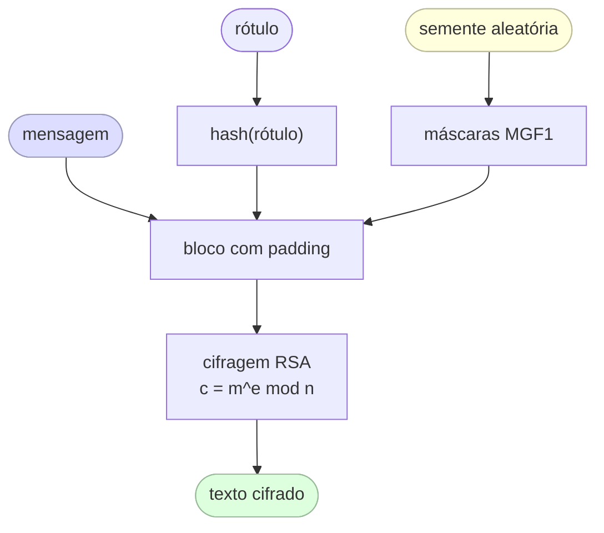
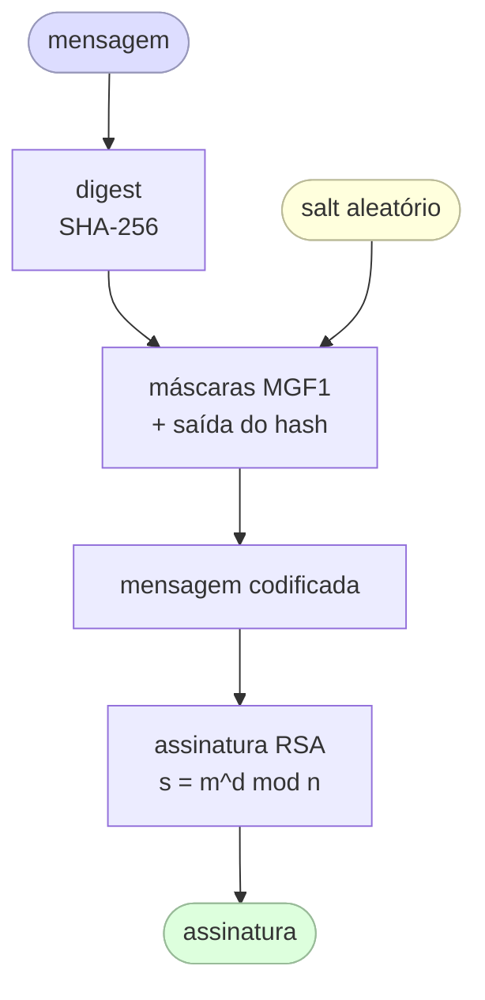

## Algoritmo RSA

O RSA (Rivest–Shamir–Adleman)[^rsa][^rsa_paper] é um dos algoritmos de criptografia assimétrica mais antigos e mais usados. Diferentemente dos algoritmos simétricos, que usam a mesma chave para cifrar e decifrar, o RSA usa um **par de chaves**: uma **chave pública**, que qualquer pessoa pode conhecer, e uma **chave privada**, que deve permanecer secreta. A própria ideia de criptografia de chave pública foi apresentada por Diffie e Hellman em 1976[^dh_paper].

Sua segurança se apoia em uma assimetria matemática simples: multiplicar dois números primos grandes é rápido, mas fatorar o resultado de volta nesses primos é computacionalmente inviável com chaves de tamanho suficiente (2048 bits ou mais).

O RSA é a base de muitos protocolos que você já usa, incluindo TLS/HTTPS[^rfc8446], SSH[^rfc4253], PGP[^rfc4880] e a assinatura de JWT com `RS256`[^rfc7518].

---

## Conceitos principais

### Par de chaves

| Chave | Quem a possui | Finalidade |
|---|---|---|
| Chave pública `(e, n)` | Qualquer pessoa | Cifrar dados ou verificar uma assinatura |
| Chave privada `(d, n)` | Somente o dono | Decifrar dados ou criar uma assinatura |

As duas chaves estão ligadas matematicamente: uma mensagem cifrada com a chave pública **só** pode ser decifrada com a chave privada correspondente, e vice-versa.

### Fundamento matemático

O RSA é construído sobre a **aritmética modular** e o **teorema de Euler**[^euler]. Os passos principais são:

1. Escolha dois números primos grandes `p` e `q`.
2. Calcule `n = p × q` (o **módulo**, público).
3. Calcule a função totiente de Euler: `φ(n) = (p − 1)(q − 1)`.
4. Escolha `e` tal que `1 < e < φ(n)` e `gcd(e, φ(n)) = 1` (comumente `e = 65537`).
5. Calcule `d` como o inverso modular de `e` módulo `φ(n)`, isto é, `d × e ≡ 1 (mod φ(n))`.

A chave pública é `(e, n)`. A chave privada é `(d, n)`. Os primos `p` e `q` são descartados após a geração das chaves.

### Cifragem e decifragem

Dada uma mensagem `m` (como um inteiro, com `m < n`):

- **Cifrar:** `c = m^e mod n`
- **Decifrar:** `m = c^d mod n`

A correção decorre do teorema de Euler: `(m^e)^d ≡ m (mod n)`.

### Assinaturas digitais

O RSA também pode ser usado para **assinar** dados, invertendo o papel das chaves:

- **Assinar** (com a chave privada): `s = m^d mod n`
- **Verificar** (com a chave pública): conferir que `s^e mod n = m`

É assim que funcionam os tokens JWT assinados com `RS256`: o servidor assina o token com a sua chave privada; qualquer cliente que tenha a chave pública consegue verificá-lo, sem conseguir forjar um novo.

---

## Por que não usar RSA para tudo?

O RSA é lento em comparação com algoritmos simétricos como o AES. Na prática, o RSA é usado apenas para **trocar ou proteger uma chave simétrica** (um padrão chamado *criptografia híbrida*). A chave simétrica então cuida da maior parte da cifragem dos dados. É exatamente isso que o TLS faz.

Além disso, o RSA "puro", sem padding, é inseguro. O uso moderno exige esquemas de padding como o **OAEP** (para cifragem) ou o **PSS** (para assinaturas).

---

## Esquemas de padding

O RSA puro — aplicar a fórmula matemática diretamente a uma mensagem — é o **RSA de livro-texto** (textbook RSA), e ele é quebrado na prática. Sem padding, ele vaza estrutura: cifrar a mesma mensagem sempre produz o mesmo texto cifrado, e um atacante pode manipular textos cifrados algebricamente. Dois esquemas de padding padronizados resolvem isso, um para cada caso de uso.

### OAEP — Optimal Asymmetric Encryption Padding

O OAEP (definido no PKCS#1 v2 / RFC 8017[^rfc8017], proposto originalmente por Bellare e Rogaway[^oaep_paper]) é o padding correto a usar ao **cifrar** dados com RSA. Antes da exponenciação modular, o texto claro é combinado com uma semente aleatória por meio de um par de funções de geração de máscara (MGF1, tipicamente construídas sobre o SHA-256):



Propriedades principais:

- **Aleatorizado** — cifrar o mesmo texto claro duas vezes produz textos cifrados diferentes, impedindo a análise de padrões.
- **Tudo ou nada** — um único bit invertido no texto cifrado faz a decifragem falhar por completo, em vez de produzir silenciosamente uma saída corrompida.
- **Seguro IND-CCA2** — resistente a ataques de texto cifrado escolhido no modelo de oráculo aleatório.

!!! warning "Nunca use o padding de cifragem PKCS#1 v1.5"

    O antigo padding de cifragem `PKCS1v15` é vulnerável ao ataque de Bleichenbacher (1998)[^bleichenbacher][^bleichenbacher_paper] e às suas muitas variantes. Use sempre OAEP em sistemas novos.

### PSS — Probabilistic Signature Scheme

O PSS (também definido no PKCS#1 v2 / RFC 8017[^rfc8017], apresentado por Bellare e Rogaway[^pss_paper]) é o padding correto a usar ao **assinar** dados com RSA. Ele funciona de forma parecida — um salt aleatório passa pelo hash junto com o digest da mensagem antes da operação com a chave privada —, o que torna cada assinatura única, mesmo para a mesma mensagem.



Propriedades principais:

- **Aleatorizado** — o salt faz com que assinar a mesma mensagem duas vezes gere assinaturas diferentes, ao contrário do esquema de assinatura determinístico `PKCS1v15`.
- **Prova de segurança justa (tight)** — o PSS tem uma redução demonstrável à dificuldade do RSA, enquanto as assinaturas PKCS#1 v1.5 não têm.
- **Identificadores padrão** — `RS256` (PKCS#1 v1.5) vs. `PS256` (PSS com SHA-256) no JWT; prefira `PS256` em sistemas novos.

---

## Ed25519 — uma alternativa moderna

O Ed25519[^ed25519][^eddsa_paper] é um **algoritmo de assinatura de curvas elípticas** baseado na curva de Edwards `Curve25519`[^curve25519][^curve25519_paper], padronizado na RFC 8032[^rfc8032]. Ele não é RSA, mas cumpre o mesmo papel — assinaturas digitais assimétricas — e é cada vez mais a escolha preferida em protocolos modernos.

### Por que curvas elípticas?

A segurança do RSA vem da dificuldade da fatoração de inteiros[^factoring]. A criptografia de curvas elípticas (ECC)[^ecc] usa outro problema difícil: o **problema do logaritmo discreto em curvas elípticas (ECDLP)**. O ECDLP é mais difícil por bit, o que significa que chaves muito menores alcançam o mesmo nível de segurança:

| Algoritmo | Tamanho da chave | Força simétrica equivalente |
|---|---|---|
| RSA | 2048 bits | ~112 bits |
| RSA | 3072 bits | ~128 bits |
| Ed25519 | 256 bits | ~128 bits |
| Ed25519 | 256 bits | ~128 bits |

Uma chave Ed25519 de 256 bits tem segurança aproximadamente equivalente à de uma chave RSA de 3072 bits, sendo muito menor e mais rápida.

### Como o Ed25519 funciona

O Ed25519 é definido sobre a **curva de Edwards torcida** (twisted Edwards curve):

```
-x² + y² = 1 − (121665/121666)·x²·y²  (mod p),   p = 2²⁵⁵ − 19
```

Geração de chaves:

1. Escolha uma chave privada aleatória `k` de 32 bytes.
2. Aplique o SHA-512 a `k` para produzir uma semente de 64 bytes; os 32 bytes inferiores são ajustados (clamped) e usados como o escalar `a`.
3. A chave pública é o ponto da curva `A = a · B`, em que `B` é o ponto base da curva.

Assinando uma mensagem `m`:

1. Derive um nonce determinístico `r = hash(second_half_of_seed || m)`.
2. Calcule `R = r · B`.
3. Calcule `S = (r + hash(R || A || m) · a) mod ℓ`, em que `ℓ` é a ordem da curva.
4. A assinatura é `(R, S)` — 64 bytes no total.

A verificação confere que `S · B == R + hash(R || A || m) · A`.

### Principais vantagens sobre o RSA

| Propriedade | RSA (2048 bits) | Ed25519 |
|---|---|---|
| Tamanho da chave | 2048 bits | 256 bits |
| Tamanho da assinatura | 256 bytes | 64 bytes |
| Geração de chaves | Lenta (busca de primos) | Rápida (escalar aleatório) |
| Velocidade de assinatura | Moderada | Muito rápida |
| Velocidade de verificação | Rápida | Muito rápida |
| Assinaturas determinísticas | Não (o PSS usa salt) | Sim (nonce derivado de chave+mensagem) |
| Resistência a ataques de canal lateral | Exige cuidado | Embutida no projeto |
| Complexidade de padding | Obrigatório (OAEP/PSS) | Nenhum necessário |

### Determinismo — uma faca de dois gumes

As assinaturas Ed25519 são **determinísticas**: o nonce `r` é derivado da chave privada e da mensagem, e não de uma fonte aleatória externa. Isso elimina toda uma classe de bugs catastróficos — com destaque para a falha de ECDSA do Sony PlayStation 3[^ps3], em que um nonce constante expôs a chave privada. A desvantagem é que, se a função de hash for quebrada, o determinismo poderia, em teoria, ajudar um atacante; na prática, isso não é uma preocupação para o SHA-512.

### Onde o Ed25519 é usado

- **SSH** — `ssh-keygen -t ed25519` é hoje o tipo de chave recomendado[^rfc4253].
- **TLS 1.3** — suportado como algoritmo de assinatura[^rfc8446].
- **JWT** — identificador de algoritmo `EdDSA` (`alg: "EdDSA"` com `crv: "Ed25519"`)[^rfc7518][^rfc8037].
- **Git** — assinatura de commits com GPG por meio de uma subchave Ed25519.
- **Signal, WireGuard, age** — todos usam chaves da família Curve25519.

!!! tip "Qual você deve usar?"

    - Use **Ed25519** em sistemas novos sempre que possível — chaves menores, operações mais rápidas e nenhum padding para configurar errado.
    - Use **RSA + PSS** ao interoperar com sistemas legados que não suportam ECC, e sempre com chaves de 2048 bits ou mais.
    - Evite completamente o RSA puro, o padding de cifragem PKCS#1 v1.5 e chaves de 1024 bits ou menores.

---

## Gerando as chaves RSA

=== "Parte 1"

    :fontawesome-brands-youtube:{ .youtube } [The RSA Encryption Algorithm (1 of 2: Generating the Keys)](https://youtu.be/4zahvcJ9glg){target="_blank"}

    [{ width=90% }](https://youtu.be/4zahvcJ9glg){target="_blank"}

=== "Parte 2"

    :fontawesome-brands-youtube:{ .youtube } [The RSA Encryption Algorithm (2 of 2: Generating the Keys)](https://youtu.be/oOcTVTpUsPQ){target="_blank"}

    [{ width=90% }](https://youtu.be/oOcTVTpUsPQ){target="_blank"}


[^rsa]: [RSA cryptosystem — Wikipedia](https://en.wikipedia.org/wiki/RSA_(cryptosystem)){target="_blank"}
[^euler]: [Euler's theorem — Wikipedia](https://en.wikipedia.org/wiki/Euler%27s_theorem){target="_blank"}
[^bleichenbacher]: [Bleichenbacher's attack — Wikipedia](https://en.wikipedia.org/wiki/Adaptive_chosen-ciphertext_attack#Bleichenbacher's_attack_on_PKCS1_v1.5){target="_blank"}
[^curve25519]: [Curve25519 — Wikipedia](https://en.wikipedia.org/wiki/Curve25519){target="_blank"}
[^ed25519]: [EdDSA / Ed25519 — Wikipedia](https://en.wikipedia.org/wiki/EdDSA){target="_blank"}
[^ecc]: [Elliptic-curve cryptography — Wikipedia](https://en.wikipedia.org/wiki/Elliptic-curve_cryptography){target="_blank"}
[^factoring]: [Integer factorization — Wikipedia](https://en.wikipedia.org/wiki/Integer_factorization){target="_blank"}

[^rsa_paper]: R.L. Rivest, A. Shamir, L. Adleman. "A Method for Obtaining Digital Signatures and Public-Key Cryptosystems." *Communications of the ACM*, 21(2):120–126, 1978. [ACM DL](https://dl.acm.org/doi/10.1145/359340.359342){target="_blank"}
[^dh_paper]: W. Diffie, M.E. Hellman. "New Directions in Cryptography." *IEEE Transactions on Information Theory*, 22(6):644–654, 1976. [PDF](https://ee.stanford.edu/~hellman/publications/24.pdf){target="_blank"}
[^oaep_paper]: M. Bellare, P. Rogaway. "Optimal Asymmetric Encryption." *EUROCRYPT 1994*, LNCS 950, pp. 92–111. [PDF](https://cseweb.ucsd.edu/~mihir/papers/oae.pdf){target="_blank"}
[^pss_paper]: M. Bellare, P. Rogaway. "The Exact Security of Digital Signatures – How to Sign with RSA and Rabin." *EUROCRYPT 1996*, LNCS 1070, pp. 399–416. [PDF](https://cseweb.ucsd.edu/~mihir/papers/pss.pdf){target="_blank"}
[^bleichenbacher_paper]: D. Bleichenbacher. "Chosen Ciphertext Attacks Against Protocols Based on the RSA Encryption Standard PKCS #1." *CRYPTO 1998*, LNCS 1462, pp. 1–12. [PDF](https://archiv.infsec.ethz.ch/education/fs08/secsem/bleichenbacher98.pdf){target="_blank"}
[^curve25519_paper]: D.J. Bernstein. "Curve25519: New Diffie-Hellman Speed Records." *PKC 2006*, LNCS 3958, pp. 207–228. [PDF](https://cr.yp.to/ecdh/curve25519-20060209.pdf){target="_blank"}
[^eddsa_paper]: D.J. Bernstein, N. Duif, T. Lange, P. Schwabe, B.-Y. Yang. "High-Speed High-Security Signatures." *CHES 2011*, LNCS 6917, pp. 124–142. [PDF](https://ed25519.cr.yp.to/ed25519-20110926.pdf){target="_blank"}
[^ps3]: fail0verflow. "Console Hacking 2010: PS3 Epic Fail." 27th Chaos Communication Congress, 2010. [PDF](https://fahrplan.events.ccc.de/congress/2010/Fahrplan/attachments/1780_27c3_console_hacking_2010.pdf){target="_blank"}

[^rfc8017]: [RFC 8017 — PKCS #1: RSA Cryptography Specifications v2.2](https://datatracker.ietf.org/doc/html/rfc8017){target="_blank"}
[^rfc8032]: [RFC 8032 — Edwards-Curve Digital Signature Algorithm (EdDSA)](https://datatracker.ietf.org/doc/html/rfc8032){target="_blank"}
[^rfc8037]: [RFC 8037 — CFRG Elliptic Curves for JOSE (OKP key type, Ed25519)](https://datatracker.ietf.org/doc/html/rfc8037){target="_blank"}
[^rfc7518]: [RFC 7518 — JSON Web Algorithms (JWA)](https://datatracker.ietf.org/doc/html/rfc7518){target="_blank"}
[^rfc8446]: [RFC 8446 — The Transport Layer Security (TLS) Protocol Version 1.3](https://datatracker.ietf.org/doc/html/rfc8446){target="_blank"}
[^rfc4253]: [RFC 4253 — The Secure Shell (SSH) Transport Layer Protocol](https://datatracker.ietf.org/doc/html/rfc4253){target="_blank"}
[^rfc4880]: [RFC 4880 — OpenPGP Message Format](https://datatracker.ietf.org/doc/html/rfc4880){target="_blank"}

[^ecdsa_video]: :simple-youtube: [ECDSA Signatures | How does ECDSA work and what are Elliptic Curves?](https://www.youtube.com/watch?v=e3ugVpBBlhc){target="_blank"}

[^eddsa_video]: :simple-youtube: [Ed25519 Signature Schemes: Theory and Practice](https://www.youtube.com/watch?v=9w7ajCIWg-g){target="_blank"}

[^elliptic_curves]: :simple-youtube: [Elliptic Curves - Computerphile](https://www.youtube.com/watch?v=NF1pwjL9-DE){target="_blank"}