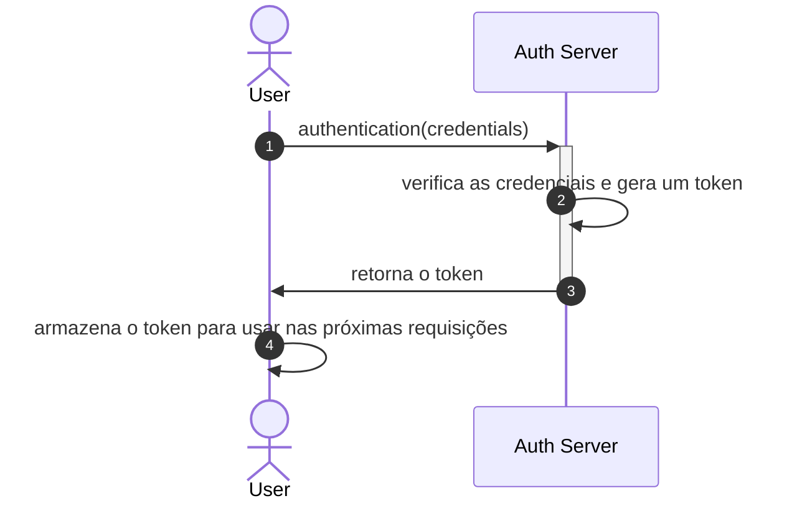
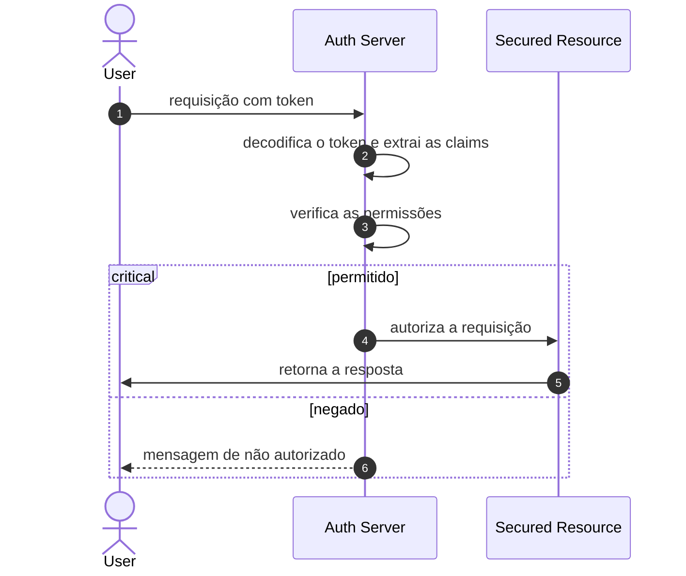
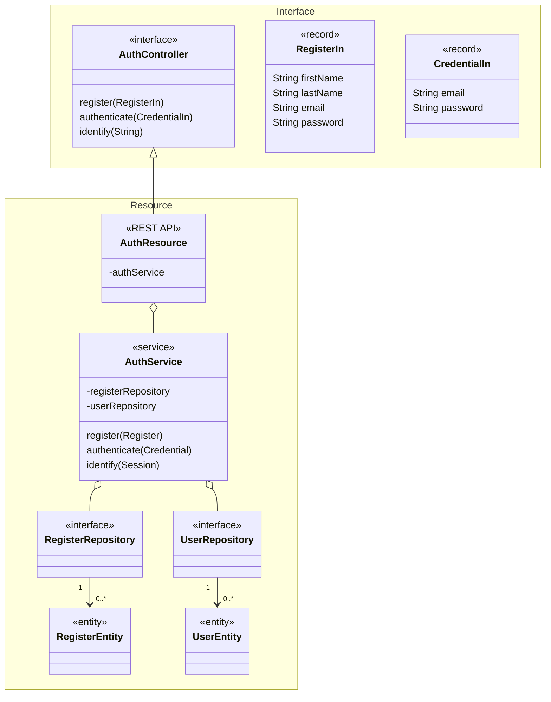

Segurança é um aspecto importante do desenvolvimento de software. Ela envolve proteger a confidencialidade, a integridade e a disponibilidade de dados e recursos. Dois conceitos-chave em segurança são autenticação e autorização.

### [Autenticação](#authentication) { #authentication }

Autenticação é o processo de verificar a identidade de um usuário ou sistema. Ela garante que o usuário ou sistema é quem diz ser. Métodos comuns de autenticação incluem senhas, biometria e autenticação em dois fatores. O sistema confere essas credenciais com os dados armazenados. Se as credenciais forem válidas, o sistema confirma a identidade do usuário.

Em muitos sistemas, após uma autenticação bem-sucedida, o sistema gera um token. Esse token é um dado que representa a sessão autenticada do usuário. É como um ingresso digital que comprova a identidade do usuário por um determinado período.

Esse token é então devolvido ao usuário. O software cliente do usuário (como um navegador web) armazena esse token e o envia junto com cada requisição seguinte ao servidor (no caso de um servidor stateless). Assim, o servidor sabe que a requisição vem de um usuário autenticado sem precisar pedir as credenciais novamente.

Veja um passo a passo simplificado:

1. O usuário envia seu nome de usuário e senha (ou outras credenciais) ao servidor;
2. O servidor verifica as credenciais. Se forem válidas, o servidor gera um token.
3. O servidor envia esse token de volta ao usuário.
4. O software cliente do usuário armazena esse token.
5. Em cada requisição seguinte, o cliente envia esse token junto com a requisição.
6. O servidor verifica o token para garantir que ele é válido e não expirou.
7. Esse processo de autenticação baseada em token é muito usado em aplicações web e APIs modernas. Ele ajuda a manter a sessão do usuário e permite que o servidor autentique requisições sem armazenar o estado do usuário.

### [Autorização](#authorization) { #authorization }

Autorização é o processo de conceder ou negar acesso a recursos ou ações específicas com base nos privilégios do usuário autenticado. Ela determina o que um usuário tem permissão para fazer dentro de um sistema. A autorização pode ser baseada em papéis (role-based), em que as permissões são atribuídas a partir de papéis predefinidos, ou baseada em atributos (attribute-based), em que as permissões dependem de atributos específicos do usuário.

Em muitos sistemas, o token não só representa a identidade do usuário, como também inclui informações sobre suas permissões ou papéis. Isso costuma ser feito com um tipo de token chamado [JSON Web Token (JWT)](./jwt.md), que pode carregar um payload de dados.

Veja um passo a passo simplificado:

1. Após a autenticação, o software cliente do usuário envia uma requisição a um servidor. Essa requisição inclui o token.
2. O servidor decodifica o token e extrai a identidade e as permissões do usuário.
3. O servidor verifica se o usuário tem as permissões necessárias para a ação solicitada. Isso pode envolver comparar os papéis ou outros atributos do usuário com os requisitos da ação.
4. Se o usuário tiver as permissões necessárias, o servidor permite a ação. Caso contrário, o servidor nega a ação.

Esse processo permite que o servidor autorize ações sem precisar consultar repetidamente as permissões do usuário. Ele também possibilita servidores stateless, já que as informações necessárias vêm em cada requisição.

Ao implementar mecanismos robustos de autenticação e autorização, os sistemas de software garantem que apenas usuários autorizados tenham acesso a dados e funcionalidades sensíveis, reduzindo o risco de acessos não autorizados e de possíveis violações de segurança.

Como a plataforma tem apenas um ponto de entrada, ele é

O JWT é uma abordagem descentralizada

O ponto de entrada da API é o gateway, então, como sugerido por [^5].

## Serviço de autenticação

- Responsabilidades:
    - Cadastro:
    - Autenticação:
    - Autorização:

Dois projetos Maven

- Interfaces

- Implementação: resource

## Material adicional

- [JSON Web Token](./jwt.md){:target="_blank"}

- :fontawesome-brands-youtube:{ .youtube } [Autenticação e Autorização com Spring Security e JWT Tokens](https://www.youtube.com/watch?v=5w-YCcOjPD0){:target="_blank"} por [Fernanda Kipper](https://github.com/Fernanda-Kipper){:target="_blank"}

    [{ width=60% }](https://www.youtube.com/watch?v=5w-YCcOjPD0){:target="_blank"}

[^5]: DELANTHA, R., [Spring Cloud Gateway security with JWT](https://medium.com/@rajithgama/spring-cloud-gateway-security-with-jwt-23045ba59b8a){:target="_blank"}, 2023.
